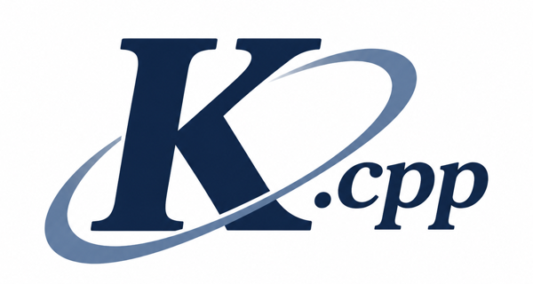

<p align="center">
  <a href="https://kaelcpp.dev">
    
  </a>
</p>

<p align="center">
  A deep learning framework built from scratch in C++20, from tensors to GPT-2.
</p>

<p align="center">
  <a href="https://kaelcpp.dev"><b>kaelcpp.dev</b></a> ·
  <a href="docs/README.md">Book</a> ·
  <a href="https://github.com/JetBerri/kael.cpp/releases">Releases</a>
</p>

<p align="center">
  <a href="https://github.com/JetBerri/kael.cpp/actions/workflows/ci.yml"></a>
  <a href="LICENSE"></a>
</p>

---

kael implements every layer of a framework like PyTorch without wrapping another one: strided tensors, autograd, training, a CPU backend tuned with SIMD and threading, a CUDA backend, Python bindings, and a transformer that loads and runs GPT-2. Its behavior is tested against PyTorch. The goal is didactic, and the book at [kaelcpp.dev](https://kaelcpp.dev) rebuilds it one chapter per layer.

## Quick start

Requirements: CMake 3.24 or newer and a C++20 compiler.

```bash
cmake -S . -B build
cmake --build build
ctest --test-dir build --output-on-failure
```

Install the Python package `kael-tensor` from the [releases](https://github.com/JetBerri/kael.cpp/releases) or from source with `pip install .`.

```cpp
#include <iostream>

#include "kael/kael.h"

int main() {
    kael::Tensor a = kael::arange(0, 6).to(kael::DType::F64);
    kael::Tensor b = a;          // shares data with a
    b.at<double>({0}) = 7.0;
    std::cout << a << "\n";      // tensor([7.0000, 1.0000, 2.0000, 3.0000, 4.0000, 5.0000], ...)
}
```

## Results

| Workload | CPU, Apple M5 Pro | GPU, NVIDIA T4 |
|----------|-------------------|----------------|
| MNIST MLP | 97.42%, 0.62 s per epoch | 97.18%, 1.52 s per epoch |
| `matmul`, `f32` | 557 GFLOP/s | 427 GFLOP/s |
| GPT-2 small | 15 tokens/s | 14 tokens/s |

Details in [chapter 08](docs/08-cpu-performance.md) and [chapter 09](docs/09-cuda-backend.md#reference-run).

## License

[Apache-2.0](LICENSE). kael was built with AI assistance; every design decision is reviewed, tested and documented in the book.
