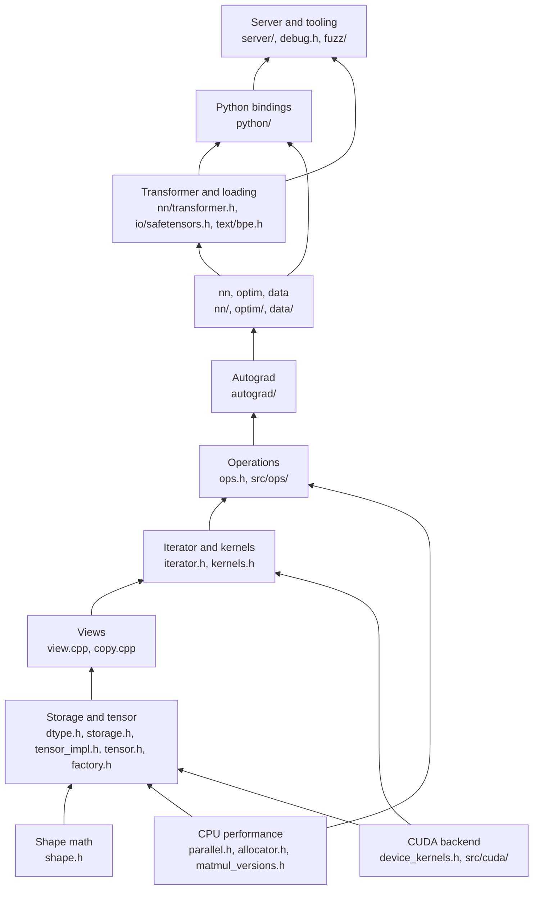

# 00. Overview

kael is a deep learning framework written from scratch in C++20. It starts with the arithmetic of shapes and strides and ends with a GPT-2 model that loads published weights, tokenizes text and generates tokens, from C++, from Python and over HTTP. This book explains every layer in the order it was built, so that an engineer who knows C++ but has never looked inside a tensor library can rebuild kael from an empty directory.

This chapter is the map. It states the goals, shows how the layers depend on each other, lists where each piece lives in the repository, gives the build and test commands, and ties every chapter to a git tag that holds the code at the end of that stage.

## Goals

kael is didactic. Each design choice favors code that a reader can follow over the last bit of speed, but the library still has to be correct and usable.

- **Understand by building.** Every mechanism that PyTorch hides (strides, views, type promotion, the autograd graph, the caching allocator, the KV cache) exists in kael as a small, readable implementation.
- **Correct before fast.** Every operation is tested against NumPy or PyTorch, with golden data for the numeric edge cases (NaN, infinities, signed zeros, empty tensors).
- **Real end goal.** Version 1.0 loads the original 124M-parameter GPT-2 weights from a safetensors file. The test `test_real_gpt2_logits_match_huggingface` in `python/tests/test_gpt.py` checks that its logits match the Hugging Face `transformers` reference within `1e-3`.
- **Few dependencies.** The library needs a C++20 compiler, the system threads library and nlohmann_json. GoogleTest is fetched by default for the tests (`KAEL_BUILD_TESTS=ON`). Google Benchmark, a BLAS library, the CUDA toolkit and nanobind are optional and only enter through CMake options.

kael is not a production framework. It has four element types (`float32`, `float64`, `int64`, `bool`), no negative strides, and a CUDA backend that is tested with host emulation and compile-only CI builds, not yet on a real GPU.

## Architecture

The library is a stack of layers. Each layer uses only the layers below it. The diagram reads bottom to top, in the same order as the book.



The layers in one sentence each:

| Layer | Role | Chapter |
|-------|------|---------|
| Shape math | Free functions on `Shape` and `Strides`: element count, contiguous strides, offsets, broadcasting | [01](01-shapes-and-strides.md) |
| Storage and tensor | `Storage` owns bytes, `TensorImpl` interprets them, `Tensor` is a shared handle to an impl | [02](02-memory-model.md) |
| Views | New metadata over the same storage: `transpose`, `slice`, `expand`, `view`, `reshape` | [03](03-views.md) |
| Iterator and kernels | `TensorIterator` computes the broadcast shape, the result dtype and a coalesced loop for any element-wise operation | [04](04-tensor-iterator.md) |
| Operations | Arithmetic, reductions, matrix products, indexing, softmax and sequence operations | [05](05-operations.md) |
| Autograd | Reverse-mode differentiation: graph nodes recorded by every operation, a topological engine, gradcheck | [06](06-autograd.md) |
| nn, optim, data | Modules, losses, optimizers, schedulers, datasets and a MNIST training loop | [07](07-neural-networks.md) |
| CPU performance | Thread pool, packed SIMD matrix product, caching allocator, fused kernels | [08](08-cpu-performance.md) |
| CUDA | A device backend behind `device_kernels.h`, with a host emulation for testing | [09](09-cuda-backend.md) |
| Python | nanobind module `kael`, NumPy interop and the wheel build | [10](10-python-bindings.md) |
| Transformer and loading | GPT blocks with a KV cache, safetensors, GPT-2 weight mapping and the BPE tokenizer | [11](11-transformer.md), [12](12-model-loading.md) |
| Server and tooling | FastAPI server, debugging helpers, fuzzers, sanitizers and CI | [13](13-serving-and-tooling.md) |

CPU performance and CUDA are drawn beside the main stack because they replace the internals of lower layers instead of adding a layer on top. The caching allocator sits under `Storage`, and the device backend sits under the iterator and the factories. Code above them does not change.

Two design decisions shape every layer and have their own records: [ADR 0001](adr/0001-runtime-dtype.md) makes the element type a run-time value, and [ADR 0002](adr/0002-tensor-as-handle.md) makes `Tensor` a shared handle.

## Directory map

The repository, from `git ls-files`, without the contents of `tests/golden/` (71 per-operation folders and a manifest):

```text
.github/workflows/   ci.yml (build, sanitizers, CUDA compile, Python, fuzz, coverage, clang-tidy), wheels.yml
CMakeLists.txt       library target, options and optional subprojects
pyproject.toml       Python package kael-tensor (scikit-build-core and nanobind)
include/kael/        public headers
  autograd/          engine.h, functions.h, grad_mode.h, gradcheck.h, meta.h, node.h
  data/              dataloader.h, dataset.h, mnist.h
  io/                safetensors.h
  nn/                module.h, linear.h, layernorm.h, embedding.h, transformer.h, loss.h, init.h, ...
  optim/             optimizer.h, sgd.h, adam.h, scheduler.h, clip.h
  text/              bpe.h
src/                 implementation, one file per header plus the folders below
  autograd/          engine, nodes, recording and the gradient formulas
  cuda/              backend.cu, kernels.inl, backend_fake.cpp, backend_none.cpp
  data/              dataset.cpp, mnist.cpp
  internal/          private helpers: checked_math.h, element_functions.h, copy.h, ...
  io/                safetensors.cpp
  linalg/            matmul_versions.cpp
  nn/                module, layers, losses, init, functional, transformer
  ops/               binary, unary, inplace, reduce, linalg, indexing, nn, sequence
  optim/             optimizer.cpp
  text/              bpe.cpp, unicode_classes.inc
tests/               GoogleTest suites, one file per component
  generated/         NumPy-generated broadcast and view cases
  golden/            PyTorch-generated .npy fixtures, one folder per operation
  support/           allclose.h, npy.h, npy.cpp, values.h
python/              Python package
  kael/              pure Python layer: nn, optim, data
  src/               nanobind bindings
  tests/             pytest suite
examples/            mnist_mlp.cpp, char_gpt.cpp, gpt2_generate.cpp, gpt2_generate.py, mnist.py, quickstart.ipynb
benchmarks/          Google Benchmark suites and compare.py
experiments/         micrograd.cpp, a scalar autograd warm-up
fuzz/                libFuzzer targets for safetensors and MNIST IDX files, with seed corpora
scripts/             test runner, fixture generators, dataset downloads, GPU scripts
server/              app.py (FastAPI), Dockerfile, requirements.txt
docs/                this book and the ADRs
```

Public headers live in `include/kael/` and are included as `"kael/tensor.h"`. Private headers live in `src/` (for example `src/internal/checked_math.h`) and are only visible to the library, because `CMakeLists.txt` declares `target_include_directories(kael PUBLIC include PRIVATE src)`. The umbrella header `include/kael/kael.h` includes the core, the operations, autograd and the debugging helpers. The `nn`, `optim`, `data`, `io` and `text` headers are included one by one.

## Build and test

Requirements: CMake 3.24 or newer and a C++20 compiler. Configuring downloads nlohmann_json and GoogleTest with `FetchContent`, so the first configure needs network access.

Build the library and the tests, then run them:

```bash
cmake -S . -B build
cmake --build build --parallel
ctest --test-dir build --output-on-failure
```

`scripts/run_tests.sh` runs the last two commands against an existing `build/` directory. All C++ tests compile into a single executable, `build/tests/kael_tests`, and `gtest_discover_tests` registers each test with CTest. Run one group of suites directly with a GoogleTest filter:

```bash
build/tests/kael_tests --gtest_filter='BroadcastShapes.*'
```

The CI job `build-test` in `.github/workflows/ci.yml` configures a Debug build with warnings as errors and runs it on Linux with GCC and Clang and on macOS with Clang. Reproduce the strictest local variants with:

```bash
cmake -S . -B build-asan -DCMAKE_BUILD_TYPE=Debug -DKAEL_WARNINGS_AS_ERRORS=ON -DKAEL_ENABLE_SANITIZERS=ON
cmake -S . -B build-tsan -DCMAKE_BUILD_TYPE=Debug -DKAEL_WARNINGS_AS_ERRORS=ON -DKAEL_ENABLE_TSAN=ON
cmake -S . -B build-fake-cuda -DCMAKE_BUILD_TYPE=Debug -DKAEL_WARNINGS_AS_ERRORS=ON -DKAEL_ENABLE_SANITIZERS=ON -DKAEL_FAKE_CUDA=ON
```

Build each directory with `cmake --build <dir> --parallel` and test it with `ctest --test-dir <dir> --output-on-failure`.

The other CI jobs:

| Job | What it does |
|-----|--------------|
| `cuda-compile-only` | Configures with `-DKAEL_ENABLE_CUDA=ON -DCMAKE_CUDA_ARCHITECTURES=86` in the `nvidia/cuda:12.6.2-devel-ubuntu22.04` container and builds. No tests run, because the runner has no GPU. |
| `python` | `pip install ".[test]"` and `pytest python/tests -q` on Linux and macOS with Python 3.12. |
| `fuzz` | Builds `fuzz_safetensors` and `fuzz_idx` with sanitizers and runs each for 60 seconds on its corpus. |
| `coverage` | Runs `kael_tests` with Clang source-based coverage and prints an `llvm-cov report` for `src` and `include/kael`. It calls `llvm-profdata-<version>` and `llvm-cov-<version>`, with the major version taken from `clang -dumpversion`, so the tools match the Clang that built the tests. |
| `clang-tidy` | Runs `run-clang-tidy` over every `.cpp` file under `src/` with the repository `.clang-tidy`. |

Build and test the Python package:

```bash
pip install ".[test]"
pytest python/tests
```

`pyproject.toml` builds the extension through scikit-build-core with `KAEL_BUILD_PYTHON=ON` and `KAEL_BUILD_TESTS=OFF`. The package name on the index is `kael-tensor`, and the import name is `kael`.

Build the examples and the benchmarks with their options. Benchmarks need a Release build:

```bash
cmake -S . -B build-release -DCMAKE_BUILD_TYPE=Release -DKAEL_BUILD_EXAMPLES=ON -DKAEL_BUILD_BENCHMARKS=ON
cmake --build build-release --parallel
build-release/benchmarks/kael_bench
```

## CMake options

All options are declared at the top of `CMakeLists.txt`.

| Option | Default | Effect |
|--------|---------|--------|
| `KAEL_WARNINGS_AS_ERRORS` | `OFF` | Adds `-Werror` to every kael target. The warning set is always `-Wall -Wextra -Wpedantic -Wshadow -Wconversion -Wsign-conversion`. |
| `KAEL_ENABLE_SANITIZERS` | `OFF` | Builds with `-fsanitize=address,undefined`. Also compiles the caching allocator out (`KAEL_NO_CACHING_ALLOCATOR`) so that AddressSanitizer sees every allocation. |
| `KAEL_ENABLE_TSAN` | `OFF` | Builds with `-fsanitize=thread`. Cannot be combined with `KAEL_ENABLE_SANITIZERS`. Also compiles the caching allocator out. |
| `KAEL_BUILD_BENCHMARKS` | `OFF` | Fetches Google Benchmark and builds `benchmarks/` (target `kael_bench`). Configuring fails if `KAEL_ENABLE_SANITIZERS` is on. |
| `KAEL_BUILD_EXAMPLES` | `OFF` | Builds `mnist_mlp`, `char_gpt` and `gpt2_generate` from `examples/`. |
| `KAEL_USE_BLAS` | `OFF` | Multiplies matrices with the system BLAS: Accelerate on macOS, `find_package(BLAS)` elsewhere. |
| `KAEL_ENABLE_CUDA` | `OFF` | Enables the CUDA language, links `CUDA::cudart` and compiles `src/cuda/backend.cu`. |
| `KAEL_FAKE_CUDA` | `OFF` | Compiles `src/cuda/backend_fake.cpp`, which runs the CUDA kernels on the host to test the device path without a GPU. Mutually exclusive with `KAEL_ENABLE_CUDA`. |
| `KAEL_USE_CUBLAS` | `OFF` | With `KAEL_ENABLE_CUDA`, links cuBLAS and uses it for device matrix products. |
| `KAEL_BUILD_TESTS` | `ON` | Fetches GoogleTest and builds `tests/` (`kael_tests`) and the `micrograd` experiment. |
| `KAEL_BUILD_FUZZERS` | `OFF` | Builds the libFuzzer targets in `fuzz/`. Needs Clang. |
| `KAEL_BUILD_PYTHON` | `OFF` | Builds the nanobind extension in `python/` and compiles the library as position independent code. |
| `KAEL_NATIVE` | `OFF` | Adds `-march=native`, or `-mcpu=native` where only that flag exists, to the library. |

When neither CUDA option is on, `src/cuda/backend_none.cpp` provides the device functions, and every device operation throws `kael was built without CUDA; configure with KAEL_ENABLE_CUDA=ON`.

The project version comes from `project(kael VERSION 1.0.0 LANGUAGES CXX)`. CMake passes it to the library as the `KAEL_VERSION` definition, and `kael::version()` in `include/kael/version.h` returns it.

## Phases, chapters and tags

kael was built in thirteen phases. Phase 1 set up the repository (license, `.gitignore`, `.clang-format`, `.editorconfig`). Every later phase has a chapter, and from phase 3 on, a git tag marks the last commit of the phase. Milestone tags `v0.1.0` to `v1.0.0` point at the same commits as the phase that completed each milestone.

| Phase | Chapter | Phase tag | Milestone tag | Last commit of the phase |
|-------|---------|-----------|---------------|--------------------------|
| 2. Shapes and strides | [01](01-shapes-and-strides.md) | none | | `c44095f docs(chapters): add chapter 01 shapes and strides` |
| 3. Core tensor | [02](02-memory-model.md) | `chapter-03-core` | | `d90fbfb docs(chapters): add chapter 02 memory model` |
| 4. Views | [03](03-views.md) | `chapter-04-views` | | `d41fcb4 test(view): add NumPy-generated view chains` |
| 5. Iteration | [04](04-tensor-iterator.md) | `chapter-05-iteration` | | `5075617 test(bench): add elementwise benchmarks` |
| 6. Operations | [05](05-operations.md) | `chapter-06-ops` | | `c786049 fix(ops): align edge cases with PyTorch` |
| 7. Autograd | [06](06-autograd.md) | `chapter-07-autograd` | | `8933c72 feat(autograd): add reverse-mode engine, formulas and gradcheck` |
| 8. Training | [07](07-neural-networks.md) | `chapter-08-training` | `v0.1.0` | `09baa43 feat(examples): add MNIST training` |
| 9. CPU performance | [08](08-cpu-performance.md) | `chapter-09-cpu-performance` | `v0.2.0` | `9a30568 fix(storage): make the block deleter default constructible on GCC` |
| 10. CUDA | [09](09-cuda-backend.md) | `chapter-10-cuda` | `v0.3.0` | `1fd592c chore(release): bump version to 0.3.0` |
| 11. Python | [10](10-python-bindings.md) | `chapter-11-python` | `v0.4.0` | `6472c9d ci(github): build Python wheels` |
| 12. Transformer | [11](11-transformer.md), [12](12-model-loading.md) | `chapter-12-transformer` | | `cb0f4be test(nn): skip the full GPT-2 construction under sanitizers` |
| 13. Polish | [13](13-serving-and-tooling.md) | `chapter-13-polish` | `v1.0.0` | `cb0f4be test(nn): skip the full GPT-2 construction under sanitizers` |

Three details of the tags matter when you use them:

- Tag numbers follow phases, not chapters. `chapter-03-core` holds the code of chapter 02, `chapter-04-views` the code of chapter 03, and so on up to `chapter-12-transformer`.
- `chapter-12-transformer`, `chapter-13-polish` and `v1.0.0` point at the same commit, `cb0f4be`. Phases 12 and 13 were tagged together, so there is no tag between the transformer work (sequence operations, safetensors, GPT with KV cache) and the polish work (debugging helpers, fuzzers, coverage, clang-tidy).
- Work continued after `v1.0.0` on the current branch without new tags. The memory-mapped safetensors loader, atomic safetensors saves, the GPT-2 BPE tokenizer, `examples/gpt2_generate.cpp`, the HTTP server and its Docker image, the lock around the global random generator, the fused cross entropy and several performance and correctness fixes exist only at the branch head. Chapters 12 and 13 describe that code, so read them against the branch head, not against a tag.

## How to read this book

Read the chapters in order. Each one lists its prerequisites, explains the idea with small numeric examples, walks through the real code, and ends with a numbered plan to rebuild that stage with a test checkpoint for every step.

The chapters describe the code at the head of the branch. To see the code as it was at the end of a phase, check out its tag in a separate worktree, so that your main checkout stays on the branch:

```bash
git worktree add ../kael-core chapter-03-core
cmake -S ../kael-core -B ../kael-core/build
cmake --build ../kael-core/build --parallel
ctest --test-dir ../kael-core/build --output-on-failure
```

A plain `git checkout chapter-03-core` works too, followed by `git checkout -` to return. The early tags are useful because they are small: at `chapter-03-core` the library is shapes, storage, tensors, factories, random numbers and printing, with no views, operations or autograd. Later phases changed some of that code. For example, the caching allocator under `Storage` arrived in phase 9, and the typed error classes arrived in phase 10. Each chapter notes such changes where they matter.

To see what a phase added, diff two consecutive tags:

```bash
git diff --stat chapter-03-core chapter-04-views
git log --oneline chapter-03-core..chapter-04-views
```

Commits follow Conventional Commits with a scope (`feat(view): ...`, `fix(ops): ...`), so `git log --oneline` reads as a changelog of each phase.

When you rebuild kael yourself, use the test suites as the specification. Each chapter names the GoogleTest suites in `tests/` that prove its behavior. Copy a suite into your own project before writing the code it tests, and work until it passes.

## Prerequisites for the reader

- C++17 or later: templates, lambdas, `std::shared_ptr`, `std::unique_ptr`, move semantics. kael uses C++20 features (`std::span`, concepts, templated lambdas, `std::ranges`), and the chapters explain them where they appear.
- CMake basics: configuring, building and running CTest.
- Linear algebra at the level of matrix products, and calculus at the level of the chain rule, from chapter 06 on.
- Python and NumPy from chapter 10 on, and for the scripts that generate test fixtures.

No prior knowledge of PyTorch internals is assumed. kael follows PyTorch semantics where it can (broadcasting, type promotion, view rules, autograd behavior), so knowing PyTorch as a user helps to check the results.

## Further reading

- Edward Z. Yang, "PyTorch internals", the blog post that describes strides, storage, dispatch and autograd in PyTorch.
- The NumPy documentation on broadcasting and on the `ndarray` memory layout.
- Andrej Karpathy's micrograd, a scalar autograd engine in about a hundred lines of Python.
- Vaswani et al., "Attention Is All You Need" (2017).

Next: [01. Shapes and strides](01-shapes-and-strides.md)
