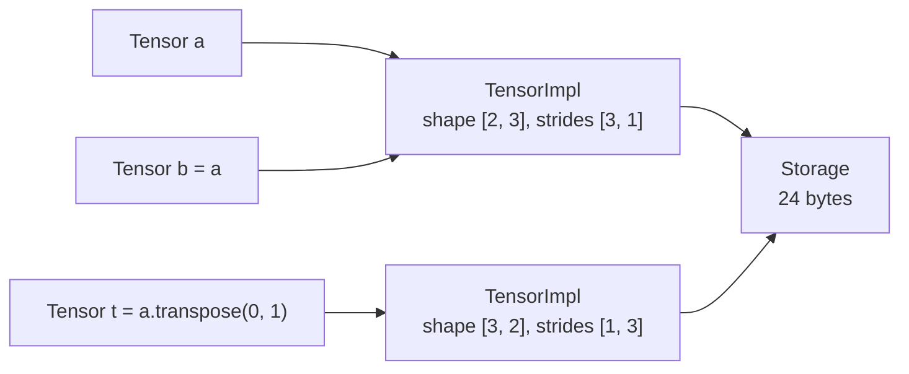
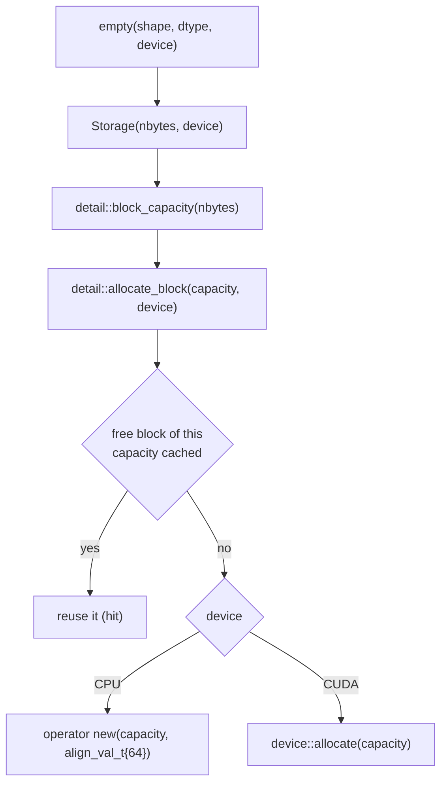

# 02. Memory model

This chapter turns the shape arithmetic of chapter 01 into real tensors. It maps to phase 3 of the project (tag `chapter-03-core`). By the end there is a `Tensor` you can create, read, write, clone, convert between element types, fill with random values and print. Later phases added a caching allocator under `Storage`, a CUDA device, autograd metadata and typed errors. This chapter describes the current code and marks those additions where they appear.

| File | Role |
|------|------|
| `include/kael/error.h` | `kael::Error`, `IndexError`, `ValueError`, `TypeError` and the `KAEL_CHECK_*` macros |
| `include/kael/dtype.h` | `DType`, `Device`, element sizes, type traits, `convert_value`, `promote_types` and the `dispatch` family |
| `include/kael/scalar.h` | `Scalar`, a number with a dtype category, for factories and operations with a constant |
| `include/kael/device.h`, `src/device.cpp` | `parse_device`, `cuda_is_available` and `cuda_synchronize` |
| `include/kael/storage.h`, `src/storage.cpp` | `Storage`: an owned or borrowed block of bytes on one device |
| `include/kael/allocator.h`, `src/allocator.cpp` | The caching block allocator behind `Storage` (phase 9, covered in depth in chapter 08) |
| `include/kael/tensor_impl.h`, `src/tensor_impl.cpp` | `TensorImpl`: storage plus shape, strides, offset, dtype, device; metadata validation |
| `include/kael/tensor.h`, `src/tensor.cpp` | `Tensor`: the shared handle, element access, `to`, `clone`, `contiguous` |
| `include/kael/factory.h`, `src/factory.cpp` | `empty`, `zeros`, `ones`, `full`, `arange`, `linspace`, `eye`, `scalar`, `from_vector` |
| `include/kael/random.h`, `src/random.cpp` | The global generator and `rand`, `randn`, `randint`, `randperm`, `bernoulli`, `multinomial` |
| `src/print.cpp` | `operator<<` for `Tensor` |
| `include/kael/kael.h` | Umbrella header |
| `include/kael/version.h`, `src/version.cpp` | `kael::version()` |

## Prerequisites

- [01. Shapes and strides](01-shapes-and-strides.md): `Shape`, `Strides`, `numel`, `contiguous_strides`, `offset_from_index`, `wrap_dim` and the checked arithmetic helpers.
- The design records [ADR 0001](adr/0001-runtime-dtype.md) (runtime dtype), [ADR 0002](adr/0002-tensor-as-handle.md) (tensor as a handle) and [ADR 0004](adr/0004-pytorch-shaped-api.md) (a PyTorch-shaped API with typed errors).

## Three layers

A tensor is three objects stacked on each other:

```text
Tensor              a handle: one std::shared_ptr<TensorImpl>
  |
  v
TensorImpl          the interpretation: shape, strides, offset, dtype, device, autograd metadata
  |
  v
Storage             the memory: nbytes bytes on one device
  |
  v
[ raw bytes ... ]   a block from the caching allocator, or external memory
```

Each layer knows only what it needs. `Storage` has no shape and no dtype: it is bytes. `TensorImpl` does not own the bytes, it shares them through a `std::shared_ptr<Storage>`. `Tensor` holds no data and no metadata of its own, only a pointer to an impl, which is why passing it by value is cheap.

The ownership graph, once views exist (chapter 03):



`a` and `b` are the same tensor: one impl, two handles. `t` is a different tensor (its own impl, its own metadata) over the same bytes. Both relations matter, and `Tensor` has a query for each:

- `is_same(other)` compares impl pointers. It answers "are these handles to one tensor".
- `shares_storage(other)` compares storage pointers. It answers "can a write through one change the other".

For the snippet above, `a.is_same(b)` is true, `a.is_same(t)` is false, and `a.shares_storage(t)` is true.

## The element type is a runtime value

`DType` is an enum with four values.

From `include/kael/dtype.h`:

```cpp
// Bool is stored as std::uint8_t: sizeof(bool) is not fixed by the standard and
// std::vector<bool> cannot hand out element pointers.
enum class DType { F32, F64, I64, Bool };

enum class Device { CPU, CUDA };
```

The dtype lives in the metadata, not in the C++ type. There is one class, `kael::Tensor`, instead of `Tensor<float>`, `Tensor<double>` and so on. A `std::vector<Tensor>` can hold mixed types, the autograd graph can store any tensor in its nodes, and the Python bindings expose one `Tensor` type, as PyTorch does. [ADR 0001](adr/0001-runtime-dtype.md) records the alternatives.

`Device` sits next to `DType` in the same header because both are plain enums used by every layer. `include/kael/device.h` declares `parse_device(name)`, which maps `"cpu"` to `Device::CPU`, `"cuda"` or `"cuda:0"` to `Device::CUDA` and throws `ValueError` for anything else, plus `cuda_is_available()` and `cuda_synchronize()`, which forward to the backend described in chapter 09. The Python bindings and the C++ examples share `parse_device`, so both accept the same device names.

### Type tables

Each dtype has a size, a name and a C++ type.

| `DType` | `to_string` | `element_size` | C++ type (`cpp_type_t`) |
|---------|-------------|----------------|-------------------------|
| `F32` | `float32` | 4 | `float` |
| `F64` | `float64` | 8 | `double` |
| `I64` | `int64` | 8 | `std::int64_t` |
| `Bool` | `bool` | 1 | `std::uint8_t` |

The mapping exists in both directions as compile-time traits. `dtype_of_v<float>` is `DType::F32`, and `cpp_type_t<DType::F32>` is `float`. `dtype_of` has no primary definition, only specializations, so `dtype_of_v<int>` does not compile. That is deliberate: `int` is not a kael element type, and a silent conversion to `I64` would hide a mistake.

The `switch` statements over `DType` (`element_size`, `to_string`, `dispatch`) have no `default` branch. With `-Wall`, the compiler warns about every switch that misses an enumerator, so adding a fifth dtype points at every place that needs a new case. After the switch, `detail::unreachable()` throws a `kael::Error`, which covers a corrupted enum value without undefined behavior.

### Dispatch: from a runtime dtype to a C++ type

Code that touches elements needs the C++ type back. `dispatch` is a `switch` that calls a templated lambda with the right type.

From `include/kael/dtype.h`:

```cpp
template <typename F> decltype(auto) dispatch(DType dtype, F&& f) {
    switch (dtype) {
    case DType::F32:
        return f.template operator()<float>();
    case DType::F64:
        return f.template operator()<double>();
    case DType::I64:
        return f.template operator()<std::int64_t>();
    case DType::Bool:
        return f.template operator()<std::uint8_t>();
    }
    detail::unreachable();
}
```

The lambda uses the C++20 template parameter list syntax, `[&]<typename T>() { ... }`. Its call operator is a template, so `dispatch` names the type explicitly with `f.template operator()<float>()`. An operation is written once and the compiler instantiates it for each dtype.

From `src/factory.cpp`:

```cpp
Tensor full(const Shape& shape, Scalar value, DType dtype, Device device) {
    Tensor t = empty(shape, dtype, device);
    dispatch(dtype, [&]<typename T>() {
        const T converted = value.as<T>();
        if (device == Device::CPU) {
            std::fill_n(t.data_ptr<T>(), t.numel(), converted);
        } else {
            device::fill(dtype, t.device_data(), t.numel(), &converted);
        }
    });
    return t;
}
```

The return type is `decltype(auto)`, so `dispatch` returns whatever the lambda returns, including `void`. All four instantiations must return the same type.

Two restricted variants serve operations that do not make sense for every dtype:

- `dispatch_floating(dtype, op, f)` instantiates only `float` and `double`, and throws `TypeError` with `"<op> only supports floating point dtypes, got <dtype>"` for the others. `linspace` and the random samplers use it.
- `dispatch_no_bool(dtype, op, f)` instantiates `float`, `double` and `std::int64_t`, and throws `TypeError` for `Bool`.

The restricted variants also cut compile time and binary size: a kernel that only makes sense for floats is not instantiated for integers.

### Why Bool is a `std::uint8_t`

Bool elements are stored as one byte holding 0 or 1, for the two reasons in the comment above the enum. `sizeof(bool)` is implementation defined, so the storage size would not be portable. `std::vector<bool>` stores packed bits and cannot return a `bool*`, so kael could not copy from it with a pointer. `from_vector` has a separate non-template overload for `std::vector<bool>` and `std::initializer_list<bool>` that copies element by element.

The byte representation has one trap. `static_cast<std::uint8_t>(2.5)` is 2, which is not a valid bool. `convert_value` handles it.

From `include/kael/dtype.h`:

```cpp
// A plain static_cast would turn 2.5 into the invalid bool value 2.
template <typename To, typename From> constexpr To convert_value(From value) {
    if constexpr (std::is_same_v<To, std::uint8_t>) {
        return value != From{0} ? To{1} : To{0};
    } else if constexpr (std::is_integral_v<To> && std::is_floating_point_v<From>) {
        return saturating_cast<To>(value);
    } else {
        return static_cast<To>(value);
    }
}
```

Every conversion into a tensor goes through it: `full(shape, 2.5, DType::Bool)` fills ones, `to(DType::Bool)` maps every non-zero to 1, and `from_vector(std::vector<std::uint8_t>{2, 0})` stores `{1, 0}`. NaN converts to true, because `NaN != 0` is true. That matches PyTorch.

Conversions from floating point to `I64` go through `saturating_cast`. A `static_cast` of NaN or of a value outside the integer range is undefined behavior, so `saturating_cast` checks first:

```cpp
// Casting an out-of-range float to an integer is undefined behavior. Saturate instead, and map
// NaN to zero, as Rust's `as` does.
template <typename To, typename From> constexpr To saturating_cast(From value) {
    if (value != value) {
        return To{0};
    }
    constexpr auto lowest = static_cast<From>(std::numeric_limits<To>::min());
    if (value <= lowest) {
        return std::numeric_limits<To>::min();
    }
    if (value >= -lowest) {
        return std::numeric_limits<To>::max();
    }
    return static_cast<To>(value);
}
```

`-lowest` is `2^63`, which is exact in `float` and `double`, while `INT64_MAX` is not. In range, the cast truncates toward zero (`-2.7` becomes `-2`), as `TensorTo.FloatToIntTruncatesTowardsZero` pins down. Out of range, `1e30` becomes `INT64_MAX`, `-inf` becomes `INT64_MIN`, and NaN becomes 0 (`FloatToInteger.*` in `tests/test_integer_overflow.cpp`). The CUDA copy kernel calls a device copy of the same function from `src/internal/element_functions.h`, which cannot use `std::numeric_limits`.

### Type promotion

When two dtypes meet in an operation, the result type follows a fixed order: `Bool < I64 < F32 < F64`. `promote_types(a, b)` returns the higher of the two. `I64` with `F32` gives `F32`, as in PyTorch. Chapter 04 builds the full promotion rules of the iterator on this function.

## Scalar

Factories and operations accept plain numbers: `full({2}, 2.5)`, `t + 1`. `Scalar` carries such a number with a dtype category. It arrived in phase 5 with type promotion, and `full` uses it.

From `include/kael/scalar.h`:

```cpp
class Scalar {
public:
    constexpr Scalar(bool value) : value_(std::int64_t{value ? 1 : 0}), dtype_(DType::Bool) {}

    template <std::integral T>
    constexpr Scalar(T value) : value_(static_cast<std::int64_t>(value)), dtype_(DType::I64) {}

    template <std::floating_point T>
    constexpr Scalar(T value) : value_(static_cast<double>(value)), dtype_(DType::F32) {}
    // dtype() and as<T>() follow
private:
    std::variant<std::int64_t, double> value_;
    DType dtype_;
};
```

The constructors are implicit on purpose, so a literal converts at the call site. The `bool` overload is a non-template, which wins over the `std::integral` template for `true` and `false`. Integers are stored exactly as `std::int64_t` and floating values as `double`, so `as<T>()` converts once, through `convert_value`, at the point of use.

A floating scalar reports `F32`, not `F64`. The dtype of a scalar is a category (bool, integer, floating) with the default type of that category. `promote_with_scalar` uses the category: a scalar never raises the precision of a tensor within the same category, so `F32 + 2.5` stays `F32`, `F64 + 2.5` stays `F64`, and `I64 + 2.5` becomes `F32`.

## Storage

`Storage` owns a block of bytes on one device.

From `include/kael/storage.h`:

```cpp
class Storage {
public:
    static constexpr std::size_t kAlignment = 64;

    explicit Storage(std::int64_t nbytes, Device device = Device::CPU);
    [[nodiscard]] static Storage external(std::byte* data, std::int64_t nbytes,
                                          std::shared_ptr<void> owner);

    Storage(const Storage&) = delete;
    Storage& operator=(const Storage&) = delete;
    Storage(Storage&&) noexcept = default;
    Storage& operator=(Storage&&) noexcept = default;
    ~Storage() = default;
    // data(), nbytes(), device(), version(), bump_version()
private:
    struct BlockDeleter {
        std::int64_t capacity;
        Device device;
        void operator()(std::byte* ptr) const noexcept;
    };

    std::unique_ptr<std::byte[], BlockDeleter> data_;
    std::shared_ptr<void> owner_;
    std::int64_t nbytes_;
    Device device_;
    std::int64_t version_ = 0;
};
```

The design rules:

- **Not copyable.** Two owners of one block would free it twice. Sharing happens one level up, through `std::shared_ptr<Storage>` in `TensorImpl`.
- **Movable.** A move transfers the `std::unique_ptr`, so the moved-from object owns nothing.
- **Zero bytes means a null pointer.** The constructor allocates only when `nbytes > 0`. Allocating zero bytes has implementation-defined results, and an empty tensor never reads its storage.
- **Uninitialized memory.** `empty()` returns whatever the block held. `zeros` and the other factories decide what to write.
- **64-byte alignment.** `kAlignment` is the size of a cache line on common CPUs and a multiple of the 16-, 32- and 64-byte SIMD vector widths, so a buffer never starts in the middle of a cache line or a vector.
- **A version counter.** `version()` and `bump_version()` count in-place writes to the storage. Autograd uses it from phase 7 on to detect that a tensor saved for the backward pass was modified (chapter 06).

### The allocation path

The constructor does not call `operator new` itself. It asks the caching allocator for a block.

From `src/storage.cpp`:

```cpp
Storage::Storage(std::int64_t nbytes, Device device) : nbytes_(nbytes), device_(device) {
    KAEL_CHECK_VALUE(nbytes >= 0, "storage size must be non-negative, got " << nbytes << " bytes");

    if (nbytes > 0) {
        const std::int64_t capacity = detail::block_capacity(nbytes);
        data_ = {detail::allocate_block(capacity, device), BlockDeleter{capacity, device}};
    }
}
```

`block_capacity` rounds the request up to a bucket size: a multiple of 512 bytes up to 64 KiB, and the next power of two above that.

```text
request      capacity
1            512
512          512
513          1024
65536        65536
65537        131072
200000       262144
```

The deleter remembers the capacity and the device, so the block goes back to the right bucket of the right cache. `nbytes()` still reports the requested size, not the capacity: the rounding is invisible to `TensorImpl`.



When a `Storage` dies, `BlockDeleter` calls `detail::release_block`, which puts the block back in the free list of its capacity if the cache is enabled and the cached total stays at or below 1 GiB, and frees it otherwise. It also frees the block when the free list itself cannot grow: `release_block` runs in a `noexcept` deleter, so a `std::bad_alloc` from caching would terminate the process. Host blocks are allocated and freed with the aligned forms of `operator new` and `operator delete`, which must always be paired: freeing aligned memory with the plain `operator delete` is undefined behavior. The `std::unique_ptr` with a custom deleter makes the right pairing the only possible one.

Why a cache: training loops allocate tensors of the same sizes on every step. Reusing blocks avoids a system allocation per intermediate result, and on a GPU it avoids repeated `cudaMalloc` and `cudaFree` calls, which are expensive and can synchronize the device. Phase 3 allocated directly with aligned `operator new`. Phase 9 added the cache. Chapter 08 covers the bucket policy, the statistics in `allocator_stats()`, `empty_cache()`, fork safety and thread safety.

The cache can be turned off three ways: at build time with the `KAEL_NO_CACHING_ALLOCATOR` definition (CMake sets it when sanitizers are on, so AddressSanitizer sees each allocation and each free), at startup with the `KAEL_NO_CACHING_ALLOCATOR` environment variable, and at run time with `set_caching_allocator_enabled(false)`.

Without a CUDA backend, `device::allocate` throws `kael was built without CUDA; configure with KAEL_ENABLE_CUDA=ON`, so `Storage(16, Device::CUDA)` fails cleanly.

### External storage

`Storage::external` wraps memory that kael did not allocate.

From `src/storage.cpp`:

```cpp
Storage Storage::external(std::byte* data, std::int64_t nbytes, std::shared_ptr<void> owner) {
    Storage storage(0);
    storage.data_ = {data, BlockDeleter{0, Device::CPU}};
    storage.nbytes_ = nbytes;
    storage.owner_ = std::move(owner);
    return storage;
}
```

A capacity of 0 tells `BlockDeleter` not to release anything. The `owner` keeps the real memory alive: the memory-mapped safetensors loader passes the mapping (chapter 12), and the NumPy interop passes a reference to the source array (chapter 10). When the last tensor over the storage dies, `owner_` is released, and its own deleter unmaps the file or drops the array reference. This was added in phase 11.

## TensorImpl

`TensorImpl` is a plain struct that pairs a storage with its interpretation.

From `include/kael/tensor_impl.h`:

```cpp
// Strides and offset count elements, not bytes.
struct TensorImpl {
    // special members declared out of line
    std::shared_ptr<Storage> storage;
    Shape shape;
    Strides strides;
    std::int64_t offset = 0;
    DType dtype = DType::F32;
    Device device = Device::CPU;
    std::unique_ptr<autograd::AutogradMeta> autograd;

    [[nodiscard]] std::int64_t numel() const { return kael::numel(shape); }
    [[nodiscard]] std::int64_t dim() const { return static_cast<std::int64_t>(shape.size()); }
    [[nodiscard]] bool is_contiguous() const;
    void validate() const;
};
```

Strides and offset count elements, not bytes, as in PyTorch. The byte address of an element is `storage->data() + (offset + sum(index[i] * strides[i])) * element_size(dtype)`. Element units keep the stride arithmetic of chapter 01 independent of the dtype, so a conversion with `to(DType)` produces the same strides.

The members are public. `TensorImpl` is the internal representation, and views, operations and autograd all build impls directly. Invariants are enforced at one point, when an impl is wrapped in a `Tensor`, not by accessors.

`autograd` holds the per-tensor autograd state (`requires_grad`, `grad`, `grad_fn`) from phase 7 on. It is a `std::unique_ptr` to a forward-declared type, so `tensor_impl.h` does not include the autograd headers, and tensors that never take part in autograd pay for one null pointer. A `unique_ptr` to an incomplete type needs the destructor and move operations to be defined where the type is complete, which is why the special members are declared in the header and defaulted in `src/tensor_impl.cpp`.

### Validation

A wrong stride or offset would read memory that belongs to another allocation. `validate()` checks every impl before it becomes a `Tensor`:

1. The storage pointer is not null.
2. The shape has no negative dimension.
3. Shape and strides have the same length.
4. No stride is negative.
5. The offset is not negative.
6. The impl's device equals the storage's device.
7. If the tensor has elements, its last reachable element fits inside the storage.

The last rule is the important one. The furthest element a tensor can reach has every index at its maximum:

```text
last_element = offset + sum over i of (shape[i] - 1) * strides[i]
bytes_needed = (last_element + 1) * element_size(dtype)
must hold:     bytes_needed <= storage.nbytes()
```

A contiguous `[2, 3]` float32 tensor with strides `[3, 1]` and offset 0:

```text
last_element = 0 + (2 - 1) * 3 + (3 - 1) * 1 = 5
bytes_needed = (5 + 1) * 4 = 24 bytes
```

A strided view: 10 float32 values in storage (40 bytes), shape `[3]`, stride `[2]`, offset 4. It reads elements 4, 6 and 8:

```text
last_element = 4 + (3 - 1) * 2 = 8
bytes_needed = (8 + 1) * 4 = 36 bytes   and 36 <= 40
```

From `src/tensor_impl.cpp`:

```cpp
void check_fits_in_storage(const TensorImpl& impl) {
    std::int64_t last_element = impl.offset;
    for (std::size_t i = 0; i < impl.shape.size(); ++i) {
        const std::int64_t extent =
            detail::checked_mul(impl.shape[i] - 1, impl.strides[i], "tensor extent");
        last_element = detail::checked_add(last_element, extent, "tensor extent");
    }
    const std::int64_t bytes_needed =
        detail::checked_mul(last_element + 1, element_size(impl.dtype), "tensor extent in bytes");

    KAEL_CHECK(bytes_needed <= impl.storage->nbytes(), /* message with shape, strides, offset, dtype */);
}
```

Every step is overflow-checked. Without that, absurd strides could wrap around to a small product that passes the comparison and then read far outside the buffer.

The check only runs when `numel() > 0`. An empty tensor reads nothing, so it needs no bytes, and `shape[i] - 1` would be `-1` for a zero dimension, which `checked_mul` rejects. The `TensorImplValidate.EmptyTensorNeedsNoBytes` test covers this case, and `TensorImplValidate.ExactlyAtTheLimit` and `OneByteShortThrows` pin the boundary on both sides, where `<` and `<=` get confused.

This check is the safety net for chapter 03. A view that computes its metadata wrong throws here instead of reading out of bounds.

kael rejects negative strides. NumPy allows them, for example to reverse an axis without copying. Supporting them would change the bound above (the first reachable element would no longer be at `offset`), and every loop and kernel would have to handle backward steps. PyTorch does not support negative strides either.

### Contiguity

A tensor is **contiguous**, in kael's definition, when its elements are laid out in row-major order with no gaps: its strides equal `contiguous_strides(shape)`. Many kernels have a fast path for contiguous inputs, and `view` requires compatible strides.

From `src/tensor_impl.cpp`:

```cpp
bool TensorImpl::is_contiguous() const {
    if (numel() == 0) {
        return true;
    }
    std::int64_t expected_stride = 1;
    for (std::size_t i = shape.size(); i-- > 0;) {
        // The stride of a size-1 dimension is never used to step, so any value is fine.
        if (shape[i] == 1) {
            continue;
        }
        if (strides[i] != expected_stride) {
            return false;
        }
        expected_stride *= shape[i];
    }
    return true;
}
```

Two relaxations compared with a plain `strides == contiguous_strides(shape)`:

- Size-1 dimensions are skipped. `[2, 1, 3]` with strides `[3, 99, 1]` reads the same memory as with `[3, 3, 1]`. Views such as `unsqueeze` and `select` produce such strides.
- Empty tensors are always contiguous: there is nothing to lay out.

The transposed `[3, 2]` view with strides `[1, 3]` is not contiguous: the last dimension has stride 3, not 1.

## Tensor

`Tensor` holds one `std::shared_ptr<TensorImpl>` and nothing else.

From `include/kael/tensor.h`:

```cpp
class Tensor {
public:
    static Tensor from_impl(std::shared_ptr<TensorImpl> impl);

    [[nodiscard]] const Shape& shape() const noexcept { return impl_->shape; }
    [[nodiscard]] const Strides& strides() const noexcept { return impl_->strides; }
    [[nodiscard]] std::int64_t offset() const noexcept { return impl_->offset; }
    [[nodiscard]] DType dtype() const noexcept { return impl_->dtype; }
    [[nodiscard]] Device device() const noexcept { return impl_->device; }
    // ... element access, conversions, views, operations, autograd
private:
    explicit Tensor(std::shared_ptr<TensorImpl> impl);
    std::shared_ptr<TensorImpl> impl_;
};
```

### Copying shares, `clone` copies

`Tensor` follows the rule of zero: no hand-written copy constructor, assignment or destructor. `std::shared_ptr` already does the right thing. Copying a tensor copies the pointer and increments a reference count, and the data is not touched.

```cpp
kael::Tensor a = kael::zeros({2, 3});
kael::Tensor b = a;          // same tensor
b.at<float>({0, 0}) = 7.0f;
a.at<float>({0, 0});         // 7.0

kael::Tensor c = a.clone();  // independent copy
c.at<float>({0, 0}) = 1.0f;
a.at<float>({0, 0});         // still 7.0
```

This is the PyTorch and NumPy model. [ADR 0002](adr/0002-tensor-as-handle.md) explains why value semantics would not work for views and autograd.

### Construction always validates

The constructor is private, and the only public way in is `from_impl`, which calls it. The constructor rejects a null impl and calls `impl_->validate()`.

From `src/tensor.cpp`:

```cpp
Tensor::Tensor(std::shared_ptr<TensorImpl> impl) : impl_(std::move(impl)) {
    KAEL_CHECK(impl_ != nullptr, "cannot create a tensor from a null impl");
    impl_->validate();
}
```

There is no default constructor. A `Tensor` always refers to a valid impl, so no member function checks for an empty handle. Code that needs an optional tensor uses `std::optional<Tensor>`, as `grad()` does.

### Queries

`size(dim)` and `stride(dim)` accept negative dimensions through `dim_position` from chapter 01, so `t.size(-1)` is the last dimension. `numel()`, `dim()` and `is_contiguous()` forward to the impl. `nbytes()` is `numel() * element_size(dtype())`: the bytes the tensor's elements occupy, not the size of the storage, which can be larger for a view.

### Element access

There are four ways to reach elements, from raw to checked:

| Member | Returns | Checks |
|--------|---------|--------|
| `data_ptr<T>()` | `T*` to the first element | dtype matches `T`, tensor on CPU |
| `data_ptr_raw()` | `std::byte*` to the first element | tensor on CPU |
| `at<T>(index)` | `T&` to one element | dtype, CPU, index count, each index in range |
| `item<T>()`, `item()` | the single value, as `T` or as `double` | exactly one element |

The pointer to the first element must include the offset. Forgetting it is a classic bug that stays invisible while every offset is 0, which is the case until chapter 03 creates views. `test_tensor.cpp` builds an impl by hand with a non-zero offset to catch it before views exist.

From `src/tensor.cpp`:

```cpp
std::byte* Tensor::first_element() const {
    std::byte* base = impl_->storage->data();
    // An empty view can have an offset past the end of its storage, or a null storage.
    return numel() == 0 ? base : base + offset() * element_size(dtype());
}
```

For an empty tensor the base is returned unchanged. The storage of `zeros({3, 0, 2})` has a null pointer, and an empty view (for example `slice(0, 5, 5)` of a 5-element tensor) can have an offset at or past the end of its storage. Adding a non-zero offset to a null pointer, or moving a pointer more than one past the end of its allocation, is undefined behavior, and UndefinedBehaviorSanitizer reports it.

`data_ptr<T>()` checks that `T` matches the dtype. Asking a `float32` tensor for `data_ptr<double>()` throws `TypeError` with `expected dtype float64 but tensor has float32`. This is the runtime replacement for the compile-time check that a templated `Tensor<T>` would give.

`at` accepts negative indices and wraps them by adding the dimension size, so `t.at<float>({-1, -1})` is the last element. It then calls `offset_from_index`, which rejects anything still out of range with `IndexError`. `at` has overloads for `std::span<const std::int64_t>` and `std::initializer_list<std::int64_t>`, so both `t.at<float>({1, 2})` and `t.at<float>(some_shape)` work.

`item<T>()` and `item()` work on any shape with one element, including `[]`, `[1]` and `[1, 1]`. On a CUDA tensor they copy to the host first. `data_ptr` and `at` throw on a CUDA tensor instead, with a message that tells you to call `cpu()`, because their pointer cannot be dereferenced on the host. `device_data()` returns the address without that check, for code that passes it to device kernels.

### Conversions and copies

From `src/tensor.cpp`:

```cpp
Tensor Tensor::to(DType target) const {
    if (target == dtype()) {
        return *this;
    }
    Tensor out = empty(shape(), target, device());
    detail::convert_strided(out, *this);
    autograd::record_to(out, *this);
    return out;
}
```

When the dtype already matches, `to` returns the same tensor, not a copy. PyTorch does the same, and the `TensorTo.SameDtypeReturnsSameImpl` test pins it. Code that needs an independent copy must call `clone()`. Otherwise the result is a new contiguous tensor. `detail::convert_strided` (chapter 03) walks the source through its strides and converts each element with `convert_value`, so non-contiguous sources work.

The other members in this group:

- `to(Device)`, `cpu()` and `cuda()` copy between host and device through the backend's copy functions, after making the source contiguous. Same-device calls return `*this`.
- `move_to_(Device)` moves a tensor in place: it replaces the storage, strides and offset of the existing impl, so every handle to this tensor sees the new device. `nn::Module` uses it to move parameters without breaking references held by optimizers.
- `clone()` allocates a new contiguous tensor. For a contiguous source it copies the bytes with `std::memcpy` (or `device::copy_within_device`). For a non-contiguous source it uses `convert_strided`. The result always has offset 0 and a storage sized for its elements, even when the source was a small view into a large storage.
- `contiguous()` returns `*this` when the tensor is already contiguous, and `clone()` otherwise.

`to(DType)`, `to(Device)` and `clone()` call an `autograd::record_*` function. Those do nothing until chapter 06, where they record the graph node that sends gradients back through the conversion. `move_to_` records nothing.

## Factories

All factories end in `empty`, which computes the byte count with overflow checks, allocates the storage and builds a contiguous impl.

From `src/factory.cpp`:

```cpp
Tensor empty(const Shape& shape, DType dtype, Device device) {
    const std::int64_t bytes =
        detail::checked_mul(numel(shape), element_size(dtype), "tensor size in bytes");

    auto impl = std::make_shared<TensorImpl>();
    impl->storage = std::make_shared<Storage>(bytes, device);
    impl->device = device;
    impl->shape = shape;
    impl->strides = contiguous_strides(shape);
    impl->dtype = dtype;
    return Tensor::from_impl(std::move(impl));
}
```

`numel` can be within range while `numel * element_size` overflows. `checked_mul` catches that, and `Factory.BytesOverflowThrows` tests it.

| Factory | Behavior |
|---------|----------|
| `empty(shape, dtype, device)` | Uninitialized. Defaults: `F32`, `CPU` |
| `zeros`, `ones` | `full` with 0 or 1 |
| `full(shape, value, dtype, device)` | Every element set to `value.as<T>()`. On a device, `device::fill` |
| `empty_like`, `zeros_like`, `ones_like` | Same shape, dtype and device as the argument |
| `arange(end)`, `arange(start, end, step)` | `ceil((end - start) / step)` values. Rejects `Bool`, non-finite bounds, zero step, and a step that points away from `end` |
| `linspace(start, end, steps)` | Floating only. The last value is set to exactly `end` |
| `eye(n)` | `n x n` identity |
| `scalar(value)` | A 0-d tensor |
| `from_vector(data, shape)`, `from_vector(data)` | Copies a `std::vector` or an initializer list. The dtype comes from the element type |

Three details:

- `arange` with an integer dtype truncates `start` and `step` before it computes the values, as PyTorch does. `arange(0.5, 3.5, 1.5, DType::I64)` has `ceil(3.0 / 1.5) = 2` elements, `0` and `0 + 1 * 1 = 1`.
- `linspace` computes `start + i * delta` and then overwrites the last value with `end`, because the accumulated product can land one rounding step away from it.
- `from_vector` deduces the dtype from the element type through `dtype_of_v`, so the literals decide: `{1.f, 2.f}` is `F32`, `{1.0, 2.0}` is `F64`, `{std::int64_t{1}}` is `I64`. A list of plain `int` literals does not compile, because `dtype_of<int>` has no definition.

## Random numbers

All random factories draw from one global `std::mt19937_64`.

From `src/random.cpp`:

```cpp
constexpr std::uint64_t kDefaultSeed = 0;

std::mt19937_64& global_generator() {
    static std::mt19937_64 generator(kDefaultSeed);
    return generator;
}
```

The generator is a function-local static, created on first use, so it does not depend on the initialization order of globals in other translation units. Its default seed is fixed, so a program that never calls `manual_seed` still produces the same numbers on every run on the same platform.

| Function | Distribution | Dtypes |
|----------|--------------|--------|
| `manual_seed(seed)` | Reseeds the generator | |
| `rand(shape, dtype)` | Uniform in `[0, 1)` | `F32`, `F64` |
| `randn(shape, dtype)` | Standard normal | `F32`, `F64` |
| `randint(low, high, shape)` | Uniform integers in `[low, high)` | `I64` |
| `randperm(n)` | A permutation of `0 .. n-1` | `I64` |
| `bernoulli(shape, p, dtype)` | 1 with probability `p` | any |
| `multinomial(weights, samples, replacement)` | Indices drawn with the given weights, per row of a `[K]` or `[B, K]` tensor | `I64` |

Floating samples are drawn as `double` and converted, so the same seed gives the same sequence for `F32` and `F64` (`Random.Float32AndFloat64SeeTheSameSequence`). The conversion has one trap: a `double` slightly below 1 can round up to `1.0f`, which is outside `[0, 1)`. `rand` replaces any `1.0f` with `std::nextafter(1.0f, 0.0f)`.

The generator engine is fully specified by the C++ standard, but `std::normal_distribution` and `std::uniform_real_distribution` are not. libstdc++ and libc++ can produce different numbers from the same engine state. A seed reproduces results on one platform, not across platforms. The tests therefore check properties (same seed gives the same values, the mean and standard deviation of `randn` are close to 0 and 1, `randint` stays in bounds) and never compare against hard-coded numbers.

In phase 13, a mutex was added around the generator, with `pthread_atfork` handlers that hold it across `fork()` so a child process never inherits a locked mutex. `RandomThreads.ConcurrentSamplingDoesNotRace` samples from several threads under ThreadSanitizer.

`multinomial` arrived in phase 12 for text generation (chapter 11).

## Printing

`operator<<` prints the values as a flat list, then the shape, the dtype and, for non-CPU tensors, the device:

```text
tensor([0.0000, 1.0000, 2.0000, 3.0000, 4.0000, 5.0000], shape=[2, 3], dtype=float32)
tensor([true, true, true], shape=[3], dtype=bool)
tensor([3.5000], shape=[], dtype=float32)
tensor([], shape=[2, 0], dtype=float32)
tensor([0.0000, 1.0000, 2.0000, ..., 1497.0000, 1498.0000, 1499.0000], shape=[1500], dtype=float32)
```

From `src/print.cpp`:

```cpp
std::ostream& operator<<(std::ostream& os, const Tensor& t) {
    std::ostringstream text;
    text << std::fixed << std::setprecision(kFloatPrecision) << "tensor([";
    const Tensor host = t.cpu();
    dispatch(t.dtype(), [&]<typename T>() { print_elements<T>(text, host); });
    text << "], shape=" << to_string(t.shape()) << ", dtype=" << t.dtype();
    if (t.device() != Device::CPU) {
        text << ", device=" << t.device();
    }
    text << ")";
    return os << text.str();
}
```

The text is built in a separate `std::ostringstream`, so `std::fixed` and the precision do not leak into the caller's stream (`TensorPrint.LeavesStreamFlagsUntouched`). Elements are read with `at<T>(index_from_linear(i, shape))`, the slow general path from chapter 01, which handles any strides. Tensors with more than 1000 elements print the first 3 and the last 3 with `...` between them. `F32` and `F64` print with 4 decimals, `I64` as integers, and `Bool` as `true` and `false`.

## Errors

Every kael error is a `kael::Error`, derived from `std::runtime_error`. Three subclasses classify the cause, and the Python bindings translate each to the matching Python exception.

| Class | Used for | Python exception |
|-------|----------|------------------|
| `IndexError` | Element index, dimension or position out of range | `IndexError` |
| `ValueError` | Bad shapes, sizes or argument values | `ValueError` |
| `TypeError` | Unsupported or mismatched dtype | `TypeError` |
| `Error` | Everything else: internal invariants, device problems | `RuntimeError` |

The subclasses arrived in phase 10. Before that every check threw `kael::Error`, which is still the base, so code that catches `kael::Error` catches all of them.

From `include/kael/error.h`:

```cpp
// `msg` is not parenthesized so that stream chains like "index " << i work.
// NOLINTBEGIN(bugprone-macro-parentheses)
#define KAEL_CHECK_AS(exception, cond, msg)                                                        \
    do {                                                                                           \
        if (!(cond)) {                                                                             \
            ::std::ostringstream kael_check_stream_;                                               \
            kael_check_stream_ << msg;                                                             \
            ::kael::detail::fail<exception>(__FILE__, __LINE__, #cond, kael_check_stream_.str());  \
        }                                                                                          \
    } while (0)
// NOLINTEND(bugprone-macro-parentheses)

#define KAEL_CHECK(cond, msg) KAEL_CHECK_AS(::kael::Error, cond, msg)
#define KAEL_CHECK_INDEX(cond, msg) KAEL_CHECK_AS(::kael::IndexError, cond, msg)
#define KAEL_CHECK_VALUE(cond, msg) KAEL_CHECK_AS(::kael::ValueError, cond, msg)
#define KAEL_CHECK_TYPE(cond, msg) KAEL_CHECK_AS(::kael::TypeError, cond, msg)
```

The macro evaluates the condition once and builds the message only on failure, so a passing check costs one branch. `#cond` turns the condition into text. `detail::fail<Exception>` formats `kael error at <file>:<line>: check '<condition>' failed: <message>` and throws. It is marked `[[noreturn]]`, so the compiler knows that code after a failed check is unreachable. The `do { ... } while (0)` wrapper makes the macro behave as one statement after an `if` without braces.

A macro is used instead of a function because only a macro can capture the condition text, the file and the line at the call site, and avoid building the message when the check passes.

## Umbrella header and version

`include/kael/kael.h` includes the core headers, the operations, autograd, the parallel runtime, the allocator and the debugging helpers. The `nn`, `optim`, `data`, `io` and `text` headers are not included and must be included individually.

`kael::version()` returns the `KAEL_VERSION` compile definition, which `CMakeLists.txt` sets from the project version (`1.0.0`). The test `Version.MatchesTheProjectVersion` compares it with the same CMake value passed to the tests, so a version bump that forgets one side fails the build's tests.

## Edge cases and pitfalls

- **Offset in pointers.** `data_ptr`, `data_ptr_raw` and `at` all add the offset. A pointer computed from `storage->data()` alone is wrong for every view. `Tensor.DataPtrRespectsOffset` and `TensorAt.RespectsOffsetAndStrides` cover it.
- **Empty tensors.** Storage of 0 bytes has a null pointer. `validate` skips the fit check, `first_element` avoids pointer arithmetic on null, and `print` writes `tensor([], ...)`.
- **Byte count overflow.** `empty` checks `numel * element_size`, and `validate` checks every term of the extent, so a huge shape or stride throws `ValueError` instead of allocating a wrapped-around size.
- **Bool bytes.** Any path that writes a Bool element goes through `convert_value`, so a Bool tensor never holds a byte other than 0 or 1.
- **Float to integer.** NaN and out-of-range floats would be undefined behavior in a `static_cast`. `convert_value` saturates them to `INT64_MIN` or `INT64_MAX` and maps NaN to 0.
- **`to` may alias.** `to(dtype())` and `to(device())` return the same tensor. Writing to the result writes to the source.
- **Device memory on the host.** `data_ptr` and `at` throw for CUDA tensors. `device_data()` is the only way to get a device address, and its comment states that only device code may dereference it.
- **Platform-dependent random numbers.** The same seed gives different `randn` values on libstdc++ and libc++. Tests must not hard-code sampled values.
- **Static tensors.** The allocator caches are allocated with `new` and never destroyed, so a tensor with static storage duration can release its block after `main` returns without touching a destroyed cache.

## How it is tested

`-Wall -Wextra -Wpedantic -Wshadow -Wconversion -Wsign-conversion` are on for the library and the tests, and CI adds `-Werror`. One CI job runs everything under AddressSanitizer and UndefinedBehaviorSanitizer with the cache compiled out, and another runs under ThreadSanitizer.

| File | Suites | What they prove |
|------|--------|-----------------|
| `tests/test_dtype.cpp` | `DType`, `Version`, `Device` | Element sizes, names, stream output, traits in both directions, `dispatch` selects the matching type and supports `void` lambdas, the restricted variants reject the wrong dtypes, the version string, `parse_device` accepts `cpu`, `cuda` and `cuda:0` and rejects other names |
| `tests/test_storage.cpp` | `Storage` | Allocation, 64-byte alignment for several sizes, every byte writable, zero bytes is null, negative size throws, CUDA throws without a backend, moves, external memory released with its owner and never passed to the allocator |
| `tests/test_tensor_impl.cpp` | `TensorImpl`, `TensorImplValidate` | Contiguity for normal and transposed strides, 0-d impls, the exact byte limit and one byte short, offset past the end, negative strides and offsets, size mismatches, null storage, empty tensors, dtype size, stride overflow |
| `tests/test_tensor.cpp` | `Tensor`, `TensorItem`, `TensorAt`, `TensorPrint`, `TensorTo` | Copy shares and clone does not, clone of an offset tensor starts at 0, `data_ptr` type checks and offset, negative `size` and `stride` dims, `item` rules, negative indices in `at`, printing of every dtype, summaries and stream flags, conversion rounding, truncation and Bool rules |
| `tests/test_factory.cpp` | `Factory` | Defaults, `full` with Bool, `*_like`, `arange` examples and errors, integer truncation, `linspace` endpoints, `eye`, `scalar`, `from_vector` dtype deduction and Bool normalization, zero-sized shapes allocate nothing, byte overflow |
| `tests/test_random.cpp` | `Random`, `RandomThreads` | Seeds reproduce, different seeds differ, F32 and F64 see one sequence, ranges, moments, permutations, Bernoulli extremes and frequency, dtype rejection, concurrent sampling |
| `tests/test_allocator.cpp` | `CachingAllocator`, `Allocator` | Bucket sizes, reuse, statistics, `empty_cache`, the 1 GiB limit, disabling the cache (details in chapter 08) |
| `tests/test_errors.cpp` | `TypedErrors` | Each error kind derives from `kael::Error`, and representative failures throw the expected subclass |

The `make_tensor` helper in `test_tensor.cpp` builds an impl by hand with a chosen storage size and offset. That is how the offset tests run before any view function exists.

## Build it yourself

Start from chapter 01: `shape.h`, `shape.cpp`, `checked_math.h` and `error.h` with their tests passing.

1. Write `include/kael/dtype.h`: `DType`, `Device`, `element_size`, `to_string`, `is_floating_point`, `operator<<`, the `dtype_of` and `cpp_type` traits, `convert_value` and `dispatch`. Checkpoint: `DType.DispatchSelectsMatchingType` and `DType.DispatchMatchesElementSize` pass, and `dtype_of_v<int>` fails to compile.
2. Write `Storage` with aligned `operator new` and a deleter that calls the aligned `operator delete`. Leave the caching allocator for chapter 08. Checkpoint: `Storage.AlignedTo64Bytes`, `ZeroBytesIsNull`, `NegativeBytesThrows` and `Movable` pass.
3. Write `TensorImpl` with `is_contiguous` and `validate`, including the checked extent computation. Checkpoint: all `TensorImplValidate` tests pass, in particular `ExactlyAtTheLimit`, `OneByteShortThrows` and `EmptyTensorNeedsNoBytes`.
4. Write `Tensor` with the private validating constructor, `from_impl`, the queries, `is_same` and `shares_storage`. Checkpoint: `Tensor.FromImplValidates` and `Tensor.Queries` pass.
5. Add `empty`, `full`, `zeros`, `ones` and the `*_like` variants. Checkpoint: `Tensor.CopySharesData` passes, and `Factory.BytesOverflowThrows` throws.
6. Add `first_element`, `data_ptr`, `data_ptr_raw`, `at` with negative index wrapping, and `item`. Checkpoint: `Tensor.DataPtrRespectsOffset`, `TensorAt.RespectsOffsetAndStrides` and the `TensorItem` tests pass.
7. Add `arange`, `linspace`, `eye`, `scalar` and `from_vector` with its Bool overloads. Checkpoint: the `Factory` suite passes.
8. Add `to(DType)` and `clone()`. Until chapter 03 provides `convert_strided`, a loop over `index_from_linear` with `at` works for any strides. Checkpoint: the `TensorTo` tests and `Tensor.CloneOfOffsetTensorStartsAtZero` pass.
9. Add the global generator, `manual_seed`, `rand`, `randn` and `randint`. Checkpoint: `Random.SameSeedSameValues`, `Float32AndFloat64SeeTheSameSequence` and `RandInUnitInterval` pass.
10. Add `operator<<` in `print.cpp`. Checkpoint: the `TensorPrint` tests pass, including `LeavesStreamFlagsUntouched`.
11. Add `kael.h` and `version()`. Checkpoint: the README example compiles against the umbrella header and prints `tensor([7.0000, 1.0000, 2.0000, 3.0000, 4.0000, 5.0000], shape=[6], dtype=float64)`.
12. Configure with `-DKAEL_ENABLE_SANITIZERS=ON` and run all tests. Checkpoint: no sanitizer reports.

The caching allocator, CUDA storage, external storage, `Scalar`, the typed error subclasses, `move_to_`, autograd metadata and the random mutex come later. Each chapter that needs one adds it.

## Further reading

- Edward Z. Yang, "PyTorch internals": tensors, storage, strides and dispatch.
- The C++ reference pages for `std::align_val_t` and aligned `operator new`, and for `std::mersenne_twister_engine`.
- The NumPy documentation on `ndarray` memory layout.

Next: [03. Views](03-views.md)
