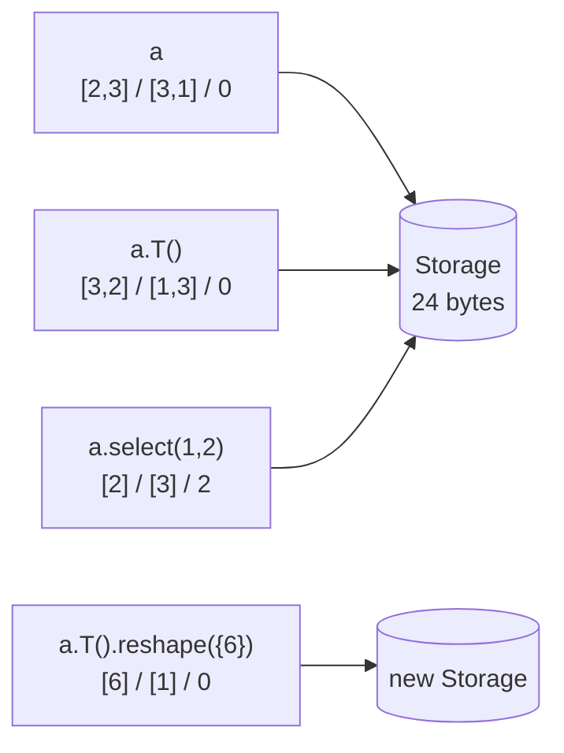

# 03. Views

This chapter builds the view layer: the operations that produce a new tensor by changing only its shape, strides and offset, while the bytes stay in the same `Storage`. It also builds the one place that moves bytes between two arbitrary layouts, the strided copy. Together they correspond to the views phase of the project and give every later chapter cheap transposes, slices and broadcasts.

| File | Role |
|------|------|
| `src/view.cpp` | `make_view` and every view method of `Tensor`: `view`, `reshape`, `transpose`, `permute`, `T`, `mT`, `squeeze`, `unsqueeze`, `expand`, `slice`, `select`, `narrow`, `flatten`, `unflatten`, `split`, `chunk`, `detach`, `has_internal_overlap` |
| `src/tensor_impl.cpp` | `TensorImpl::is_contiguous` and `TensorImpl::validate`, which every view passes through |
| `src/tensor.cpp` | `clone`, `contiguous`, `to(DType)`: the operations that materialize a layout |
| `src/copy.cpp`, `src/internal/copy.h` | `detail::convert_strided`, the strided copy with dtype conversion |
| `src/ops/inplace.cpp` | `copy_` and the in-place write rules that protect aliased memory |
| `include/kael/storage.h` | the version counter shared by every view of one buffer |
| `scripts/gen_view_cases.py` | generates `tests/generated/view_cases.inc` from NumPy |

## Prerequisites

- [01. Shapes and strides](01-shapes-and-strides.md): `contiguous_strides`, `broadcast_strides`, `infer_shape`, `wrap_dim`, `dim_position`.
- [02. Memory model](02-memory-model.md): `Storage`, `TensorImpl`, the `Tensor` handle, `DType`, `dispatch`.
- [ADR 0002: tensor as handle](adr/0002-tensor-as-handle.md) explains why a `Tensor` is a `std::shared_ptr<TensorImpl>`.

## What a view is

A tensor in kael is four pieces of metadata over a byte buffer:

```text
TensorImpl
  storage  -> shared_ptr<Storage>   (bytes, shared)
  shape    -> [2, 3]                (logical sizes)
  strides  -> [3, 1]                (elements to skip per step in each dim)
  offset   -> 0                     (element index of [0, 0] inside storage)
```

The address of element `[i, j]` is `offset + i * strides[0] + j * strides[1]`, measured in elements. Two `TensorImpl` objects that hold the same `storage` pointer read and write the same bytes, even when their shapes, strides and offsets differ.

**Views** are new `TensorImpl` objects that share the storage of an existing tensor and change only the metadata. Creating a view costs one small heap allocation and never touches the data.

The alternative, copying on every transpose or slice, would make `x.T()` cost O(n) memory and time and would break the semantics users expect from NumPy and PyTorch: writes through a slice must reach the original.

Consider `a = arange(6).view({2, 3})`:

```text
storage (float32):  [ 0 | 1 | 2 | 3 | 4 | 5 ]
                      0   1   2   3   4   5    <- element index

a          shape [2, 3]  strides [3, 1]  offset 0
           [[0, 1, 2],
            [3, 4, 5]]

a.T()      shape [3, 2]  strides [1, 3]  offset 0
           [[0, 3],
            [1, 4],
            [2, 5]]

a.select(1, 2)
           shape [2]     strides [3]     offset 2
           [2, 5]

arange(10).slice(0, 1, 8, 3)
           shape [3]     strides [3]     offset 1
           [1, 4, 7]
```

All four values above were checked by running the code against `build/libkael.a`.



The last node shows the one case in this chapter that does not share: `reshape` of a non-contiguous tensor allocates new storage. The sections below explain why.

## Contiguity

**Contiguous** tensors are those whose elements, visited in row-major logical order, sit at consecutive storage positions. For a shape `[d0, d1, ..., dn]` that means the strides equal `contiguous_strides(shape)`, with two relaxations that `TensorImpl::is_contiguous` implements:

1. An empty tensor is always contiguous. There is nothing to visit.
2. The stride of a size-1 dimension is ignored. The loop never steps along it, so its value cannot change any address.

From `src/tensor_impl.cpp`:

```cpp
bool TensorImpl::is_contiguous() const {
    if (numel() == 0) {
        return true;
    }
    std::int64_t expected_stride = 1;
    for (std::size_t i = shape.size(); i-- > 0;) {
        // The stride of a size-1 dimension is never used to step, so any value is fine.
        if (shape[i] == 1) {
            continue;
        }
        if (strides[i] != expected_stride) {
            return false;
        }
        expected_stride *= shape[i];
    }
    return true;
}
```

The walk goes from the last dimension to the first and tracks the stride a contiguous layout would have. The offset does not matter: a contiguous slice in the middle of a buffer (`a.select(0, 1)` with offset 3) is still contiguous.

Worked checks:

| Tensor | Shape | Strides | Contiguous | Reason |
|--------|-------|---------|------------|--------|
| `a` | `[2, 3]` | `[3, 1]` | yes | matches `[3, 1]` |
| `a.T()` | `[3, 2]` | `[1, 3]` | no | last stride is 3, expected 1 |
| `a.unsqueeze(1)` | `[2, 1, 3]` | `[3, 3, 1]` | yes | the size-1 stride is skipped |
| `arange(10).slice(0, 0, 10, 2)` | `[5]` | `[2]` | no | gap between elements |
| `from_vector({1.f, 2.f, 3.f}).expand({2, 3})` | `[2, 3]` | `[0, 1]` | no | stride 0 repeats a row |
| `zeros({0, 3}).T()` | `[3, 0]` | `[1, 3]` | yes | empty |

Contiguity matters for three reasons. `view` requires it. Kernels have a fast path when every operand advances by exactly one element (chapter [04](04-tensor-iterator.md)). And `clone` of a contiguous tensor is one `memcpy`.

## The view constructor

Every view goes through one helper in an anonymous namespace. From `src/view.cpp`:

```cpp
Tensor make_view(const Tensor& base, Shape shape, Strides strides, std::int64_t offset) {
    auto impl = std::make_shared<TensorImpl>();
    impl->storage = base.impl()->storage;
    impl->shape = std::move(shape);
    impl->strides = std::move(strides);
    impl->offset = offset;
    impl->dtype = base.dtype();
    impl->device = base.device();
    return Tensor::from_impl(std::move(impl));
}
```

Three design points follow from this function:

- The new impl copies the `shared_ptr<Storage>`, so the storage lives as long as any view of it. A slice of a large tensor keeps the whole buffer alive. That is the same trade-off PyTorch makes.
- `Tensor::from_impl` calls the private constructor, which calls `impl_->validate()`. Validation rejects negative strides, negative offsets, a device mismatch, and, through `check_fits_in_storage`, any layout whose last element would fall outside the storage. The extent arithmetic uses `detail::checked_mul` and `detail::checked_add`, so a malicious or buggy layout throws instead of overflowing `int64`. No view method can produce an out-of-bounds tensor, even if its own arithmetic has a bug.
- The autograd metadata is not copied. Each public view method calls an `autograd::record_*` function after `make_view` (for example `record_transpose`) so the backward pass knows how to route gradients through the view. Chapter [06](06-autograd.md) covers those functions. `detach` is the one view that records nothing: it returns a tensor with the same storage and no history.

## Metadata-only views

Each method below computes a new shape, strides and offset, then calls `make_view`. None of them reads an element.

### transpose and permute

`transpose(dim0, dim1)` swaps two entries of shape and strides. `permute(dims)` reorders all of them. Both accept negative dims through `dim_position`. `permute` checks that `dims` has one entry per dimension and that no dimension repeats, using a `std::vector<bool> seen`.

From `src/view.cpp`:

```cpp
Tensor Tensor::transpose(std::int64_t dim0, std::int64_t dim1) const {
    if (dim() == 0) {
        wrap_dim(dim0, 1);
        wrap_dim(dim1, 1);
        return *this;
    }
    const std::size_t first = dim_position(dim0, dim());
    const std::size_t second = dim_position(dim1, dim());

    Shape new_shape = shape();
    Strides new_strides = strides();
    std::swap(new_shape[first], new_shape[second]);
    std::swap(new_strides[first], new_strides[second]);
    Tensor out = make_view(*this, std::move(new_shape), std::move(new_strides), offset());
    autograd::record_transpose(out, *this, dim0, dim1);
    return out;
}
```

A 0-d tensor accepts `dim0` and `dim1` in `[-1, 0]`, the same rule PyTorch uses. `wrap_dim(dim, 1)` validates the index and the function returns the tensor itself. `squeeze(dim)` follows the same rule.

`T()` is `transpose(0, 1)` for a 2-d tensor and the identity for 0-d and 1-d tensors. It throws for more than 2 dimensions and points to `mT()`, which is `transpose(-2, -1)` and requires at least 2 dimensions.

### squeeze and unsqueeze

`squeeze()` drops every size-1 dimension together with its stride. `squeeze(dim)` drops one dimension if its size is 1 and returns `*this` otherwise.

`unsqueeze(dim)` inserts a size-1 dimension. The inserted stride never steps, so any value is legal, but kael picks one that keeps contiguity obvious:

```cpp
const std::size_t position = dim_position(dim, this->dim() + 1);
const std::int64_t new_stride =
    position < shape().size() ? shape()[position] * strides()[position] : 1;
```

The stride is the extent of the dimension it is inserted before, or 1 at the end. For `a` with shape `[2, 3]` and strides `[3, 1]`:

| Call | Shape | Strides |
|------|-------|---------|
| `a.unsqueeze(0)` | `[1, 2, 3]` | `[6, 3, 1]` |
| `a.unsqueeze(1)` | `[2, 1, 3]` | `[3, 3, 1]` |
| `a.unsqueeze(2)` | `[2, 3, 1]` | `[3, 1, 1]` |

The result equals `contiguous_strides` of the new shape when the input is contiguous, so code that compares strides directly (and tools that print them) see a familiar layout.

### expand and stride 0

`expand(shape)` makes a tensor look larger than its storage by repeating elements. It is how broadcasting is materialized as a view. The rule is the broadcasting rule from chapter [01](01-shapes-and-strides.md): align shapes from the right; a size-1 dimension can grow to any size; new leading dimensions can be added; any other mismatch is an error.

A dimension that grows from 1 to `n` gets stride 0. Stepping along it adds `0 * i` to the address, so every position reads the same element. New leading dimensions also get stride 0. `broadcast_strides` in `src/shape.cpp` computes exactly that:

```cpp
const std::size_t new_dims = target.size() - shape.size();
Strides result(target.size(), 0);
for (std::size_t i = 0; i < shape.size(); ++i) {
    const std::int64_t target_dim = target[i + new_dims];
    KAEL_CHECK_VALUE(shape[i] == target_dim || shape[i] == 1, /* ... */);
    if (shape[i] == target_dim) {
        result[i + new_dims] = strides[i];
    }
}
```

`Tensor::expand` first resolves `-1` entries with `resolve_expand_shape` (`-1` keeps the current size and is not allowed for a new leading dimension), then calls `broadcast_strides` and `make_view`.

Worked example, `v = from_vector({1.f, 2.f, 3.f})` with shape `[3]`, strides `[1]`:

```text
v.expand({2, 3})       shape [2, 3]  strides [0, 1]
  row 0: offset 0 + 0*0 + j*1 -> 1 2 3
  row 1: offset 0 + 1*0 + j*1 -> 1 2 3

c = from_vector({1.f, 2.f, 3.f}, {3, 1})
c.expand({3, 4})       shape [3, 4]  strides [1, 0]
  [[1, 1, 1, 1],
   [2, 2, 2, 2],
   [3, 3, 3, 3]]
```

Both stride vectors were printed by a compiled check. The 12-element view reads from a 3-element buffer.

Stride 0 creates **internal overlap**: several logical positions map to one storage element. Reading is safe. Writing is not, because the result of `expanded.add_(1)` would depend on how many times the loop visits each element. `Tensor::has_internal_overlap` detects the common case, a stride of 0 on a dimension larger than 1:

```cpp
bool Tensor::has_internal_overlap() const {
    for (std::size_t i = 0; i < shape().size(); ++i) {
        if (shape()[i] > 1 && strides()[i] == 0) {
            return true;
        }
    }
    return false;
}
```

Every in-place operation calls `check_writable` in `src/ops/inplace.cpp`, which throws with this message when the check is true:

```text
add_ cannot write to shape [2, 3] with strides [0, 1] because several positions share one element; call clone() first
```

The check looks only for stride 0. That is the way kael's own view methods create overlap: `expand` is the only one that sets a stride to 0, strides are never negative (validation rejects them), and `slice` only multiplies strides by a positive step. A general overlap test for arbitrary strides is not implemented.

### slice, select and narrow

`slice(dim, start, end, step)` keeps every `step`-th index in `[start, end)` of one dimension. Bounds follow Python slicing: negative values count from the end, then both are clamped to `[0, size]` by `clamp_slice_bound`. The step must be positive. The new metadata is:

```text
offset'      = offset + first * stride
shape'[dim]  = last > first ? (last - first - 1) / step + 1 : 0
stride'[dim] = stride * step
```

For `arange(10).slice(0, 1, 8, 3)`: `first = 1`, `last = 8`, size `(8 - 1 - 1) / 3 + 1 = 3`, stride `1 * 3 = 3`, offset `0 + 1 * 1 = 1`. The view reads storage elements 1, 4 and 7. The offset and stride products use `checked_mul` and `checked_add`, so a huge step throws `kael::Error` with the quantity name in the message instead of wrapping.

`select(dim, index)` fixes one index and removes the dimension: `offset' = offset + index * stride`, then the shape and stride entries are erased. Negative indices wrap once; an index outside `[-size, size)` throws through `KAEL_CHECK_INDEX`.

`narrow(dim, start, length)` is a strict `slice(dim, start, start + length)`. Unlike `slice`, it does not clamp. It throws when `start` or `length` falls outside the dimension. Use `narrow` where an out-of-range request is a bug, such as `cat` writing into the output.

### split and chunk

Both return `std::vector<Tensor>` of `narrow` views along one dimension.

- `split(chunk_size, dim)` produces pieces of `chunk_size`, with a smaller last piece. A `do ... while` loop guarantees at least one piece, so splitting a size-0 dimension returns one empty view.
- `chunk(chunks, dim)` computes `chunk_size = ceil(total / chunks)` and calls `split`. Like PyTorch, it can return fewer pieces than requested: `arange(6).chunk(4)` gives 3 pieces of size 2, and `arange(5).chunk(3)` gives sizes 2, 2, 1. If the dimension is empty, it returns `chunks` handles to one empty view.

## view versus reshape

`view` and `reshape` both reinterpret the elements in row-major order under a new shape. Both accept one `-1`, resolved by `infer_shape`. They differ in what they promise.

From `src/view.cpp`:

```cpp
Tensor Tensor::view(const Shape& requested) const {
    KAEL_CHECK_VALUE(is_contiguous(), "view needs a contiguous tensor, but shape "
                                          << to_string(shape()) << " has strides "
                                          << to_string(strides()) << "; use reshape instead");
    Shape target = infer_shape(requested, numel());
    Strides target_strides = contiguous_strides(target);
    Tensor out = make_view(*this, std::move(target), std::move(target_strides), offset());
    autograd::record_view(out, *this);
    return out;
}

Tensor Tensor::reshape(const Shape& requested) const {
    return contiguous().view(requested);
}
```

`view` never copies. It requires a contiguous input, because only then is "row-major order of the old shape" the same as "consecutive storage positions", which is what `contiguous_strides(target)` assumes. It keeps the offset, so a view of a contiguous slice still starts in the right place.

`reshape` always succeeds when the element counts match. `contiguous()` returns `*this` when the tensor is already contiguous and `clone()` otherwise. So:

| Input | `view` | `reshape` |
|-------|--------|-----------|
| contiguous | shares storage | shares storage |
| non-contiguous | throws `kael::Error` | copies into new storage, then views it |

Worked example with `t = a.T()` (shape `[3, 2]`, strides `[1, 3]`):

```text
t.view({6})     -> error: view needs a contiguous tensor, but shape [3, 2]
                   has strides [1, 3]; use reshape instead
t.reshape({6})  -> [0, 3, 1, 4, 2, 5], new storage
a.reshape({3, 2}) -> shares storage with a
```

The flattened order `0, 3, 1, 4, 2, 5` is the logical row-major order of `t`, not the storage order of `a`. No choice of strides on the original 6-element buffer can express that sequence as a single 1-d view, so a copy is unavoidable here.

kael's rule is deliberately simpler than PyTorch's. PyTorch's `reshape` returns a view whenever the requested shape is compatible with the existing strides, even for some non-contiguous inputs (for example splitting one dimension of a transposed tensor). kael copies for every non-contiguous input. The cost is an occasional unnecessary copy; the gain is one line of code and a rule a reader can state in a sentence. The header comment in `include/kael/tensor.h` states it: "Shares memory with this tensor only if it is contiguous; otherwise it copies."

`flatten(start_dim, end_dim)` and `unflatten(dim, sizes)` compute the target shape and call `reshape`, so they inherit the same rule. Two special cases in `flatten`: a 0-d tensor becomes shape `[1]`, and `start_dim == end_dim` returns `*this`.

## Materializing a layout

Three operations produce a fresh contiguous tensor from any layout.

- `clone()` allocates `empty(shape(), dtype(), device())`. For a contiguous source it copies `nbytes()` with `std::memcpy` (or `device::copy_within_device` on CUDA). For a non-contiguous source it calls `detail::convert_strided`.
- `contiguous()` is `is_contiguous() ? *this : clone()`.
- `to(DType)` allocates the target dtype and calls `convert_strided`, which converts each element.

`convert_strided` is the strided copy. It does not loop over indices itself. It builds a `TensorIterator` (chapter [04](04-tensor-iterator.md)) with the destination as output and the source as input, then runs an identity function through a double dtype dispatch. From `src/copy.cpp`:

```cpp
void convert_strided(Tensor& dst, const Tensor& src) {
    TensorIterator iterator;
    iterator.add_output(dst).add_input(src).build();
    if (iterator.on_device()) {
        device::convert(dst.dtype(), src.dtype(), iterator.device_layout());
        return;
    }
    auto identity = [](auto value) { return value; };
    dispatch(src.dtype(), [&]<typename From>() {
        dispatch(dst.dtype(), [&]<typename To>() { run_typed<To, From, 1>(iterator, identity); });
    });
}
```

Routing the copy through the iterator means the copy inherits everything the iterator does: broadcasting of the source, dimension coalescing, the contiguous fast path, and parallel execution. `run_typed<To, From, 1>` writes `convert_value<To>(identity(x))`, so a float `2.5` becomes bool `1`, not the invalid byte `2` that a plain `static_cast` would produce.

## copy_ and aliasing

`Tensor::copy_(source)` writes `source` into the existing layout of `*this`. It is the write half of every view-based algorithm: `cat` writes each input into `out.narrow(...)`, and `index_select` uses it in its general path.

From `src/ops/inplace.cpp`:

```cpp
Tensor& Tensor::copy_(const Tensor& source) {
    check_grad_rules(*this, &source, "copy_");
    check_writable(*this, "copy_");
    const autograd::NoGradGuard guard;
    const Tensor same_device = source.to(device());
    detail::convert_strided(*this, without_partial_aliasing(*this, same_device).expand(shape()));
    impl_->storage->bump_version();
    return *this;
}
```

Reading the steps in order:

1. `check_grad_rules` rejects writes that would corrupt the autograd graph (chapter [06](06-autograd.md)).
2. `check_writable` rejects a destination with internal overlap.
3. The source moves to the destination device.
4. `without_partial_aliasing` clones the source if it shares storage with the destination but has a different layout.
5. `expand(shape())` broadcasts the source to the destination shape, so `copy_` from a `[2]` row into a `[2, 2]` matrix fills both rows.
6. The storage version is bumped.

Step 4 is the aliasing guard. Consider `t = arange(0, 4)` and `t.slice(0, 1, 4).copy_(t.slice(0, 0, 3))`. The source reads elements 0, 1, 2 and the destination writes elements 1, 2, 3. If the iterator ran element by element in place, writing element 1 would overwrite the value that the next step reads, and the result would be `[0, 0, 0, 0]`. Cloning the source first gives the intended `[0, 0, 1, 2]`. The test `Copy.OverlappingWithItself` covers this case, and `InPlace.PartiallyOverlappingOperandIsReadBeforeWriting` covers the same pattern for `add_`.

The guard compares layouts with `same_layout` (shape, strides and offset all equal). When the source is exactly the destination, as in `t.mul_(t)`, each output element depends only on the input element at the same address, so no clone is needed and none is made.

## The version counter

Views make it possible to change a tensor's values through a different handle. Autograd must notice that, because a backward formula that saved `x` would otherwise compute gradients from the new values. kael stores a counter on the shared `Storage`. From `include/kael/storage.h`:

```cpp
[[nodiscard]] std::int64_t version() const noexcept { return version_; }
void bump_version() noexcept { ++version_; }
```

`Tensor::version()` returns `impl_->storage->version()`. Because the counter lives on the storage and not on the `TensorImpl`, every view of a buffer reports the same version, and a write through any of them is visible to all. Every in-place operation in `src/ops/inplace.cpp` calls `bump_version()` after writing: `binary_inplace` (used by `add_`, `sub_`, `mul_`, `div_`, `pow_`), `clamp_`, `copy_`, `masked_fill_` and `scatter_add_`. `fill_` and `zero_` delegate to `copy_`. Creating a view does not bump the counter.

Compiled check:

```cpp
Tensor a = arange(6).view({2, 3});
// a.version() == 0
Tensor v = a.view({6});
v.add_(1);
// a.version() == 1, a == [[1, 2, 3], [4, 5, 6]]
```

`autograd::SavedTensor` in `src/autograd/recording.h` records `t.version()` when a tensor is saved for backward and checks it again in `get()`. A mismatch throws "one of the variables needed for gradient computation has been modified by an inplace operation". Chapter [06](06-autograd.md) shows where tensors are saved.

## Edge cases and pitfalls

- Writing through an expanded view: `expand` returns stride 0. The header comment says "do not write to it", and `check_writable` enforces it for every in-place op. Call `clone()` first to get a writable copy (`InPlace.ExpandedTensorThrows`).
- Partial aliasing in `copy_` and in-place binary ops: A source that shares storage with a different layout is cloned before the write. Without that, the result depends on traversal order.
- `reshape` hides a copy: After `t.reshape(...)` on a non-contiguous `t`, writes to the result do not reach `t`. Use `view` when sharing is required: it throws instead of silently copying. `flatten` and `unflatten` share this behavior.
- Empty tensors: An empty tensor is contiguous. A slice with `start >= end` has size 0 and keeps a valid offset. `Tensor::first_element` returns the storage base for an empty tensor, because an empty view can carry an offset past the end of its storage. `chunk` of an empty dimension returns `chunks` empty views; `split` returns one.
- 0-d tensors: `transpose`, `squeeze(dim)` accept dims in `[-1, 0]` and return the tensor itself. `flatten` turns a 0-d tensor into shape `[1]`. `unsqueeze(0)` on a 0-d tensor gives shape `[1]` with stride 1.
- Overflow in view arithmetic: `slice` uses `checked_mul` and `checked_add` for the offset and stride. `validate` recomputes the extent with checked math for every new impl, so even a layout that slipped through cannot point outside the storage.
- Negative steps: Not supported. `slice` throws for `step <= 0` and `validate` rejects negative strides. The Python bindings also reject `t[::-1]` with `ValueError` (`test_negative_step_is_rejected` in `python/tests/test_indexing.py`).
- Lifetime: A view holds the storage. A small slice of a large tensor keeps the whole buffer alive until the slice is destroyed. `clone()` the slice to release it.

## How it is tested

`tests/test_view.cpp` holds one GoogleTest suite per operation:

| Suite | What it proves |
|-------|----------------|
| `IsContiguous` | size-1 dimensions do not matter, transposes and gaps are not contiguous, empty tensors always are |
| `Contiguous`, `Clone`, `To` | `contiguous()` returns the same impl when possible; `clone()` of a view does not share storage and is contiguous, including stride-0 views and views with an offset; `to` works on non-contiguous input |
| `InferShape` | `-1` resolution and its errors |
| `View` | shares storage, writes reach the original, keeps the offset, works on 0-d, rejects non-contiguous input |
| `Reshape` | `ContiguousShares` and `NonContiguousCopiesInLogicalOrder` |
| `Transpose`, `Permute`, `MatrixTranspose` | stride swaps, inverses, negative dims, `T` and `mT` rules |
| `Squeeze`, `Unsqueeze` | removal and insertion of size-1 dims and round trips |
| `Expand` | stride 0 for new and size-1 dims, `-1`, errors, `HasInternalOverlap` |
| `Slice`, `Select`, `Narrow` | step arithmetic, clamping, negative bounds, empty results, errors |
| `Flatten`, `Unflatten`, `Split`, `Chunk` | dimension ranges and PyTorch-compatible piece sizes |
| `ViewChain` | chains of views, plus `GeneratedNumPyCases` |
| `ZeroDimensional` | dim 0 and -1 accepted on scalars |

`ViewChain.GeneratedNumPyCases` is the differential test. `scripts/gen_view_cases.py` (seed 7, 60 cases) builds random shapes with `numpy.arange`, applies random chains of transpose, permute, slice, select, unsqueeze, squeeze, expand and reshape in NumPy, and writes the final shape and values to `tests/generated/view_cases.inc`. The test replays each chain in kael on an iota tensor and compares the shape, the values read through the view, and the values of `clone()` of the view. Because the input values are their own indices, any wrong stride or offset shows up as a wrong number.

`tests/test_ops_inplace.cpp` covers the write side: `InPlace.ExpandedTensorThrows`, `InPlace.PartiallyOverlappingOperandIsReadBeforeWriting`, `InPlace.ViewsSeeTheChange`, `Copy.BetweenDifferentStrides`, `Copy.ConvertsAndBroadcasts` and `Copy.OverlappingWithItself`. `tests/test_kernels.cpp` has `StridedCopy.ConvertsThroughIterator`. The golden tests in chapter [05](05-operations.md) apply `transpose`, `permute`, `slice` and `expand` views to inputs before every operation, so every op is also checked on non-contiguous layouts.

From Python, `test_views_share_memory` in `python/tests/test_tensor.py` and `test_getitem_is_a_view` in `python/tests/test_indexing.py` check sharing through the bindings.

## Build it yourself

1. Write `TensorImpl::is_contiguous` with the two relaxations (empty, size-1). Checkpoint: the four `IsContiguous` tests pass.
2. Write `make_view` and make sure it goes through `Tensor::from_impl` so `validate` runs. Write `detach` as the first user. Checkpoint: a detached tensor `shares_storage` with its source.
3. Write `clone` with the contiguous `memcpy` path only, and `contiguous`. Checkpoint: `Contiguous.ContiguousReturnsSameImpl`.
4. Write `transpose`, `permute`, `T`, `mT`. Checkpoint: `Transpose.*`, `Permute.*`, `MatrixTranspose.*`.
5. Write `detail::convert_strided` on top of the `TensorIterator` from chapter [04](04-tensor-iterator.md) (or, if you build in book order, a temporary odometer loop that walks `index_from_linear` and `offset_from_index`, replaced later). Use it in `clone` for non-contiguous input and in `to(DType)`. Checkpoint: `Contiguous.TransposedValuesInLogicalOrder`, `Clone.OfViewDoesNotShareAndIsContiguous`, `To.WorksOnNonContiguous`.
6. Write `view` and `reshape`. Checkpoint: `View.*` and `Reshape.*`; `a.T().view({6})` throws and `a.T().reshape({6})` returns `[0, 3, 1, 4, 2, 5]`.
7. Write `squeeze` (both overloads) and `unsqueeze` with the stride rule above. Checkpoint: `Squeeze.*`, `Unsqueeze.*`.
8. Write `expand` on top of `broadcast_strides`, and `has_internal_overlap`. Checkpoint: `Expand.*`; `from_vector({1.f, 2.f, 3.f}).expand({2, 3}).strides()` is `[0, 1]`.
9. Write `slice` with clamped bounds and checked arithmetic, then `select` and `narrow`. Checkpoint: `Slice.*`, `Select.*`, `Narrow.IsAStrictSlice`.
10. Write `flatten`, `unflatten`, `split`, `chunk`. Checkpoint: `Flatten.*`, `Unflatten.*`, `Split.*`, `Chunk.*`.
11. Run `python3 scripts/gen_view_cases.py` (needs NumPy) and include the generated file in a `ViewChain` test. Checkpoint: `ViewChain.GeneratedNumPyCases` passes.
12. Add `Storage::version` and `bump_version`, then `copy_` with `check_writable` and `without_partial_aliasing`. Checkpoint: `Copy.*` and `InPlace.ExpandedTensorThrows`.

Run a subset with the built test binary:

```bash
cmake --build build
build/tests/kael_tests --gtest_filter='IsContiguous.*:View.*:Reshape.*:Expand.*:Slice.*:ViewChain.*:Copy.*'
```

## Further reading

- Edward Yang, "PyTorch internals" (blog post): the storage, sizes, strides and offset model this chapter follows.
- NumPy documentation, "The N-dimensional array (ndarray)": the section on internal memory layout and strides.
- NumPy documentation on `numpy.lib.stride_tricks.as_strided`: what goes wrong when overlapping views are written.

Next: [04. TensorIterator](04-tensor-iterator.md)
