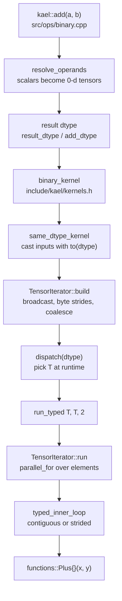

# 04. TensorIterator

This chapter builds the engine behind every elementwise operation: a loop that walks one output and any number of inputs with arbitrary shapes, strides and offsets, applies broadcasting, merges dimensions that can be walked as one, and hands contiguous runs of elements to a typed inner loop. On top of it sit the type promotion rules and the dtype dispatch that turn a generic lambda into a call on `float`, `double`, `std::int64_t` or `std::uint8_t`. It corresponds to the iterator phase of the project.

| File | Role |
|------|------|
| `include/kael/iterator.h` | `LoopDims`, `coalesce_dims`, `check_same_device`, the `TensorIterator` class and its templated `run` and `run_range` |
| `src/iterator.cpp` | building the iterator: input checks, common shape, output allocation, byte strides, coalescing |
| `include/kael/dtype.h` | `promote_types`, `dtype_category`, `convert_value`, `dispatch`, `dispatch_floating`, `dispatch_no_bool` |
| `include/kael/scalar.h` | `Scalar` and `promote_with_scalar` |
| `include/kael/operand.h` | `Operand`, a tensor or a scalar |
| `include/kael/kernels.h` | `result_dtype`, `run_typed`, `typed_inner_loop` and the public kernel templates (`unary_kernel`, `binary_kernel`, `comparison_kernel`, ...) |
| `src/internal/element_functions.h` | the functor for every elementwise operation, shared by CPU and CUDA |

## Prerequisites

- [01. Shapes and strides](01-shapes-and-strides.md): `broadcast_shapes`, `broadcast_strides`, `numel`.
- [02. Memory model](02-memory-model.md): `DType`, `Scalar`, `Tensor::device_data`, factories.
- [03. Views](03-views.md): strides, stride 0 from `expand`, contiguity, `convert_strided`.
- [ADR 0001: runtime dtype](adr/0001-runtime-dtype.md) explains why the dtype is a runtime value and not a template parameter of `Tensor`.
- [ADR 0003: type promotion](adr/0003-type-promotion.md) explains why the promotion rules follow PyTorch.

## The problem

A binary operation such as `a + b` must handle every combination of:

- shapes that broadcast against each other (`[2, 3, 4]` and `[4]`),
- layouts that are not contiguous (a transpose, a stepped slice, a stride-0 expand),
- dtypes that differ (`int64` plus `float32`),
- an output that is either allocated fresh or is an existing view (for in-place ops and `copy_`).

Writing one loop per operation per case does not scale. kael separates the problem into three layers:



The iterator knows nothing about dtypes beyond byte sizes. The kernel layer knows nothing about strides. The functor knows only how to combine two values.

## Type promotion

### The table

kael has four dtypes. `promote_types` in `include/kael/dtype.h` ranks them `Bool < I64 < F32 < F64` and returns the higher one:

| `promote_types` | Bool | I64 | F32 | F64 |
|-----------------|------|-----|-----|-----|
| Bool | Bool | I64 | F32 | F64 |
| I64 | I64 | I64 | F32 | F64 |
| F32 | F32 | F32 | F32 | F64 |
| F64 | F64 | F64 | F64 | F64 |

`int64 + float32` gives `float32`, as in PyTorch, even though large integers lose precision. The table is checked at compile time by `static_assert`s in `Promotion.Table` in `tests/test_iterator.cpp`.

A coarser grouping, the **category**, is defined by `dtype_category`: Bool is 0, I64 is 1, floating types are 2. Categories drive the two rules below.

### Scalars

A C++ number passed to an op becomes a `Scalar`. Its dtype comes from its C++ type, not its value. From `include/kael/scalar.h`:

```cpp
constexpr Scalar(bool value) : value_(std::int64_t{value ? 1 : 0}), dtype_(DType::Bool) {}

template <std::integral T>
constexpr Scalar(T value) : value_(static_cast<std::int64_t>(value)), dtype_(DType::I64) {}

template <std::floating_point T>
constexpr Scalar(T value) : value_(static_cast<double>(value)), dtype_(DType::F32) {}
```

A floating scalar has dtype F32 even when written as a `double` literal. It stores the value as `double`, so no precision is lost before the cast to the final dtype.

A scalar never raises the precision of a tensor within the same category; it only moves the result to a higher category:

```cpp
// A scalar never raises the precision of a tensor within the same category:
// F32 + 2.5 stays F32, while I64 + 2.5 moves to the default float, F32.
constexpr DType promote_with_scalar(DType tensor_dtype, Scalar scalar) {
    return dtype_category(scalar.dtype()) <= dtype_category(tensor_dtype) ? tensor_dtype
                                                                          : scalar.dtype();
}
```

| Tensor dtype | Scalar | Result |
|--------------|--------|--------|
| F32 | `2.5` | F32 |
| F64 | `2.5f` | F64 |
| I64 | `2.5` | F32 |
| I64 | `2` | I64 |
| Bool | `2` | I64 |
| Bool | `true` | Bool |
| F64 | `true` | F64 |

The rows are copied from `Promotion.Scalars`.

### 0-d tensors

An `Operand` holds either a `Tensor` or a `Scalar` (`include/kael/operand.h`). Before any kernel runs, `detail::resolve_operands` in `src/ops/binary.cpp` turns a scalar operand into a 0-d tensor of dtype `promote_with_scalar(other.dtype(), value)`. From that point on, every operand is a tensor.

0-d tensors get the same treatment as scalars in `result_dtype`, which picks the dtype of an op with several tensor inputs. From `include/kael/kernels.h`:

```cpp
// Tensors with dimensions decide the dtype; a 0-d tensor only wins with a higher category.
inline DType result_dtype(std::initializer_list<const Tensor*> tensors) {
    std::optional<DType> dimensioned;
    std::optional<DType> zero_dimensional;
    for (const Tensor* t : tensors) {
        std::optional<DType>& group = t->dim() == 0 ? zero_dimensional : dimensioned;
        group = group ? promote_types(*group, t->dtype()) : t->dtype();
    }
    if (!dimensioned || !zero_dimensional) {
        return dimensioned ? *dimensioned : *zero_dimensional;
    }
    return dtype_category(*zero_dimensional) > dtype_category(*dimensioned) ? *zero_dimensional
                                                                            : *dimensioned;
}
```

The inputs split into two groups, each promoted with the table. If both groups exist, the 0-d group wins only when its category is higher. Results of a compiled check:

| Expression | Result |
|------------|--------|
| `randn({3}) + scalar(1.0, DType::F64)` | float32 |
| `ones({3}, DType::I64) + scalar(1.0)` | float32 |
| `ones({3}, DType::I64) + 2.5` | float32 |
| `ones({3}) + ones({3}, DType::F64)` | float64 |
| `ones({3}, DType::I64) * true` | int64 |

The reason for this rule is the common case `x * 0.5` on a float32 tensor. Without it, the literal (or a 0-d float64 tensor holding a loss value) would upcast a large activation tensor to float64 and double its memory. PyTorch uses the same rule, and the golden cases `zero_dim_wider`, `zero_dim_higher_category` and `zero_dim_lower_category` in `scripts/generate/golden.py` check kael against it.

### Op-specific overrides

`result_dtype` is the default. Some ops adjust it, in `src/internal/arithmetic.h` and in the op files:

| Op | Rule | Source |
|----|------|--------|
| `add` | Bool + Bool gives I64 | `detail::add_dtype` |
| `div` | integer or Bool results become F32 | `detail::div_dtype` |
| `sub`, `pow`, `floor_divide` | Bool inputs throw | `detail::check_no_bool` |
| comparisons | compute in `result_dtype`, output Bool | `comparison_kernel` |
| `logical_*` | inputs converted to Bool first | `logical` in `src/ops/binary.cpp` |
| `exp`, `log`, `sin`, ... | integer and Bool inputs become F32 | `floating_unary_kernel` |
| in-place ops | result category must not exceed the category of `self` | `check_result_fits` in `src/ops/inplace.cpp` |

`add_dtype` differs from PyTorch, where Bool + Bool stays Bool. For that reason the `add` golden cases skip the `bools` pattern (`BOOL_PATTERNS[1:]` in `scripts/generate/golden.py`). Reductions, matmul and `cat` have their own dtype rules, covered in chapter [05](05-operations.md).

## Dtype dispatch

Tensors carry their dtype as a runtime `enum class DType`. Kernels are templates on the C++ element type. `dispatch` bridges the two with a `switch` that calls a templated lambda. From `include/kael/dtype.h`:

```cpp
template <typename F> decltype(auto) dispatch(DType dtype, F&& f) {
    switch (dtype) {
    case DType::F32:
        return f.template operator()<float>();
    case DType::F64:
        return f.template operator()<double>();
    case DType::I64:
        return f.template operator()<std::int64_t>();
    case DType::Bool:
        return f.template operator()<std::uint8_t>();
    }
    detail::unreachable();
}
```

The caller writes a C++20 template lambda:

```cpp
dispatch(dtype, [&]<typename T>() { run_typed<T, T, 2>(iterator, f); });
```

The compiler instantiates the body four times, once per dtype. The `switch` picks one at runtime. Two variants restrict the set: `dispatch_floating(dtype, op, f)` instantiates only `float` and `double` and throws `kael::TypeError` for other dtypes with a message naming `op`, and `dispatch_no_bool` excludes `std::uint8_t` (also `TypeError`). Restricting instantiation matters for functors that do not compile for every type, such as `std::exp` on `std::int64_t` or `-x` on a Bool.

Bool is stored as `std::uint8_t`. The comment in `dtype.h` gives the reason: `sizeof(bool)` is not fixed by the standard, and `std::vector<bool>` cannot hand out element pointers. Writing any other value than 0 or 1 into a Bool tensor would break `logical_*` and `equal`, so every store goes through `convert_value`:

```cpp
// A plain static_cast would turn 2.5 into the invalid bool value 2.
template <typename To, typename From> constexpr To convert_value(From value) {
    if constexpr (std::is_same_v<To, std::uint8_t>) {
        return value != From{0} ? To{1} : To{0};
    } else if constexpr (std::is_integral_v<To> && std::is_floating_point_v<From>) {
        return saturating_cast<To>(value);
    } else {
        return static_cast<To>(value);
    }
}
```

The second branch handles float to `I64`. A plain `static_cast` of an out-of-range float or of NaN to an integer is undefined behavior, so `saturating_cast` clamps to the integer range and maps NaN to 0, as Rust's `as` does. Chapter [02](02-memory-model.md) shows it.

Conversion between two runtime dtypes, as in `to(DType)`, needs a double dispatch. `convert_strided` in `src/copy.cpp` nests one `dispatch` for `From` inside one for `To`, producing 16 instantiations of the copy loop (chapter [03](03-views.md)).

## Broadcasting in the iterator

The iterator receives an output (given or to be allocated) and one or more inputs. `TensorIterator::build` runs four steps:

```cpp
TensorIterator& TensorIterator::build() {
    check_inputs();
    const Shape common_shape = common_input_shape();
    prepare_output(common_shape);
    prepare_loop(common_shape);
    return *this;
}
```

`check_inputs` requires at least one input, an output or an output dtype, the same dtype on every input, and the same device on every operand. The iterator does not convert dtypes; the kernel layer casts inputs before adding them.

`common_input_shape` folds `broadcast_shapes` over all input shapes. The output is not part of broadcasting. `prepare_output` either allocates `empty(common_shape, dtype, device)` or checks that the given output has exactly the common shape. An in-place op cannot grow `self`: `a.add_(b)` with `a` of shape `[3]` and `b` of shape `[2, 3]` throws "output shape [3] does not match the shape [2, 3] of the inputs".

`prepare_loop` turns every operand into a base pointer and a stride vector over the common shape:

```cpp
void TensorIterator::prepare_loop(const Shape& common_shape) {
    base_pointers_.clear();
    LoopDims full;
    full.shape = common_shape;
    full.operand_strides.push_back(to_bytes(output_->strides(), output_->dtype()));
    base_pointers_.push_back(output_->device_data());
    for (Tensor& input : inputs_) {
        full.operand_strides.push_back(to_bytes(
            broadcast_strides(input.shape(), input.strides(), common_shape), input.dtype()));
        base_pointers_.push_back(input.device_data());
    }

    element_count_ = numel(common_shape);
    dims_ = coalesce_dims(full);
    if (dims_.shape.empty()) {
        dims_.shape.push_back(1);
        for (Strides& strides : dims_.operand_strides) {
            strides.push_back(0);
        }
    }
}
```

Three decisions are visible here:

1. Broadcasting is the same stride-0 trick as `expand`. An input of shape `[4]` against a common shape `[2, 3, 4]` gets strides `[0, 0, 1]`. The loop then treats every operand identically.
2. Strides are converted to bytes. Operand 0 (the output) and operand 1 (an input) can have different element sizes, as in `convert_strided` from `int64` to `float32`. With byte strides, one `std::byte*` per operand and one stride per operand per dimension describe everything, and the iterator never needs to know `T`.
3. The base pointer is `device_data()`, which already includes the tensor offset. The loop only adds stride multiples.

If every dimension has size 1 (or the tensor is 0-d), coalescing leaves no dimensions. `prepare_loop` then adds one dimension of size 1 with stride 0 so the loop body always has an innermost dimension.

## Dimension coalescing

Walking a `[2, 3, 4]` tensor as three nested loops costs a counter update at every row boundary. When the memory layout allows it, two adjacent dimensions can be merged into one. The condition, for every operand, is that stepping once along the outer dimension lands where stepping `size` times along the inner dimension would:

```text
stride[outer] == stride[inner] * shape[inner]
```

From `src/iterator.cpp`:

```cpp
LoopDims coalesce_dims(const LoopDims& dims) {
    LoopDims merged = without_size_one_dims(dims);

    for (std::size_t inner = merged.shape.size(); inner-- > 1;) {
        const std::size_t outer = inner - 1;
        if (!can_merge_with_next(merged, outer)) {
            continue;
        }
        merged.shape[outer] *= merged.shape[inner];
        merged.shape.erase(merged.shape.begin() + static_cast<std::ptrdiff_t>(inner));
        for (Strides& strides : merged.operand_strides) {
            strides[outer] = strides[inner];
            strides.erase(strides.begin() + static_cast<std::ptrdiff_t>(inner));
        }
    }
    return merged;
}
```

First `without_size_one_dims` drops every size-1 dimension, because its stride is never used. Then the loop goes from the innermost pair outward. When a pair merges, the outer size becomes the product and the merged dimension keeps the inner stride. The next iteration compares the merged dimension with the one before it, so a fully contiguous tensor collapses to a single dimension in one pass. `can_merge_with_next` requires the condition for all operands: one operand that cannot merge blocks the merge for all of them, since they share one loop.

### Worked example

`x` is a contiguous float32 tensor of shape `[2, 3, 4]`. `y` is a contiguous float32 tensor of shape `[4]`. The output is allocated.

Before coalescing, in bytes (element size 4):

```text
common shape          [ 2,  3, 4]
operand 0 (output)    [48, 16, 4]
operand 1 (x)         [48, 16, 4]
operand 2 (y)         [ 0,  0, 4]   broadcast_strides([4], [1], [2,3,4]) = [0,0,1], times 4
```

Pass 1, `inner = 2`, `outer = 1`:

```text
output: 16 == 4 * 4   yes
x:      16 == 4 * 4   yes
y:       0 == 4 * 4   no    -> no merge
```

Pass 2, `inner = 1`, `outer = 0`:

```text
output: 48 == 16 * 3  yes
x:      48 == 16 * 3  yes
y:       0 ==  0 * 3  yes   -> merge: shape [6, 4], each operand keeps the inner stride
```

Result:

```text
loop shape            [ 6, 4]
operand 0 (output)    [16, 4]
operand 1 (x)         [16, 4]
operand 2 (y)         [ 0, 4]
```

The loop runs 6 rows of 4 contiguous elements. `y` restarts at its base for every row because its outer stride is 0. A compiled check of `TensorIterator::dims()` on this input prints exactly `[6 4]`, `[16 4]`, `[16 4]`, `[0 4]`.

Two contrasting cases:

| Inputs | Loop shape | Why |
|--------|------------|-----|
| `[2, 3, 4]` contiguous with `[2, 3, 4]` contiguous | `[24]` | every pair merges |
| `[2, 3, 4]` with `[2, 1, 4]` | `[2, 3, 4]` | `y` has byte strides `[16, 0, 4]`; neither `0 == 16` nor `16 == 0 * 3` holds |
| a transposed `[2, 3]` with strides `[1, 2]` | `[2, 3]` | `1 != 2 * 3` (`Coalesce.TransposedMergesNothing`) |
| `[2, 3]` with strides `[0, 0]` | `[6]` | `0 == 0 * 3`: a fully broadcast scalar merges (`Coalesce.StrideZeroDimsMerge`) |

The iterator does not reorder dimensions. PyTorch's TensorIterator sorts dimensions by stride so a transposed input can still be walked in memory order; kael walks every operand in the logical order of the common shape. For a transposed output that means writes follow the output's logical order (`Iterator.GivenOutputIsWrittenInItsOrder`). Sorting would make transposed inputs faster at the cost of a permutation step and harder-to-follow code. It is not implemented.

## The two-level loop

`TensorIterator::run(inner_loop)` executes the operation. The inner loop is any callable with this signature:

```cpp
void inner_loop(std::byte* const* pointers, const std::int64_t* strides, std::int64_t count);
```

It receives one pointer per operand (output first), the innermost byte stride of each operand, and the number of elements to process along the innermost dimension. The iterator handles everything else.

From `include/kael/iterator.h`:

```cpp
template <typename InnerLoop> void TensorIterator::run(InnerLoop&& inner_loop) const {
    check_runs_on_host();
    if (element_count_ == 0) {
        return;
    }
    parallel_for(0, element_count_, kElementGrain, [&](std::int64_t first, std::int64_t last) {
        run_range(first, last, inner_loop);
    });
}
```

Work is split by linear element index, not by row. `parallel_for` (chapter [08](08-cpu-performance.md)) hands each worker a range `[first, last)` of at least `kElementGrain` (524288) elements, so small tensors run on the calling thread. A range can start and end in the middle of a row, which is why `run_range` has two parts.

Setup decomposes `first` into an outer counter (an odometer over all dimensions except the last) and a position inside the row:

```cpp
std::int64_t outer_position = first / inner_size;
for (std::size_t dim = outer_dims; dim-- > 0;) {
    counter[dim] = outer_position % dims_.shape[dim];
    outer_position /= dims_.shape[dim];
    for (std::size_t op = 0; op < operand_count; ++op) {
        byte_offsets[op] += counter[dim] * dims_.operand_strides[op][dim];
    }
}
std::int64_t skipped_in_row = first % inner_size;
```

The main loop calls the inner loop on the rest of the current row, then advances the odometer: it increments the last outer counter, adds its stride, and on overflow resets it (subtracting `stride * size`) and carries into the next one.

```cpp
for (std::int64_t remaining = last - first; remaining > 0;) {
    const std::int64_t count = std::min(inner_size - skipped_in_row, remaining);
    for (std::size_t op = 0; op < operand_count; ++op) {
        pointers[op] =
            base_pointers_[op] + byte_offsets[op] + skipped_in_row * inner_strides[op];
    }
    inner_loop(pointers.data(), inner_strides.data(), count);
    remaining -= count;
    skipped_in_row = 0;
    // odometer increment over the outer dimensions
}
```

Trace for the worked example above (loop shape `[6, 4]`, output strides `[16, 4]`, `y` strides `[0, 4]`), assuming a worker receives `first = 10`, `last = 24`:

| Step | Counter | Output byte offset | `y` byte offset | `count` | Elements |
|------|---------|--------------------|-----------------|---------|----------|
| setup | `[2]` | 32 | 0 | | |
| call 1 | `[2]` | 32 + 2 * 4 = 40 | 0 + 2 * 4 = 8 | 2 | 10, 11 |
| call 2 | `[3]` | 48 | 0 | 4 | 12 to 15 |
| call 3 | `[4]` | 64 | 0 | 4 | 16 to 19 |
| call 4 | `[5]` | 80 | 0 | 4 | 20 to 23 |

Byte offset 40 in the output is element 10, and byte offset 8 in `y` is `y[2]`, which is the value element 10 needs (`10 % 4 == 2`). Coalescing reduced the per-row bookkeeping from two counters to one.

The odometer is the same idea as `index_from_linear` and `offset_from_index` from chapter [01](01-shapes-and-strides.md), but incremental: computing the full offset from a linear index costs a division per dimension per element; the odometer costs one addition per row.

## Typed inner loops

The kernel layer turns a value-level functor `f(x, y)` into an inner loop. From `include/kael/kernels.h`:

```cpp
template <typename Out, typename In, std::size_t... I, typename F>
void typed_inner_loop(std::byte* const* pointers, const std::int64_t* strides, std::int64_t count,
                      F& f, std::index_sequence<I...>) {
    const bool contiguous = strides[0] == static_cast<std::int64_t>(sizeof(Out)) &&
                            ((strides[I + 1] == static_cast<std::int64_t>(sizeof(In))) && ...);
    if (contiguous) {
        Out* out = reinterpret_cast<Out*>(pointers[0]);
        const In* const inputs[] = {reinterpret_cast<const In*>(pointers[I + 1])...};
        for (std::int64_t i = 0; i < count; ++i) {
            out[i] = convert_value<Out>(f(inputs[I][i]...));
        }
        return;
    }
    for (std::int64_t i = 0; i < count; ++i) {
        *reinterpret_cast<Out*>(pointers[0] + i * strides[0]) = convert_value<Out>(
            f(*reinterpret_cast<const In*>(pointers[I + 1] + i * strides[I + 1])...));
    }
}
```

The `std::index_sequence<I...>` expands the input pack, so one template handles unary (`InputCount = 1`), binary (2) and ternary (3) functors. All inputs share the type `In`; only the output can differ (`Out = std::uint8_t` for comparisons, any `To` for `convert_strided`).

The contiguous branch matters for speed: with typed pointers and unit stride the compiler can vectorize the loop. The strided branch is the general case and handles stride 0 (broadcast) and any other step. After coalescing, most real workloads hit the contiguous branch for long rows.

`run_typed` connects the typed loop to the iterator and to the device backend:

```cpp
template <typename Out, typename In, std::size_t InputCount, typename F>
void run_typed(const TensorIterator& iterator, F& f) {
    if constexpr (DeviceFunction<F>) {
        if (iterator.on_device()) {
            device::elementwise(F::kOp, dtype_of_v<Out>, dtype_of_v<In>, iterator.device_layout(),
                                f.parameters());
            return;
        }
    }
    iterator.run([&](std::byte* const* pointers, const std::int64_t* strides, std::int64_t count) {
        typed_inner_loop<Out, In>(pointers, strides, count, f,
                                  std::make_index_sequence<InputCount>{});
    });
}
```

A functor that satisfies the `DeviceFunction` concept (it has a static `kOp` of type `device::ElementOp` and a `parameters()` method) can run on CUDA: the iterator exports its coalesced layout as a `device::ElementLayout` (at most `device::kMaxDims` = 8 dimensions and `device::kMaxOperands` = 4 operands), and the backend runs the same functor on the GPU. Chapter [09](09-cuda-backend.md) covers that path. A plain lambda is not a `DeviceFunction`; kernels built from one copy device inputs to the host, run there, and copy the result back.

## The kernel templates

The public templates in `include/kael/kernels.h` are thin wrappers over two helpers:

- `detail::same_dtype_kernel(dtype, f, inputs...)` opens a `NoGradGuard`, allocates the output with `allocate_output(dtype)`, adds each input as `input.to(dtype)`, builds, and dispatches `run_typed<T, T, N>`.
- `detail::same_dtype_kernel_out(out, f, inputs...)` does the same with a given output, casting inputs to `out.dtype()`.

| Template | Output dtype | Use |
|----------|--------------|-----|
| `unary_kernel(t, f)` | `t.dtype()` | `neg`, `abs`, `sign`, `relu` |
| `floating_unary_kernel(t, f)` | `t.dtype()` if floating, else F32 | `exp`, `log`, `tanh`, `sigmoid`, `gelu` |
| `unary_kernel_out(out, t, f)` | `out.dtype()` | writes into a view |
| `binary_kernel(a, b, f)` | `result_dtype({&a, &b})` | arithmetic |
| `binary_kernel_out(out, a, b, f)` | `out.dtype()` | in-place arithmetic |
| `ternary_kernel(a, b, c, f)` | `result_dtype({&a, &b, &c})` | `where` |
| `comparison_kernel(a, b, f)` | Bool | comparisons and logical ops |

Casting with `to(dtype)` before the iterator keeps the iterator single-dtype and keeps every functor monomorphic in `T`. The cost is a temporary copy of any input whose dtype differs from the result. `to` returns the tensor itself when the dtype already matches, so the common case pays nothing.

The `NoGradGuard` exists because these kernels are building blocks: the public op records one autograd node for the whole operation (chapter [06](06-autograd.md)), and the internal `to` calls must not record their own.

## Element functions

`src/internal/element_functions.h` defines one functor per elementwise operation in namespace `kael::functions`. Functors without runtime arguments inherit from `Tagged<ElementOp::...>`, which provides `kOp` and an empty `parameters()`. Functors with arguments, such as `Clamp` and `MaskedFill`, declare both themselves:

```cpp
template <ElementOp Op> struct Tagged {
    static constexpr ElementOp kOp = Op;
    [[nodiscard]] KAEL_HD ElementParameters parameters() const { return {}; }
};

struct Plus : Tagged<ElementOp::Plus> {
    template <typename T> KAEL_HD auto operator()(T a, T b) const {
        if constexpr (kWraps<T>) {
            return wrapping_add(a, b);
        } else {
            return a + b;
        }
    }
};
```

`KAEL_HD` expands to `__host__ __device__` under `nvcc` and to nothing otherwise, so the CPU loop and the CUDA kernel compile the same arithmetic. Functors are structs instead of lambdas for that reason and because the `kOp` tag gives the device backend a value it can switch on.

Functors with runtime arguments store them as members and return them from `parameters()`: `Clamp<T>` holds `low` and `high`, `MaskedFill<T>` holds `replacement`. `ElementParameters` keeps integer arguments in an `std::int64_t` array apart from the `double` array for real ones, because a `double` cannot hold every `int64` exactly (chapter [09](09-cuda-backend.md)).

Several functors encode numerical or semantic decisions:

- `Sigmoid` uses `1 / (1 + exp(-x))` for `x >= 0` and `exp(x) / (1 + exp(x))` for `x < 0`, so `exp` never receives a large positive argument.
- `Maximum` and `Minimum` call `nan_aware_max` and `nan_aware_min`: if either value is NaN, the result is NaN. A plain `a < b ? b : a` would return the second argument whenever the first is NaN, making the result depend on argument order. `src/internal/nan_aware.h` has a host-only copy of the same functions used by reductions and softmax.
- `Plus`, `Minus`, `Times` and `Negate` compute signed integers through `wrapping_add`, `wrapping_subtract` and `wrapping_multiply`, which cast to the unsigned type, operate there and cast back. Signed overflow is undefined behavior in C++; the unsigned detour makes it wrap around in two's complement, as PyTorch does. `Absolute` negates the same way, so `abs(INT64_MIN)` is `INT64_MIN`. The reductions, `matmul`, `cumsum` and `scatter_add_` (through `Plus` on the CPU, an unsigned `atomicAdd` on CUDA and `wrapping_add` in the host emulation) call the same helpers.
- `Power` uses `std::pow` for floating types and `integer_power` for integers: exponentiation by squaring in the unsigned type, so overflow wraps instead of being undefined. A negative integer exponent gives `1` for base 1, `±1` for base -1, and `0` otherwise.
- `Absolute` and `Sign` return their input unchanged for `std::uint8_t`, because Bool values are already 0 or 1.
- `Clamp` returns NaN if either bound is NaN.
- `GeluExact` uses `std::erf`; `GeluTanh` uses the tanh approximation with constant `0.044715`.

## Edge cases and pitfalls

- Empty tensors: `element_count_` is 0, so `run` returns before calling `parallel_for`. The output still has the broadcast shape (`Kernels.EmptyAndScalarInputs`, `Iterator.ZeroSizedRunsNothing`).
- 0-d tensors: Coalescing leaves no dimensions; `prepare_loop` inserts one dimension of size 1 and the inner loop runs once (`Iterator.ScalarsRunOneElement`).
- Output aliasing an input: Same layout is safe because each output element depends only on the input element at the same position, and that element is read before it is written (`Kernels.OutputCanBeOneOfTheInputs`). Different layouts over the same storage are not safe; the in-place ops clone such inputs first (chapter [03](03-views.md)).
- Output shape: A given output never broadcasts. `prepare_output` throws if its shape differs from the common input shape (`Kernels.GivenOutputWithWrongShapeThrows`).
- Mixed dtypes reaching the iterator: `check_inputs` throws "iterator inputs must share a dtype". Callers cast first; the kernel templates do this.
- Bool stores: Every store goes through `convert_value`, so no Bool tensor ever holds a value other than 0 or 1.
- Integer division by zero under threads: `floor_divide` throws from inside the functor. The exception crosses the `parallel_for` boundary and reaches the caller (`ParallelIterator.IntegerDivisionByZeroStillThrows`).
- Determinism: Elementwise results do not depend on the thread count, because each element is computed independently (`ParallelIterator.ResultsDoNotDependOnThreadCount`).
- Device limits: A layout with more than 8 dimensions after coalescing, or an op with more than 4 operands, throws in `device_layout()`. The CPU path has no such limit.

## How it is tested

`tests/test_iterator.cpp`:

- `Coalesce.*` call `coalesce_dims` directly on hand-written `LoopDims`: fully contiguous becomes one loop, a broadcast operand stops a merge (`[2, 3, 4]` becomes `[2, 12]`), a transpose merges nothing, size-1 dims disappear, all-size-1 leaves no dims, stride-0 dims merge.
- `Iterator.*` drive `TensorIterator` with a hand-written float inner loop: contiguous input is one dimension, strides are in bytes per operand, contiguous, broadcast and transposed adds, a three-dimensional odometer, zero-sized and scalar inputs, a transposed given output, building twice, and the error cases.
- `Promotion.Table` and `Promotion.Scalars` are `static_assert`s on `promote_types` and `promote_with_scalar`.

`tests/test_kernels.cpp`:

- `Kernels.RandomCasesMatchTheNaiveReference` generates 500 random pairs of broadcastable shapes (0 to 4 dims, sizes 0 to 5) with random layouts (transposed, stepped, expanded or plain) and compares `binary_kernel` against a reference that indexes every element with `index_from_linear` and `at<double>`. Every combination of broadcasting, stride and coalescing path is exercised against code that has no fast path at all.
- The other `Kernels.*` tests cover promotion, ternary broadcasting, Bool output, writing through views, and the output-shape check. `StridedCopy.ConvertsThroughIterator` checks `to` and `clone` on a transpose.

`tests/test_parallel_ops.cpp` has `ParallelIterator.*`: large ranges are split, small ranges stay in one call, every layout visits every element in its place under 4 threads, results do not depend on the thread count, and exceptions propagate.

The golden tests of chapter [05](05-operations.md) check promotion against PyTorch for every binary op: the comparison in `tests/test_golden.cpp` requires the same dtype, not only the same values.

## Build it yourself

1. Write `promote_types`, `dtype_category`, `convert_value` and `dispatch` in `dtype.h`. Checkpoint: `Promotion.Table` compiles.
2. Write `Scalar` and `promote_with_scalar`. Checkpoint: `Promotion.Scalars` compiles.
3. Write `LoopDims` and `coalesce_dims`. Checkpoint: all six `Coalesce.*` tests pass.
4. Write `TensorIterator` with `add_output`, `allocate_output`, `add_input`, `build` and the private steps `check_inputs`, `common_input_shape`, `prepare_output`, `prepare_loop`. Checkpoint: `Iterator.ContiguousIsOneDimension` and `Iterator.StridesAreInBytesPerOperand`.
5. Write `run` and `run_range` without threads first (call `run_range(0, element_count_, inner_loop)`). Checkpoint: the remaining `Iterator.*` tests pass, including `ThreeDimensionalOdometer` and `GivenOutputIsWrittenInItsOrder`.
6. Write `typed_inner_loop` and `run_typed` (host branch only), then `same_dtype_kernel`, `same_dtype_kernel_out`, `result_dtype` and the public templates. Checkpoint: `Kernels.*` pass, including `RandomCasesMatchTheNaiveReference`.
7. Replace the temporary loop in `convert_strided` (chapter [03](03-views.md)) with the iterator. Checkpoint: `StridedCopy.ConvertsThroughIterator` and `ViewChain.GeneratedNumPyCases`.
8. Add `src/internal/element_functions.h` with `Plus`, `Minus`, `Times`, `Divides` and the comparison functors. Checkpoint: `binary_kernel(a, b, functions::Plus{})` gives the same result as the lambda version.
9. When chapter [08](08-cpu-performance.md) adds `parallel_for`, wrap `run_range` in it. Checkpoint: `ParallelIterator.*`.

```bash
cmake --build build
build/tests/kael_tests --gtest_filter='Coalesce.*:Iterator.*:Promotion.*:Kernels.*:StridedCopy.*'
```

## Further reading

- Edward Yang, "PyTorch internals" (blog post), the section on TensorIterator and kernel dispatch.
- The PyTorch documentation page "Tensor Attributes", section on type promotion, for the 0-d and category rules.
- NumPy documentation, "Broadcasting".

Next: [05. Operations](05-operations.md)
