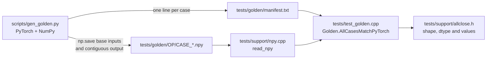

# 05. Operations

This chapter builds the operator library on top of the iterator: elementwise arithmetic and math, in-place variants, reductions, matrix multiplication, indexing, the softmax family and sequence operations. It also builds the golden test pipeline that compares 783 cases across 67 operations against PyTorch. It corresponds to the operations phase of the project.

| File | Role |
|------|------|
| `include/kael/ops.h` | the public declarations of every free-function op and the operator overloads |
| `src/ops/binary.cpp` | `add`, `sub`, `mul`, `div`, `floor_divide`, `pow`, `maximum`, `minimum`, comparisons, logical ops, `equal`, operators |
| `src/ops/unary.cpp` | `neg`, `abs`, `sign`, `exp`, `log`, `log1p`, `expm1`, `sqrt`, `rsqrt`, `sin`, `cos`, `tanh`, `sigmoid`, `relu`, `gelu`, `clamp` |
| `src/ops/inplace.cpp` | `add_`, `sub_`, `mul_`, `div_`, `pow_`, `clamp_`, `copy_`, `fill_`, `zero_`, `masked_fill_`, `scatter_add_`, `index_add_`, compound assignment |
| `src/ops/reduce.cpp` | `sum`, `prod`, `mean`, `max`, `min`, `argmax`, `argmin`, `var`, `std`, `all`, `any`, `norm` |
| `src/ops/linalg.cpp` | `matmul`, `dot`, `outer`, `mm`, `bmm` |
| `src/ops/indexing.cpp` | `cat`, `stack`, `where`, `masked_fill`, `index_select`, `gather` |
| `src/ops/nn.cpp` | `logsumexp`, `softmax`, `log_softmax`, `cross_entropy_losses`, `standardize` |
| `src/ops/sequence.cpp` | `cumsum`, `sort`, `topk`, `tril`, `triu` |
| `src/internal/arithmetic.h`, `index_checks.h`, `nan_aware.h`, `operands.h` | shared helpers for dtype rules, index validation, NaN handling and operand resolution |
| `scripts/gen_golden.py`, `tests/golden/`, `tests/support/`, `tests/test_golden.cpp` | the golden test pipeline |

## Prerequisites

- [03. Views](03-views.md): `expand`, `narrow`, `permute`, `contiguous`, `copy_`, aliasing rules.
- [04. TensorIterator](04-tensor-iterator.md): `binary_kernel` and friends, type promotion, `dispatch`, element functions.

## The shape of an op

Every public op in kael follows the same four-step pattern. `mul` in `src/ops/binary.cpp` is the shortest example:

```cpp
Tensor mul(const Operand& a, const Operand& b) {
    const auto [x, y] = detail::resolve_operands(a, b);
    Tensor out = binary_kernel(x, y, detail::kTimes);
    autograd::record_mul(out, x, y);
    return out;
}
```

1. Normalize the inputs. `resolve_operands` turns a `Scalar` operand into a 0-d tensor whose dtype follows `promote_with_scalar`, so `t * 2` and `t * scalar(2)` behave the same.
2. Validate and choose the result dtype. `mul` uses the default `result_dtype`; other ops add checks.
3. Compute without recording autograd history. The kernel templates open a `NoGradGuard` internally; ops that compose several kernels wrap the body in `autograd::without_grad`.
4. Record one autograd node for the whole op with an `autograd::record_*` function. Chapter [06](06-autograd.md) describes what each one saves.

Separating step 3 from step 4 means a composite op such as `softmax`, built from `max`, `sub`, `exp`, `sum` and `div`, appears in the graph as one `SoftmaxBackward` node with one hand-written gradient, not five nodes.

`Operand` is implicitly constructible from a `Tensor` and from any type convertible to `Scalar`, so `include/kael/ops.h` declares the arithmetic operators once for all combinations:

```cpp
Tensor operator+(const Operand& a, const Operand& b);
Tensor operator*(const Operand& a, const Operand& b);
Tensor& operator+=(Tensor& t, const Operand& other);
```

`x + 1`, `1 + x` and `x + y` all resolve to `add`. `x += y` calls `x.add_(y)`.

## Elementwise binary ops

| Op | Dtype rule | Notes |
|----|------------|-------|
| `add` | `add_dtype`: Bool + Bool gives I64, else `result_dtype` | inputs cast before the kernel |
| `sub` | `result_dtype` | Bool throws |
| `mul` | `result_dtype` | Bool * Bool stays Bool |
| `div` | `div_dtype`: integer results become F32 | true division, never integer division |
| `floor_divide` | `result_dtype` | Bool throws; integer division by zero throws |
| `pow` | `result_dtype` | Bool throws; integer base with a negative integer scalar exponent throws |
| `maximum`, `minimum` | `result_dtype` | NaN propagates |
| `eq`, `ne`, `lt`, `le`, `gt`, `ge` | compute in `result_dtype`, output Bool | `comparison_kernel` |
| `logical_and`, `logical_or`, `logical_xor` | inputs converted to Bool, output Bool | |
| `logical_not` | output Bool | `IsZero` on the Bool input |

`equal(a, b)` returns a C++ `bool`: false if the shapes differ, otherwise true when every element of `eq(a, b)` is set. It copies to the host first, so it works for CUDA tensors.

### floor_divide

Floor division rounds toward negative infinity, unlike C++ `/`, which truncates toward zero. The integer version corrects the truncated quotient when the signs differ and the division is inexact. From `src/ops/binary.cpp`:

```cpp
template <typename T> T integer_floor_division(T a, T b) {
    KAEL_CHECK(b != T{0}, "floor_divide by zero with integer dtype");
    if (b == static_cast<T>(-1)) {
        using Wrapping = std::make_unsigned_t<T>;
        return static_cast<T>(Wrapping{0} - static_cast<Wrapping>(a));
    }
    const T quotient = static_cast<T>(a / b);
    const bool rounded_towards_zero = (a % b != 0) && ((a < 0) != (b < 0));
    return rounded_towards_zero ? static_cast<T>(quotient - 1) : quotient;
}
```

The `b == -1` branch exists because `INT64_MIN / -1` overflows, which is undefined behavior in C++. Negating through the unsigned type wraps instead. Division by zero throws `kael::Error` instead of crashing with `SIGFPE`.

Compiled check: `floor_divide([7, -7, 7, -7], [2, 2, -2, -2])` gives `[3, -4, -4, 3]`.

The floating version computes the quotient from `std::fmod` and corrects it the same way. Division by zero falls through to `a / b`, giving `inf` or NaN. The result for floats is checked against PyTorch, including the 100 special-value pairs in the golden `special` case.

### pow

Floating types call `std::pow`. Integer types use `functions::integer_power` (exponentiation by squaring in the unsigned type, chapter [04](04-tensor-iterator.md)). A negative integer exponent has an integer answer only for bases 1 and -1, so kael returns 1, ±1 or 0. Compiled check: `pow([2, 1, -1, -1, 0], [-1, -1, -1, -2, -1])` gives `[0, 1, -1, 1, 0]`.

When the exponent is a C++ integer scalar and the base is an integer tensor, `detail::check_integer_exponent` rejects a negative value up front with "integers to negative integer powers are not allowed", which matches PyTorch's behavior for scalar exponents.

## Elementwise unary ops

`src/ops/unary.cpp` is a list of one-line wrappers. Two templates choose the dtype:

- `unary_kernel` keeps the input dtype: `neg` (Bool throws), `abs`, `sign`, `relu`.
- `floating_unary_kernel` keeps floating dtypes and turns integer and Bool inputs into F32: `exp`, `log`, `log1p`, `expm1`, `sqrt`, `rsqrt`, `sin`, `cos`, `tanh`, `sigmoid`, `gelu`.

`gelu(t, approximate)` picks `functions::GeluExact` (the `erf` form) or `functions::GeluTanh`. `clamp(t, min, max)` promotes the dtype with both scalars, so clamping an I64 tensor to `0.5` returns F32, then runs `functions::Clamp<T>` through `detail::clamp_into`.

## In-place ops

In-place ops write into the existing layout of `self`. `binary_inplace` in `src/ops/inplace.cpp` runs every check before writing:

```cpp
template <typename F>
Tensor& binary_inplace(Tensor& self, const Tensor& other, DType result, const char* op, F f) {
    check_grad_rules(self, &other, op);
    check_writable(self, op);
    check_result_fits(result, self.dtype(), op);
    binary_kernel_out(self, self, without_partial_aliasing(self, other), f);
    self.impl()->storage->bump_version();
    return self;
}
```

| Check | Rule | Example that throws |
|-------|------|---------------------|
| `check_grad_rules` | with grad mode on, `self` must not be a leaf that requires grad, must not have history, and the source must not require grad | `w.add_(1)` on a parameter outside `NoGradGuard` |
| `check_writable` | `self` must not have internal overlap | `x.expand({2, 3}).add_(1)` |
| `check_result_fits` | the category of the result dtype must not exceed the category of `self` | `int_tensor.add_(0.5)`, because I64 + F32 scalar gives F32 |
| `prepare_output` (iterator) | `self` does not broadcast | `zeros({3}).add_(ones({2, 3}))` |

The dtype of `self` never changes. A result in a lower or equal category is converted on store: `float_tensor.add_(int_tensor)` is fine. `div_` on an I64 tensor fails `check_result_fits` because `div_dtype` gives F32.

`without_partial_aliasing` clones `other` when it shares storage with `self` in a different layout (chapter [03](03-views.md)). `bump_version` marks the storage as modified for autograd.

The other in-place ops follow the same pattern. `fill_(value)` is `copy_(scalar(value, dtype()))`; `copy_` broadcasts the 0-d source with `expand`. `masked_fill_` runs `functions::MaskedFill<T>` over `self` and the mask converted to `self`'s dtype. `scatter_add_` and `index_add_` are covered under indexing below.

## Reductions

### Semantics

All reductions take `const Dims& dims = {}` and `bool keepdim = false`:

- An empty `dims` reduces every dimension.
- Negative dims wrap. A repeated dim throws, after wrapping: `sum(t, {0, 0})` and `sum(t, {0, -2})` on a 2-d tensor both fail with "dimension ... appears more than once in reduction".
- A 0-d tensor accepts dim `0` and `-1`, matching PyTorch.
- With `keepdim = false`, reduced dimensions are removed. With `keepdim = true`, they stay as size 1, so the result broadcasts against the input. For a `[2, 3, 4]` tensor, `sum(t, {1})` has shape `[2, 4]` and `sum(t, {1}, true)` has shape `[2, 1, 4]`. `sum(t, {}, true)` has shape `[1, 1, 1]`.

`argmax` and `argmin` reduce one dimension (`argmax(t, dim, keepdim)`) or the flattened tensor (`argmax(t)`); they do not take a list.

Result dtypes, empty-input behavior and NaN handling, as implemented:

| Op | Input dtypes | Result dtype | Empty reduced dimension | NaN in input |
|----|--------------|--------------|-------------------------|--------------|
| `sum` | all | float keeps its dtype; I64 and Bool give I64 | 0 | NaN |
| `prod` | all | same as `sum` | 1 | NaN |
| `mean` | floating only | input dtype | NaN (0 / 0) | NaN |
| `var`, `std` | floating only | input dtype | NaN | NaN |
| `norm` | floating only | input dtype | 0 | NaN |
| `max`, `min` | all | input dtype | throws | NaN propagates |
| `argmax`, `argmin` | all | I64 | throws | index of the first NaN |
| `all`, `any` | all | Bool | `all` gives true, `any` gives false | NaN counts as nonzero |

The NaN rules match PyTorch. `max` and `min` use `detail::nan_aware_max` and `detail::nan_aware_min` from `src/internal/nan_aware.h`: if either argument is NaN, return it. A plain `std::max` returns its first argument when the comparison is false, so the result would depend on where the NaN sits. `argmax` uses `best_position`, which jumps to the first NaN and stops searching:

```cpp
template <typename T, typename Chunk, typename Better>
std::int64_t best_position(Chunk chunk, std::int64_t size, Better better) {
    std::int64_t best = 0;
    for (std::int64_t i = 1; i < size; ++i) {
        if constexpr (std::is_floating_point_v<T>) {
            if (std::isnan(chunk[best])) {
                break;
            }
            if (std::isnan(chunk[i])) {
                best = i;
                continue;
            }
        }
        if (better(chunk[i], chunk[best])) {
            best = i;
        }
    }
    return best;
}
```

`better` is `std::greater` for `argmax` and `std::less` for `argmin`. Strict comparison means ties keep the first index: `argmax([1, 3, 3])` is 1.

`max` of a dimension with size 0 throws "max of an empty dimension in shape [0] has no result". Reducing a non-empty dimension of a tensor that is empty elsewhere is fine: `max(zeros({0, 3}), {1})` has shape `[0]`.

`var(t, dims, keepdim, correction)` divides by `max(N - correction, 0)`. The default `correction = 1` gives the unbiased estimator; `correction = 0` gives the population variance. With one element and correction 1 the divisor is 0 and the result is NaN, as in PyTorch. `std` is `sqrt(var(...))`.

### Planning a reduction

Every CPU reduction starts by turning "reduce dims D of tensor t" into "for each of `output_count` outputs, reduce a chunk of `chunk_size` values". `plan_reduction` in `src/ops/reduce.cpp` does this with a permute:

1. Mark the reduced dimensions (`reduced_positions`).
2. Permute the tensor so kept dimensions come first and reduced dimensions come last.
3. If the permuted tensor is contiguous, each output's chunk is a contiguous run. If it is not and exactly one dimension is reduced on the CPU, read the chunk with a stride (`StridedChunk`) instead of copying. Otherwise call `contiguous()`, which copies.

Worked example: a contiguous `[2, 3, 4]` tensor with strides `[12, 4, 1]`, reduced over `{1}`.

```text
kept_first     [0, 2]   reduced_last [1]
permute        [0, 2, 1]  -> shape [2, 4, 3], strides [12, 1, 4]   (not contiguous)
one reduced dim, CPU      -> strided plan, no copy
  chunk_size   3          (the reduced size)
  chunk_stride 4          (stride of the reduced dim)
  output_count 8          (2 * 4)
  kept_sizes   [2, 4]   kept_strides [12, 1]
output shape   [2, 4]   (or [2, 1, 4] with keepdim)
```

Output 5 sits at kept index `[1, 1]`, so its chunk starts at element `1 * 12 + 1 * 1 = 13` and reads elements 13, 17 and 21, which are `t[1, 0, 1]`, `t[1, 1, 1]` and `t[1, 2, 1]`. Reducing over the last dimension `{2}` needs no permutation and the chunks are contiguous rows. Reducing over `{0, 2}` gives a non-contiguous permutation with two reduced dimensions, so the plan copies.

The strided path exists because reducing one non-last dimension (for example `sum(x, {0})` over a batch) is common and a copy would double memory traffic. `ReduceStrided.SingleDimOfNonContiguousViewsMatchesACopy` checks that the strided path gives exactly the result of reducing a contiguous copy.

### Accumulation and reproducibility

`reduce_chunks` runs one reduction per output, in parallel over outputs. Within one chunk, the sum-like reductions (`sum`, `prod`, `mean`, `var`, `norm`) use two more levels.

From `src/ops/reduce.cpp`:

```cpp
// Independent accumulators let the compiler vectorize without reordering a single accumulator.
template <typename Value, typename Term, typename Combine>
Value fold_lanes(std::int64_t first, std::int64_t last, Value identity, Term term,
                 Combine combine) {
    std::array<Value, kLanes> lanes;
    lanes.fill(identity);
    std::int64_t i = first;
    for (; i + kLanes <= last; i += kLanes) {
        for (std::int64_t lane = 0; lane < kLanes; ++lane) {
            auto& accumulator = lanes[static_cast<std::size_t>(lane)];
            accumulator = combine(accumulator, term(i + lane));
        }
    }
    // ... combine the lanes, then the tail
}
```

- `fold_lanes` keeps `kLanes = 8` independent accumulators. Floating-point addition is not associative, so the compiler may not vectorize a single running sum on its own. Eight explicit lanes give it independent chains.
- `reduce_in_blocks` splits chunks longer than `kReductionBlock = 16384` elements into fixed blocks, reduces blocks in parallel, then combines the partial results pairwise in a tree. The comment states the reason: "The blocks do not depend on the thread count, so floating-point results are reproducible." The same input gives bit-identical sums on 1 or 16 threads (`ParallelReduce.ResultsDoNotDependOnThreadCount`).

Floating inputs accumulate in `double` and integer inputs in `std::int64_t` (the `Accumulator<In>` alias). Float32 results are cast back at the end. Summing ten million copies of `0.1f` stays within 1 of `1e6` (`Reduce.SumOfManyFloatsDoesNotDrift`); a running float32 sum would drift far more.

`var` is two-pass: compute the mean in `double`, then sum squared deviations from it. The one-pass formula `E[x^2] - E[x]^2` cancels catastrophically when the mean is large compared to the spread. `Reduce.VarDoesNotLosePrecisionWithLargeMean` checks `var([1e8 + 1, 1e8 - 1], correction 0)` equals 1 to within `1e-9`.

`max`, `min`, `argmax`, `argmin`, `all` and `any` are order-independent and use a plain loop per chunk.

On CUDA, `sum`, `max` and `min` call `device::reduce` on the contiguous plan; `mean`, `var` and `norm` are composed from `device_sum` and elementwise ops; the remaining reductions copy to the host (`on_host`). Chapter [09](09-cuda-backend.md) covers the device kernels.

## Matrix multiplication

### Shape rules

`matmul(a, b)` follows NumPy and PyTorch:

1. A 1-d `a` is treated as a row `[1, n]`; a 1-d `b` as a column `[n, 1]`. The added dimension is removed from the result.
2. The last dimension of `a` must equal the second-to-last of `b`.
3. All dimensions before the last two are batch dimensions and broadcast with `broadcast_shapes`.

Every row below is a golden case in `MATMUL_PATTERNS`:

| `a` | `b` | Result |
|-----|-----|--------|
| `[4]` | `[4]` | `[]` |
| `[2, 3]` | `[3, 4]` | `[2, 4]` |
| `[3]` | `[3, 2]` | `[2]` |
| `[2, 3]` | `[3]` | `[2]` |
| `[5, 2, 3]` | `[5, 3, 2]` | `[5, 2, 2]` |
| `[2, 1, 3, 4]` | `[5, 4, 2]` | `[2, 5, 3, 2]` |
| `[3]` | `[5, 3, 2]` | `[5, 2]` |
| `[5, 2, 3]` | `[3]` | `[5, 2]` |
| `[2, 0]` | `[0, 3]` | `[2, 3]` of zeros |
| `[0, 2, 3]` | `[3, 2]` | `[0, 2, 2]` |

From `src/ops/linalg.cpp`:

```cpp
const bool a_is_vector = a.dim() == 1;
const bool b_is_vector = b.dim() == 1;
const Tensor left = a_is_vector ? a.unsqueeze(0) : a;
const Tensor right = b_is_vector ? b.unsqueeze(1) : b;

KAEL_CHECK_VALUE(left.size(-1) == right.size(-2),
                 "matmul shapes " << to_string(a.shape()) << " and " << to_string(b.shape())
                                  << " do not align");

const Shape batch = broadcast_shapes(batch_shape_of(left), batch_shape_of(right));
Tensor out =
    multiply_batches(left, right, batch, {left.size(-2), left.size(-1), right.size(-1)});
if (b_is_vector) {
    out = out.squeeze(-1);
}
return a_is_vector ? out.squeeze(b_is_vector ? -1 : -2) : out;
```

Trace for `a` of shape `[3]` and `b` of shape `[5, 3, 2]`: `left` is `[1, 3]`, `right` is `[5, 3, 2]`, the batch is `broadcast_shapes([], [5]) = [5]`, the product is `[5, 1, 2]`, and `squeeze(-2)` gives `[5, 2]`.

### Batching

`multiply_batches` reduces every case to "multiply `B` pairs of contiguous row-major matrices":

```cpp
Tensor as_batch_of_matrices(const Tensor& matrix, const Shape& batch, std::int64_t rows,
                            std::int64_t columns) {
    return matrix.expand(with_matrix_dims(batch, rows, columns))
        .reshape({numel(batch), rows, columns});
}
```

`expand` broadcasts the batch dimensions with stride 0 (chapter [03](03-views.md)). `reshape` then flattens the batch into one dimension. A contiguous input passes through without a copy. A transposed, sliced or broadcast input is copied into a contiguous buffer by `reshape`. For `[2, 1, 3, 4] @ [5, 4, 2]`, `a` is expanded to `[2, 5, 3, 4]` and copied into 10 matrices, and `b` to `[2, 5, 4, 2]`, also 10 matrices. This trades memory for one simple kernel that only handles packed row-major matrices. Both inputs are first converted to `promote_types(a.dtype(), b.dtype())`; Bool throws "matmul does not support dtype bool".

The output starts as `zeros`. The CPU path then runs `parallel_for` over the batch with a grain chosen so each task does at least `kWorkPerParallelTask` (2^21) multiply-adds. Each matrix product calls:

- `matmul_versions::multiply` for `float` and `double`, which picks BLAS when available and otherwise one of the hand-written kernels by problem size (chapter [08](08-cpu-performance.md));
- `multiply_exact` for `std::int64_t`: a plain i-k-j loop with `wrapping_add` and `wrapping_multiply`, so overflow wraps around instead of being undefined. Integer products must be exact, and BLAS has no integer routines.

### dot, outer, mm and bmm

`dot`, `mm` and `bmm` check the ranks (1 and 1, 2 and 2, 3 and 3) with `check_ranks` and call `matmul`. `outer(a, b)` checks that both are 1-d and computes `a.unsqueeze(1) * b.unsqueeze(0)`: a broadcasting multiply, not a matrix product.

## Indexing ops

| Op | Implementation |
|----|----------------|
| `cat(tensors, dim)` | checks every shape matches outside `dim`, promotes all dtypes with `promote_types`, allocates the output and writes each input into `out.narrow(dim, start, length)` with `copy_` |
| `stack(tensors, dim)` | checks all shapes are equal, `unsqueeze(dim)` each input, then `cat` |
| `where(condition, a, b)` | requires a Bool condition; `a` and `b` are `Operand`s; runs `functions::Where` through `ternary_kernel`, so all three broadcast |
| `masked_fill(t, mask, value)` | `t.expand(broadcast_shapes(t.shape(), mask.shape())).clone()`, then `masked_fill_` on the clone |
| `index_select(t, dim, indices)` | 1-d I64 indices; picks whole slices along `dim` |
| `gather(t, dim, indices)` | `out[i][j] = t[indices[i][j]][j]` for `dim = 0`, and so on |
| `scatter_add_(dim, indices, source)` | the inverse of `gather`: `self[indices[i][j]][j] += source[i][j]` for `dim = 0` |
| `index_add_(dim, indices, source)` | reshapes the 1-d indices to broadcast along `dim`, expands them to `source.shape()`, and calls `scatter_add_` |

`cat` reuses views and `copy_` instead of computing output offsets by hand. Each `narrow` is a window into the output, and `copy_` handles any input layout and dtype conversion.

`where` has one subtlety: `ternary_kernel` casts all inputs, including the Bool condition, to the result dtype of the three. `functions::Where` then tests `keep != T{0}`. Because `result_dtype` includes the condition, which is Bool and therefore the lowest category, the condition never changes the result dtype. `where([true, false, true], int64 [1, 2, 3], 0.5)` gives float32 `[1, 0.5, 3]`.

`index_select` has two paths. When `dim == 0` and both tensors are contiguous on the CPU, each selected row is one `std::memcpy` of `nbytes() / shape[0]` bytes. Otherwise it copies `t.narrow(dim, source, 1)` into `out.narrow(dim, i, 1)` for each index. On CUDA it reshapes the indices and calls `gather`.

`gather` and `scatter_add_` walk the index tensor with `detail::IndexWalker` from `src/internal/index_checks.h`. The walker is an odometer over the index shape that tracks three offsets at once: into the index tensor, into the source (for `scatter_add_`), and into the target, where the target offset skips the indexed axis. `target_offset(index)` then adds `index * target_strides[axis]`. Every index goes through `detail::checked_index`, which throws `KAEL_CHECK_INDEX` for values outside `[0, size)`. kael does not accept negative indices in these ops.

Compiled checks:

```text
gather(arange(6).reshape({2, 3}), 1, [[2, 0], [1, 1]])  -> [[2, 0], [4, 4]]
zeros({3}).scatter_add_(0, [0, 2, 0, 0], [1, 2, 3, 4])   -> [8, 0, 2]
index_select(arange(6).reshape({3, 2}), 0, [2, 0, 2])    -> [[4, 5], [0, 1], [4, 5]]
```

`scatter_add_` sums repeated indices (`0` appears three times above: `1 + 3 + 4 = 8`). It refuses a source or index tensor that shares storage with `self`, because the loop reads and writes in one pass.

## Sequence ops

All sequence ops move the target dimension last on the host, run a per-row loop on contiguous data, and move the result back:

```cpp
Tensor moved_to_last_on_host(const Tensor& t, std::int64_t dim) {
    return t.detach().cpu().transpose(dim, -1).contiguous();
}
```

| Op | Rule |
|----|------|
| `cumsum(t, dim)` | running sum along `dim`; integer and Bool inputs give I64 |
| `sort(t, dim, descending)` | `std::stable_sort` on index arrays; returns `SortResult{values, indices}` |
| `topk(t, k, dim, largest)` | `std::partial_sort` of the first `k` positions; `k` must be in `[0, size]` |
| `tril(t, diagonal)`, `triu(t, diagonal)` | build a Bool mask for the last two dims and call `where(mask, t, zeros_like(t))` |

`sort` and `topk` compute only the index tensor, then fill `values` with `gather(t, dim, indices)`. Gradients therefore flow through the existing `gather` backward without a dedicated sort backward.

NaN ordering follows PyTorch: NaN is greater than every number. `ordered_before(a, b)` returns true for `a` finite and `b` NaN. Ascending order puts NaN last and descending order puts it first. Compiled check: `sort([3, NaN, 1, 2])` gives values `[1, 2, 3, NaN]` and indices `[2, 3, 0, 1]`.

`stable_sort` keeps equal elements in input order for `sort`. `topk` uses `partial_sort`, which is not stable, so the order of tied values in its output is not specified.

## Softmax, log-softmax and logsumexp

### The overflow problem

`softmax(x)_i = exp(x_i) / sum_j exp(x_j)`. Evaluated literally in float32, `exp(89)` already overflows to `inf`, and `inf / inf` is NaN. The fix uses the identity `softmax(x) = softmax(x - c)` for any constant `c`. Choosing `c = max(x)` makes the largest exponent `exp(0) = 1` and every other exponent at most 1, so nothing overflows and the denominator is at least 1.

Worked example, `x = [1, 2, 3]`:

```text
max                3
x - max            [-2, -1, 0]
exp                [0.1353, 0.3679, 1.0000]
sum                1.5032
softmax            [0.0900, 0.2447, 0.6652]
log(sum)           0.4076
log_softmax        x - max - log(sum) = [-2.4076, -1.4076, -0.4076]
logsumexp          max + log(sum)     = 3.4076
```

With `x = [1000, 1000, -1000, 999]`, kael returns softmax `[0.4223, 0.4223, 0.0000, 0.1554]` and logsumexp `1000.8620`. Both values were printed by a compiled check; the naive formula returns NaN.

`log_softmax` is computed as `shifted - log(sum(exp(shifted)))`, not as `log(softmax(x))`. For a very negative entry, `softmax` underflows to 0 and `log(0)` is `-inf`, while the shifted form keeps the exact value. `LogSoftmax.IsExactWhereLogOfSoftmaxIsNot` tests this.

### Two implementations

`softmax` and `log_softmax` in `src/ops/nn.cpp` have a fused row kernel and a composed fallback:

```cpp
Tensor softmax(const Tensor& t, std::int64_t dim) {
    Tensor out = autograd::without_grad([&] {
        const Tensor x = as_floating(t);
        if (x.numel() == 0) {
            return x.clone();
        }
        if (is_last_dim_of_contiguous(x, dim)) {
            return dispatch_floating(x.dtype(), "softmax", [&]<typename T>() {
                return map_rows<T>(x, x.size(-1), kExponentialCost, softmax_row<T>);
            });
        }
        const Tensor exponentials = exp(shifted_by_max(x, dim));
        return exponentials / sum(exponentials, {dim}, true);
    });
    autograd::record_softmax(out, t, dim);
    return out;
}
```

- `as_floating` turns integer and Bool inputs into F32.
- The fused path runs when the input is a contiguous CPU tensor and `dim` is the last dimension, which is the case for attention scores and classifier logits. `softmax_row` makes one pass for the maximum (with `nan_aware_max`), one pass that writes `exp(x - max)` and accumulates the total in `double`, and one pass that divides. `map_rows` parallelizes over rows. Chapter [08](08-cpu-performance.md) measures the gain.
- The composed path handles every other layout with `max(..., keepdim = true)`, broadcasting subtraction, `exp`, `sum(..., keepdim = true)` and division. `keepdim` is what makes the broadcast line up.

`FusedKernels.LastDimensionMatchesTheComposedPath` and `FusedKernels.HandlesNonFiniteValuesLikeTheComposedPath` check that the two paths agree.

### Non-finite inputs

`logsumexp` uses a variant of the shift:

```cpp
const Tensor largest = finite_or_zero(max(x, {dim}, true));
const Tensor shifted_total = log(sum(exp(x - largest), {dim}, true)) + largest;
```

If every entry is `-inf`, the maximum is `-inf` and `x - max` would be `-inf - (-inf) = NaN`. If an entry is `+inf`, `x - max` would be `inf - inf = NaN` too. `finite_or_zero` replaces an infinite maximum with 0, so the shift is skipped exactly when it would create NaN:

| Input | Result | Matches PyTorch |
|-------|--------|-----------------|
| `[-inf, -inf]` | `-inf` | yes (`all_minus_infinity`) |
| `[inf, 1]` | `inf` | yes (`plus_infinity`) |
| `[-inf, 0, 1]` | `1.3133` | yes (`some_minus_infinity`) |
| empty | `log(sum(empty)) = log(0) = -inf` | yes |

`softmax` and `log_softmax` do not use `finite_or_zero`. For `[inf, 1]` both return `[NaN, NaN]`, which is also what PyTorch returns (`LogSoftmax.InfinityGivesNanLikePyTorch` and the golden `plus_infinity` cases). An all `-inf` row gives NaN for the same reason.

`cross_entropy_losses(logits, targets)` and `standardize(t, normalized_dims, eps)` live in the same file. They are fused row kernels used by the loss and layer norm modules and are covered in chapter [08](08-cpu-performance.md).

## The golden test pipeline

Hand-written expected values catch the cases the author thought of. The golden pipeline checks kael against PyTorch on a systematic grid of shapes, layouts, dtypes and special values.



### Generating cases

`scripts/gen_golden.py` describes each input with `spec(shape, dtype, kind, view, values)`. `kind` selects the distribution in `make_base`: `normal` uses `torch.randn`, `positive` uses `rand * 3 + 0.01` (for `log`, `sqrt` and `pow` bases), I64 uses `randint(-5, 6)`, Bool uses `rand > 0.5`, and explicit `values` override all of them. `view` is a string applied after creation: `transpose:0:1`, `permute:1:2:0`, `slice:dim:start:end:step` or `expand:3:4`.

Cases are grouped into reusable pattern lists. For binary ops, `BROADCAST_PATTERNS` covers same shape, rank broadcasting, size-1 broadcasting, a transposed input, a stepped slice, an expanded input, a permuted broadcast, scalar and tensor, scalar and scalar, an empty input and float64. `PROMOTION_PATTERNS` covers the 0-d promotion rules and mixed dtypes. `SPECIAL_PATTERN` pairs every value in `SPECIAL_VALUES` (NaN, `±inf`, `±0`, `±1`, `1e-10`, `±1000`) with every other, 100 pairs in total. Reductions use `REDUCTION_PATTERNS` (every dim, negative dims, two dims, keepdim, views, 0-d, empty, NaN), and the softmax family uses `NN_PATTERNS` plus the infinity cases.

`write_case` does the work for one case:

```python
def write_case(manifest, op, name, inputs, args, compute):
    torch.manual_seed(zlib.crc32(f"{op}/{name}".encode()))
    directory = GOLDEN_DIR / op
    directory.mkdir(parents=True, exist_ok=True)

    viewed = []
    for input_name, input_spec in inputs.items():
        base = make_base(input_spec)
        np.save(directory / f"{name}_{input_name}.npy", base.numpy())
        viewed.append(apply_view(base, input_spec["view"]))

    expected = compute(*viewed, **args)
    np.save(directory / f"{name}_out.npy", expected.contiguous().numpy())
    # ... append the manifest line
```

Three choices make the data reproducible and portable:

- The seed is the CRC32 of `op/name`, so adding or removing a case does not change the random data of any other case.
- The file stores the base tensor before the view, as a plain contiguous `.npy`. The view is recorded in the manifest and applied again in C++. The C++ side therefore exercises its own `transpose`, `slice`, `permute` and `expand` on exactly the same data.
- The output is saved after `.contiguous()`, so the reader needs no stride support.

Each case becomes one manifest line:

```text
op=add case=transposed inputs=a,b view_a=transpose:0:1 view_b=none args=
op=sum case=keepdim_two inputs=x view_x=none args=dims:1/2,keepdim:1
op=clamp case=matrix inputs=x view_x=none args=min:-0.5,max:0.5
```

`encode_args` writes lists with `/` and booleans as `0` or `1`. For in-place ops the `compute` lambda calls the PyTorch in-place method on the view (`lambda a, b: a.add_(b)`), so the expected output is the mutated view.

Regenerate the data with the project virtual environment, which has PyTorch installed through the `test` extra in `pyproject.toml`:

```bash
venv/bin/python scripts/gen_golden.py
```

The script deletes `tests/golden/` first and rewrites everything, including the fixtures in `tests/golden/npy/`, `mlp/`, `nn/` and `optim/` that other test files read. Commit the regenerated directory together with the code change that needed it. CI does not run the generator; it reads the committed files.

### Reading .npy files

`tests/support/npy.cpp` implements `kael::test::read_npy(path)`, a minimal reader for the NumPy format:

1. Check the 6-byte magic `\x93NUMPY` and require format version 1.
2. Read the 2-byte little-endian header length and the header text.
3. Extract `descr`, `fortran_order` and `shape` from the header with string search. `'<f4'`, `'<f8'`, `'<i8'` and `'|b1'` map to F32, F64, I64 and Bool. Fortran order and any other dtype throw.
4. Allocate `empty(shape, dtype)` and read `nbytes()` raw bytes into it.

It relies on little-endian hosts, which covers every platform kael targets. The Bool mapping works because NumPy stores `bool` as one byte with value 0 or 1, the same as kael's `std::uint8_t`.

### Comparing

`tests/support/allclose.h` provides `kael::test::allclose(actual, expected, options)`, a GoogleTest `AssertionResult`:

- Shapes must be equal and dtypes must be equal. A promotion bug fails even when the values match.
- Floating values pass when `|a - e| <= atol + rtol * |e|`. `default_tolerance` gives `rtol = 1e-5, atol = 1e-6` for F32 and `rtol = 1e-12, atol = 1e-14` for F64. I64 and Bool must match exactly.
- Infinities must match exactly, including sign.
- NaN matches NaN only when `equal_nan` is set.
- The failure message names the first mismatching element by index and prints both values and the difference.

`tests/support/values.h` has `values<T>(t)`, which reads any tensor into a `std::vector<T>` in logical order. The hand-written unit tests use it.

### Running the cases

`tests/test_golden.cpp` contains one test, `Golden.AllCasesMatchPyTorch`. It reads the manifest line by line, parses the `key=value` fields, looks up the op name in a `std::map<std::string, GoldenOp>`, loads the inputs, applies the views, calls the op and compares:

```cpp
void run_case(const GoldenCase& golden) {
    const auto op = golden_ops().find(golden.op);
    ASSERT_NE(op, golden_ops().end()) << "no golden op registered for " << golden.op;

    const std::filesystem::path directory = kGoldenDir / golden.op;
    Inputs inputs;
    for (const std::string& input : golden.input_names) {
        const Tensor base = kael::test::read_npy(directory / (golden.name + "_" + input + ".npy"));
        inputs.push_back(apply_view(base, golden.fields.at("view_" + input)));
    }
    const Tensor expected = kael::test::read_npy(directory / (golden.name + "_out.npy"));
    const Tensor actual = op->second(inputs, Args(golden.fields.at("args")));
    EXPECT_TRUE(kael::test::allclose(actual, expected, {.equal_nan = true}));
}
```

`GoldenOp` is `std::function<Tensor(const Inputs&, const Args&)>`. Small adapters (`binary`, `unary`, `inplace`, `reduction`, `reduction_with_correction`, `arg_reduction`, `tensor_pair`) wrap kael functions so each registry entry is one line, for example `{"sum", reduction(kael::sum)}`. `Args` parses `dims:1/2,keepdim:1` into typed accessors.

Each case runs under `SCOPED_TRACE(op + "/" + name)` and inside `try`/`catch`, so one throwing case reports its name and the loop continues. A failure reads like `add/transposed` followed by the first mismatching element. `KAEL_GOLDEN_DIR` is set by `tests/CMakeLists.txt` to the source tree path, so the test runs from any working directory.

To add a golden op: add an `add_cases(...)` call in `scripts/gen_golden.py`, regenerate, and add one entry to `golden_ops()`. The `ASSERT_NE` on the registry lookup fails loudly if the second step is forgotten.

The same idea appears at the Python level: `python/tests/test_ops.py` compares the bindings against PyTorch directly with pytest (`test_binary_operators_match_torch_with_broadcast`, `test_reductions_match_torch`, `test_matmul_matches_torch`, `test_softmax_family_matches_torch` and others).

## Edge cases and pitfalls

- Integer division: `div` always returns a floating result, so integer `/` never truncates and never divides by zero in integer arithmetic. `floor_divide` throws on an integer zero divisor and handles `INT64_MIN // -1` by wrapping.
- Integer overflow in `pow`: `integer_power` multiplies in the unsigned type, so overflow wraps instead of being undefined.
- Signed integer overflow elsewhere: `add`, `sub`, `mul`, `neg`, `abs`, `sum`, `prod`, `matmul`, `cumsum` and `scatter_add_` go through `wrapping_add`, `wrapping_subtract` and `wrapping_multiply` from `src/internal/element_functions.h`, so `INT64_MAX + 1` is `INT64_MIN` in two's complement, as in PyTorch. On a real GPU, device `scatter_add_` wraps through an unsigned `atomicAdd`; the host emulation uses `wrapping_add` (`Cuda.IntegerScatterAddWrapsAround`).
- Float to integer conversion: `to(DType::I64)` saturates out-of-range values to `INT64_MIN` or `INT64_MAX` and maps NaN to 0 (chapter [02](02-memory-model.md)).
- In-place dtype: in-place ops never change `self.dtype()` and throw when the result needs a higher category (`InPlace.LosingCategoryThrows`).
- NaN in reductions: `max`, `min` and the softmax maximum use NaN-aware comparisons; `argmax` returns the first NaN; `all` and `any` treat NaN as true.
- Empty reductions: `sum` gives 0, `prod` gives 1, `mean` gives NaN, `max`, `min`, `argmax` and `argmin` throw for an empty reduced dimension.
- Variance of one element: divides by 0 with the default correction and returns NaN.
- Floating-point reproducibility: reductions split long chunks into fixed 16384-element blocks and combine them in a fixed tree, so results do not depend on the thread count.
- Overflow in softmax: always shifted by the maximum. `logsumexp` also guards infinite maxima with `finite_or_zero`.
- Hidden copies in matmul: broadcast batch dimensions and non-contiguous inputs are materialized by `reshape` before the kernel. A `[1000, 64, 64] @ [64, 64]` product copies the right operand 1000 times.
- Index validation: `gather`, `scatter_add_`, `index_select` and `cross_entropy_losses` check every index and throw `KAEL_CHECK_INDEX` errors. Negative indices are rejected, not wrapped.
- Aliasing in `scatter_add_`: a source or index tensor that shares storage with `self` throws.
- Unstable `topk`: tied values may appear in any order.

## How it is tested

| File | Suites | What they prove |
|------|--------|-----------------|
| `tests/test_ops_binary.cpp` | `Arithmetic`, `Binary`, `Comparisons`, `Equal`, `Logical`, `Operators`, `Promotion`, `Scalars` | results, dtype rules, scalar operands on both sides, operator overloads |
| `tests/test_ops_unary.cpp` | `Unary`, `Clamp` | values, integer to F32, NaN bounds in `clamp` |
| `tests/test_ops_inplace.cpp` | `InPlace`, `Copy`, `Fill`, `CompoundOperators`, `OpsInplace` | storage kept, views see writes, category check, overlap check, aliasing, `index_add_` |
| `tests/test_ops_reduce.cpp` | `Reduce`, `ReduceStrided` | keepdim, dims validation, dtypes, empty inputs, NaN propagation, ties, `var` precision, strided plan equals a copy |
| `tests/test_ops_linalg.cpp` | `Matmul`, `Dot`, `Outer`, `StrictAliases` | shape rules, empty inner dimension, promotion, views, rank checks |
| `tests/test_ops_indexing.cpp` | `Cat`, `Stack`, `Where`, `MaskedFill`, `IndexSelect`, `Gather`, `ScatterAdd` | shapes, promotion, broadcasting, index errors |
| `tests/test_ops_nn.cpp` | `LogSumExp`, `Softmax`, `LogSoftmax`, `NnFunctions`, `FusedKernels` | no overflow, all `-inf`, integer inputs, fused path equals composed path |
| `tests/test_sequence_ops.cpp` | `Cumsum`, `Sort`, `Topk`, `Triangular`, `IndexAdd`, `FastIndexing`, `Multinomial` | sequence semantics and NaN ordering |
| `tests/test_integer_overflow.cpp` | `IntegerOverflow`, `FloatToInteger` | signed `add`, `sub`, `mul`, `neg`, `abs`, `sum`, `prod`, `matmul`, `cumsum` and `scatter_add_` wrap around; float to `I64` saturates, maps NaN to 0 and keeps the exact lower bound |
| `tests/test_parallel_ops.cpp` | `ParallelReduce` | thread-count independence and accuracy of long sums |
| `tests/test_golden.cpp` | `Golden.AllCasesMatchPyTorch` | 783 cases over 67 ops against PyTorch, including dtype |
| `tests/test_golden_support.cpp` | `Allclose`, `Npy` | the comparison and the reader themselves: tolerance per dtype, NaN option, infinities, shape and dtype checks, failure message, every dtype, scalar and empty arrays, rejected files (missing, Fortran order, float16, not an npy file) |

Run the op tests and the golden test:

```bash
cmake --build build
build/tests/kael_tests --gtest_filter='Arithmetic.*:Reduce*.*:Matmul.*:Softmax.*:LogSoftmax.*:LogSumExp.*:Golden.*'
```

## Build it yourself

1. Write `detail::resolve_operands` and `add`, `sub`, `mul`, `div` with their dtype rules in `src/internal/arithmetic.h`. Leave out the autograd `record_*` calls until chapter [06](06-autograd.md). Checkpoint: `Arithmetic.*` and `Promotion.*` in `tests/test_ops_binary.cpp`.
2. Add `floor_divide`, `pow`, `maximum`, `minimum`, comparisons, logical ops, `equal` and the operator overloads. Checkpoint: the rest of `tests/test_ops_binary.cpp`.
3. Write the unary ops on `unary_kernel` and `floating_unary_kernel`. Checkpoint: `Unary.*`, `Clamp.*`.
4. Write `binary_inplace` with its checks, then `add_` to `pow_`, `clamp_`, `fill_`, `zero_`, `masked_fill_` and the compound operators. Checkpoint: `InPlace.*`, `Fill.*`, `CompoundOperators.*`.
5. Write `tests/support/npy.cpp`, `allclose.h` and `values.h`. Checkpoint: `Allclose.*` and `Npy.*`.
6. Write `tests/test_golden.cpp` with the binary and unary ops registered, and `scripts/gen_golden.py` with the matching pattern lists. Run `venv/bin/python scripts/gen_golden.py`. Checkpoint: `Golden.AllCasesMatchPyTorch` passes for those ops.
7. Write `plan_reduction` with only the contiguous path, `reduce_chunks`, and `sum` with a plain `double` loop. Checkpoint: `Reduce.SumAllAndAlongDims`, `Reduce.KeepdimLeavesSizeOne`, `Reduce.RepeatedOrInvalidDimsThrow`.
8. Add `fold_lanes` and `reduce_in_blocks`, then `prod`, `mean`, `var`, `std`, `norm`, `max`, `min`, `argmax`, `argmin`, `all`, `any`. Checkpoint: all `Reduce.*`, then the reduction golden cases.
9. Add the strided plan for a single reduced dimension. Checkpoint: `ReduceStrided.*`.
10. Write `matmul_forward` and `multiply_batches` with `multiply_exact` for every dtype first, then switch floats to `matmul_versions::multiply` in chapter [08](08-cpu-performance.md). Add `dot`, `outer`, `mm`, `bmm`. Checkpoint: `Matmul.*` and the matmul golden cases.
11. Write `cat`, `stack`, `where`, `masked_fill`, `index_select`, `gather` and `scatter_add_` with `IndexWalker`. Checkpoint: `tests/test_ops_indexing.cpp` and the indexing golden cases.
12. Write the composed `logsumexp`, `softmax` and `log_softmax`. Checkpoint: `LogSumExp.*`, `Softmax.*`, `LogSoftmax.*`, and the golden `large_values`, `all_minus_infinity` and `plus_infinity` cases.
13. Add the fused row kernels. Checkpoint: `FusedKernels.*`.
14. Write `cumsum`, `sort`, `topk`, `tril`, `triu`. Checkpoint: `Cumsum.*`, `Sort.*`, `Topk.*`, `Triangular.*`.

## Further reading

- PyTorch documentation for `torch.matmul`, `torch.sort`, `torch.var` and `torch.logsumexp`: the reference semantics kael's golden tests check against.
- NumPy documentation, "Broadcasting" and the `.npy` format specification (`numpy.lib.format`).
- Nicholas Higham, "Accuracy and Stability of Numerical Algorithms": summation error and pairwise summation.
- Goldberg, "What Every Computer Scientist Should Know About Floating-Point Arithmetic".

Next: [06. Autograd](06-autograd.md)
