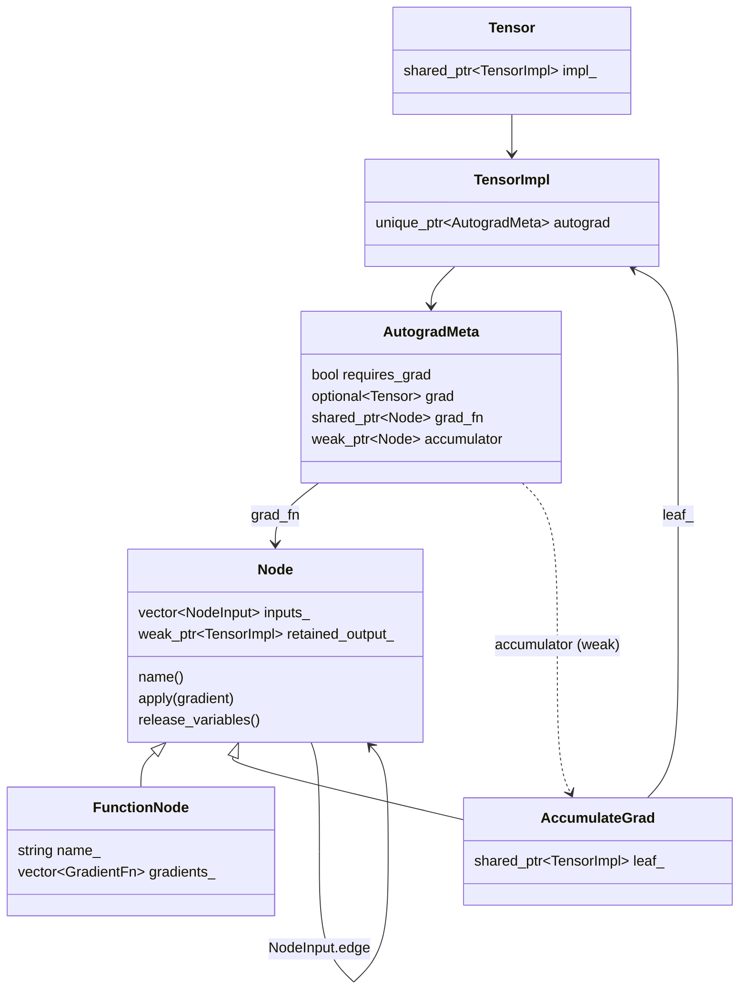
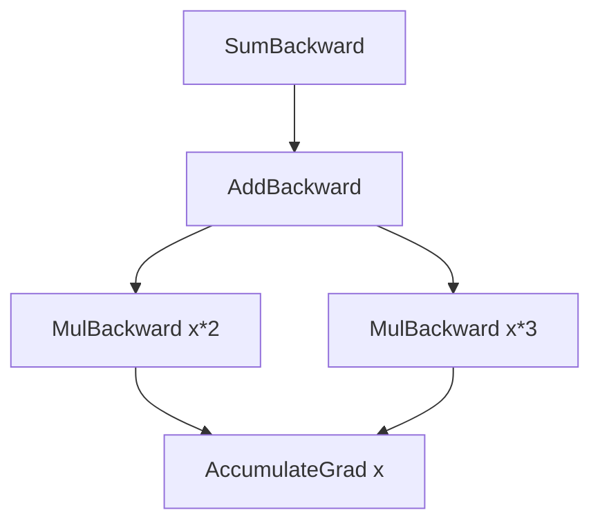

# 06. Autograd

This chapter builds reverse-mode automatic differentiation. After it, any tensor expression built from kael operations can call `backward()` and every leaf that requires a gradient receives the derivative of the result with respect to itself. The chapter starts from a 128-line scalar engine in `experiments/micrograd.cpp` and then walks through the tensor engine that the rest of the library uses: the graph data structures, how operations record history, the engine that walks the graph, the derivative formulas, and the finite-difference checker that tests them. It maps to the autograd phase of the project (commit `feat(autograd): add reverse-mode engine, formulas and gradcheck`, preceded by `feat(experiments): add scalar micrograd`).

| File | Role |
|------|------|
| `experiments/micrograd.cpp` | Scalar warm-up: a `Value` type with `+`, `*`, `tanh`, `exp` and `backward()` |
| `include/kael/autograd/meta.h` | `AutogradMeta`: the per-tensor autograd state stored on `TensorImpl` |
| `include/kael/autograd/node.h`, `src/autograd/node.cpp` | `Node`, `NodeInput`, `Edge`, `AccumulateGrad`, `FunctionNode`, `gradient_edge` |
| `include/kael/autograd/engine.h`, `src/autograd/engine.cpp` | `backward()`: dependency counting, gradient buffers, graph release |
| `include/kael/autograd/grad_mode.h`, `src/autograd/grad_mode.cpp` | Thread-local grad mode, `NoGradGuard`, `EnableGradGuard`, `without_grad` |
| `src/autograd/recording.h`, `src/autograd/recording.cpp` | `SavedTensor`, `should_record`, `set_history`, `sum_to_shape` |
| `src/autograd/record.h` | One `record_*` declaration per differentiable operation |
| `src/autograd/functions_math.cpp` | Binary and unary formulas (add, mul, div, pow, exp, tanh, relu, gelu, ...) |
| `src/autograd/functions_reduce.cpp` | Reductions, softmax, log-softmax, cross entropy, standardize, cumsum |
| `src/autograd/functions_view.cpp` | View and conversion formulas (view, transpose, permute, slice, select, to) |
| `src/autograd/functions_indexing.cpp` | cat, where, masked_fill, index_select, gather |
| `src/autograd/functions_linalg.cpp` | matmul, including the 1-D cases |
| `src/autograd/tensor_autograd.cpp` | The `Tensor` member functions: `requires_grad_`, `grad`, `backward`, `retain_grad`, `detach_`, `version` |
| `include/kael/autograd/gradcheck.h`, `src/autograd/gradcheck.cpp` | Finite-difference gradient checker |
| `include/kael/autograd/functions.h` | Public `sum_to_shape` |

## Prerequisites

- [02. Memory model](02-memory-model.md): `TensorImpl`, `Storage`, the `Tensor` handle.
- [03. Views](03-views.md): views share storage, and the storage version counter.
- [05. Operations](05-operations.md): every operation whose derivative this chapter defines.
- [ADR 0005: define-by-run autograd graph](adr/0005-dynamic-autograd-graph.md) explains why the graph is built while operations run.

## The idea

A program that computes a loss is a composition of primitive functions. Reverse mode applies the chain rule from the output backwards. If `y = f(u)` and `u = g(x)`, then `dy/dx = dy/du * du/dx`. The engine stores, for every intermediate value, the function that produced it and the inputs it read. After the forward pass it visits the values in reverse order and multiplies the incoming gradient by each local derivative.

Two facts shape every design decision below.

1. A value used in several places receives a gradient from each use. The engine must add them, and it must not propagate a node's gradient further until every contribution has arrived.
2. The engine never builds a Jacobian. Each backward function maps the gradient of its output (same shape as the output) to the gradient of each input (same shape as that input). This product of a vector with a Jacobian is cheap: for `y = a * b` the backward of `a` is `g * b`, an elementwise product, not a diagonal matrix.

## Warm-up: scalar micrograd

`experiments/micrograd.cpp` is a scalar engine in the style of Karpathy's micrograd. It is built as the `micrograd` executable and registered as a CTest test in `tests/CMakeLists.txt`. Read it first: every concept of the tensor engine appears here in miniature.

From `experiments/micrograd.cpp`:

```cpp
struct Node {
    double data = 0.0;
    double grad = 0.0;
    std::vector<std::shared_ptr<Node>> parents;
    std::function<void(Node&)> propagate;
};
```

A `Value` is a handle to a shared `Node`. Each operator computes the result and attaches a `propagate` closure that pushes the output's gradient into the parents.

From `experiments/micrograd.cpp`:

```cpp
friend Value operator*(const Value& a, const Value& b) {
    return Value::derived(a.data() * b.data(), {a.node_, b.node_}, [](Node& out) {
        out.parents[0]->grad += out.parents[1]->data * out.grad;
        out.parents[1]->grad += out.parents[0]->data * out.grad;
    });
}
```

The `+=` is the accumulation rule. `backward()` performs a depth-first topological sort, seeds the root with `1.0` and calls `propagate` in reverse topological order, so every node runs after all the nodes that consume it.

From `experiments/micrograd.cpp`:

```cpp
std::function<void(Node*)> visit = [&](Node* node) {
    if (!visited.insert(node).second) {
        return;
    }
    for (const auto& parent : node->parents) {
        visit(parent.get());
    }
    order.push_back(node);
};
visit(node_.get());

node_->grad = 1.0;
std::for_each(order.rbegin(), order.rend(), [](Node* node) {
    if (node->propagate) {
        node->propagate(*node);
    }
});
```

The test `neuron_matches_hand_derivation` evaluates one neuron `y = tanh(w1*x1 + w2*x2 + b)` with `w1 = 0.5`, `x1 = 2.0`, `w2 = -1.5`, `x2 = 0.5`, `b = 0.25`.

```text
activation = 0.5*2.0 + (-1.5)*0.5 + 0.25 = 0.5
y          = tanh(0.5)                 = 0.462117
slope      = 1 - tanh(0.5)^2           = 0.786448

dy/dw1 = slope * x1 =  1.572895
dy/dx1 = slope * w1 =  0.393224
dy/dw2 = slope * x2 =  0.393224
dy/dx2 = slope * w2 = -1.179672
dy/db  = slope      =  0.786448
```

The other three checks pin down the rules the tensor engine must keep:

- `repeated_input_accumulates`: `a * a` with `a = 3` gives `6`, because both parents of the product are the same node and both `+=` land on it.
- `diamond_waits_for_both_paths`: `x*2 + x*3` with `x = 2` gives `5`. The topological order guarantees that `x` propagates only after both products have added into it.
- `exp_derivative_is_itself`: `exp` reuses its own output, `out.data`, in the backward closure. Saving outputs instead of inputs is a pattern the tensor engine reuses for `exp`, `tanh`, `sigmoid` and `sqrt`.

Three limitations of the scalar design motivate the tensor engine:

| micrograd | Problem at scale | Tensor engine answer |
|-----------|------------------|----------------------|
| Recursive DFS in `backward()` | Stack overflow on long chains | Iterative traversal with explicit stacks |
| `grad` lives on every node | Intermediates hold gradients nobody reads | Only leaves (and `retain_grad` tensors) store `grad` |
| Closures read parent `data` at backward time | Mutating a parent after the forward pass silently corrupts gradients | `SavedTensor` checks a version counter |

## Graph data structures

### Autograd metadata on the tensor

Every `TensorImpl` carries an optional pointer to autograd state. Tensors that never take part in differentiation pay one null pointer.

From `include/kael/tensor_impl.h`:

```cpp
std::unique_ptr<autograd::AutogradMeta> autograd;
```

From `include/kael/autograd/meta.h`:

```cpp
struct AutogradMeta {
    bool requires_grad = false;
    std::optional<Tensor> grad;
    std::shared_ptr<Node> grad_fn;
    std::weak_ptr<Node> accumulator;
};
```

- `requires_grad`: the tensor participates in the graph.
- `grad`: the accumulated gradient. Only leaves and tensors marked with `retain_grad()` fill it.
- `grad_fn`: the node that produced this tensor. A tensor with a null `grad_fn` is a **leaf**.
- `accumulator`: a weak reference to the leaf's `AccumulateGrad` node, so every op that reads the same leaf shares one accumulator.

The `Tensor` accessors are thin reads of this struct.

From `src/autograd/tensor_autograd.cpp`:

```cpp
bool Tensor::requires_grad() const noexcept {
    return impl_->autograd && impl_->autograd->requires_grad;
}

bool Tensor::is_leaf() const noexcept {
    return grad_fn() == nullptr;
}
```

`requires_grad_` refuses two things: changing the flag on a non-leaf, and requesting gradients for a non-floating dtype ("only floating point tensors can require gradients").

### Nodes and edges

**Node** and **edge** are the two graph terms. A node is one backward function. An edge points from a node to the node that receives the gradient of one of its inputs. In kael an edge is a `std::shared_ptr<Node>`, so the graph is owned from the output towards the leaves: holding the loss keeps the whole graph alive, and dropping it frees everything.

From `include/kael/autograd/node.h`:

```cpp
using Edge = std::shared_ptr<Node>;
using GradientList = std::vector<std::optional<Tensor>>;
using GradientFn = std::function<Tensor(const Tensor&)>;

struct NodeInput {
    Edge edge;
    Shape shape;
    DType dtype;
};
```

`NodeInput` stores the shape and dtype of the input as it was at record time. The engine uses them to validate every gradient a node returns.

`Node` is an abstract class with `name()`, `apply(gradient)` and `release_variables()`. Two concrete classes exist.

- `FunctionNode` holds one `GradientFn` per input. `apply` calls each non-null function and returns the list. A null function means "this input does not need a gradient" and produces `std::nullopt`.
- `AccumulateGrad` holds a strong reference to a leaf's `TensorImpl` and adds the incoming gradient into `leaf.autograd->grad`. It has no inputs, so the traversal stops there.



The weak references break the cycles. A leaf owns its meta, the meta must find the accumulator, and the accumulator must reach the leaf. If both directions were strong, neither would ever be freed. The same reasoning applies to `retained_output_` (see `retain_grad` below).

`gradient_edge` returns the edge a new node should point at for one of its inputs: the input's `grad_fn` if it has one, a shared accumulator if it is a leaf that requires grad, and null otherwise.

From `src/autograd/node.cpp`:

```cpp
Edge gradient_edge(const Tensor& t) {
    if (!t.requires_grad()) {
        return nullptr;
    }
    if (Edge function = t.grad_fn()) {
        return function;
    }
    AutogradMeta& meta = *t.impl()->autograd;
    Edge accumulator = meta.accumulator.lock();
    if (!accumulator) {
        accumulator = std::make_shared<AccumulateGrad>(t.impl());
        meta.accumulator = accumulator;
    }
    return accumulator;
}
```

For `y = (a * b).sum()` with `a` of shape `[2, 3]` and `b` of shape `[3]`, both leaves, the recorded graph is:

```text
SumBackward
  MulBackward
    AccumulateGrad   (a)
    AccumulateGrad   (b)
```

## Recording history

### Who records

Each differentiable operation computes its result first and then calls a `record_*` function from `src/autograd/record.h`. The computation runs with gradients disabled, so internal helpers do not record their own nodes; the single `record_*` call adds the one node that represents the whole op.

From `src/ops/binary.cpp`:

```cpp
Tensor add(const Operand& a, const Operand& b) {
    const auto [x, y] = detail::resolve_operands(a, b);
    const DType dtype = detail::add_dtype(x, y);
    Tensor out = autograd::without_grad(
        [&] { return binary_kernel(x.to(dtype), y.to(dtype), detail::kPlus); });
    autograd::record_add(out, x, y);
    return out;
}
```

`without_grad` matters here: `x.to(dtype)` would otherwise record a `ToBackward` node. Fused ops (`softmax`, `log_softmax`, `cross_entropy_losses`, `standardize` in `src/ops/nn.cpp`) follow the same pattern with larger bodies.

### When to record

From `src/autograd/recording.cpp`:

```cpp
bool can_record(const Tensor& output) {
    return GradMode::is_enabled() && is_floating_point(output.dtype());
}

bool should_record(const Tensor& output, std::initializer_list<const Tensor*> inputs) {
    return can_record(output) && std::any_of(inputs.begin(), inputs.end(), [](const Tensor* input) {
               return input->requires_grad();
           });
}
```

An op records when grad mode is on, the output is floating point, and at least one input requires grad. Comparisons, `argmax` and integer ops never record because their outputs are integral or boolean (`NonDifferentiableOpsHaveNoHistory`).

### Attaching the node

`set_history` builds the `FunctionNode` and installs fresh metadata on the output.

From `src/autograd/recording.cpp`:

```cpp
void set_history(const Tensor& output, std::string name, const std::vector<Tensor>& inputs,
                 std::vector<GradientFn> gradients) {
    std::vector<NodeInput> node_inputs;
    node_inputs.reserve(inputs.size());
    for (std::size_t i = 0; i < inputs.size(); ++i) {
        node_inputs.push_back(make_input(inputs[i]));
        if (!inputs[i].requires_grad()) {
            gradients[i] = nullptr;
        }
    }
    auto meta = std::make_unique<AutogradMeta>();
    meta->requires_grad = true;
    meta->grad_fn = std::make_shared<FunctionNode>(std::move(name), std::move(node_inputs),
                                                   std::move(gradients));
    output.impl()->autograd = std::move(meta);
}
```

Nulling the gradient function of an input that does not require grad does two things: the engine skips that computation, and the closure, with any tensors it captured, is destroyed immediately. In `Linear`, `matmul(input, weight.T())` records a closure for the input that captures the weight; when the input is raw data the closure dies at once and the weight is not kept alive by the graph.

### Saved tensors and version counters

Most formulas need forward values: `mul` needs the other operand, `exp` needs its output. They capture a `SavedTensor`.

From `src/autograd/recording.h`:

```cpp
class SavedTensor {
public:
    explicit SavedTensor(const Tensor& t) : data_(t.detach()), version_(t.version()) {}

    [[nodiscard]] const Tensor& get() const {
        KAEL_CHECK(data_.version() == version_,
                   "one of the variables needed for gradient computation has been modified by an "
                   "inplace operation: expected version "
                       << version_ << ", got " << data_.version());
        return data_;
    }
    ...
};
```

Two choices are deliberate.

1. It stores `t.detach()`, a view without autograd metadata. Storing the tensor itself would create a cycle when an op saves its own output: output impl owns meta, meta owns `grad_fn`, `grad_fn` owns the saved output impl. `DetachedSavedOutputDoesNotLeak` checks that the node of `exp(x)` dies with its output.
2. It records the storage version. Every in-place op calls `storage->bump_version()` (see [03. Views](03-views.md)), and views share the counter because it lives on `Storage`. Any write through any alias after the forward pass is detected at backward time.

Example from `AutogradVersion.ModifyingSavedInputThrows`:

```cpp
const Tensor x = leaf({1, 2});
Tensor constant = doubles({3, 4});
const Tensor y = (x * constant).sum();
constant.add_(1);
y.backward();
```

`MulBackward` saved `constant` at version 0. `add_` moves it to version 1. Backward throws `... modified by an inplace operation: expected version 0, got 1`. Without the check, `x.grad` would silently be `[4, 5]` instead of `[3, 4]`.

### In-place ops and autograd

kael does not rebase history for in-place ops. Instead `src/ops/inplace.cpp` rejects every in-place op that would need it while grad mode is on.

From `src/ops/inplace.cpp`:

```cpp
void check_grad_rules(const Tensor& self, const Tensor* source, const char* op) {
    if (!autograd::GradMode::is_enabled()) {
        return;
    }
    KAEL_CHECK(!self.requires_grad() || !self.is_leaf(),
               "a leaf tensor that requires grad is being used in the in-place operation " << op);
    KAEL_CHECK(
        !self.requires_grad(),
        op << " is not supported on a tensor with gradient history; use the out-of-place op");
    KAEL_CHECK(source == nullptr || !source->requires_grad(),
               op << " is not supported with a source that requires grad");
}
```

| Target of `add_` | Grad mode on | Grad mode off |
|------------------|--------------|---------------|
| Plain tensor | allowed, bumps version | allowed, bumps version |
| Leaf with `requires_grad` | throws | allowed (optimizer updates) |
| Non-leaf with history | throws | allowed |
| Source requires grad | throws | allowed |

This keeps the engine small. PyTorch supports in-place ops on graph tensors by rewriting `grad_fn`; that requires per-view base tracking that kael does not have. The cost is that user code must write `y = y + 1` instead of `y.add_(1)` inside a differentiable computation. Optimizers run under `NoGradGuard` and are not affected.

## The engine

`kael::autograd::backward(root, gradient, retain_graph)` is the only entry point. `Tensor::backward` forwards to it.

### Seeding

From `src/autograd/engine.cpp`:

```cpp
Tensor seed_gradient(const Tensor& root, const std::optional<Tensor>& gradient) {
    if (!gradient) {
        KAEL_CHECK_VALUE(root.numel() == 1,
                         "grad can be implicitly created only for scalar outputs, got "
                         "shape "
                             << to_string(root.shape()));
        return ones_like(root);
    }
    ...
    return gradient->to(root.dtype());
}
```

A scalar root gets an implicit gradient of one. A non-scalar root needs an explicit gradient of the same shape. That gradient is the vector in the vector-Jacobian product. `MeanExampleFromHand` passes `[3, 6]` to `mean(x, {1})` for `x` of shape `[2, 3]` and checks that row 0 receives `3/3 = 1` and row 1 receives `6/3 = 2` per element.

### Ordering by dependency count

The engine needs a node to run only after every consumer has delivered its gradient. Instead of a DFS topological sort, it counts, for each node, how many edges reach it from the root's subgraph, then runs Kahn's algorithm.

From `src/autograd/engine.cpp`:

```cpp
std::unordered_map<Node*, std::int64_t> count_dependencies(Node* root) {
    std::unordered_map<Node*, std::int64_t> dependencies;
    std::unordered_set<Node*> visited{root};
    std::vector<Node*> pending{root};
    while (!pending.empty()) {
        const Node* node = pending.back();
        pending.pop_back();
        for (const NodeInput& input : node->inputs()) {
            Node* next = input.edge.get();
            if (next == nullptr) {
                continue;
            }
            ++dependencies[next];
            if (visited.insert(next).second) {
                pending.push_back(next);
            }
        }
    }
    return dependencies;
}
```

The traversal uses an explicit stack, so depth is bounded by heap memory, not by the call stack. `DeepChainBackwardAndDestruction` runs backward through 10000 chained additions.

### The main loop

From `src/autograd/engine.cpp`:

```cpp
while (!ready.empty()) {
    Node* node = ready.back();
    ready.pop_back();

    GradientList gradients;
    if (const auto buffered = buffers.find(node); buffered != buffers.end()) {
        const Tensor incoming = std::move(buffered->second);
        buffers.erase(buffered);
        node->store_retained_gradient(incoming);
        ...
        gradients = node->apply(incoming);
        ...
    }
    if (!retain_graph) {
        node->release_variables();
    }
    // for each input i: check_gradient, add_to_buffer, decrement dependency, push when zero
}
```

Per node, in order:

1. Take the summed gradient out of `buffers`. A node that received no gradient (every path to it returned `nullopt`) skips `apply` but still releases its inputs' dependency counts, so the loop always terminates.
2. Store it for `retain_grad` if requested.
3. Call `apply` to get one optional gradient per input.
4. Unless `retain_graph`, call `release_variables()`, which clears the `GradientFn` list and with it every `SavedTensor`. This frees forward activations as soon as they are no longer needed, and makes a second `backward()` through the same node fail with `Trying to backward through the graph a second time (...); specify retain_graph=true`.
5. For each input edge, validate the gradient with `check_gradient` (shape and dtype must equal the recorded `NodeInput`), add it into the target's buffer, decrement the target's count, and push the target when the count reaches zero.

Buffer accumulation is out of place.

From `src/autograd/engine.cpp`:

```cpp
void add_to_buffer(std::unordered_map<Node*, Tensor>& buffers, Node* node, const Tensor& gradient) {
    const auto [slot, inserted] = buffers.try_emplace(node, gradient);
    if (!inserted) {
        slot->second = slot->second + gradient;
    }
}
```

The first gradient is stored by handle, without a copy. It may alias a tensor that a formula returned unchanged (for example `AddBackward` returns `g` itself to both inputs). An in-place `add_` on it would corrupt the other consumer's value, so the sum allocates a new tensor.

The whole `backward` body runs under `NoGradGuard`, so the formula computations do not record history. The consequence: kael computes first-order gradients only. There is no `create_graph` option.

### Worked trace: the diamond

`y = (x*2 + x*3).sum()` with `x = [1, 2]`:



Dependency counts: `AddBackward` 1, each `MulBackward` 1, `AccumulateGrad` 2.

```text
step  pop             incoming   outputs                   counts after
1     SumBackward     1          [1, 1] -> Add             Add 0  -> push
2     AddBackward     [1, 1]     [1, 1] -> M1, [1, 1] -> M2   M1 0, M2 0 -> push both
3     MulBackward x*3 [1, 1]     [3, 3] -> X               X 1
4     MulBackward x*2 [1, 1]     [2, 2] -> X (buffer 5, 5) X 0 -> push
5     AccumulateGrad  [5, 5]     x.grad = [5, 5]
```

`AccumulateGrad` runs once, with the sum. This is `DiamondWaitsForBothPaths` in `tests/test_autograd_engine.cpp`.

### Accumulating into leaves

From `src/autograd/node.cpp`:

```cpp
void accumulate(TensorImpl& target, const Tensor& gradient) {
    if (!target.autograd) {
        return;
    }
    std::optional<Tensor>& stored = target.autograd->grad;
    if (stored) {
        stored->add_(gradient);
    } else {
        stored = gradient.clone();
    }
}
```

The first gradient is cloned so `x.grad` never aliases an engine buffer or a saved tensor (`GradIsACopyOfThePropagatedGradient`). Later gradients are added in place, because the stored gradient is owned by the leaf. This is why gradients accumulate across `backward()` calls until `zero_grad()` resets the optional (`LeafSharedByTwoGraphsAccumulates`: `(x*2).sum()` then `(x*3).sum()` leaves `x.grad = [5, 5]`). The early return handles tensors detached in place, described below.

### Gradient mode

From `src/autograd/grad_mode.cpp`:

```cpp
thread_local bool grad_enabled = true;
```

The flag is per thread. `GradModeGuard` saves the previous value and restores it in its destructor, so guards nest and survive exceptions (`NestedGuardsRestoreInOrder`, `ExceptionRestoresState`). `NoGradGuard` and `EnableGradGuard` are the two fixed-value subclasses, and `without_grad(f)` runs `f` under a `NoGradGuard` and returns its result.

A thread-local flag interacts with the thread pool from [08. CPU performance](08-cpu-performance.md). A kernel launched from a `NoGradGuard` scope runs its chunks on worker threads whose own flag is still `true`. `src/parallel.cpp` copies the caller's mode into each job.

From `src/parallel.cpp`:

```cpp
Job(std::int64_t begin, std::int64_t end, std::int64_t chunk_size, const ParallelBody& body)
    : begin_(begin), end_(end), chunk_size_(chunk_size), body_(body),
      grad_enabled_(autograd::GradMode::is_enabled()) {}

void work() noexcept {
    const autograd::GradModeGuard grad_mode(grad_enabled_);
    ...
```

### `retain_grad`

Intermediate tensors do not store gradients. `retain_grad()` asks the tensor's `grad_fn` to remember the output with a weak reference.

From `src/autograd/tensor_autograd.cpp`:

```cpp
void Tensor::retain_grad() {
    KAEL_CHECK(requires_grad(), "retain_grad needs a tensor that requires grad");
    if (const auto function = grad_fn()) {
        function->retain_output(impl_);
    }
}
```

When the engine pops that node it calls `store_retained_gradient(incoming)` before `apply`, which runs the same `accumulate` used by leaves. On a leaf, `retain_grad` does nothing because leaves already store their gradient. The reference is weak so a retained tensor that goes out of scope is not resurrected by its own graph. `RetainGradStoresIntermediateGradient`: for `middle = x * 3` and loss `(middle * 2).sum()`, `middle.grad = [2, 2]` and `x.grad = [6, 6]`.

### `detach` and `detach_`

`detach()` returns a new view on the same storage with no autograd metadata (`make_view` in `src/view.cpp` copies storage, shape, strides, offset, dtype and device, nothing else). Gradients stop at it: `(x.detach() * x).sum()` gives `x.grad = x`, not `2x` (`CutsTheGradient`). It shares the version counter, so writing through a detached alias of a saved tensor still trips the version check (`ModifyingSavedOutputThroughDetachThrows`).

`detach_()` resets the tensor's own metadata.

From `src/autograd/tensor_autograd.cpp`:

```cpp
Tensor& Tensor::detach_() {
    impl_->autograd.reset();
    return *this;
}
```

The tensor becomes a leaf that does not require grad. Graphs that were already recorded still reference its `TensorImpl`: an `AccumulateGrad` holds it strongly, and a `retain_grad` node holds it weakly. Commit `fix(autograd): skip gradients of tensors detached in place` made `accumulate` return early when `target.autograd` is null. Before that fix, running backward through such a graph dereferenced a null `unique_ptr`. The regression tests are `InPlaceOnALeafInTheGraphSkipsItsGradient` and `InPlaceOnARetainedOutputSkipsItsGradient`. In the second one, `y = x * 2` is retained, then detached in place; backward of `(y * 3).sum()` still reaches `x` (`x.grad = [6, 6]`) because the graph edges are untouched, but `y.grad` stays empty.

### Destroying long graphs

A chain of 50000 additions creates 50000 nodes, each owning the previous through a `shared_ptr`. The default destructor of the last node would destroy its input, whose destructor destroys its input, and so on: one stack frame set per node, enough to overflow the stack. `Node::~Node` flattens that recursion.

From `src/autograd/node.cpp`:

```cpp
// A long chain would otherwise overflow the stack by destroying each node from the previous one.
Node::~Node() {
    std::vector<Edge> pending;
    move_edges_into(pending);
    while (!pending.empty()) {
        const Edge edge = std::move(pending.back());
        pending.pop_back();
        if (edge && edge.use_count() == 1) {
            edge->move_edges_into(pending);
        }
    }
}
```

When `edge` is the last owner of a node (`use_count() == 1`), the loop steals that node's edges before the node dies. The node's own destructor then finds `inputs_` empty and returns at once. Nodes still owned elsewhere (a shared leaf accumulator, a tensor the user still holds) are left alone. `DeepChainDestructionWithoutBackward` builds 50000 nodes and drops them.

## Formulas

Every formula is a lambda `Tensor(const Tensor& g)` where `g` has the output's shape. It must return a tensor of the input's shape and dtype, or the engine rejects it with `Function <name> returned an invalid gradient at index <i>`.

### Broadcasting and `sum_to_shape`

If `a` has shape `[2, 3]` and `b` has shape `[3]`, `a * b` broadcasts `b` to `[2, 3]`. The gradient for `b` comes back as `[2, 3]` and must be reduced: each element of `b` was used twice, so its gradient is the sum over the broadcast dimension.

From `src/autograd/recording.cpp`:

```cpp
Tensor sum_to_shape(const Tensor& gradient, const Shape& target) {
    KAEL_CHECK_VALUE(gradient.dim() >= static_cast<std::int64_t>(target.size()), ...);
    const auto extra = static_cast<std::size_t>(gradient.dim()) - target.size();
    Tensor reduced = gradient;
    if (extra > 0) {
        Dims leading(extra);
        std::iota(leading.begin(), leading.end(), std::int64_t{0});
        reduced = kael::sum(reduced, leading);
    }
    Dims stretched;
    for (std::size_t i = 0; i < target.size(); ++i) {
        if (target[i] == 1 && reduced.shape()[i] != 1) {
            stretched.push_back(static_cast<std::int64_t>(i));
        }
    }
    return stretched.empty() ? reduced : kael::sum(reduced, stretched, true);
}
```

Broadcasting adds leading dimensions and stretches size-1 dimensions. `sum_to_shape` undoes both: it sums away the leading ones, then sums the stretched ones with `keepdim`. With `g = [[1, 2, 3], [4, 5, 6]]`:

| Target | Steps | Result |
|--------|-------|--------|
| `[2, 3]` | none | `g` |
| `[3]` | sum dim 0 | `[5, 7, 9]` |
| `[1, 3]` | dim 0 is stretched, sum keepdim | `[[5, 7, 9]]` |
| `[2, 1]` | dim 1 is stretched, sum keepdim | `[[6], [15]]` |

Every binary formula goes through `matching_input`, which applies `sum_to_shape` and casts back to the input's dtype. The cast handles type promotion: `F32 * F64` computes in `F64`, but the `F32` input must receive an `F32` gradient (`MixedPrecisionInputKeepsItsDtype`).

From `src/autograd/functions_math.cpp`:

```cpp
GradientFn matching_input(const Tensor& input, GradientFn gradient) {
    return [shape = input.shape(), dtype = input.dtype(), gradient = std::move(gradient)](
               const Tensor& g) { return sum_to_shape(gradient(g), shape).to(dtype); };
}
```

### Multiplication

For `y = a * b` elementwise, `dy_i/da_i = b_i`, so the vector-Jacobian product is `g * b`.

From `src/autograd/functions_math.cpp`:

```cpp
void record_mul(const Tensor& out, const Tensor& a, const Tensor& b) {
    if (should_record(out, {&a, &b})) {
        binary_history(
            out, "MulBackward", a, b,
            [saved = SavedTensor(b)](const Tensor& g) { return g * saved.get(); },
            [saved = SavedTensor(a)](const Tensor& g) { return g * saved.get(); });
    }
}
```

Worked example with `a = [[1, 2, 3], [4, 5, 6]]`, `b = [10, 20, 30]`, loss `(a * b).sum()`. `SumBackward` expands the seed `1` to `g = ones([2, 3])`.

```text
a.grad = sum_to_shape(g * b, [2, 3]) = [[10, 20, 30], [10, 20, 30]]
b.grad = sum_to_shape(g * a, [3])    = [1+4, 2+5, 3+6] = [5, 7, 9]
```

The other elementwise formulas follow the same template. A selection:

| Op | Backward | Saves |
|----|----------|-------|
| `add`, `sub` | `g`, `-g` | nothing |
| `div` | `g / b`, `-g * a / b^2` | `a`, `b` |
| `pow` | `g * p * x^(p-1)` (0 where `p == 0`), `g * y * log(x)` (0 where `x == 0`) | base, exponent, output |
| `exp` | `g * y` | output |
| `log` | `g / x` | input |
| `sqrt` | `g / (2y)` | output |
| `tanh` | `g * (1 - y^2)` | output |
| `sigmoid` | `g * y * (1 - y)` | output |
| `relu` | `g * (x > 0)` | input |
| `abs` | `g * sign(x)` | input |
| `clamp` | `g * (min <= x <= max)` | input |
| `maximum`, `minimum` | `g` to the winner, `g/2` to each on a tie | both inputs |

Conventions at non-differentiable points match PyTorch: `relu'(0) = 0` and `abs'(0) = sign(0) = 0` (`ConventionsAtNonDifferentiablePoints`).

### Matrix multiplication

For `C = A B` with `A` of shape `[m, k]` and `B` of shape `[k, n]`, `C_ij = sum_p A_ip B_pj`. Then `dC_ij/dA_ip = B_pj`, and summing over the outputs that `A_ip` touches:

```text
dL/dA_ip = sum_j G_ij B_pj = (G B^T)_ip
dL/dB_pj = sum_i G_ij A_ip = (A^T G)_pj
```

Worked example with `A = [[1, 2], [3, 4]]`, `B = [[5, 6], [7, 8]]`, loss `(A B).sum()`, so `G = ones([2, 2])`:

```text
B^T      = [[5, 7], [6, 8]]
G B^T    = [[11, 15], [11, 15]]   = A.grad
A^T      = [[1, 3], [2, 4]]
A^T G    = [[4, 4], [6, 6]]       = B.grad
```

`record_matmul` also handles 1-D operands and batching. `matmul` treats a 1-D left operand as a row and a 1-D right operand as a column, then removes that dimension from the result. `MatmulLayout` reinserts the dimension in `g` and in the saved operand, applies the two matrix formulas, and squeezes it out again. For batched inputs, `mT()` transposes the last two dimensions and `sum_to_shape` folds broadcast batch dimensions back.

From `src/autograd/functions_linalg.cpp`:

```cpp
[layout, right = SavedTensor(layout.right_matrix(b)), shape = a.shape(),
 dtype = a.dtype()](const Tensor& g) {
    const Tensor gradient = matmul(layout.matrix_gradient(g), right.get().mT());
    const Tensor reduced =
        sum_to_shape(gradient, layout.left_is_vector ? Shape{1, shape[0]} : shape);
    return (layout.left_is_vector ? reduced.squeeze(0) : reduced).to(dtype);
},
```

Note that the gradient for `A` saves `B`, and the gradient for `B` saves `A`. If only `B` requires grad, `set_history` drops the closure that captured `B`.

### Reductions

The gradient of a reduction is the incoming gradient broadcast back over the reduced dimensions, times a local factor. `restore_reduced_dims` reinserts the dimensions that `keepdim = false` removed, and `expand_reduced` broadcasts to the input shape.

| Reduction | Local factor | Notes |
|-----------|--------------|-------|
| `sum` | 1 | |
| `mean` | `1 / count` | `count` is the product of the reduced sizes |
| `prod` | product of the other elements | three cases: no zero, one zero, several zeros |
| `max`, `min` | `1 / ties` on the arg-extremes, 0 elsewhere | `MaxSplitsTiesEvenly` |
| `var` | `2 (x - mean) / (count - correction)` | `correction` 0 or 1 |
| `norm` | `x / norm` | 0 where `norm == 0` |
| `logsumexp` | `softmax(x)` | |

Worked example for `mean`: `x` has shape `[2, 3]`, `y = mean(x, {1})` has shape `[2]`, and the upstream gradient is `[3, 6]`. `restore_reduced_dims` gives `[[3], [6]]`, `expand` gives `[[3, 3, 3], [6, 6, 6]]`, and dividing by `count = 3` gives `[[1, 1, 1], [2, 2, 2]]`.

`prod` avoids dividing by zero. With no zero in the slice it uses `prod / x`. With exactly one zero, only that position gets a non-zero gradient: the product of the others. With two or more zeros every gradient is zero. The implementation computes `others = prod(where(x == 0, 1, x))` and selects among the three cases with `where` (`ProdWithZeros`).

### Softmax and log-softmax

For `y = softmax(x)` along a dimension, `dy_i/dx_j = y_i (delta_ij - y_j)`. Multiply by `g_i` and sum over `i`:

```text
dL/dx_j = sum_i g_i y_i (delta_ij - y_j) = y_j (g_j - sum_i g_i y_i)
```

From `src/autograd/functions_reduce.cpp`:

```cpp
void record_softmax(const Tensor& out, const Tensor& x, std::int64_t dim) {
    if (should_record(out, {&x})) {
        set_history(out, "SoftmaxBackward", {x}, {[y = SavedTensor(out), dim](const Tensor& g) {
                        return y.get() * (g - kael::sum(g * y.get(), {dim}, true));
                    }});
    }
}
```

The formula never forms the `n x n` Jacobian. Worked example with `x = [1, 2, 3]` and `g = [1, 0, 0]`:

```text
y          = [0.0900, 0.2447, 0.6652]
sum(g * y) = 0.0900
g - 0.0900 = [0.9100, -0.0900, -0.0900]
x.grad     = y * (g - 0.0900) = [0.0819, -0.0220, -0.0599]
```

The gradient sums to zero, as it must: adding a constant to every logit does not change a softmax.

For `y = log_softmax(x)`, `dy_i/dx_j = delta_ij - softmax_j`, so `dL/dx = g - exp(y) * sum(g)`. `exp(y)` recovers the softmax from the saved output.

### Cross entropy

`cross_entropy_losses(logits, targets)` in `src/ops/nn.cpp` computes per-row losses `-log softmax(x)[target]` in one fused kernel and records one `CrossEntropyBackward` node. Its gradient with respect to the logits of one row is `softmax(x) - onehot(target)`, scaled by the upstream gradient of that row. `kael::detail::cross_entropy_gradient` computes that directly in one pass per row without materializing a one-hot tensor.

From `src/ops/nn.cpp`:

```cpp
softmax_row(in + row * row_size, result, row_size);
for (std::int64_t i = 0; i < row_size; ++i) {
    result[i] *= weight[row];
}
result[target[row]] -= weight[row];
```

Worked example from `NnLoss.CrossEntropyWorkedExample`, logits `[2, 1, 0.1]`, target 0:

```text
softmax   = [0.6590, 0.2424, 0.0986]
loss      = -log(0.6590) = 0.4170
gradient  = [0.6590 - 1, 0.2424, 0.0986] = [-0.3410, 0.2424, 0.0986]
```

Only `logits` gets an edge; `targets` are integer class indices.

### Layer normalization core

`standardize(x, normalized_dims, eps)` computes `y = (x - mean) / sqrt(var + eps)` over the trailing dimensions. Its backward is the classic layer norm formula, where `sigma = sqrt(var + eps)` and means run over the normalized dimensions:

```text
dL/dx = (g - mean(g) - y * mean(g * y)) / sigma
```

From `src/autograd/functions_reduce.cpp`:

```cpp
const Tensor scale = kael::sqrt(kael::var(saved.get(), dims, true, 0) + eps);
return (g - kael::mean(g, dims, true) -
        y.get() * kael::mean(g * y.get(), dims, true)) /
       scale;
```

`LayerNorm` in [07. Neural networks](07-neural-networks.md) multiplies the result by `weight` and adds `bias`; those get their gradients from the ordinary `MulBackward` and `AddBackward` nodes.

### Views and indexing

View formulas reshape the gradient back to the input's geometry.

| Op | Backward |
|----|----------|
| `view`, `reshape`, `squeeze()` | `g.reshape(input_shape)` |
| `transpose(d0, d1)` | `g.transpose(d0, d1)` |
| `permute(dims)` | `g.permute(inverse(dims))` |
| `unsqueeze(d)` / `squeeze(d)` | `g.squeeze(d)` / `g.unsqueeze(d)` |
| `expand` | `sum_to_shape(g, input_shape)` |
| `slice`, `select` | zeros of the input shape, copy `g` into the slice |
| `cat` | `g.narrow(dim, start, length)` per input |
| `index_select` | zeros, then `index_add_(dim, indices, g)` |
| `gather` | zeros, then `scatter_add_(dim, indices, g)` |
| `where` | `where(mask, g, 0)` and `where(mask, 0, g)`, both reduced with `sum_to_shape` |
| `to(dtype)`, `to(device)` | `g.to(input dtype)`, `g.to(input device)` |

`index_select` and `gather` must add, not assign: an index that appears twice receives both gradients (`IndexSelectAddsRepeatedIndices`). This is what makes `Embedding` correct when a batch repeats a token.

## Gradcheck

Analytic formulas are easy to get subtly wrong. `gradcheck` compares them against central finite differences.

From `include/kael/autograd/gradcheck.h`:

```cpp
struct GradcheckOptions {
    double epsilon = 1e-6;
    double absolute_tolerance = 1e-5;
    double relative_tolerance = 1e-3;
    std::uint64_t projection_seed = 0;
};

using GradcheckFunction = std::function<Tensor(const std::vector<Tensor>&)>;

[[nodiscard]] GradcheckResult gradcheck(const GradcheckFunction& function,
                                        const std::vector<Tensor>& inputs,
                                        const GradcheckOptions& options = {});
```

The function may return a tensor of any shape. Checking the full Jacobian would need one backward per output element. Instead `gradcheck` draws a fixed random tensor `v` of the output's shape (normal, seeded by `projection_seed`) and checks the scalar `L(x) = sum(f(x) * v)`. One backward gives `dL/dx = v^T J` for every input element. A wrong Jacobian entry changes `v^T J` with probability one for a random `v`.

The numeric side perturbs one element at a time in place, evaluates `L` under `NoGradGuard` at `x + eps` and `x - eps`, and restores the value.

From `src/autograd/gradcheck.cpp`:

```cpp
double numeric_derivative(const GradcheckFunction& function, const std::vector<Tensor>& inputs,
                          double& element, const Tensor& weights, double epsilon) {
    const double original = element;
    element = original + epsilon;
    const double above = projected_value(function, inputs, weights);
    element = original - epsilon;
    const double below = projected_value(function, inputs, weights);
    element = original;
    return (above - below) / (2 * epsilon);
}
```

The central difference has error `O(eps^2)`, against `O(eps)` for a forward difference. A pair passes when `|analytic - numeric| <= absolute_tolerance + relative_tolerance * |numeric|`. Failures are collected into `GradcheckResult::report` as `input <i> element [<index>]: analytic <a> != numeric <n>`.

Inputs must be `F64`, require grad and be leaves. `F32` has about 7 significant digits, and with `eps = 1e-6` the difference `f(x + eps) - f(x - eps)` would lose most of them to rounding. Leaves are required because the checker reads `input.grad()` and writes elements through `input.at<double>(index)`.

`Gradcheck.DetectsAWrongGradient` proves the checker can fail: the function returns `x * 2` when grad mode is on (backward sees slope 2) and `x * 3` under `NoGradGuard` (finite differences see slope 3).

## Edge cases and pitfalls

- **Non-scalar roots.** `backward()` without a gradient on a tensor with more than one element throws `grad can be implicitly created only for scalar outputs`. Pass a gradient of the root's shape, or reduce first.
- **Second backward.** Without `retain_graph = true`, nodes release their closures after the first pass. A second pass throws instead of silently computing with freed data (`SecondBackwardWithoutRetainThrows`). With `retain_graph`, leaves accumulate both passes (`RetainGraphAccumulatesInLeaves`).
- **Stale saved tensors.** Any in-place write after the forward pass to a tensor a node saved, through any view or `detach()` alias, throws at backward time. A common way to hit this is calling `optimizer.step()` between a forward pass and its `backward()`: the optimizer updates parameters in place, and a second linear layer saved its weight for the input gradient.
- **In-place on graph tensors.** `add_` and friends on a leaf that requires grad, or on any tensor with history, throw while grad mode is on. Wrap parameter updates in `NoGradGuard`.
- **Gradient accumulation.** Leaf gradients add up across calls. Call `zero_grad()` on each parameter (or `Module::zero_grad`, `Optimizer::zero_grad`) before each step.
- **Detached-in-place tensors inside a live graph.** `detach_()` removes the tensor's metadata but not the graph's references to it. The engine skips the gradient instead of crashing.
- **Dtype and shape mismatches from a formula.** `check_gradient` rejects them with the node name and input index. `InvalidGradientShapeNamesTheNode` injects a `BadNode` to prove the message.
- **Deep graphs.** Traversal, dependency counting and destruction are iterative. Recursion depth does not grow with graph depth.
- **Integer outputs.** Ops with integral or boolean outputs never record, even if an input requires grad.
- **Higher-order gradients.** Not supported. The engine runs under `NoGradGuard`, so gradients have no history.
- **Debug hooks.** Setting `KAEL_TRACE_BACKWARD` in the environment prints each node, its gradient shape and its L2 norm to stderr. `set_anomaly_detection(true)` from `kael/debug.h` makes the engine check every returned gradient for NaN. Both are covered in [13. Serving and tooling](13-serving-and-tooling.md).

## How it is tested

| Test file | Suites | What it proves |
|-----------|--------|----------------|
| `experiments/micrograd.cpp` (CTest `micrograd`) | four boolean checks | The scalar engine matches a hand derivation, accumulates, waits on diamonds |
| `tests/test_autograd_fields.cpp` | `AutogradFields` | Leaf defaults, `requires_grad_` rules, views do not inherit `requires_grad` without history, storage version starts at 0 and is shared by views, every in-place op bumps it, in-place grad rules |
| `tests/test_autograd_grad_mode.cpp` | `GradMode` | Default on, guards restore on scope exit, nesting, exceptions |
| `tests/test_autograd_engine.cpp` | `AutogradEngine`, `AutogradDetach`, `AutogradVersion` | Recording, accumulation (repeated input, triple add, diamond), seeding rules, `retain_graph`, `zero_grad`, gradient copy semantics, invalid gradients, no leak through saved outputs, 10000-node backward and 50000-node destruction, `retain_grad`, `detach`, `detach_` regression tests, version errors |
| `tests/test_autograd_sum_to_shape.cpp` | `SumToShape` | Leading and stretched dimensions, identity, scalar target, too few dimensions |
| `tests/test_autograd_gradcheck.cpp` | `Gradcheck`, `AutogradFormulas` | The checker detects wrong gradients and restores inputs; every formula passes gradcheck on seeded random `F64` inputs (`manual_seed(1234)`), plus hand examples for `mean`, ties in `max`, zeros in `prod`, repeated indices |
| `tests/test_autograd_mlp.cpp` | `AutogradGolden` | A two-layer tanh perceptron with log-softmax and gather matches PyTorch's loss to `1e-12` and gradients of `w1`, `b1`, `w2`, `b2` |

The golden fixture comes from `write_mlp_fixture` in `scripts/generate/golden.py`. It seeds PyTorch with `20260`, builds a 6x4 input, a 5-unit tanh hidden layer and 3 classes in `float64`, runs `loss.backward()` and saves inputs, targets, loss, parameters and gradients as `.npy` files under `tests/golden/mlp/`. The C++ test loads them with `kael::test::read_npy` and replays the same computation.

The `AutogradFormulas` fixture uses helpers that keep inputs in the differentiable region: `positive_input` for `log`, `sqrt` and `pow`; `away_from_zero` for `abs`, `relu` and `prod`, so a finite difference never straddles a kink.

## Build it yourself

1. Write the scalar engine: `Node` with `data`, `grad`, `parents`, `propagate`; `Value` with `+`, `*`, `tanh`, `exp`; DFS `backward()`. Checkpoint: the four checks in `experiments/micrograd.cpp` print `micrograd: gradients match`.
2. Add `AutogradMeta` and the `std::unique_ptr<autograd::AutogradMeta> autograd` field on `TensorImpl`. Implement `requires_grad`, `requires_grad_`, `is_leaf`, `grad`, `zero_grad`, `version`. Checkpoint: `AutogradFields.*` pass.
3. Implement `GradMode` with a `thread_local` flag and the guard classes. Checkpoint: `GradMode.*` pass.
4. Implement `Node`, `NodeInput`, `FunctionNode`, `AccumulateGrad`, `gradient_edge`, `make_input`. Start with a recursive destructor.
5. Implement `should_record`, `set_history` and `SavedTensor` without the version check. Add `record_add` and `record_mul` and call them from `add` and `mul`, computing the result under `without_grad`. Checkpoint: `AutogradEngine.ResultOfOpHasHistory` and `OpWithoutGradInputsHasNoHistory`.
6. Implement the engine: seed, `count_dependencies`, the ready stack, gradient buffers, `check_gradient`, `release_variables`. Checkpoint: `RepeatedInputAccumulates`, `TripleAddAccumulates`, `DiamondWaitsForBothPaths`, `SecondBackwardWithoutRetainThrows`.
7. Implement `sum_to_shape` and route binary formulas through `matching_input`. Checkpoint: `SumToShape.*` and `AutogradFormulas.AddBroadcast`.
8. Write `gradcheck`. Checkpoint: `Gradcheck.*` pass, including `DetectsAWrongGradient`.
9. Add formulas file by file: math, reduce, view, indexing, linalg. Add one `AutogradFormulas` test per op before its formula. Checkpoint: the full `AutogradFormulas` suite passes.
10. Add the version check in `SavedTensor::get` and `check_grad_rules` in the in-place ops. Checkpoint: `AutogradVersion.*` and `AutogradFields.InplaceOnLeafRequiringGradThrows`.
11. Add `retain_grad`, `detach`, `detach_` and the null check in `accumulate`. Checkpoint: `AutogradEngine.RetainGrad*` and `AutogradDetach.*`.
12. Replace the recursive node destructor with the iterative one. Checkpoint: `DeepChainDestructionWithoutBackward` passes; with the recursive version it crashes.
13. Generate the MLP fixture with `scripts/generate/golden.py` and replay it. Checkpoint: `AutogradGolden.TwoLayerPerceptronMatchesPyTorch`.

## Further reading

- Andrej Karpathy, micrograd, and the accompanying lecture "The spelled-out intro to neural networks and backpropagation".
- Baydin, Pearlmutter, Radul, Siskind, "Automatic Differentiation in Machine Learning: a Survey".
- Edward Z. Yang, "PyTorch internals" blog post, and the PyTorch "Autograd mechanics" note.

Next: [07. Neural networks and training](07-neural-networks.md)
