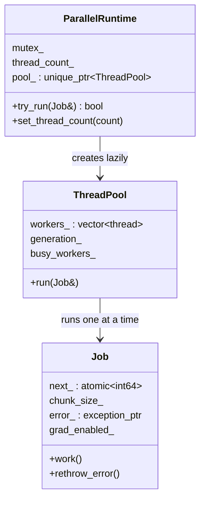
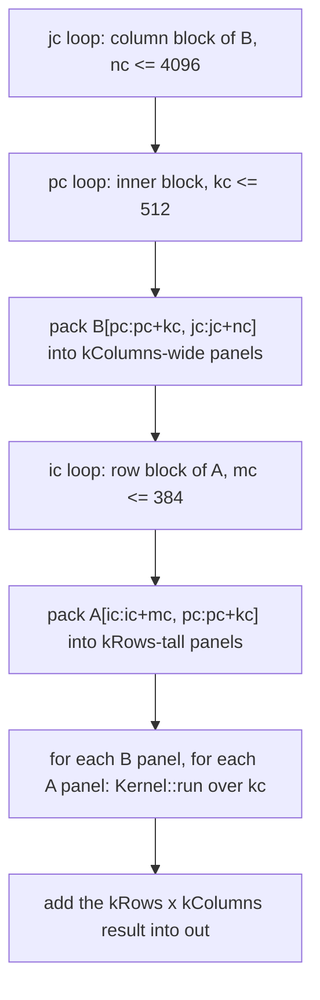

# 08. CPU performance

The previous chapters produce a correct framework that trains an MLP on MNIST. This chapter makes it fast on a CPU without changing any result. It adds a thread pool with a `parallel_for` primitive, splits elementwise kernels and reductions across threads, builds matrix multiplication as a ladder of six versions from a textbook triple loop to a packed, register-blocked, multithreaded kernel, adds a caching block allocator, and fuses softmax, log softmax, layer normalization and cross entropy into single-pass row kernels. It maps to milestone v0.2 (performance) and to the git tag `chapter-09-cpu-performance`.

| File | Role |
|------|------|
| `include/kael/parallel.h` | `parallel_for`, `set_num_threads`, `get_num_threads`, `kElementGrain` |
| `src/parallel.cpp` | `Job`, `ThreadPool`, `ParallelRuntime`, thread count detection, fork handling |
| `include/kael/matmul_versions.h` | The six matmul versions, `blas`, `multiply` dispatch |
| `src/linalg/matmul_versions.cpp` | Loop orders, tiling, packing, micro-kernels, threading, BLAS calls |
| `src/ops/linalg.cpp` | `matmul` front end: batching, dtype dispatch, exact integer path |
| `src/ops/reduce.cpp` | Blocked, lane-split, thread-count-independent reductions |
| `src/ops/nn.cpp` | Fused row kernels for softmax, log softmax, `standardize` and cross entropy |
| `include/kael/allocator.h`, `src/allocator.cpp` | Caching block allocator and its statistics |
| `include/kael/iterator.h` | `TensorIterator::run`, which splits elementwise work |
| `benchmarks/` | Google Benchmark suites and `compare.py` |

## Prerequisites

- [02. Memory model](02-memory-model.md): `Storage`, alignment, and how a tensor owns its bytes.
- [04. TensorIterator](04-tensor-iterator.md): the two-level loop that this chapter parallelizes.
- [05. Operations](05-operations.md): reductions, `matmul`, softmax and their reference semantics.
- [06. Autograd](06-autograd.md): grad mode, which worker threads must inherit.
- [07. Neural networks and training](07-neural-networks.md): `LayerNorm` and `cross_entropy`, which use the fused kernels.

## Where the time goes

Two numbers describe most CPU kernels.

- **Memory traffic**: the bytes a kernel reads and writes in main memory.
- **Arithmetic intensity**: floating-point operations per byte of memory traffic.

A kernel with low arithmetic intensity is bound by memory bandwidth. Adding threads helps only until the memory bus saturates, and SIMD helps little. A kernel with high arithmetic intensity is bound by the arithmetic units, and SIMD and threads both pay off.

Compare elementwise addition and matrix multiplication on `float` data.

| Kernel | Bytes moved | Flops | Intensity |
|--------|-------------|-------|-----------|
| `out = a + b`, n elements | 12n (two reads, one write) | n | 1/12 flop per byte |
| `C += A B`, all n x n | at least 12n^2 | 2n^3 | n/6 flops per byte |

For n = 1024, the matmul does 2 147 483 648 flops on 12 MiB of distinct data. Each element of A and B is used n times. If the kernel reloads operands from main memory every time, it behaves like the addition and wastes that reuse. The whole matmul ladder below is about turning the theoretical reuse into reuse that happens in registers and caches.

Addition cannot be improved that way: each element is used once. For elementwise work the remaining levers are threads (more cores pulling on the memory bus), avoiding per-element index arithmetic (chapter 04), and not allocating.

## The thread pool

### Design

`parallel_for(begin, end, grain, body)` calls `body(first, last)` on disjoint sub-ranges whose union is `[begin, end)`. The caller passes a **grain**: the smallest range worth handing to another thread. Below that size, the cost of waking a thread exceeds the work.

From `include/kael/parallel.h`:

```cpp
inline constexpr std::int64_t kElementGrain = 524288;

using ParallelBody = std::function<void(std::int64_t, std::int64_t)>;

void parallel_for(std::int64_t begin, std::int64_t end, std::int64_t grain,
                  const ParallelBody& body);
```

`kElementGrain` is the grain for one cheap operation per element. Kernels with more work per index divide it by their cost, as the reductions and fused kernels below show.

The runtime has three pieces in `src/parallel.cpp`:



### The parallel_for algorithm

From `src/parallel.cpp`:

```cpp
void parallel_for(std::int64_t begin, std::int64_t end, std::int64_t grain,
                  const ParallelBody& body) {
    KAEL_CHECK_VALUE(grain > 0, "parallel_for grain must be positive, got " << grain);
    const std::int64_t length = end - begin;
    if (length <= 0) {
        return;
    }
    const std::int64_t threads = inside_parallel_region ? 1 : get_num_threads();
    if (length <= grain || threads == 1) {
        body(begin, end);
        return;
    }
    const std::int64_t chunks = threads * kChunksPerThread;
    const std::int64_t chunk_size = std::max(grain, (length + chunks - 1) / chunks);
    Job job(begin, end, chunk_size, body);
    job.start();
    if (ParallelRuntime::instance().try_run(job)) {
        job.rethrow_error();
    } else {
        body(begin, end);
    }
}
```

The range is cut into about `threads * kChunksPerThread` chunks (`kChunksPerThread = 4`), never smaller than the grain. Four chunks per thread give dynamic load balancing: a thread that finishes early takes another chunk instead of waiting for a slow one. The grain floor keeps chunks big enough to amortize scheduling.

Worked example with 8 threads and `grain = kElementGrain = 524288`:

| Range length | Chunks wanted | `chunk_size` | Chunks run |
|--------------|---------------|--------------|------------|
| 100 | none | none | 1 inline call (`length <= grain`) |
| 1 000 000 | 32 | `max(524288, 31250) = 524288` | 2 |
| 4 000 000 | 32 | `max(524288, 125000) = 524288` | 8 |

Adding two 1000 x 1000 tensors therefore uses two chunks. The grain says that splitting a memory-bound add further does not pay.

### Chunk claiming

Each `Job` holds an atomic cursor. Every participating thread, including the caller, loops on `fetch_add`:

```cpp
void work() noexcept {
    const autograd::GradModeGuard grad_mode(grad_enabled_);
    const bool was_inside = std::exchange(inside_parallel_region, true);
    for (;;) {
        const std::int64_t start = next_.fetch_add(chunk_size_, std::memory_order_relaxed);
        if (start >= end_) {
            break;
        }
        try {
            body_(start, std::min(start + chunk_size_, end_));
        } catch (...) {
            keep_first_error(std::current_exception());
            next_.store(end_, std::memory_order_relaxed);
        }
    }
    inside_parallel_region = was_inside;
}
```

Three details matter:

1. Relaxed ordering is enough for the cursor. Each start value is handed out once. The data the body writes is published to the caller by the mutex and condition variable in `ThreadPool::run`.
2. The first exception is kept and rethrown on the calling thread by `rethrow_error`. Storing `end_` into the cursor stops the other threads from claiming new chunks. Without this, an error in one chunk would terminate the process, because `work` is `noexcept` and runs on a worker.
3. Grad mode is thread-local (chapter 06). The job captures the caller's mode and installs it on every worker with `GradModeGuard`. Otherwise a kernel running under `NoGradGuard` would record graph nodes on the workers.

### The pool

`ThreadPool` owns `thread_count - 1` workers. The calling thread is the last participant, so `set_num_threads(4)` means four threads do the work, not five. If starting a worker throws, for example `std::system_error` when the system refuses a new thread, the constructor stops and joins the workers already started before it rethrows. Otherwise the destructors of joinable `std::thread` objects would call `std::terminate`. The `kMaxThreads` limit of 1024 keeps a mistyped count from asking the system for millions of threads.

From `src/parallel.cpp`:

```cpp
void run(Job& job) {
    {
        const std::lock_guard lock(mutex_);
        job_ = &job;
        ++generation_;
        busy_workers_ = workers_.size();
    }
    wake_workers_.notify_all();
    job.work();
    std::unique_lock lock(mutex_);
    workers_done_.wait(lock, [this] { return busy_workers_ == 0; });
    job_ = nullptr;
}
```

Workers sleep on `wake_workers_` and wait for `generation_` to change. A generation counter instead of a boolean flag avoids a missed or doubled wake-up: a worker runs each generation exactly once. The caller waits until every worker has left `job.work()`, because the `Job` lives on the caller's stack.

### One job at a time

`ParallelRuntime::try_run` takes the runtime mutex with `std::try_to_lock`. If another thread already runs a job, the second caller does not queue. It runs its whole range inline on its own thread. Two Python threads calling `matmul` at once therefore both make progress: one uses the pool and the other runs serially. The test `ParallelThreads.SecondCallerDoesNotWaitForTheActiveJob` checks this.

The pool is created on first use. `set_thread_count` resets it, and the next `try_run` builds a new one with the new size.

### Nested parallel regions

`inside_parallel_region` is a `thread_local` flag set by `Job::work`. A `parallel_for` called from inside a body sees it and runs inline:

```cpp
const std::int64_t threads = inside_parallel_region ? 1 : get_num_threads();
```

Nesting happens in practice. Batched `matmul` in `src/ops/linalg.cpp` splits batches with `parallel_for`, and each batch calls `matmul_versions::multiply`, which also uses `parallel_for`. When the batches are split, each matrix runs single-threaded inside its chunk. When the batch grain covers the whole batch, the outer call runs inline on the caller with the flag unset, and the inner matmul uses all threads. Either way the machine is used once, not oversubscribed.

`set_num_threads` refuses to run inside a region (`ParallelThreads.ChangingThreadCountInsideBodyThrows`), because it resets the pool that is running the body.

### Choosing the thread count

From `src/parallel.cpp`:

```cpp
constexpr std::int64_t kMaxThreads = 1024;

std::int64_t default_thread_count() {
    const char* configured = std::getenv("KAEL_NUM_THREADS");
    if (configured == nullptr) {
        return hardware_thread_count();
    }
    char* end = nullptr;
    const std::int64_t parsed = std::strtoll(configured, &end, 10);
    KAEL_CHECK_VALUE(end != configured && *end == '\0' && parsed > 0 && parsed <= kMaxThreads,
                     "KAEL_NUM_THREADS must be an integer between 1 and "
                         << kMaxThreads << ", got '" << configured << "'");
    return parsed;
}
```

The order is:

1. `set_num_threads(count)` at runtime. It rejects a count outside `1..kMaxThreads` (1024) with `ValueError`.
2. `KAEL_NUM_THREADS`, read once when the runtime is first used. Values such as `abc`, `0`, `-2`, `4x` or `100000` throw `ValueError` instead of being ignored, so a typo does not fall back to the hardware count unnoticed.
3. `hardware_thread_count()`. On Apple platforms it reads `hw.perflevel0.physicalcpu`, the number of performance cores, because efficiency cores slow matmul and elementwise kernels down: a static split gives them the same share of work as a fast core. Elsewhere it uses `std::thread::hardware_concurrency()`, at least 1.

```bash
KAEL_NUM_THREADS=1 build/tests/kael_tests --gtest_filter='MatmulVersions*'
```

### Fork safety

After `fork()`, the child has a copy of the parent's memory but only the thread that called `fork`. The pool's worker threads do not exist in the child. Calling into the pool would wait forever for workers that never answer. Destroying it would try to join threads that do not exist. A mutex held by a parent thread at the moment of the fork would stay locked forever.

`ParallelRuntime` registers a `pthread_atfork` child handler on POSIX systems:

```cpp
// The workers do not exist in a forked child, so the pool can be neither used nor destroyed.
void forget_threads_after_fork() {
    new (&mutex_) std::mutex;
    [[maybe_unused]] const auto* forgotten = pool_.release();
    inside_parallel_region = false;
}
```

The child rebuilds the mutex in place, leaks the pool object on purpose, and clears the region flag. The next `parallel_for` in the child creates a fresh pool. This matters for Python: `multiprocessing` with the `fork` start method, and data loaders built on it, fork a process that already ran kael kernels.

## Splitting elementwise work

`TensorIterator::run` in `include/kael/iterator.h` is the single place where elementwise kernels go parallel:

```cpp
template <typename InnerLoop> void TensorIterator::run(InnerLoop&& inner_loop) const {
    check_runs_on_host();
    if (element_count_ == 0) {
        return;
    }
    parallel_for(0, element_count_, kElementGrain, [&](std::int64_t first, std::int64_t last) {
        run_range(first, last, inner_loop);
    });
}
```

The split is over the linear element index of the coalesced iteration space. `run_range` converts `first` into a multi-dimensional counter once, then walks the two-level loop from chapter 04 until `last`. Each chunk writes a disjoint part of the output, so no synchronization is needed. Every binary, unary, comparison, `where`, `clamp` and dtype conversion kernel inherits threading from this one call.

Every element is computed by the same expression whatever the chunk boundaries are, so elementwise results do not depend on the thread count. `ParallelIterator.ResultsDoNotDependOnThreadCount` checks it.

## Splitting reductions

Reductions have two shapes of parallelism, and `src/ops/reduce.cpp` uses both.

### Many outputs

`sum(x, {1})` on a `[1000, 1000]` tensor produces 1000 independent outputs. `reduce_chunks` splits the output index:

```cpp
const std::int64_t grain =
    std::max<std::int64_t>(1, kElementGrain / std::max<std::int64_t>(1, size));
parallel_for(0, reduction.output_count, grain, [&](std::int64_t first, std::int64_t last) {
```

The grain is counted in outputs, so it is `kElementGrain` divided by the number of elements each output reads (`size`). With `size = 1000` the grain is 524 outputs.

### One long output

`sum(x)` over 1 000 000 elements has one output. Splitting the output index gives nothing to split. `reduce_in_blocks` cuts the input into fixed blocks of `kReductionBlock = 16384` elements, reduces each block, and combines the partial results with a pairwise tree:

```cpp
// The blocks do not depend on the thread count, so floating-point results are reproducible.
template <typename Value, typename Block, typename Combine>
Value reduce_in_blocks(std::int64_t size, Value initial, Block block, Combine combine) {
    if (size <= kReductionBlock) {
        return combine(initial, block(0, size));
    }
    const std::int64_t block_count = (size + kReductionBlock - 1) / kReductionBlock;
    std::vector<Value> partial(static_cast<std::size_t>(block_count));
    parallel_for(0, block_count, kElementGrain / kReductionBlock,
```

Floating-point addition is not associative. If the partial sums followed thread boundaries, `sum(x)` with 4 threads would differ in the last bits from `sum(x)` with 8 threads. Here the block boundaries depend only on the size, and the tree combines partials in a fixed order, so the result is bit-identical for any thread count. `ParallelReduce.ResultsDoNotDependOnThreadCount` tests that.

For 1 000 000 elements there are 62 blocks (61 full blocks and one of 576 elements). The grain is `524288 / 16384 = 32` blocks, so at most two chunks run.

### Vectorizable accumulation

Inside a block, `fold_lanes` keeps eight independent accumulators:

```cpp
// Independent accumulators let the compiler vectorize without reordering a single accumulator.
template <typename Value, typename Term, typename Combine>
Value fold_lanes(std::int64_t first, std::int64_t last, Value identity, Term term,
                 Combine combine) {
    std::array<Value, kLanes> lanes;
    lanes.fill(identity);
```

A loop `total += x[i]` has a dependency chain through `total`. The compiler cannot vectorize it without `-ffast-math`, because reordering changes the rounding. Eight explicit lanes make the order part of the program, so the compiler can map lanes onto SIMD registers and stay exact with respect to the source. Floating-point sums accumulate in `double` (`Accumulator<In>`), and integer sums in `std::int64_t`.

The pairwise tree also improves accuracy. A running total adds every term to one ever-growing value, so rounding error builds up over all n additions. Here each partial covers at most 16384 terms split over eight lanes, and the partials meet in a tree of depth log2 of the block count. `ParallelReduce.LongSumIsMoreAccurateThanRunningTotal` sums 2^24 copies of 0.1 in `double` and checks that the result is closer to the exact value than a running total.

## The matmul ladder

`src/linalg/matmul_versions.cpp` keeps every step of the optimization as a separate function, all with one signature:

```cpp
struct Sizes {
    std::int64_t rows;
    std::int64_t inner;
    std::int64_t columns;
};

template <typename T> void v1_ijk(const T* a, const T* b, T* out, const Sizes& sizes);
```

`a` is `rows x inner`, `b` is `inner x columns`, both row-major and contiguous. Every version computes `out += a * b`: it accumulates into `out`. The caller zero-fills the output first (`multiply_batches` uses `zeros`). Accumulation lets the same function serve as a building block for blocked loops and matches BLAS with `beta = 1`.

All versions are instantiated for `float` and `double` and are tested against the same reference.

### v1: ijk

```cpp
for (std::int64_t i = 0; i < rows; ++i) {
    for (std::int64_t j = 0; j < columns; ++j) {
        T total{0};
        for (std::int64_t k = 0; k < inner; ++k) {
            total += a[i * inner + k] * b[k * columns + j];
        }
        out[i * columns + j] += total;
    }
}
```

The inner loop walks `b` down a column with stride `columns`. Each access touches a new cache line and uses one `float` of its 16. For n = 1024 the stride is 4096 bytes, which also maps every access in the column onto few cache sets. This version is the baseline.

### v2: ikj

Swapping the two inner loops makes every inner access unit-stride:

```cpp
for (std::int64_t i = 0; i < rows; ++i) {
    T* out_row = out + i * columns;
    for (std::int64_t k = 0; k < inner; ++k) {
        const T a_ik = a[i * inner + k];
        const T* b_row = b + k * columns;
        for (std::int64_t j = 0; j < columns; ++j) {
            out_row[j] += a_ik * b_row[j];
        }
    }
}
```

The inner loop is now `out_row[j] += scalar * b_row[j]`, an AXPY that the compiler vectorizes. The weakness is reuse: for each `i`, the whole of `b` streams through the cache. Once `b` is larger than the cache, every row of the output reloads `b` from memory.

`multiply` uses v2 for small problems, where packing overhead would dominate.

### v3: tiled

Cache blocking restricts the loops to tiles that fit in cache, so a tile of `b` is reused for many rows before it is evicted. `kTileBlocks{64, 256, 2048}` gives 64 rows, 256 inner and 2048 columns per tile:

```cpp
for (std::int64_t jc = 0; jc < columns; jc += kTileBlocks.columns) {
    const std::int64_t j_end = std::min(columns, jc + kTileBlocks.columns);
    for (std::int64_t pc = 0; pc < inner; pc += kTileBlocks.inner) {
        const std::int64_t k_end = std::min(inner, pc + kTileBlocks.inner);
        for (std::int64_t ic = 0; ic < rows; ic += kTileBlocks.rows) {
```

For `float`, a 256 x 2048 tile of `b` is 2 MiB, read once per 64-row band. The inner loop is still the v2 AXPY, so `out` is read and written once per `k`. The output row segment of 2048 floats is 8 KiB, small enough to stay in L1 across the 256 `k` steps of a tile.

The remaining cost is that each `out` element is loaded and stored `inner` times. The arithmetic units wait on loads and stores, not on multiplies.

### v4: packed with a register micro-kernel

The fix is the structure used by GotoBLAS and BLIS. Compute a small `kRows x kColumns` block of the output entirely in registers, across the whole `k` range of a block, and store it once. To feed that micro-kernel with unit-stride loads, copy (**pack**) the operands into the order the kernel reads them.



The block sizes are `kPackedBlocks{384, 512, 4096}`, rounded up to multiples of the micro-kernel shape.

The packed layout of a B panel puts the `kColumns` values of row `k` next to each other, then row `k + 1`, and so on. The packed A panel stores the `kRows` values of column `k`, then column `k + 1`. From `pack_rows`:

```cpp
for (std::int64_t top = 0; top < rows; top += Kernel::kRows) {
    const std::int64_t height = std::min(Kernel::kRows, rows - top);
    for (std::int64_t k = 0; k < inner; ++k) {
        for (std::int64_t i = 0; i < height; ++i) {
            packed[i] = a[(top + i) * stride + k];
        }
        std::fill(packed + height, packed + Kernel::kRows, T{0});
        packed += Kernel::kRows;
    }
}
```

Packing a 10 x 3 block of A with `kRows = 4`:

```text
A rows 0..9, columns k = 0..2

panel 0 (rows 0..3):  a00 a10 a20 a30 | a01 a11 a21 a31 | a02 a12 a22 a32
panel 1 (rows 4..7):  a40 a50 a60 a70 | a41 a51 a61 a71 | a42 a52 a62 a72
panel 2 (rows 8..9):  a80 a90  0   0  | a81 a91  0   0  | a82 a92  0   0
```

Edges are zero-padded, so the micro-kernel always runs a full `kRows x kColumns` shape with no bounds checks. `multiply_row_block` copies only the valid `height x width` part of the result back into `out`.

Packing costs one extra read and write of each operand block. In exchange:

- The micro-kernel reads both panels with unit stride, which is the best case for the hardware prefetcher.
- A panel of B (`kc * kColumns` elements, 24 KiB for `float` with `kc = 512` and `kColumns = 12`) is reused for every A panel in the row block.
- Each output element is loaded and stored once per `kc` block instead of once per `k`.

The micro-kernel for v4 is `GenericKernel<T, 4, 4>`: a 4 x 4 accumulator array in plain C++.

```cpp
static void run(const T* a, const T* b, std::int64_t inner, T* result) {
    std::array<T, static_cast<std::size_t>(Rows * Columns)> accumulators{};
    for (std::int64_t k = 0; k < inner; ++k) {
        for (std::int64_t i = 0; i < Rows; ++i) {
            const T a_value = a[i];
            T* row = accumulators.data() + i * Columns;
            for (std::int64_t j = 0; j < Columns; ++j) {
                row[j] += a_value * b[j];
            }
        }
        a += Rows;
        b += Columns;
    }
    std::copy(accumulators.begin(), accumulators.end(), result);
}
```

Per `k` step it loads 4 + 4 values and does 16 multiply-adds: an intensity of 2 per load, against 1/2 for the AXPY of v2 and v3.

Pack buffers come from `allocate_pack`, which aligns them to `kPackAlignment = 64` bytes, the cache line size of common CPUs.

### v5: SIMD micro-kernel

v5 runs the same packed algorithm with a larger kernel chosen by `SimdKernelFor<T>`. On ARM with NEON (`__ARM_NEON`), `float` uses `NeonFloatKernel`, an 8 x 12 kernel:

```cpp
for (std::int64_t k = 0; k < inner; ++k) {
    const float32x4_t a_low = vld1q_f32(a);
    const float32x4_t a_high = vld1q_f32(a + 4);
    const float32x4_t b0 = vld1q_f32(b);
    const float32x4_t b1 = vld1q_f32(b + 4);
    const float32x4_t b2 = vld1q_f32(b + 8);
    KAEL_FMA_COLUMN(0, b0, 0);
    // ... columns 1 to 11
```

The register budget explains the shape. AArch64 has 32 vector registers of 128 bits. The 8 x 12 output tile is 96 floats, which is 24 registers (`c[12][2]`). Two hold the A column (`a_low`, `a_high`) and three hold the B row (`b0`, `b1`, `b2`). That is 29 registers, with no spills. Each `k` step does 5 loads and 24 vector FMAs (96 scalar multiply-adds), using `vfmaq_laneq_f32` to multiply a vector of A by one lane of B without a separate broadcast.

`double` uses `NeonDoubleKernel`, 6 x 8 with 2-wide vectors: 24 accumulator registers (`c[8][3]`) plus three for A, with B broadcast by `vdupq_n_f64`.

Without NEON, `SimdKernelFor<T>` is `GenericKernel<T, 6, 8>`. The fixed-size accumulator loop is written so that the compiler can vectorize it. Build with `-DKAEL_NATIVE=ON` to compile `kael` with `-march=native` (or `-mcpu=native`) and let the compiler use AVX2 or AVX-512 on x86.

### v6: threaded

v6 is v5 with `Threaded = true`. Two loops run through `run_blocks`, which calls `parallel_for` when threaded and calls the body directly otherwise.

1. Packing B is split by panel, with grain `kElementGrain / panel_elements`.
2. The row blocks of A are split across threads.

The row block size adapts to the thread count so that every thread gets a block:

```cpp
template <typename Kernel, bool Threaded>
std::int64_t row_block_for(std::int64_t rows, std::int64_t largest) {
    if constexpr (Threaded) {
        const std::int64_t threads = get_num_threads();
        return std::min(largest, rounded_up<Kernel::kRows>((rows + threads - 1) / threads));
    } else {
        return largest;
    }
}
```

For 1024 rows, 8 threads and `kRows = 8`, the row block is `min(384, rounded_up<8>(128)) = 128`, giving 8 blocks. With the full 384 rows, only 3 threads would have work.

Each body invocation allocates its own packed A buffer, so threads never share writable scratch memory. The packed B buffer is shared and read-only during the multiply phase.

Small blocks do not go parallel:

```cpp
const bool worthwhile = rows * kc * nc >= kThreadedProblem;
// ...
run_blocks<Threaded>(block_count, worthwhile ? 1 : block_count, ...);
```

`kThreadedProblem` is 128^3. Below it, the grain equals the block count, so `parallel_for` runs everything inline.

Threading does not change results. Each output element is accumulated over `k` in the same order, by the same micro-kernel, whatever row block contains it. `MatmulThreadPartition.MatchesTheSingleThreadResultExactly` compares v6 with 1 thread and with 2 to 16 threads using `kael::equal`, on shapes chosen to produce ragged edges (for example 387 x 513 x 4100 with 4 threads).

### BLAS and Accelerate

`-DKAEL_USE_BLAS=ON` links a system BLAS. On Apple platforms CMake links the Accelerate framework and defines `KAEL_USE_ACCELERATE`. Elsewhere it uses `find_package(BLAS)` and defines `KAEL_USE_CBLAS`. Both paths call the CBLAS interface:

```cpp
cblas_sgemm(CblasRowMajor, CblasNoTrans, CblasNoTrans, rows, columns, inner, 1.0f, a, inner,
            b, columns, 1.0f, out, columns);
```

`beta = 1.0f` keeps the `out +=` contract. The sizes are cast to `int`, the CBLAS index type. Without BLAS, calling `matmul_versions::blas` throws "kael was built without BLAS; configure with KAEL_USE_BLAS=ON".

### Dispatch

From `src/linalg/matmul_versions.cpp`:

```cpp
template <typename T> void multiply(const T* a, const T* b, T* out, const Sizes& sizes) {
    if (blas_available()) {
        blas(a, b, out, sizes);
    } else if (sizes.rows * sizes.inner * sizes.columns <= kSmallProblem) {
        v2_ikj(a, b, out, sizes);
    } else {
        v6_threaded(a, b, out, sizes);
    }
}
```

`kSmallProblem` is 32^3. `matmul` in `src/ops/linalg.cpp` sends only floating-point types to `multiply`. Integer matrices go to `multiply_exact`, an ikj loop in the element type, so that large `i64` values are never rounded through a floating-point kernel (`MatmulDispatch.LargeIntegerMatrixStillUsesExactArithmetic`).

Batched matmul broadcasts the batch dimensions, flattens them, and splits the batch across threads with grain `kWorkPerParallelTask / work`, where `kWorkPerParallelTask` is 2^21 multiply-adds and `work = rows * inner * columns`. Batches of tiny matrices are grouped into one chunk. Batches of large matrices run one at a time with the threaded kernel, as described under nested regions.

## The caching block allocator

A training step allocates and frees the same set of tensor sizes on every iteration. A system allocator call for a multi-megabyte block can map fresh pages, and the first touch of each page costs a page fault. The caching allocator keeps freed blocks and hands them back for the next request of the same size class.

### Size classes

From `src/allocator.cpp`:

```cpp
std::int64_t block_capacity(std::int64_t nbytes) {
    if (nbytes <= kLargestSteppedSize) {
        return (nbytes + kBucketStep - 1) / kBucketStep * kBucketStep;
    }
    KAEL_CHECK(nbytes <= kLargestBucket, "cannot reserve " << nbytes << " bytes");
    return next_power_of_two(nbytes);
}
```

Requests up to 64 KiB round up to a multiple of 512 bytes. Larger requests round up to a power of two. Values printed by a snippet linked against `build/libkael.a`:

| Requested bytes | Capacity |
|-----------------|----------|
| 1 | 512 |
| 24 | 512 |
| 513 | 1024 |
| 65 536 | 65 536 |
| 65 537 | 131 072 |
| 1 000 000 | 1 048 576 |

Rounding trades memory for hit rate. A `[1000, 1000]` `float` tensor (4 000 000 bytes) takes a 4 MiB block and wastes about 5 percent. Exact-size buckets would waste nothing, but tensors whose sizes differ by a few bytes would never share blocks. Requests above 2^62 bytes are rejected before rounding could overflow.

### The cache

`BlockCache` keeps one free list per capacity in an `unordered_map<std::int64_t, std::vector<std::byte*>>`, all guarded by one mutex. `allocate` pops a cached block (a hit) or calls the system allocator (a miss). `release` pushes the block back, unless caching is disabled or the cache would exceed `kMaxCachedBytes` (1 GiB), in which case the block goes back to the system. `try_cache` also catches the `std::bad_alloc` that growing a free list can throw and frees the block instead: caching is optional, and `release` runs from a `noexcept` deleter.

`Storage` holds the capacity in its deleter, so freeing a tensor releases its block to the right bucket. Host blocks come from `::operator new` with `std::align_val_t{Storage::kAlignment}`, 64 bytes, so cached blocks keep the alignment guarantee (`CachingAllocator.ReusedBlocksStayAligned`).

The public API in `include/kael/allocator.h`:

| Function | Effect |
|----------|--------|
| `allocator_stats(Device)` | `reserved_bytes`, `in_use_bytes`, `cached_bytes`, `hits`, `misses` |
| `empty_cache()` | Frees every cached block of both the host and the device cache |
| `set_caching_allocator_enabled(bool)` | Turns caching off (dropping cached blocks) or on |
| `caching_allocator_enabled()` | Current state |

Caching is on by default. Set `KAEL_NO_CACHING_ALLOCATOR` in the environment to start with it off. Builds with `KAEL_ENABLE_SANITIZERS` or `KAEL_ENABLE_TSAN` compile it out with the `KAEL_NO_CACHING_ALLOCATOR` definition, because reused blocks hide use-after-free bugs from AddressSanitizer.

Two lifetime details:

- The caches are allocated with `new` and never destroyed. A tensor with static storage duration can free its block after `main` returns, and the cache must still exist then.
- `install_fork_handlers` registers `pthread_atfork` handlers that lock both cache mutexes before `fork` and release them in the parent and the child. Without them, a thread holding the cache mutex during the fork would leave it locked forever in the child.

The same `BlockCache` class backs the device cache in [chapter 09](09-cuda-backend.md), with `device::allocate` and `device::release` as the system functions.

## Fused row kernels

The composed softmax in chapter 05 is `exp(x - max(x)) / sum(exp(...))`. On a `[N, C]` tensor that is five passes over memory and three temporaries of size N x C. When the reduced dimension is the last one of a contiguous CPU tensor, `src/ops/nn.cpp` uses one kernel per row instead.

### map_rows

```cpp
template <typename T, typename RowKernel>
Tensor map_rows(const Tensor& x, std::int64_t row_size, std::int64_t cost, RowKernel kernel) {
    Tensor out = empty(x.shape(), x.dtype());
    const T* in = x.data_ptr<T>();
    T* results = out.data_ptr<T>();
    const std::int64_t grain = std::max<std::int64_t>(1, kElementGrain / (cost * row_size));
    parallel_for(0, x.numel() / row_size, grain, [&](std::int64_t first, std::int64_t last) {
        for (std::int64_t row = first; row < last; ++row) {
            kernel(in + row * row_size, results + row * row_size, row_size);
        }
    });
    return out;
}
```

`cost` scales the grain to the work per element. `kExponentialCost = 16` reflects that `std::exp` costs far more than an add. `kStandardizeCost = 4` covers the three passes of layer normalization. For softmax over `[1000, 1000]`, the grain is `524288 / (16 * 1000) = 32` rows, so the 1000 rows split into up to 32 chunks.

The fast path is selected by `is_last_dim_of_contiguous`: CPU device, at least one dimension, contiguous, and `dim` naming the last dimension. Any other case falls back to the composed expression, which is correct for every layout.

### Softmax and log softmax

```cpp
template <typename T> void softmax_row(const T* row, T* out, std::int64_t size) {
    const T largest = row_maximum(row, size);
    double total = 0.0;
    for (std::int64_t i = 0; i < size; ++i) {
        out[i] = std::exp(row[i] - largest);
        total += static_cast<double>(out[i]);
    }
    const auto denominator = static_cast<T>(total);
    for (std::int64_t i = 0; i < size; ++i) {
        out[i] /= denominator;
    }
}
```

Three passes over one row, which stays in cache between passes. The max shift keeps `exp` from overflowing. The sum accumulates in `double`. `row_maximum` uses `nan_aware_max`, so a NaN in the row propagates the same way as in the composed path (`FusedKernels.HandlesNonFiniteValuesLikeTheComposedPath`).

`log_softmax_row` computes `x - max - log(sum(exp(x - max)))` without ever forming `log(softmax)`, which would give `-inf` where the softmax underflows to zero.

### Layer normalization

`standardize(t, normalized_dims, eps)` computes `(x - mean) / sqrt(var + eps)` over the trailing `normalized_dims` dimensions. `nn::LayerNorm::forward` calls it and then applies the affine weight and bias. `standardize_row` makes two `double` passes for the mean and the centered sum of squares, then one pass to write the output. The two-pass variance avoids the cancellation of the one-pass formula `E[x^2] - E[x]^2`. The backward pass is recorded separately as `StandardizeBackward` (chapter 06).

### Cross entropy

`cross_entropy_losses(logits, targets)` computes one loss per row on the CPU without materializing `log_softmax`:

```cpp
template <typename T> T cross_entropy_row(const T* row, std::int64_t target, std::int64_t size) {
    const T largest = row_maximum(row, size);
    double total = 0.0;
    for (std::int64_t i = 0; i < size; ++i) {
        total += static_cast<double>(std::exp(row[i] - largest));
    }
    return std::log(static_cast<T>(total)) - (row[target] - largest);
}
```

The gradient is fused too. `record_cross_entropy` stores a `CrossEntropyBackward` node that calls `detail::cross_entropy_gradient`, which writes `softmax(row) * g[row]` and subtracts `g[row]` at the target column, in one pass per row. The composed path (`nll_loss(log_softmax(x), t)`) would build a `log_softmax` node, a `gather` node and a scatter in the backward pass. The benchmark pair `BM_CrossEntropyFused` and `BM_CrossEntropyComposed` measures the difference for `[64, 10]`, `[4096, 65]` and `[1024, 50257]` logits, the last being a GPT-2 vocabulary.

On a CUDA tensor, `cross_entropy_losses` uses the composed path.

## Benchmarks

### Building

Benchmarks use Google Benchmark v1.9.0, fetched by CMake. Build them in Release mode in a separate build directory:

```bash
cmake -S . -B build-release -DCMAKE_BUILD_TYPE=Release -DKAEL_BUILD_BENCHMARKS=ON -DKAEL_BUILD_EXAMPLES=ON
cmake --build build-release --parallel
```

Configuring with both `KAEL_BUILD_BENCHMARKS` and `KAEL_ENABLE_SANITIZERS` fails on purpose: sanitizers distort timings. Add `-DKAEL_USE_BLAS=ON` to also benchmark the BLAS path. It defines `KAEL_BENCH_BLAS` for the benchmark target, which registers `BM_MatmulVersion<blas<float>>`.

### Suites

All suites link into one executable, `build-release/benchmarks/kael_bench`.

| File | Benchmarks | Measures |
|------|------------|----------|
| `bench_matmul.cpp` | `BM_Matmul`, `BM_MatmulVersion<v1_ijk<float>>` to `<v6_threaded<float>>`, `BM_MatmulThreads` | Each ladder step at 256, 512, 1024 and 2048; v6 at 1024 with 1, 2, 4, 5, 8 and 15 threads; reports a `flops` rate |
| `bench_elementwise.cpp` | `BM_NaiveAdd*`, `BM_KernelAdd*`, `BM_ContiguousFromTransposed`, `BM_AddThreads` | The naive index-per-element add in `naive_add.h` against `binary_kernel`, for contiguous, broadcast and transposed inputs; add scaling from 2^13 to 2^23 elements |
| `bench_compare.cpp` | `BM_Compare*`, `BM_CrossEntropyFused`, `BM_CrossEntropyComposed`, `BM_LinearWithBias`, `BM_LinearWithoutBias` | The operations compared with NumPy and PyTorch; fused against composed cross entropy; a `Linear` training step |
| `bench_cuda.cpp` | `BM_Device*` | Device kernels; they report an error and skip without a CUDA device |

Run a subset with a filter:

```bash
build-release/benchmarks/kael_bench --benchmark_filter='BM_MatmulVersion'
KAEL_NUM_THREADS=4 build-release/benchmarks/kael_bench --benchmark_filter='BM_Compare'
```

`BM_MatmulThreads` and `BM_AddThreads` call `set_num_threads` themselves. The other benchmarks use the default thread count or `KAEL_NUM_THREADS`.

### Comparing with NumPy and PyTorch

`benchmarks/compare.py` runs `kael_bench --benchmark_filter=BM_Compare --benchmark_format=json`, times the same operations with NumPy and PyTorch through `timeit` (best of 7 repeats of 5 calls), and times one MNIST epoch with the `mnist_mlp` example and with an equivalent PyTorch model. It prints a Markdown table. It needs `numpy` and `torch` installed and the MNIST files in `data/mnist`.

```bash
scripts/download/mnist.sh
python benchmarks/compare.py --threads 8
```

| Option | Default |
|--------|---------|
| `--bench` | `build-release/benchmarks/kael_bench` |
| `--mnist` | `build-release/examples/mnist_mlp` |
| `--data` | `data/mnist` |
| `--threads` | `torch.get_num_threads()` |

`--threads` sets the PyTorch thread count and exports `KAEL_NUM_THREADS` with the same value before it starts `kael_bench` and `mnist_mlp`, so both libraries use the same number of threads. NumPy follows its BLAS environment variables. `python benchmarks/compare.py --help` describes every option. The repository does not store benchmark results: numbers depend on the machine, so generate them locally.

## Edge cases and pitfalls

- **Empty ranges and empty matrices.** `parallel_for` returns at once when `end <= begin`. `multiply_packed` and `blas` return when any of `rows`, `inner`, `columns` is zero, leaving `out` untouched (`MatmulVersionsEmpty.ZeroSizesLeaveOutputUntouched`). Empty reductions keep their meaning: `sum` of an empty tensor is 0, `prod` is 1 and `mean` is NaN (`ParallelReduce.EmptyReductionsKeepTheirMeaning`). `max`, `min`, `argmax` and `argmin` of an empty dimension throw, because `plan_nonempty_reduction` rejects them.
- **Non-positive grain.** `parallel_for` rejects `grain <= 0` with `ValueError`. Grain formulas such as `kElementGrain / (cost * row_size)` wrap the result in `std::max<std::int64_t>(1, ...)` because the division reaches zero for wide rows.
- **Exceptions in workers.** A body that throws on a worker would call `std::terminate` without the capture in `Job::work`. Integer division by zero inside a parallel elementwise kernel still reaches the caller as an exception (`ParallelIterator.IntegerDivisionByZeroStillThrows`), and the pool keeps working afterwards (`ParallelThreads.PoolKeepsWorkingAfterAnException`).
- **Thread-count-dependent rounding.** Any reduction whose partial sums follow chunk boundaries gives different bits for different thread counts. Reductions use fixed `kReductionBlock` blocks, and matmul keeps a fixed `k` order per element.
- **Lost grad mode.** A kernel that runs autograd-aware code on a worker would see the default grad mode. `Job` copies the caller's mode.
- **Oversubscription.** Nested `parallel_for` calls run inline. A second concurrent caller runs serially instead of creating more threads.
- **Fork.** The child process cannot use the parent's pool or locked mutexes. Both the parallel runtime and the allocator install `pthread_atfork` handlers. The C++ fork test is compiled out under ThreadSanitizer.
- **Edge tiles.** Packing zero-pads partial panels, and `multiply_row_block` copies only `height x width` results back. Shapes that are not multiples of the micro-kernel are tested explicitly.
- **Integer overflow in BLAS sizes.** CBLAS takes `int` dimensions. kael casts with `static_cast<int>`, so a single matrix dimension above 2^31 - 1 is out of reach of the BLAS path.
- **Allocator cap.** The cache never holds more than 1 GiB per device. Blocks released beyond that go back to the system (`CachingAllocator.HugeBlocksAreNotKeptWhenOverTheLimit`). Call `empty_cache()` to return cached memory explicitly.

## How it is tested

| Suite | File | What it proves |
|-------|------|----------------|
| `ParallelThreads` | `tests/test_parallel.cpp` | Every index visited once, non-zero `begin`, grain respected, small ranges inline, exceptions propagate, grad mode copied, nested calls inline, concurrent callers complete, thread count readable but not writable inside a body |
| `ParallelConfig` | `tests/test_parallel.cpp` | `set_num_threads` validation, including a count above `kMaxThreads`; one thread runs the whole range in one call |
| `ParallelFork` | `tests/test_parallel.cpp` | A forked child runs `parallel_for` and allocates `Storage` without hanging, and the parent keeps working |
| `ParallelIterator` | `tests/test_parallel_ops.cpp` | Large ranges split, small ranges do not, every layout writes every element in place, results independent of thread count |
| `ParallelReduce` | `tests/test_parallel_ops.cpp` | Results independent of thread count, many outputs match hand-computed slices, long sums beat a running total in accuracy, empty reductions |
| `MatmulVersions` | `tests/test_matmul_versions.cpp` | Every version matches a reference in `float` and `double` over shapes that exercise edge tiles |
| `MatmulVersionsThreads`, `MatmulThreadPartition` | `tests/test_matmul_versions.cpp` | Bitwise identical results for any thread count and partition |
| `MatmulDispatch` | `tests/test_matmul_versions.cpp` | Integer matmul stays exact |
| `CachingAllocator`, `Allocator` | `tests/test_allocator.cpp` | Bucket sharing, hits and misses, alignment, statistics, `empty_cache`, the 1 GiB cap, disabling mid-life, concurrent use, zero-byte storage, failed reservations, unrepresentable sizes |
| `FusedKernels`, `Softmax`, `LogSoftmax` | `tests/test_ops_nn.cpp` | Fused kernels match the composed path including non-finite values, strided and wide inputs, `standardize` gradcheck |

`python/tests/test_interop.py::test_fork_keeps_parallel_work_running` repeats the fork check from Python with `multiprocessing` and the `fork` start method.

## Build it yourself

1. Write `parallel_for` as a serial loop that calls `body(begin, end)` and validates the grain. Checkpoint: a test that records every visited index and checks each appears once.
2. Add `ThreadPool` with a generation counter, `Job` with an atomic cursor, and the `try_to_lock` runtime. Checkpoint: `ParallelThreads.VisitsEveryIndexOnce` and `ConcurrentCallersAllComplete` pass under `-DKAEL_ENABLE_TSAN=ON`.
3. Capture exceptions and grad mode in `Job::work`, and add the `thread_local` region flag. Checkpoint: `ExceptionReachesCaller`, `GradModeIsCopiedToWorkers` and `NestedCallRunsInline`.
4. Read `KAEL_NUM_THREADS`, detect performance cores, and add the `pthread_atfork` child handler. Checkpoint: `ParallelFork.ChildCanStillRunParallelWork`.
5. Call `parallel_for` from `TensorIterator::run`. Checkpoint: `ParallelIterator.ResultsDoNotDependOnThreadCount`.
6. Rewrite reductions with `fold_lanes` and `reduce_in_blocks`. Checkpoint: `ParallelReduce.ResultsDoNotDependOnThreadCount` and `LongSumIsMoreAccurateThanRunningTotal`.
7. Write `v1_ijk` and a parameterized test against a `double` reference, then add `v2_ikj` and `v3_tiled` to the same test. Checkpoint: `MatmulVersions` passes for odd shapes such as 1 x 1 x 1, 7 x 1 x 13 and 65 x 257 x 31.
8. Write `pack_rows`, `pack_column_panels`, `multiply_row_block` and `GenericKernel`, and wire them as `v4_packed`. Checkpoint: `MatmulVersions` with v4, and `BM_MatmulVersion<v4_packed<float>>` faster than v3 at 1024.
9. Add the NEON kernels (or rely on `GenericKernel<T, 6, 8>` with `KAEL_NATIVE`) as `v5_simd`. Checkpoint: same tests, higher `flops` counter.
10. Thread the packed loop as `v6_threaded` and add `multiply` dispatch. Checkpoint: `MatmulThreadPartition` and `BM_MatmulThreads`.
11. Add the BLAS path behind `KAEL_USE_BLAS`. Checkpoint: configure with `-DKAEL_USE_BLAS=ON` and run `MatmulVersions`.
12. Write `BlockCache`, `block_capacity` and the fork handlers, and route `Storage` through `allocate_block` and `release_block`. Checkpoint: `CachingAllocator.*`, and `ctest` with `-DKAEL_ENABLE_SANITIZERS=ON`.
13. Add `map_rows` with the softmax, log softmax and standardize row kernels, then the fused cross entropy forward and gradient. Checkpoint: `FusedKernels.*` and `BM_CrossEntropyFused` faster than `BM_CrossEntropyComposed`.
14. Build the benchmarks and run `benchmarks/compare.py`. Checkpoint: the table prints with a row for every operation.

## Further reading

- Kazushige Goto and Robert van de Geijn, "Anatomy of High-Performance Matrix Multiplication", the packed-panel structure behind v4 to v6.
- Field Van Zee and Robert van de Geijn, "BLIS: A Framework for Rapidly Instantiating BLAS Functionality".
- Samuel Williams, Andrew Waterman and David Patterson, "Roofline: An Insightful Visual Performance Model for Multicore Architectures".
- Nicholas Higham, "The Accuracy of Floating Point Summation", for pairwise summation error bounds.
- The Google Benchmark user guide.

Next: [09. CUDA backend](09-cuda-backend.md)
