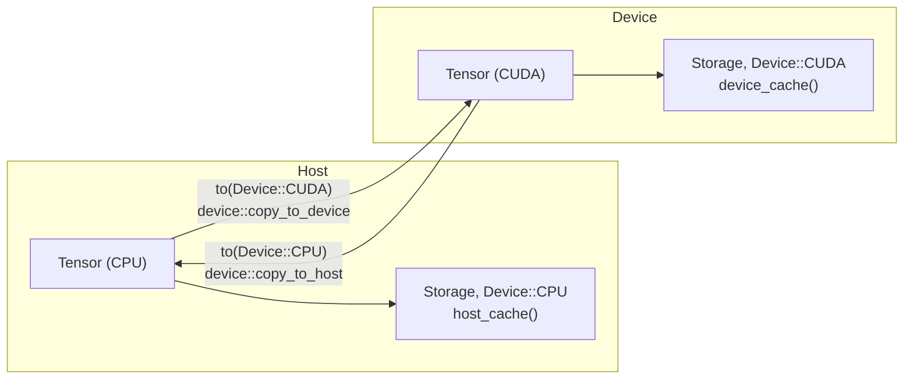
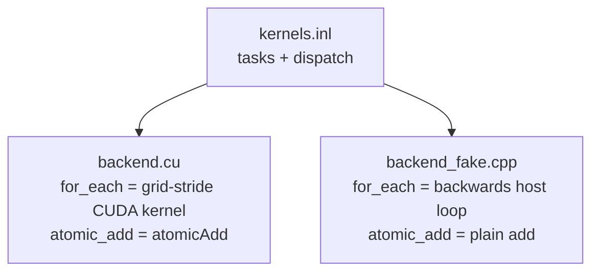

# 09. CUDA backend

This chapter adds a second device. A tensor can live in GPU memory, move between host and device, and run elementwise kernels, reductions, matmul, gather and scatter there, with autograd and `nn` modules working unchanged. The backend is a small C-style interface of about a dozen functions. Three translation units implement it: the real CUDA backend, a host emulation that runs the same kernel code on the CPU, and a stub for builds without CUDA. It maps to milestone v0.3 and to the git tag `chapter-10-cuda`.

The CUDA backend has not yet run on a real GPU. It is validated in two ways: the full device test suite runs against the host emulation (`KAEL_FAKE_CUDA`), and CI compiles the real backend with `nvcc` without executing it. `scripts/test_cuda.sh` and `scripts/send_to_gpu.sh` exist for the first run on real hardware.

| File | Role |
|------|------|
| `include/kael/dtype.h` | `enum class Device { CPU, CUDA }` |
| `include/kael/device.h` | Public `cuda_is_available()` and `cuda_synchronize()` |
| `include/kael/device_kernels.h` | The backend interface in `kael::device`: memory, copies, kernels, layouts |
| `src/device.cpp` | Forwards the public functions to `kael::device` |
| `src/cuda/kernels.inl` | Kernel bodies shared by the real and the emulated backend |
| `src/cuda/backend.cu` | Real backend: CUDA runtime, kernel launcher, optional cuBLAS |
| `src/cuda/backend_fake.cpp` | Host emulation of the device, for tests without a GPU |
| `src/cuda/backend_none.cpp` | Stub that reports CUDA as unavailable and throws on use |
| `src/internal/element_functions.h` | Elementwise functors usable from host and device code (`KAEL_HD`) |
| `src/allocator.cpp` | The device instance of the caching allocator |
| `scripts/cuda/validate.sh`, `scripts/cuda/run_remote.sh` | GPU validation run and remote launcher |

## Prerequisites

- [02. Memory model](02-memory-model.md): `Storage`, `TensorImpl`, and the `Device` field.
- [04. TensorIterator](04-tensor-iterator.md): dimension coalescing, which produces the layouts sent to the device.
- [05. Operations](05-operations.md): the host reference for every kernel in this chapter.
- [06. Autograd](06-autograd.md): backward functions, which must keep gradients on the right device.
- [08. CPU performance](08-cpu-performance.md): the caching allocator reused for device memory.

## The device model

A GPU has its own memory. A pointer into device memory is a valid number on the host, but dereferencing it on the host is undefined. Data reaches the device only through explicit copies, and kernels run on the device only through launches.

kael keeps the device model minimal:

- One device type besides the host: `Device::CUDA`. There is no device index. The Python layer accepts `"cuda"` and `"cuda:0"` as the same device.
- A tensor's `Storage` records its `Device`. Every byte of one storage lives on one device.
- Views share storage, so a view of a CUDA tensor is a CUDA tensor with the same strides and offset rules as on the host.
- Operations require all operands on the same device. There is no implicit transfer.



### The backend interface

`include/kael/device_kernels.h` declares everything the rest of kael may ask of a device. It uses raw `std::byte*` pointers, `DType` tags and plain structs, so it compiles in both a C++ and a CUDA translation unit without templates crossing the boundary.

```cpp
[[nodiscard]] bool available();
void synchronize();

[[nodiscard]] std::byte* allocate(std::int64_t bytes);
void release(std::byte* block) noexcept;
void copy_to_device(std::byte* target, const std::byte* source, std::int64_t bytes);
void copy_to_host(std::byte* target, const std::byte* source, std::int64_t bytes);
void copy_within_device(std::byte* target, const std::byte* source, std::int64_t bytes);

void fill(DType dtype, std::byte* target, std::int64_t count, const void* value);
void convert(DType out, DType in, const ElementLayout& layout);
void elementwise(ElementOp op, DType out, DType in, const ElementLayout& layout,
                 ElementParameters parameters);
void reduce(ReduceOp op, DType out, DType in, std::byte* results, const std::byte* data,
            std::int64_t chunk_size, std::int64_t output_count);
void matmul(DType dtype, const std::byte* a, const std::byte* b, std::byte* out,
            const MatmulSizes& sizes);
void gather(DType dtype, std::byte* out, const std::byte* data, const std::int64_t* indices,
            const IndexLayout& layout);
void scatter_add(DType dtype, std::byte* data, const std::int64_t* indices, const std::byte* source,
                 const IndexLayout& layout);
```

Operations are named by enums. `ElementOp` lists 36 elementwise operations, from `Plus` to `MaskedFill`. `ReduceOp` has `Sum`, `Max` and `Min`. `ElementParameters` carries up to two constants, used by `Clamp` (low and high) and `MaskedFill` (the fill value):

```cpp
// Integer arguments travel apart from real ones: a double cannot hold every int64 exactly.
struct ElementParameters {
    std::array<double, 2> reals{};
    std::array<std::int64_t, 2> integers{};

    template <typename T> [[nodiscard]] T get(std::size_t index) const {
        if constexpr (std::is_integral_v<T>) {
            return static_cast<T>(integers[index]);
        } else {
            return static_cast<T>(reals[index]);
        }
    }
};
```

`Clamp<T>::parameters()` and `MaskedFill<T>::parameters()` fill `integers` for integer `T` and `reals` otherwise, and the device side reads them back with `parameters.get<T>(0)`. A round trip through `double` would round `2^53 + 1` to `2^53`, so an `i64` clamp bound or fill value would lose its low bits (`Cuda.IntegerClampAndMaskedFillKeepEveryBit`).

An alternative design passes C++ functors to the device. That would force every operation file to be compiled by `nvcc`. With enums, only `backend.cu` needs the CUDA compiler, and the rest of kael stays plain C++20.

### Layouts

The host already computes everything a kernel needs to address strided operands: `TensorIterator` coalesces dimensions and computes byte strides for each operand (chapter 04). `ElementLayout` copies that result into a fixed-size struct that can be passed by value to a kernel:

```cpp
inline constexpr int kMaxDims = 8;
inline constexpr int kMaxOperands = 4;

struct ElementLayout {
    int dims;
    int operands;
    std::int64_t count;
    std::int64_t shape[kMaxDims];
    std::int64_t strides[kMaxOperands][kMaxDims];
    std::byte* base[kMaxOperands];
};
```

Fixed arrays are necessary because kernel arguments are copied into constant memory at launch. A `std::vector` would hold a host pointer. `TensorIterator::device_layout()` builds the struct and rejects iteration spaces with more than 8 dimensions after merging, or more than 4 operands (one output plus up to three inputs, enough for `where`). Coalescing makes the limit generous: a contiguous tensor of any rank collapses to one dimension.

Worked example: `a + b` with `a` of shape `[2, 3]` (contiguous, `float`) and `b` of shape `[3]`, broadcast. After coalescing, the layout is:

```text
dims = 2, operands = 3, count = 6
shape          = [2, 3]
strides[0] out = [12, 4]    bytes
strides[1] a   = [12, 4]
strides[2] b   = [ 0, 4]    broadcast dimension has stride 0
base           = [out, a, b] device addresses
```

`IndexLayout` plays the same role for `gather` and `scatter_add`: the index tensor's shape, the axis, and three stride arrays (data, index, source) in elements.

## Moving tensors between devices

From `src/tensor.cpp`:

```cpp
Tensor Tensor::to(Device target) const {
    if (target == device()) {
        return *this;
    }
    const Tensor source = autograd::without_grad([&] { return detach().contiguous(); });
    Tensor out = empty(shape(), dtype(), target);
    if (nbytes() > 0) {
        if (target == Device::CPU) {
            device::copy_to_host(out.device_data(), source.device_data(), nbytes());
        } else {
            device::copy_to_device(out.device_data(), source.device_data(), nbytes());
        }
    }
    autograd::record_to_device(out, *this);
    return out;
}
```

The steps:

1. Same device returns the same tensor handle, not a copy (`Cuda.SameDeviceReturnsTheSameTensor`).
2. The source is made contiguous on its own device first. A transfer is one `memcpy`-style block copy, and a strided view would need one copy per element. `contiguous()` on a CUDA tensor runs the device `convert` kernel.
3. The destination is allocated on the target device with `empty`, and one bulk copy moves the bytes.
4. `record_to_device` adds a `ToDeviceBackward` node whose backward moves the gradient back: `g.to(device)` with the source device. A CPU leaf used on the device therefore receives a CPU gradient (`Cuda.GradientsCrossDevicesBackToTheOrigin`).

`cuda()` and `cpu()` are shorthands for `to(Device::CUDA)` and `to(Device::CPU)`.

`device_data()` returns the address of the first element on any device. `data_ptr<T>()` and other host accessors call `check_on_host()` and throw "this operation reads tensor memory directly, which is not possible on device cuda; call cpu() first" (`Cuda.HostOnlyAccessFailsClearly`). `item()` on a CUDA tensor copies to the host first (`Cuda.ReadingValuesCopiesToHost`).

### Moving in place

`Tensor::move_to_(Device)` replaces the storage, strides and offset of an existing `TensorImpl` with those of a moved copy. Every handle to that tensor sees the new device. `nn::Module::to(Device)` uses it so that optimizers holding parameter handles keep working after the model moves:

```cpp
void Module::to(Device device) {
    const autograd::NoGradGuard guard;
    for (Tensor& parameter : parameters()) {
        parameter.move_to_(device);
        if (const std::optional<Tensor> gradient = parameter.grad()) {
            parameter.impl()->autograd->grad = gradient->to(device);
        }
    }
}
```

`Cuda.ModuleToKeepsParameterIdentityAndValues` and `Cuda.ModuleToMovesExistingGradients` check both properties.

### Factories and scalars

`empty`, `zeros`, `ones` and `full` take a `Device`. `full` on the device calls `device::fill` with the converted value. Random factories (`rand`, `randn`, `randint`) have no device parameter in C++. Generate on the host and call `cuda()`. The Python wrappers do the same with `.to(device)`. Either way one seed produces the same values on both devices, because the generator runs on the host.

A Python or C++ scalar operand follows the tensor's device (`Cuda.ScalarsFollowTheTensorDevice`): `x.cuda() + 1` does not need a device scalar from the caller.

## How operations reach the device

Each operation family has a device branch.

| Family | Device path |
|--------|-------------|
| Elementwise with a tagged functor | `run_typed` in `include/kael/kernels.h` calls `device::elementwise(F::kOp, ...)` |
| Dtype conversion, `contiguous`, `clone` of a strided view | `detail::convert_strided` calls `device::convert` |
| `sum`, `mean`, `max`, `min`, `var`, `std`, `norm` | `device_reduce` in `src/ops/reduce.cpp` calls `device::reduce` |
| `matmul`, `mm`, `bmm` | `multiply_batches` calls `device::matmul` with batch sizes |
| `gather`, `index_select` | `device::gather` |
| `scatter_add_`, `index_add_` | `device::scatter_add` |
| `full`, `zeros`, `ones` | `device::fill` |
| `prod`, `argmax`, `argmin`, `all`, `any`, `sort`, `topk`, `cumsum` | Copy to host, compute, copy back |

The elementwise branch keys off a compile-time tag. Functors in `src/internal/element_functions.h` derive from `Tagged<ElementOp::...>`:

```cpp
template <ElementOp Op> struct Tagged {
    static constexpr ElementOp kOp = Op;
    [[nodiscard]] KAEL_HD ElementParameters parameters() const { return {}; }
};
```

The concept `detail::DeviceFunction<F>` in `include/kael/kernels.h` detects `F::kOp` and `f.parameters()`. A tagged functor on a device tensor becomes one `device::elementwise` call. An untagged functor (a lambda passed to `unary_kernel`, for instance) cannot be named on the device, so `same_dtype_kernel` copies its inputs to the host, runs there, and copies the result back. The fallback keeps every operation correct on the device, at the cost of two transfers.

The functors are the same objects for host and device. `KAEL_HD` expands to `__host__ __device__` under `nvcc` and to nothing otherwise:

```cpp
#if defined(__CUDACC__)
#define KAEL_HD __host__ __device__
#else
#define KAEL_HD
#endif
```

One definition of `GeluTanh` or `nan_aware_max` serves the CPU kernels, the CUDA kernels and the emulation, so the three cannot disagree on semantics such as NaN propagation.

Fused CPU kernels from chapter 08 (softmax, log softmax, `standardize`, cross entropy) check `x.device() == Device::CPU` and take the composed path on the device, built from elementwise and reduce kernels.

## The shared kernel set

`src/cuda/kernels.inl` is included by both `backend.cu` and `backend_fake.cpp`. It is written as a set of **tasks**: function objects whose `operator()(std::int64_t i)` processes one work item. A task knows nothing about threads or blocks. The including file supplies two things before the include:

- `for_each(count, task)`: run `task(i)` for every `i` in `[0, count)`.
- `tasks::atomic_add(target, value)`: add to memory that several work items may hit.



### Elementwise

`tasks::Element<Out, In, Inputs, F>` processes one element. `locate` decomposes the linear index into coordinates, innermost first, and accumulates byte offsets for every operand:

```cpp
KAEL_HD inline void locate(const ElementLayout& layout, std::int64_t element, std::byte** pointers) {
    std::int64_t offsets[kMaxOperands] = {};
    std::int64_t remaining = element;
    for (int dim = layout.dims - 1; dim >= 0; --dim) {
        const std::int64_t position = remaining % layout.shape[dim];
        remaining /= layout.shape[dim];
        for (int op = 0; op < layout.operands; ++op) {
            offsets[op] += position * layout.strides[op][dim];
        }
    }
    for (int op = 0; op < layout.operands; ++op) {
        pointers[op] = layout.base[op] + offsets[op];
    }
}
```

On the CPU, chapter 04 avoids this per-element division with a counter that carries from one element to the next. On a GPU each thread handles independent elements, so the decomposition is per element. Coalescing keeps `dims` small, usually 1 or 2.

With the layout from the `a + b` example, element 4 decomposes as `position = 4 % 3 = 1` in dimension 1 and `1 % 2 = 1` in dimension 0. The offsets are `out: 12 + 4 = 16`, `a: 16`, `b: 0 + 4 = 4` bytes, which address `out[1][1] = a[1][1] + b[1]`.

`elementwise` switches on `ElementOp` and picks a typed runner: `run_same` (output type equals input type), `run_floating` (transcendental functions, `float` or `double` only), or `run_compare` (output `std::uint8_t`, kael's `bool`). `with_type` maps a runtime `DType` to a C++ type with a `switch`. `cast_value` converts the result, mapping any non-zero value to 1 for `bool` outputs and calling `functions::saturating_cast` for float to integer, the device copy of the saturating conversion of chapter [02](02-memory-model.md).

### Reductions

`device::reduce` receives contiguous rows: `output_count` rows of `chunk_size` elements, as planned by `plan_reduction` on the host. Two strategies, chosen by row length:

- Rows of at most `kBlock = 4096` elements: one work item per row (`ReduceRows`).
- Longer rows: for each row, one work item per 4096-element block (`ReduceBlocks`) writes a partial result, then `MergePairs` halves the partial array repeatedly, ping-ponging between two scratch buffers, until one value remains. `StoreResult` copies it into the output.

```text
row of 20000 floats, kBlock = 4096
blocks:   [0..4095] [4096..8191] [8192..12287] [12288..16383] [16384..19999]
partial:     p0         p1           p2            p3             p4         width 5
merge 1:   p0+p1      p2+p3          p4                                      width 3
merge 2: (p0+p1)+(p2+p3)  p4                                                 width 2
merge 3: ((p0+p1)+(p2+p3))+p4                                                width 1
```

The order of additions is fixed by the block size, not by the number of GPU threads, so device sums are deterministic run to run (`Cuda.LongSumsMatchCpuAndAreDeterministic`). Sums accumulate in `double` for floating-point inputs and in `std::int64_t` for integers, matching the CPU. Integer sums use `functions::wrapping_add`, so overflow wraps around as on the CPU (`Cuda.IntegerSumWrapsAndFloatConversionSaturates`). `Max` and `Min` use `nan_aware_max` and `nan_aware_min`.

The scratch buffers come from `allocate` and go back through `release`. Rows are processed one after another on the host side, with three or more launches per row. This is simple and correct. A production backend would reduce all rows in one launch with shared-memory trees.

### Matmul

Without cuBLAS, `MatmulTiles<T>` gives each work item a 4 x 4 tile of one output matrix (`kMatmulTile = 4`) and loops over the full inner dimension:

```cpp
T accumulators[kMatmulTile][kMatmulTile] = {};
for (std::int64_t k = 0; k < sizes.inner; ++k) {
    const T* b_row = batch_b + k * sizes.columns + first_column;
    for (std::int64_t r = 0; r < row_count; ++r) {
        const T a_value = batch_a[(first_row + r) * sizes.inner + k];
        for (std::int64_t c = 0; c < column_count; ++c) {
            accumulators[r][c] = functions::wrapping_add(
                accumulators[r][c], functions::wrapping_multiply(a_value, b_row[c]));
        }
    }
}
```

The tile index encodes the batch, the tile row and the tile column. Edge tiles clip `row_count` and `column_count`. The result is written with `=`, not `+=`: unlike the CPU ladder, the device kernel owns its output tile. This kernel favors clarity. It reads every operand from global memory, with no shared-memory staging, so on real hardware it is expected to be far slower than cuBLAS. It also handles `i64` matrices, which cuBLAS does not; `wrapping_add` and `wrapping_multiply` make their overflow wrap around as on the CPU.

### Gather and scatter

`Gather<T>` and `ScatterAdd<T>` use `locate_index` to compute three positions from one element of the index tensor: where to read the index, where in the data tensor it points (replacing the coordinate on `axis` with the index value), and where in the source to read. `ScatterAdd` uses `atomic_add` because several indices can point at the same destination. On the real device this is `atomicAdd`. The `std::int64_t` specialization reinterprets the target as `unsigned long long`, which has the same two's complement addition.

Index bounds are checked on the host before the launch. `check_device_indices` in `src/internal/index_checks.h` computes `max` and `min` of the index tensor (device reductions) and validates both with `checked_index`. Out-of-range indices throw `IndexError` instead of reading or writing outside the allocation (`Cuda.OutOfRangeIndicesStillThrow`). The price is a device-to-host copy of two scalars per call.

## The real backend

`src/cuda/backend.cu` provides the launcher:

```cpp
inline constexpr int kThreadsPerBlock = 256;
inline constexpr std::int64_t kMaxBlocks = 65535;

template <typename Task> __global__ void run_task(std::int64_t count, Task task) {
    std::int64_t element = blockIdx.x * static_cast<std::int64_t>(blockDim.x) + threadIdx.x;
    const std::int64_t stride = static_cast<std::int64_t>(gridDim.x) * blockDim.x;
    for (; element < count; element += stride) {
        task(element);
    }
}

template <typename Task> void for_each(std::int64_t count, const Task& task) {
    if (count == 0) {
        return;
    }
    const auto blocks =
        static_cast<int>(std::min((count + kThreadsPerBlock - 1) / kThreadsPerBlock, kMaxBlocks));
    run_task<Task><<<blocks, kThreadsPerBlock>>>(count, task);
    KAEL_CUDA_CHECK(cudaGetLastError());
}
```

`run_task` is a **grid-stride loop**: each thread starts at its global index and advances by the total number of threads in the grid. The grid is capped at 65535 blocks, so 256 x 65535 = 16 776 960 threads cover any `count`, with large counts handled by more loop iterations per thread. The index arithmetic is in `std::int64_t` because `count` can exceed 2^31. The task is passed by value, so its layout struct travels with the launch.

Every CUDA runtime call goes through `KAEL_CUDA_CHECK`, which throws `kael::Error` with the call text, file, line and `cudaGetErrorString`. `cudaGetLastError` after a launch catches configuration errors. Errors that occur while the kernel runs surface at the next synchronizing call. `scripts/cuda/validate.sh` runs the device tests with `CUDA_LAUNCH_BLOCKING=1`, which makes every launch synchronous so an error points at the kernel that caused it.

Memory goes through `cudaMalloc` and `cudaFree`. Copies use `cudaMemcpy`, which is synchronous with respect to the host. All launches use the default stream, so kernels run in issue order and a copy to the host waits for the kernels before it. `cuda_synchronize()` calls `cudaDeviceSynchronize`. Benchmarks need it to time kernel execution instead of launch latency (`run_on_device` in `benchmarks/bench_cuda.cpp`).

`available()` returns true when `cudaGetDeviceCount` succeeds with at least one device. A binary built with CUDA still runs on a machine without a GPU: `cuda_is_available()` returns false and the device tests skip.

### cuBLAS

With `-DKAEL_USE_CUBLAS=ON` (and `KAEL_ENABLE_CUDA=ON`), `matmul` sends `f32` and `f64` products to `cublasSgemm` and `cublasDgemm`. Other dtypes still use `MatmulTiles`.

```cpp
// cuBLAS is column-major: for row-major matrices it computes the transpose, Cᵀ = Bᵀ Aᵀ.
template <typename T, typename Gemm>
void cublas_multiply(Gemm gemm, const T* a, const T* b, T* out, const MatmulSizes& sizes) {
    const T one{1};
    const T zero{0};
    for (std::int64_t batch = 0; batch < sizes.batches; ++batch) {
        const cublasStatus_t status = gemm(
            cublas_handle(), CUBLAS_OP_N, CUBLAS_OP_N, static_cast<int>(sizes.columns),
            static_cast<int>(sizes.rows), static_cast<int>(sizes.inner), &one,
            b + batch * sizes.inner * sizes.columns, static_cast<int>(sizes.columns),
            a + batch * sizes.rows * sizes.inner, static_cast<int>(sizes.inner), &zero,
            out + batch * sizes.rows * sizes.columns, static_cast<int>(sizes.columns));
```

The transpose trick avoids any copy. A row-major `M x N` matrix has the same bytes as a column-major `N x M` matrix, its transpose. Asking cuBLAS for `B^T A^T` in column-major order, with B passed first, writes `(A B)^T` in column-major order, which is `A B` in row-major order. The handle is created once in a function-local static. Batches loop on the host with one GEMM call each.

## The host emulation

`src/cuda/backend_fake.cpp` implements the same interface on the CPU. `-DKAEL_FAKE_CUDA=ON` selects it. CMake rejects `KAEL_FAKE_CUDA` together with `KAEL_ENABLE_CUDA`.

```cpp
// Backwards, so that a kernel relying on the order of its elements fails here too.
template <typename Task> void for_each(std::int64_t count, const Task& task) {
    for (std::int64_t i = count; i-- > 0;) {
        task(i);
    }
}

template <typename T> void atomic_add(T* target, T value) {
    *target = static_cast<T>(*target + value);
}
```

"Device" memory is `::operator new`, copies are `std::memcpy`, and `available()` returns true. A tensor on `Device::CUDA` in this build is still a separate allocation reached only through the backend interface, so every rule of the device model applies: host accessors throw, mixed devices are rejected, and every transfer goes through `copy_to_device` and `copy_to_host`.

The emulation exists because the kernels and all the dispatch around them can be tested on any machine:

- The task bodies in `kernels.inl` are the same source that `nvcc` compiles. A wrong stride, a wrong offset or a wrong merge step fails in the emulation exactly as it would on a GPU.
- Running work items in reverse order catches tasks that assume item `i - 1` finished before item `i`. GPU threads give no such guarantee.
- Every device branch in the operations (`on_device()`, `device_layout()`, host fallbacks, autograd across devices, `Module::to`) runs in CI.
- Coverage and clang-tidy jobs build with `KAEL_FAKE_CUDA=ON`, so the device branches count toward coverage and are linted.

The CI job for the emulation also enables AddressSanitizer, so an out-of-bounds access in a task body is reported as a host memory error. Sanitizer builds compile out the caching allocator, so `Cuda.DeviceBlocksAreCached` skips itself in that job.

What the emulation cannot catch: races between GPU threads, launch configuration limits, differences between device and host math functions, behavior specific to the CUDA runtime, and performance. Those need a real GPU and `compute-sanitizer`.

`backend_fake.cpp` defines its own `matmul` (always the tile kernel) because the cuBLAS branch in `backend.cu` does not apply.

## The stub backend

Without either option, `src/cuda/backend_none.cpp` is linked. `available()` returns false, `synchronize()` and `release()` do nothing, and every other function throws:

```cpp
[[noreturn]] void fail_without_cuda() {
    throw Error("kael was built without CUDA; configure with KAEL_ENABLE_CUDA=ON");
}
```

`CudaAbsent.MovingToADeviceThatIsMissingFailsClearly` checks that `cuda()` and `zeros(..., Device::CUDA)` throw `kael::Error` in such a build.

## The device caching allocator

`Storage(nbytes, Device::CUDA)` goes through the same `detail::allocate_block` as host storage. `cache_of(device)` returns `device_cache()`, a second `BlockCache` instance whose system functions are `device::allocate` and `device::release`:

```cpp
BlockCache& device_cache() {
    static auto* cache = new BlockCache(device::allocate, device::release);
    return *cache;
}
```

Size classes, the 1 GiB cap, statistics and `empty_cache()` behave as described in [chapter 08](08-cpu-performance.md). Caching matters more on the device: `cudaMalloc` and `cudaFree` are slow calls and `cudaFree` synchronizes the device, so freeing per tensor would serialize every training step. `allocator_stats(Device::CUDA)` reports the device numbers. `Cuda.DeviceBlocksAreCached` checks that a second allocation of the same size is a hit and that `empty_cache()` drops the cached bytes to zero.

Reduce scratch buffers bypass the cache. They call `device::allocate` and `device::release` directly.

## Build options

| Option | Default | Effect |
|--------|---------|--------|
| `KAEL_ENABLE_CUDA` | `OFF` | Enables the CUDA language, requires `CUDAToolkit`, compiles `src/cuda/backend.cu` as C++20 CUDA, links `CUDA::cudart` |
| `KAEL_USE_CUBLAS` | `OFF` | With `KAEL_ENABLE_CUDA`, links `CUDA::cublas` and defines `KAEL_USE_CUBLAS` |
| `KAEL_FAKE_CUDA` | `OFF` | Compiles `src/cuda/backend_fake.cpp` instead; no CUDA toolkit needed |
| `CMAKE_CUDA_ARCHITECTURES` | CMake default | Target GPU architectures, for example `86` or `native` |

Build the real backend:

```bash
cmake -S . -B build-cuda -DCMAKE_BUILD_TYPE=Release -DKAEL_ENABLE_CUDA=ON -DCMAKE_CUDA_ARCHITECTURES=native
cmake --build build-cuda --parallel
```

Build and test the emulation on any machine:

```bash
cmake -S . -B build-fake -DKAEL_FAKE_CUDA=ON
cmake --build build-fake --parallel
build-fake/tests/kael_tests --gtest_filter='Cuda*'
```

Build the Python package with CUDA:

```bash
pip install --config-settings=cmake.define.KAEL_ENABLE_CUDA=ON \
    --config-settings=cmake.define.CMAKE_CUDA_ARCHITECTURES=native .
```

## Validation status and GPU scripts

The CI workflow `.github/workflows/ci.yml` covers the device code in three ways:

| Job | What runs |
|-----|-----------|
| `linux-clang-fake-cuda` (build matrix entry) | Full `ctest` with `KAEL_FAKE_CUDA=ON` and AddressSanitizer plus UndefinedBehaviorSanitizer: every `Cuda.*` test executes against the emulation |
| `cuda-compile-only` | Configures and builds with `KAEL_ENABLE_CUDA=ON` and `CMAKE_CUDA_ARCHITECTURES=86` in the `nvidia/cuda:12.6.2-devel-ubuntu22.04` container; nothing runs |
| `coverage`, `clang-tidy` | Build with `KAEL_FAKE_CUDA=ON` |

No job executes the real backend on a GPU. Treat the CUDA build as untested on hardware until `scripts/test_cuda.sh` passes on one.

### scripts/test_cuda.sh

Run it on a machine with an NVIDIA GPU, `nvcc` and CMake 3.24 or newer:

```bash
bash scripts/test_cuda.sh [architecture] [build-directory] [report-directory]
```

The defaults are `native`, `build-cuda` and `cuda-report`, and `-h` or `--help` prints this usage. The script runs named steps, logs each one to `<report>/<step>.log`, and writes a PASS, FAIL or SKIP line per step to `<report>/summary.txt`:

1. `environment`, `cmake-version`, `gpu`: record `uname`, CMake, `nvcc`, compiler and `nvidia-smi` output; check that CMake is recent enough and `nvcc` is on `PATH`.
2. `configure`, `build`: Release build with `KAEL_ENABLE_CUDA=ON`, examples and benchmarks.
3. `ctest`: the whole C++ suite.
4. `device-tests`: `kael_tests --gtest_filter='Cuda*:*CudaMatmul*'` with `CUDA_LAUNCH_BLOCKING=1`. The step fails if the output contains "no CUDA device", because a skipped device test must not count as a pass.
5. `compute-sanitizer`: two device tests under NVIDIA's memory checker, if it is installed.
6. `benchmarks`: `kael_bench --benchmark_filter='BM_Device'`.
7. `configure-cublas`, `build-cublas`, `device-tests-cublas`: a second build in `<build>-cublas` with `KAEL_USE_CUBLAS=ON` and the same device tests, so the cuBLAS matmul path runs too.
8. `mnist-cpu`, `mnist-cuda`, `mnist-cuda-1024`: `examples/mnist_mlp` must reach at least 97 percent test accuracy, if `data/mnist` exists.
9. `char-gpt-cuda`, `gpt2-cpp-cuda`: the transformer examples on the device, if their data exists.
10. `python-build` and the Python steps: a virtual environment (with `virtualenv` as a fallback when `python3 -m venv` cannot bootstrap pip) with the package built for CUDA, `kael.cuda_is_available()`, `python/tests/test_cuda.py` with no skips, the full pytest suite, and the Python examples on the device.

The exit status is 0 when every step ran and passed, 1 when a step failed, and 3 when nothing failed but some steps were skipped. Exit status 3 is not a complete pass.

### scripts/cuda_colab.ipynb

Without a GPU machine, open `scripts/cuda_colab.ipynb` in Google Colab with a GPU runtime and run every cell. It clones the repository, downloads MNIST, Tiny Shakespeare and GPT-2 with the `scripts/download_*.sh` scripts, runs `scripts/test_cuda.sh`, prints `summary.txt` and downloads the report as `cuda-report.tgz`.

### scripts/send_to_gpu.sh

`scripts/send_to_gpu.sh user@host [--arch native] [--without-weights] [--no-run]` packs the current commit with `git archive` (uncommitted changes are not sent), adds `data/mnist`, `data/shakespeare` and, unless `--without-weights`, `data/gpt2`, copies them to `kael.cpp-<commit>` on the host over `scp`, runs `scripts/test_cuda.sh` there, and copies the `cuda-report` directory back as `cuda-report-<commit>-<timestamp>`. `--no-run` stops after the copy. Without a host, or when the first argument starts with `-` (such as `--help`), the script prints its usage and exits with status 2.

## Edge cases and pitfalls

- **Host access to device memory.** Every host accessor checks the device. Only `device_data()` returns a device address, and its comment in `include/kael/tensor.h` warns that only device code can dereference it.
- **Mixed devices.** `check_same_device` throws "expected all tensors to be on the same device, but found cpu and cuda" (`Cuda.MixedDevicesAreRejected`). Implicit transfers would hide slow host round trips.
- **Non-contiguous transfers.** `to(Device)` makes the source contiguous first (`Cuda.NonContiguousTensorsTransfer`).
- **Empty tensors.** `to` skips the copy when `nbytes()` is 0. `for_each` returns before launching when `count` is 0, since a launch with zero blocks is an error (`Cuda.EmptyTensorsWork` checks elementwise ops and reductions on empty tensors under the emulation). The cuBLAS branch of `device::matmul` also returns early on a zero dimension. No test exercises it, because cuBLAS has not run on a GPU.
- **Too many dimensions or operands.** `device_layout()` and `index_layout()` throw when the layout exceeds `kMaxDims` or `kMaxOperands` instead of overflowing the fixed arrays.
- **Out-of-range indices.** Checked on the host before launching gather and scatter.
- **64-bit indexing.** Kernel index arithmetic uses `std::int64_t`. A kernel with 32-bit indices would wrap silently above 2^31 elements.
- **Order assumptions.** The emulation runs work items backwards to expose them.
- **Concurrent scatter.** `ScatterAdd` uses atomics. `bool` scatter has no device atomic and runs on the host.
- **Non-determinism.** Device sums are deterministic. `scatter_add` with repeated indices on a real GPU is not: atomic float additions land in an unspecified order.
- **Asynchronous errors.** A fault inside a kernel is reported by a later CUDA call, not the launch. Use `CUDA_LAUNCH_BLOCKING=1` to locate it.
- **Unchecked frees.** `release` calls `cudaFree` without checking, because it runs in `noexcept` destructors.

## How it is tested

`tests/test_cuda.cpp` defines the `Cuda` fixture, which calls `GTEST_SKIP()` when `cuda_is_available()` is false. With `KAEL_FAKE_CUDA=ON` every test runs. Most tests compute the same expression on the CPU and on the device and compare with `expect_matches_cpu`: same device, shape and dtype, and values within `1e-4` for `f32` or `1e-10` for `f64`, NaN equal to NaN.

| Test | What it proves |
|------|----------------|
| `TransfersRoundTrip`, `SameDeviceReturnsTheSameTensor`, `NonContiguousTensorsTransfer`, `CopyBetweenDevicesWorks` | Transfers preserve values and layout semantics |
| `FactoriesCreateOnTheDevice`, `ScalarsFollowTheTensorDevice` | Factories and scalars respect the device |
| `HostOnlyAccessFailsClearly`, `ReadingValuesCopiesToHost`, `MixedDevicesAreRejected` | Device boundary rules |
| `UnaryOpsMatchCpuOnEveryLayout`, `BinaryOpsMatchCpuWithBroadcast`, `DoublePrecisionMatchesCpu`, `IntegerOpsMatchCpu`, `BoolReductionsMatchCpu`, `NonFiniteValuesMatchCpu` | 43 unary and reduction ops on contiguous, transposed and strided inputs, and 19 binary ops with same-shape, row, column and 0-d broadcasts, match the CPU in `f32` and `f64` |
| `LongSumsMatchCpuAndAreDeterministic`, `EmptyTensorsWork` | The block reduction and empty shapes |
| `IntegerClampAndMaskedFillKeepEveryBit`, `IntegerSumWrapsAndFloatConversionSaturates` | `i64` clamp bounds and fill values above 2^53 stay exact; integer sums wrap and float to `i64` saturates as on the CPU |
| `CudaMatmul.MatchesCpu`, `MatmulBatchesVectorsAndIntegersMatchCpu` | Matmul shapes, batches, vectors and `i64` |
| `IndexingMatchesCpu`, `OutOfRangeIndicesStillThrow`, `SteppedIndicesWorkOnTheDevice` | Gather, scatter, index checks |
| `BackwardMatchesCpuAndStaysOnTheDevice`, `GradientsCrossDevicesBackToTheOrigin`, `ViewAndIndexingGradientsMatchCpu`, `GradcheckRunsOnTheDevice` | Autograd on the device and across devices |
| `ModuleToKeepsParameterIdentityAndValues`, `ModuleToMovesExistingGradients`, `LayersMatchCpu`, `TrainingMatchesCpuStepByStep` | `nn` and `optim` on the device |
| `DeviceBlocksAreCached` | The device allocator cache |
| `SequenceOpsMatchCpu`, `GptMatchesCpuIncludingTheCacheAndGeneration` | Host-fallback ops and the full GPT model with KV cache |

`tests/test_cuda_absent.cpp` (`CudaAbsent`) runs in builds without a device. `python/tests/test_cuda.py` repeats the main checks from Python and skips without a device.

## Build it yourself

1. Add `Device` to `Storage` and `TensorImpl`, and write `include/kael/device_kernels.h` with only `available`, `allocate`, `release` and the three copy functions. Checkpoint: the project builds with `backend_none.cpp`.
2. Write `backend_fake.cpp` with `memcpy` copies and `operator new`, and add the `KAEL_FAKE_CUDA` CMake option. Implement `Tensor::to(Device)`, `cuda()`, `cpu()` and `check_on_host`. Checkpoint: `Cuda.TransfersRoundTrip` and `Cuda.HostOnlyAccessFailsClearly` pass with `-DKAEL_FAKE_CUDA=ON`.
3. Route device storage through a second `BlockCache`. Checkpoint: `Cuda.DeviceBlocksAreCached`.
4. Create `kernels.inl` with `Fill` and `device::fill`, and the backwards `for_each`. Checkpoint: `Cuda.FactoriesCreateOnTheDevice`.
5. Add `ElementLayout`, `TensorIterator::device_layout()`, `locate`, `Element`, `convert`, and the `Tagged` functors with `KAEL_HD`. Branch in `run_typed` and `convert_strided`, and add the host fallback for untagged functors. Checkpoint: `Cuda.UnaryOpsMatchCpuOnEveryLayout` and `Cuda.BinaryOpsMatchCpuWithBroadcast`.
6. Add `ReduceRows`, `ReduceBlocks`, `MergePairs`, `StoreResult` and the device branches in `src/ops/reduce.cpp`. Checkpoint: `Cuda.LongSumsMatchCpuAndAreDeterministic`.
7. Add `MatmulTiles` and the device branch of `multiply_batches`. Checkpoint: `CudaMatmul.MatchesCpu`.
8. Add `IndexLayout`, `Gather`, `ScatterAdd` with `atomic_add`, and host-side index checks. Checkpoint: `Cuda.IndexingMatchesCpu` and `Cuda.OutOfRangeIndicesStillThrow`.
9. Add `record_to_device` and `Module::to` with `move_to_`. Checkpoint: `Cuda.TrainingMatchesCpuStepByStep` and `Cuda.GptMatchesCpuIncludingTheCacheAndGeneration`.
10. Write `backend.cu` with the grid-stride `run_task`, `KAEL_CUDA_CHECK` and the CUDA runtime calls, then the optional cuBLAS path. Checkpoint: `cmake -DKAEL_ENABLE_CUDA=ON -DCMAKE_CUDA_ARCHITECTURES=86` builds in the `nvidia/cuda` container.
11. On a GPU machine, run `scripts/cuda/validate.sh`. Checkpoint: exit status 0.

## Further reading

- The CUDA C++ Programming Guide, chapters on the programming model, memory hierarchy and error checking.
- Mark Harris, "Optimizing Parallel Reduction in CUDA", for shared-memory reduction trees.
- The cuBLAS documentation on column-major storage and `cublasSgemm`.
- "CUDA Pro Tip: Write Flexible Kernels with Grid-Stride Loops", from the NVIDIA developer blog.

Next: [10. Python bindings](10-python-bindings.md)
