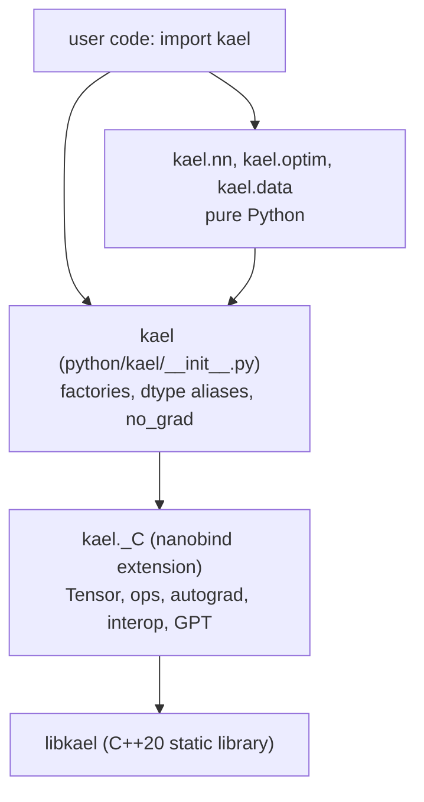
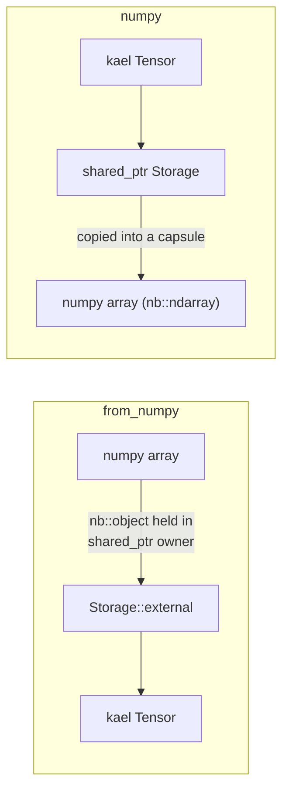

# 10. Python bindings

This chapter exposes kael to Python as the package `kael`, distributed as `kael-tensor`. A compiled extension module `kael._C`, written with nanobind, binds `Tensor`, the operations, autograd entry points, NumPy interop, safetensors I/O, the BPE tokenizer and the C++ `GPT` model. A pure-Python layer on top adds PyTorch-style factories, `no_grad`, `nn` modules, optimizers and a data loader. It maps to milestone v0.4 and to the git tag `chapter-11-python`.

| File | Role |
|------|------|
| `pyproject.toml` | Package metadata, scikit-build-core backend, pytest and cibuildwheel settings |
| `python/CMakeLists.txt` | `nanobind_add_module(_C NB_STATIC ...)`, stub generation, install rules |
| `python/src/bind.h` | Shared declarations: conversion helpers and the five `bind_*` functions |
| `python/src/bindings.cpp` | `NB_MODULE(_C, m)`, exception translation, device and operand parsing |
| `python/src/tensor_bind.cpp` | `DType`, the `Tensor` class, properties, operators, in-place methods, views |
| `python/src/ops_bind.cpp` | Unary, binary and reduction functions, factories, runtime controls |
| `python/src/autograd_bind.cpp` | `is_grad_enabled`, `set_grad_enabled`, `gradcheck` |
| `python/src/interop_bind.cpp` | Indexing, `tensor()`, `from_numpy`, `numpy()`, `__array__`, `__dlpack__` |
| `python/src/models_bind.cpp` | safetensors, `BpeTokenizer`, sequence ops, debug tools, `GPT` |
| `python/kael/__init__.py` | Public namespace, dtype aliases, factories, `no_grad`, `enable_grad` |
| `python/kael/nn/`, `python/kael/optim/`, `python/kael/data/` | Pure-Python `Module`, layers, losses, init, optimizers, schedulers, `DataLoader` |
| `python/tests/` | pytest suite |
| `.github/workflows/wheels.yml` | Wheel builds with cibuildwheel |

## Prerequisites

- [02. Memory model](02-memory-model.md): `Storage::external` and the shared ownership of tensor memory.
- [03. Views](03-views.md): strides, which NumPy interop maps one to one.
- [06. Autograd](06-autograd.md): grad mode and `backward`.
- [07. Neural networks and training](07-neural-networks.md): the C++ `nn` and `optim` APIs that the Python layer mirrors.
- [08. CPU performance](08-cpu-performance.md): the thread pool, whose work runs while the GIL is released, and its fork handling.
- [09. CUDA backend](09-cuda-backend.md): device names and transfers.
- [ADR 0002: tensor as handle](adr/0002-tensor-as-handle.md): why a Python `Tensor` can alias another.

## Two layers



The compiled module binds what must be fast or must touch memory: the tensor type, every operation, autograd, NumPy and DLPack exchange, file formats, the tokenizer and the C++ transformer. Everything that is plain orchestration (module registration, optimizer update rules, schedulers, batching) is Python. The Python `nn.Module` is a separate implementation from `kael::nn::Module`, so users can subclass it and write `forward` in Python, as in PyTorch. Only `GPT` is exposed as a C++ module.

The split keeps the binding code small. A Python `Linear` is a short class on top of `kael.matmul` and `kael.nn.init`. Binding the C++ `nn::Linear` would need trampolines for virtual `forward` and lifetime rules for submodules owned by C++.

## The extension module

### Build integration

From `python/CMakeLists.txt`:

```cmake
find_package(Python 3.9 REQUIRED COMPONENTS Interpreter Development.Module)
find_package(nanobind CONFIG REQUIRED)

nanobind_add_module(_C NB_STATIC
    src/bindings.cpp
    src/tensor_bind.cpp
    src/ops_bind.cpp
    src/autograd_bind.cpp
    src/interop_bind.cpp
    src/models_bind.cpp
)
target_link_libraries(_C PRIVATE kael::kael)
target_compile_features(_C PRIVATE cxx_std_20)
install(TARGETS _C LIBRARY DESTINATION kael)
```

`NB_STATIC` links nanobind's support library into `_C` itself, so the wheel contains one shared object and no separate nanobind library. `kael` is a static library, so the root `CMakeLists.txt` sets `POSITION_INDEPENDENT_CODE ON` on it when `KAEL_BUILD_PYTHON` is on: a static library linked into a shared object must be compiled as position-independent code.

`nanobind_add_stub` runs after the build and writes `_C.pyi`, a type stub generated from the bound signatures and docstrings. It is installed next to `_C` so editors and type checkers see the C++ API.

### Module entry point

From `python/src/bindings.cpp`:

```cpp
NB_MODULE(_C, m) {
    namespace kp = kael::python;
    namespace nb = nanobind;

    nb::register_exception_translator([](const std::exception_ptr& error, void*) {
        // ... see "Error translation"
    });

    m.attr("__version__") = std::string(kael::version());

    kp::bind_tensor(m);
    kp::bind_ops(m);
    kp::bind_autograd(m);
    kp::bind_interop(m);
    kp::bind_models(m);
}
```

The order matters. `bind_tensor` creates the `Tensor` class. The later functions fetch it with `nb::borrow<nb::class_<Tensor>>(m.attr("Tensor"))` and add methods, so each topic keeps both its free functions and its methods in one file.

### Conversion helpers

`python/src/bind.h` declares the helpers every binding file uses:

| Helper | Converts |
|--------|----------|
| `integers_from_args(args)` | `view(2, 3)` and `view((2, 3))` to one `std::vector<std::int64_t>` |
| `dims_from(dim)` | `None` (all dimensions), an `int`, or an iterable of ints to `Dims` |
| `maybe_operand(value)` | A `Tensor`, `bool`, `int`, `float`, an object with `__index__`, or a scalar with `__float__` and no `__len__`, to `Operand`; anything else to `std::nullopt` |
| `operand_from`, `scalar_from` | Like `maybe_operand`, but raise `TypeError` |

Device names go through `kael::parse_device` from `include/kael/device.h` (chapter [02](02-memory-model.md)): `"cpu"` gives `Device::CPU`, `"cuda"` or `"cuda:0"` gives `Device::CUDA`, and anything else raises `ValueError`. The C++ examples call the same function, so both accept the same names.

The order of checks in `maybe_operand` matters. `bool` is tested before `int` because Python's `True` is also an `int`, and kael keeps `bool` as its own dtype. The `__float__` without `__len__` rule accepts NumPy scalars such as `np.float32(2)` but rejects NumPy arrays, which also define `__float__` for size-1 arrays.

## Binding Tensor

`kael::Tensor` is a handle to a shared `TensorImpl` ([ADR 0002](adr/0002-tensor-as-handle.md)). nanobind stores a `Tensor` by value inside each Python object, so a Python tensor owns one handle, and copying the handle shares the data:

```python
x = kael.ones(2)
y = kael.Tensor(x)  # nb::init<const Tensor&>: a second handle to the same TensorImpl
y.add_(1)
x.tolist()  # [2.0, 2.0]
```

### Properties and methods

`bind_tensor` in `python/src/tensor_bind.cpp` exposes the PyTorch spellings:

| Python | C++ |
|--------|-----|
| `shape`, `size()`, `size(dim)` | `shape()` as a tuple, `size(dim)` |
| `dtype`, `device`, `ndim` | `dtype()`, device name string, `dim()` |
| `grad`, `grad_fn`, `is_leaf`, `requires_grad` | autograd fields; `grad_fn` is the node name |
| `T`, `mT` | `T()`, `mT()` |
| `stride()`, `numel()`, `is_contiguous()`, `contiguous()` | same names |
| `item()`, `tolist()` | `float`, `int` or `bool` according to dtype; nested lists |
| `to(...)`, `cuda()`, `cpu()` | `to(DType)` and `to(Device)` |
| `view`, `reshape`, `expand`, `permute`, `transpose`, `squeeze`, `unsqueeze`, `narrow`, `select`, `flatten`, `unflatten`, `split`, `chunk` | view functions from chapter 03 |
| `backward(gradient=None, retain_graph=False)` | `backward` |

`to` accepts any mix of a `DType`, a device name and a tensor (meaning "same device and dtype as this one"), positionally or as `device=` and `dtype=` keywords.

### Operators and NotImplemented

Arithmetic and comparison operators go through `binary_or_not_implemented`:

```cpp
template <typename Compute>
nb::object binary_or_not_implemented(nb::handle other, Compute compute) {
    std::optional<Operand> operand = maybe_operand(other);
    if (!operand) {
        return nb::borrow(Py_NotImplemented);
    }
    return nb::cast(compute(*operand));
}
```

Returning `NotImplemented` instead of raising lets Python try the other operand's reflected method, which is the protocol for mixed-type arithmetic. If both sides decline, Python raises its own `TypeError`. Reflected operators (`__radd__`, `__rsub__`, `__rtruediv__`, `__rpow__`) call the C++ function with the operands swapped, so `1 - x` computes `sub(1, x)`.

`&`, `|` and `^` map to `logical_and`, `logical_or` and `logical_xor`, and `~` to `logical_not`.

### In-place methods return self

`add_`, `mul_`, `copy_`, `fill_`, `zero_`, `clamp_`, `requires_grad_`, `detach_` and the other in-place methods are bound as lambdas over `nb::handle self` that return `nb::borrow(self)`:

```cpp
.def("add_",
     [](nb::handle self, nb::handle other) {
         nb::cast<Tensor&>(self).add_(operand_from(other));
         return nb::borrow(self);
     })
```

Returning the C++ `Tensor&` would make nanobind wrap a new Python object around a copy of the handle. The data would be shared, but `x.add_(1) is x` would be false and chaining such as `velocity.mul_(m).add_(g)` in `kael.optim.SGD` would operate on temporary wrappers. `__iadd__` and friends use the same pattern through the `inplace<&Tensor::add_>` template, so `x += 1` keeps the identity of `x` (`test_in_place_operators_keep_identity`).

### Python protocol details

- `__hash__` returns the object identity. `__eq__` is elementwise and returns a tensor, so a value-based hash would be meaningless. Identity hashing lets tensors live in sets and serve as dict keys.
- `__bool__` raises unless the tensor has exactly one element, with PyTorch's message "Boolean value of Tensor with more than one value is ambiguous".
- `__int__` returns `item<std::int64_t>()` for `i64` tensors, keeping every bit, and range-checks floating values against 2^63 before converting.
- `__index__` accepts only `i64` tensors, so an integer tensor can index a Python list.
- `__len__` and `__iter__` raise `TypeError` on 0-d tensors. `__iter__` yields `select(0, i)` views.
- `__repr__` uses the C++ `operator<<`.

### Indexing

`__getitem__` and `__setitem__` call `index_tensor` and `assign_index` in `python/src/interop_bind.cpp`. `apply_key` walks the key left to right with a running dimension counter:

| Key item | Effect |
|----------|--------|
| `int` or object with `__index__` | `select(dim, i)`, dimension removed |
| `slice` with positive step | `slice(dim, start, stop, step)` after `PySlice_AdjustIndices`; an empty slice becomes `narrow(dim, 0, 0)` |
| `None` | `unsqueeze(dim)` |
| `...` | Skips `dim() - consumed` dimensions |
| 0-d `i64` tensor | `select` with its value |
| 1-d `i64` tensor | `index_select(dim, indices)`, a copy |
| `bool` tensor as the whole key | Boolean mask over all elements, a copy |

Negative slice steps, bare Python `bool` keys and 2-d index tensors raise `ValueError` or `IndexError`. Basic indexing returns views, so `t[0, 1:] = 5` writes into `t`. Assignment through an integer tensor index is refused with `TypeError`, because `index_select` produces a copy and the write would be lost. Assignment through a bool mask calls `masked_fill_` and accepts only a number.

## Operations and factories

`bind_ops` in `python/src/ops_bind.cpp` binds most operations twice, as a module function and as a `Tensor` method, with templates that remove the repetition:

```cpp
template <UnaryFunction F>
void add_unary(nb::module_& m, nb::class_<Tensor>& tensor, const char* name, const char* doc) {
    m.def(name, F, nb::arg("input"), doc, nb::call_guard<nb::gil_scoped_release>());
    tensor.def(name, F, doc, nb::call_guard<nb::gil_scoped_release>());
}
```

`add_reduction` gives every reduction the signature `(input, dim=None, keepdim=False)`. `var` and `std` add `correction=1`. `argmax` and `argmin` take `dim=None`. Binary functions accept tensors or numbers on either side through `operand_from`.

The C++ factories take a shape vector, a `DType` and a device name. `python/kael/__init__.py` wraps them in PyTorch-style signatures:

```python
def zeros(*shape, dtype=_DEFAULT_DTYPE, device="cpu"):
    return _C.zeros(_shape(shape), dtype, device)
```

`_shape` accepts `zeros(2, 3)` and `zeros((2, 3))`. `arange` infers `int64` when all of `start`, `end` and `step` are Python `int`, and `float32` otherwise. Random factories generate on the host and move the result with `.to(device)` in the binding.

The runtime controls are bound as plain functions: `set_num_threads`, `get_num_threads`, `cuda_is_available`, `cuda_synchronize`, `empty_cache`, `allocator_stats(device="cpu")` (returned as a `dict`), and `manual_seed`. `set_num_threads` raises `ValueError` for a count outside `1..1024`, and the first call that starts the thread runtime, such as `get_num_threads()`, raises `ValueError` when `KAEL_NUM_THREADS` is not an integer in that range (chapter [08](08-cpu-performance.md)).

### The kael namespace

`python/kael/__init__.py` re-exports the `_C` functions by name, defines the dtype aliases `float32`, `float64`, `int64` and `bool` (shadowing the builtin inside the module, which is why the file imports `builtins as _builtins`), and lists the public API in `__all__`.

`no_grad` and `enable_grad` share `_GradMode`, which works both as a context manager and as a decorator:

```python
class _GradMode:
    _enabled = None

    def __init__(self):
        self._previous = []

    def __enter__(self):
        self._previous.append(is_grad_enabled())
        set_grad_enabled(self._enabled)
        return self
```

The stack of previous states makes a single instance re-entrant. The decorator form creates a fresh instance per call, so recursive or concurrent calls of a decorated function do not share a stack. The C++ grad mode is thread-local (chapter 06), and each Python thread runs on its own OS thread, so `no_grad` in one Python thread does not affect another.

## The pure-Python layer

### nn

`kael.nn.Parameter` subclasses the bound `Tensor`:

```python
class Parameter(kael.Tensor):
    def __init__(self, data, requires_grad=True):
        super().__init__(data.detach())
        self.requires_grad = requires_grad
```

nanobind classes accept Python subclasses. The parameter shares the storage of `data` and is a leaf, because `detach()` cuts it from any graph.

`Module` registers attributes in `__setattr__`: a `Parameter` goes into `_parameters`, a `Module` into `_modules`, and `register_buffer` adds non-trainable state. `state_dict` includes the buffers, and `load_state_dict` validates and restores them with the parameters (`test_load_state_dict_restores_buffers`). Assigning an attribute before `super().__init__()` raises `AttributeError` with a hint. `named_parameters` deduplicates by `id()`, so a weight shared by two layers appears once (`test_shared_parameters_appear_once`). `Module.to(device)` calls the private bindings `_move_to_` (which calls `Tensor::move_to_`) and `_set_grad_device`, so parameters keep their identity and the optimizer's references stay valid after a move.

The layers are `Linear`, `ReLU`, `GELU`, `Sigmoid`, `Tanh`, `Softmax`, `Flatten`, `Dropout`, `LayerNorm`, `Embedding`, `Sequential`, `ModuleList`, `CrossEntropyLoss` and `MSELoss`. `LayerNorm.forward` calls `kael.standardize`, and `F.cross_entropy` calls `kael.cross_entropy_losses`, so Python models get the fused C++ kernels from chapter 08. `F.binary_cross_entropy_with_logits` computes `max(x, 0)` with `kael.maximum(logits, kael.zeros_like(logits))` instead of `kael.relu`: `maximum` splits the gradient of a tie, so at `x = 0` the gradient is the analytic `sigmoid(x) - t`, as in the C++ loss, while `relu` would give 0 there (`test_binary_cross_entropy_gradient_at_zero_is_sigmoid_minus_target`). `kael.nn.init` provides `uniform_`, `normal_`, `zeros_`, `ones_`, `xavier_uniform_`, `kaiming_uniform_` and `kaiming_normal_`, all under `no_grad`.

### optim and data

`kael.optim` defines `SGD` (momentum, weight decay), `Adam`, `AdamW`, `clip_grad_norm_`, and the schedulers `StepLR`, `CosineAnnealingLR` and `WarmupCosineLR`. `clip_grad_norm_` raises `ValueError` on a NaN or infinite total norm, like the C++ version in chapter 07. `Optimizer.step` is decorated with `@kael.no_grad()` and updates parameters with in-place methods (`sub_`, `mul_`, `add_`), which bump the storage version as chapter 06 requires.

`kael.data` defines `Dataset`, `TensorDataset`, `DataLoader` and `load_mnist`. For a `TensorDataset`, `DataLoader` builds each batch with one `index_select` per tensor instead of stacking per-sample tensors. `load_mnist` calls the C++ IDX reader through `_C._load_mnist`.

## NumPy interop

kael exchanges memory with NumPy in both directions without copying when the layout allows it. Both directions solve the same problem: two libraries with independent memory management must agree on who frees the buffer.



### from_numpy: a tensor over NumPy memory

`from_numpy` reads the `data` entry of `__array_interface__`, which gives the data address and a read-only flag, and the `shape`, `strides` and `dtype` attributes of the array:

```cpp
std::shared_ptr<void> owner(new nb::object(array), [](void* held) {
    numpy_owner_release(static_cast<nb::object*>(held));
});
auto impl = std::make_shared<TensorImpl>();
impl->storage = std::make_shared<Storage>(
    Storage::external(first, empty_array ? 0 : last_byte, std::move(owner)));
impl->shape = std::move(shape);
impl->strides = std::move(strides);
impl->dtype = dtype;
Tensor result = Tensor::from_impl(std::move(impl));
return read_only ? result.clone() : result;
```

`Storage::external` (chapter 02) wraps memory kael did not allocate. Its deleter does not free the bytes. Instead the storage holds `owner`, a `shared_ptr<void>` that keeps a strong Python reference to the array. When the last tensor or view over that storage dies, the owner's deleter drops the reference:

```cpp
void numpy_owner_release(nb::object* array) {
    if (Py_IsInitialized() != 0) {
        const nb::gil_scoped_acquire acquire;
        delete array;
    }
}
```

The deleter can run on any thread, including a thread that released the GIL inside a kael call, so it acquires the GIL before touching the Python object. During interpreter shutdown the reference is leaked instead, because acquiring the GIL is no longer possible.

The conversion validates everything kael cannot represent:

| NumPy property | Handling |
|----------------|----------|
| `float32`, `float64`, `int64`, `bool` | Mapped to `F32`, `F64`, `I64`, `Bool` by `dtype_from_numpy_kind` |
| Any other dtype, for example `int32` | `TypeError` naming the kind and size |
| Non-native byte order | `TypeError` |
| Negative stride | `ValueError`: "call .copy() first" |
| Stride not a multiple of the item size | `ValueError` |
| Address not aligned to the item size | `kael::Error`, raised as `RuntimeError` |
| Read-only buffer | Copied with `clone()`, because kael tensors are always writable |
| Zero-size array | Storage of 0 bytes |

NumPy strides are in bytes and kael strides in elements, so each stride is divided by the item size. Worked example with a Fortran-ordered view:

```text
a = np.arange(6, dtype=np.float32).reshape(2, 3)    shape (2, 3), strides (12, 4) bytes
a.T                                                  shape (3, 2), strides (4, 12) bytes
kael.from_numpy(a.T)                                 shape (3, 2), strides (1, 3) elements
```

The storage size is the byte extent of the view: `item_size + sum((size - 1) * stride)`, here `4 + 2 * 4 + 1 * 12 = 24` bytes.

`kael.tensor(data)` always copies, also for NumPy input: it calls `from_numpy(...).clone()`. Use `from_numpy` when sharing is the intent.

### numpy(): a NumPy array over tensor memory

```cpp
template <typename Framework> nb::ndarray<Framework> as_ndarray(const Tensor& t) {
    KAEL_CHECK(t.device() == Device::CPU, "cannot share a tensor on device "
                                              << t.device() << " with numpy; call .cpu() first");
    KAEL_CHECK(!t.requires_grad(),
               "cannot share a tensor that requires grad; call .detach() first");
    const nb::capsule owner(
        new std::shared_ptr<Storage>(t.impl()->storage),
        [](void* held) noexcept { delete static_cast<std::shared_ptr<Storage>*>(held); });
    std::vector<std::size_t> shape(t.shape().begin(), t.shape().end());
    std::vector<std::int64_t> strides(t.strides().begin(), t.strides().end());
    return nb::ndarray<Framework>(t.device_data(), shape.size(), shape.data(), owner,
                                  strides.data(), dlpack_dtype(t.dtype()));
}
```

The capsule owns a copy of the `shared_ptr<Storage>`. The NumPy array keeps the storage alive after the tensor is gone, and the storage block is not returned to the caching allocator until the array dies (`test_numpy_keeps_the_tensor_memory_alive` calls `empty_cache()` and allocates again to prove the memory was not reused). Holding the storage, not the `TensorImpl`, also means that `Module.to("cuda")` replacing a parameter's storage leaves an earlier NumPy view valid and unchanged (`test_numpy_view_survives_moving_the_tensor`).

Strides pass through unchanged, so `t.T.numpy()` and `t[:, ::2].numpy()` are strided NumPy views, not copies.

Tensors that require grad are refused, because writes through NumPy would bypass the version counter and corrupt saved tensors without an error. `detach()` first states the intent. CUDA tensors are refused because NumPy can only address host memory.

`__array__(dtype=None, copy=None)` implements the NumPy protocol, so `np.asarray(t)` shares memory and `np.array(t, copy=True)` copies. `from_numpy(t.numpy())` round-trips to the same memory (`test_round_trip_through_numpy_needs_no_copy`).

### DLPack

`__dlpack__` delegates to the NumPy view's own `__dlpack__`, and `__dlpack_device__` returns `(1, 0)`, the DLPack code for CPU memory. Any consumer of the protocol, for example `torch.from_dlpack(t)`, gets a zero-copy view with the same lifetime rules (`test_dlpack_with_torch_shares_memory`, `test_dlpack_keeps_memory_alive`). kael has no `from_dlpack`: import goes through `from_numpy`.

## Releasing the GIL

The GIL lets one thread run Python bytecode at a time. A C++ call that keeps the GIL while it multiplies two large matrices blocks every other Python thread, including one that serves HTTP requests in `server/app.py`. Calls that do heavy work and touch no Python objects release it.

Two mechanisms are used:

- `nb::call_guard<nb::gil_scoped_release>()` on a `def` releases the GIL for the whole call, after nanobind has converted the arguments.
- A `const nb::gil_scoped_release release;` local inside the lambda, placed after the code that still needs Python. `add_reduction` converts `dim` with `dims_from` first, then releases.

| Released for | Binding |
|--------------|---------|
| Unary functions and methods (`exp`, `relu`, ...) | `add_unary` |
| Reductions (`sum`, `mean`, `max`, `min`, `prod`, `norm`, `all`, `any`) | `add_reduction` |
| `matmul`, `Tensor.matmul`, `@` | `call_guard` |
| `clone` | `call_guard` |
| `backward` | local release |
| `BpeTokenizer.encode`, `GPT.__call__`, `GPT.generate` | `call_guard` |

Binary operators, indexing, `softmax`, `cat` and factories keep the GIL. Their argument conversion runs on Python objects, and most of them are short.

`GPT.generate` takes an optional Python `on_token` callback. The C++ generation loop runs without the GIL, so the callback wrapper reacquires it before calling into Python:

```cpp
options.on_token = [&on_token](const Tensor& token) {
    const nb::gil_scoped_acquire gil;
    const nb::object answer = (*on_token)(token);
    if (answer.is_none()) {
        return true;
    }
    const int truth = PyObject_IsTrue(answer.ptr());
    if (truth < 0) {
        nb::raise_python_error();
    }
    return truth == 1;
};
```

Returning `False` from the callback stops generation. An exception in the callback propagates through C++ back to the caller as the original Python exception.

Releasing the GIL is safe only if the released code never touches Python state. In kael that holds for every released call, with one indirect path: dropping the last reference to a tensor created by `from_numpy` runs `numpy_owner_release`, which reacquires the GIL itself.

`test_gil_is_released_during_matmul` and `test_gil_is_released_during_backward` start the work in a background thread and count iterations of a busy loop in the main thread. With the GIL held, the loop could not run while the C++ code works.

## Error translation

kael throws a small hierarchy from `include/kael/error.h`: `kael::Error` derives from `std::runtime_error`, and `IndexError`, `ValueError` and `TypeError` derive from `Error`. The module registers a translator that maps them to the matching Python exceptions:

```cpp
nb::register_exception_translator([](const std::exception_ptr& error, void*) {
    try {
        std::rethrow_exception(error);
    } catch (const kael::IndexError& e) {
        PyErr_SetString(PyExc_IndexError, e.what());
    } catch (const kael::ValueError& e) {
        PyErr_SetString(PyExc_ValueError, e.what());
    } catch (const kael::TypeError& e) {
        PyErr_SetString(PyExc_TypeError, e.what());
    } catch (const kael::Error& e) {
        PyErr_SetString(PyExc_RuntimeError, e.what());
    }
});
```

The most derived classes come first, since a `catch` of `kael::Error` would also match them. Exceptions outside the hierarchy are not caught here and fall through to nanobind's built-in translators. The `KAEL_CHECK_INDEX`, `KAEL_CHECK_VALUE` and `KAEL_CHECK_TYPE` macros choose the class at the throw site, so Python code can write `except IndexError` around `t[5]` as with a list. Messages keep the C++ prefix "kael error at <file>:<line>: check '<condition>' failed:" followed by the explanation.

## Building the wheel

`pyproject.toml` selects scikit-build-core as the build backend, with nanobind as a build requirement:

```toml
[build-system]
requires = ["scikit-build-core>=0.10", "nanobind>=2.4"]
build-backend = "scikit_build_core.build"

[tool.scikit-build]
wheel.packages = ["python/kael"]
cmake.version = ">=3.24"
cmake.build-type = "Release"

[tool.scikit-build.cmake.define]
KAEL_BUILD_PYTHON = "ON"
KAEL_BUILD_TESTS = "OFF"
```

pip installs the build requirements in an isolated environment. scikit-build-core makes nanobind's CMake package findable, configures the root `CMakeLists.txt` with the defines above, builds `_C`, and assembles the wheel from `python/kael` plus the installed `_C` module and `_C.pyi`. The only runtime dependency is `numpy`. The `[project]` table declares `license = { text = "Apache-2.0" }`, so the wheel metadata names the license.

Install from a checkout, with the test extras:

```bash
python3 -m venv venv
venv/bin/pip install ".[test]"
```

The `test` extra installs `pytest`, `hypothesis`, `torch`, `transformers`, `safetensors`, `tiktoken`, `fastapi` and `httpx`. Pass CMake options through `--config-settings`, for example for CUDA:

```bash
venv/bin/pip install --config-settings=cmake.define.KAEL_ENABLE_CUDA=ON .
```

### Release wheels

`.github/workflows/wheels.yml` runs on manual dispatch. It builds wheels with `pypa/cibuildwheel` on `ubuntu-latest`, `ubuntu-24.04-arm`, `macos-latest` and `macos-13`, builds an sdist, and optionally publishes to TestPyPI or PyPI with trusted publishing. The `[tool.cibuildwheel]` table in `pyproject.toml` builds CPython 3.9 to 3.13, skips musllinux and PyPy, builds only the native architecture of each runner (`archs = ["native"]`), uses `manylinux_2_28` images on Linux because NumPy no longer publishes `manylinux2014` wheels for the test environment, and runs `pytest {project}/python/tests -q` against every wheel with `pytest`, `hypothesis`, `fastapi` and `httpx` installed. Native builds mean `ubuntu-latest` produces the x86_64 Linux wheels, `ubuntu-24.04-arm` the aarch64 ones, `macos-latest` the arm64 macOS wheels and `macos-13` the x86_64 ones, and every wheel is tested on the machine that built it. Listing both architectures per platform would make each Linux runner need QEMU for the foreign one and each macOS runner produce untested cross-compiled duplicates.

## Running the tests

```bash
venv/bin/pytest python/tests -q
```

`pyproject.toml` sets `testpaths = ["python/tests"]`, so a bare `pytest` from the repository root finds the suite. `python/tests/conftest.py` seeds both kael and NumPy with 1234 before every test.

Tests that need optional packages skip themselves with `pytest.importorskip`: `torch` for `test_autograd.py`, `test_ops.py`, `test_nn.py`, `test_gpt.py` and the DLPack tests; `transformers` and `safetensors.torch` for `test_gpt.py`; `tiktoken` for tokenizer comparisons; `fastapi` and `httpx` for `test_server.py`. `test_cuda.py` skips without a device. The cibuildwheel run installs `fastapi` and `httpx`, so the server tests run against every wheel. It leaves PyTorch out: PyTorch publishes no Intel macOS wheels after 2.2, and the default Linux wheel pulls in the CUDA libraries for every Python version. The PyTorch comparisons run in the `python` CI job instead, which installs `.[test]` and builds from source.

## Edge cases and pitfalls

- **Lifetime across the boundary.** A tensor from `from_numpy` holds a reference to the array, and an array from `numpy()` holds the storage. Deleting either side never leaves a dangling pointer (`test_from_numpy_keeps_the_array_alive`, `test_view_of_from_numpy_keeps_the_array_alive`, `test_numpy_of_view_keeps_memory_alive`).
- **GIL in deleters.** The NumPy owner may be released on a thread without the GIL. `numpy_owner_release` acquires it, and skips the release after interpreter shutdown.
- **Read-only arrays.** Sharing them would let kael write into memory NumPy declared immutable. `from_numpy` copies them (`test_from_numpy_copies_read_only_arrays`).
- **Gradients and shared memory.** `numpy()` refuses tensors that require grad.
- **Bool before int.** `maybe_operand` checks `PyBool_Check` before `PyLong_Check`. Otherwise `True` would become an `int64` scalar and change the result dtype of operations on `bool` tensors.
- **Nested sequences.** `tensor()` validates ragged lists ("nested sequences have inconsistent sizes"), mixed depth, nesting deeper than 32 levels (`kMaxNesting`), and self-referencing lists. Integer lists stay `int64` with every bit; any float makes the result `float32` unless `dtype` is given.
- **Integer conversion.** `int(t)` on a float tensor rejects values outside `[-2^63, 2^63)` instead of wrapping (`test_int_rejects_a_float_at_the_upper_int64_bound`).
- **Identity of in-place results.** In-place methods return the same Python object, which optimizers and `x += 1` rely on.
- **Negative slice steps.** Not supported, because kael strides are non-negative. The error says so.
- **Fork.** `multiprocessing` with the `fork` start method forks a process whose thread pool already started. The `pthread_atfork` handlers from chapter 08 make the child usable (`test_fork_keeps_parallel_work_running`).

## How it is tested

| File | Test functions | What it proves |
|------|-------|----------------|
| `test_tensor.py` | 37 | Factories, `tensor()` inference and validation, properties, `item`, `tolist`, conversions, hashing, operators with scalars on either side, in-place identity, views |
| `test_ops.py` | 12 | Operations against PyTorch |
| `test_autograd.py` | 15 | Gradients against PyTorch, `retain_graph`, `no_grad` and `enable_grad` as context managers and decorators, `gradcheck` with a Python callback, in-place and version checks |
| `test_indexing.py` | 18 | Every key form of `__getitem__` and `__setitem__` |
| `test_interop.py` | 23 | `from_numpy`, `numpy()`, `__array__`, DLPack, lifetimes, GIL release, fork |
| `test_errors.py` | 7 | `IndexError`, `ValueError`, `TypeError`, `RuntimeError` translation and messages, an invalid `KAEL_NUM_THREADS` |
| `test_nn.py` | 31 | `Module` registration, buffers in `load_state_dict`, layers, losses, the BCE gradient at zero, optimizers and schedulers against PyTorch, clipping a non-finite norm, training XOR |
| `test_data.py` | 8 | `Dataset`, `TensorDataset`, `DataLoader` |
| `test_cuda.py` | 10 | Device factories, transfers, `Module.to`, training on the device |
| `test_gpt.py`, `test_tokenizer.py`, `test_server.py` | 9, 3, 26 | Covered in chapters 11 to 13 |

## Build it yourself

1. Add `pyproject.toml` with scikit-build-core and nanobind, `python/CMakeLists.txt` with `nanobind_add_module(_C NB_STATIC ...)`, and an empty `NB_MODULE`. Set `POSITION_INDEPENDENT_CODE` on `kael`. Checkpoint: `pip install .` succeeds and `import kael._C` works.
2. Bind `DType` and `Tensor` with `shape`, `dtype`, `item`, `tolist` and `__repr__`, and the factories. Checkpoint: `kael._C.zeros([2, 3], kael._C.DType.F32, "cpu").shape == (2, 3)`.
3. Register the exception translator. Checkpoint: `test_errors.py` passes.
4. Write `maybe_operand` and the operators with `NotImplemented`. Checkpoint: `test_scalars_mix_on_either_side` and `test_foreign_operands_give_type_errors`.
5. Bind in-place methods returning `self`, views, `to`, `backward`. Checkpoint: `test_in_place_operators_keep_identity` and `test_views_share_memory`.
6. Bind unary functions, reductions and `matmul` with GIL release. Checkpoint: `test_gil_is_released_during_matmul`.
7. Write `apply_key` and `assign_index`. Checkpoint: `test_indexing.py`.
8. Write `from_numpy` with `Storage::external` and the GIL-acquiring owner, then `as_ndarray`, `__array__` and `__dlpack__`. Checkpoint: `test_interop.py`.
9. Write `python/kael/__init__.py` with factories and `no_grad`. Checkpoint: `test_tensor.py`.
10. Write `kael.nn`, `kael.optim` and `kael.data`. Checkpoint: `test_nn.py` and `test_data.py`.
11. Bind safetensors, `BpeTokenizer` and `GPT`, with the `on_token` callback reacquiring the GIL. Checkpoint: the full `pytest python/tests -q` run passes.
12. Add the cibuildwheel settings and `wheels.yml`. Checkpoint: a manual workflow run produces wheels for every platform.

## Further reading

- The nanobind documentation, in particular the sections on exceptions, `ndarray`, and GIL management.
- The NumPy array interface protocol (`__array_interface__`) and the `__array__` protocol.
- The DLPack specification and the Python array API standard section on `__dlpack__`.
- The scikit-build-core documentation.

Next: [11. Transformer](11-transformer.md)
