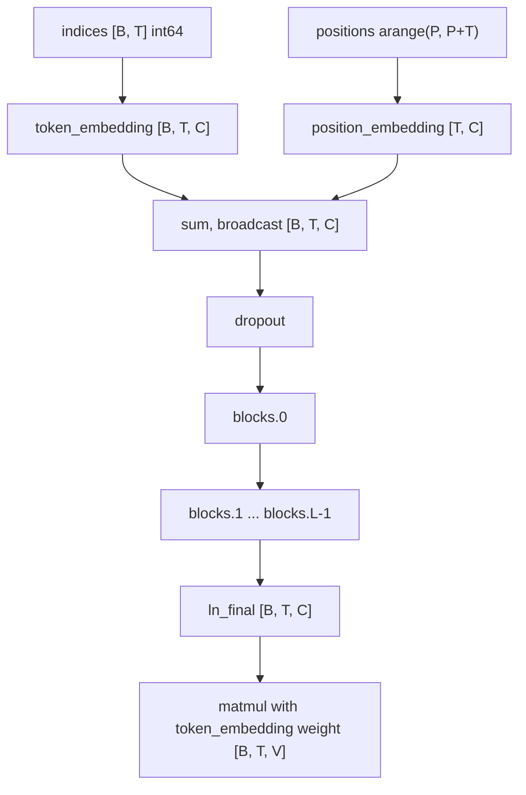
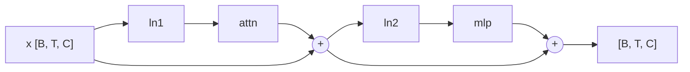

# 11. Transformer

This chapter builds a GPT-2 style decoder-only transformer on top of the modules from chapter 07: token and position embeddings, causal self-attention with several heads, a GELU MLP, pre-layer-norm residual blocks, the GPT model with tied output weights, a key/value cache for fast generation, and a sampling loop with temperature and top-k. It ends with `examples/char_gpt.cpp`, which trains a character-level model on Tiny Shakespeare. It maps to the v1.0 milestone (run GPT-2) and the `chapter-12-transformer` tag; chapter 12 then loads the real GPT-2 weights into the same classes. The tags `chapter-12-transformer`, `chapter-13-polish` and `v1.0.0` all point at the same commit. The `on_token` callback and the training-mode restore in `generate` landed after that commit, so this chapter describes the current head of the repository.

| File | Role |
|------|------|
| `include/kael/nn/transformer.h` | `GptConfig`, `LayerCache`, `KvCache`, `CausalSelfAttention`, `TransformerMlp`, `TransformerBlock`, `GPT`, `GenerateOptions`, `generate`, `load_gpt2_weights` |
| `src/nn/transformer.cpp` | Implementation of all of the above, the sampler `sample_next` and the GPT-2 name mapping |
| `include/kael/nn/activation.h` | `GELU` module with the exact and the tanh variant |
| `src/internal/element_functions.h` | `GeluExact` and `GeluTanh` element functions |
| `src/random.cpp` | `multinomial`, the sampler behind `generate` |
| `examples/char_gpt.cpp` | Character-level GPT trained on Tiny Shakespeare |
| `scripts/download/shakespeare.sh` | Downloads `input.txt` and checks its SHA-256 |
| `tests/test_transformer.cpp` | GoogleTest suites `Attention`, `Block`, `Gpt`, `Generate`, `GptGenerate`, `Gpt2Weights` |
| `python/tests/test_gpt.py` | pytest comparison against PyTorch and Hugging Face `transformers` |

## Prerequisites

- [01. Shapes and strides](01-shapes-and-strides.md): broadcasting, used by the mask and the bias.
- [03. Views](03-views.md): `view`, `select`, `transpose`, `slice`, `narrow`, `mT`, and when `contiguous` is needed.
- [05. Operations](05-operations.md): `matmul` with batch dimensions, `softmax`, `masked_fill`, `triu`, `topk`, `cat`, `argmax`.
- [06. Autograd](06-autograd.md): `NoGradGuard` and gradcheck.
- [07. Neural networks and training](07-neural-networks.md): `Module`, `Linear`, `Embedding`, `LayerNorm`, `Dropout`, `cross_entropy`, `AdamW`, schedulers and gradient clipping.

## Notation

The chapter uses one letter per dimension. Every shape below is written with these letters.

| Letter | Meaning | GPT-2 small | `char_gpt` |
|--------|---------|-------------|------------|
| `B` | batch size | 1 when generating | 32 |
| `T` | number of new positions in this call | prompt length, then 1 | 64 |
| `P` | positions already in the KV cache | 0 to 1023 | 0 |
| `C` | model width, `GptConfig::dimension` | 768 | 128 |
| `H` | attention heads, `GptConfig::heads` | 12 | 4 |
| `D` | head dimension, `C / H` | 64 | 32 |
| `V` | vocabulary size, `GptConfig::vocab_size` | 50257 | 65 |
| `L` | number of blocks, `GptConfig::layers` | 12 | 4 |
| `N` | context length, `GptConfig::max_positions` | 1024 | 64 |

## The model in one picture

A GPT maps a batch of token ids `[B, T]` to a batch of logits `[B, T, V]`: for every position, one unnormalized score per vocabulary entry for the token that comes next.



Each block is pre-layer-norm: the residual stream `x` passes through unchanged, and each sublayer reads a normalized copy and adds its result back.



## Attention from first principles

### One head, one sequence

Attention lets each position build its output as a weighted average of information from other positions. Every position produces three vectors of length `D`:

- a **query**: what this position looks for,
- a **key**: what this position offers to others,
- a **value**: what this position hands over when it is chosen.

For a sequence of `T` positions, stack them into matrices `Q`, `K`, `V` of shape `[T, D]`. Then:

```text
scores  = Q K^T / sqrt(D)          [T, D] x [D, T] = [T, T]
weights = softmax(scores, dim=-1)  [T, T], each row sums to 1
output  = weights V                [T, T] x [T, D] = [T, D]
```

Row `i` of `scores` holds the dot products of query `i` with every key. Softmax turns each row into a probability distribution over positions, and row `i` of `output` is the matching mixture of value vectors.

The division by `sqrt(D)` keeps the scores in a range where softmax still has gradient. If the entries of `q` and `k` are independent with unit variance, `q . k` is a sum of `D` such products and has variance `D`. Dividing by `sqrt(D)` brings it back to variance 1. Without it, for `D = 64` the scores have a standard deviation of 8, softmax saturates to nearly one-hot rows, and the gradients of the losing positions vanish.

### The causal mask

A language model predicts token `t + 1` from tokens `0..t`. If position `t` could attend to position `t + 1`, training would let it copy the answer.

**Causal masking** forbids every query from looking at a later key. It sets those scores to minus infinity before softmax, so their weight is exactly `exp(-inf) = 0`. The boolean matrix that marks the forbidden pairs is the causal mask.

kael builds the mask once, as a boolean matrix where `true` means "future, hide it". From `src/nn/transformer.cpp`:

```cpp
Tensor future_positions_mask(std::int64_t size) {
    return triu(ones({size, size}, DType::Bool), 1);
}
```

For `T = 3`, `triu(ones, 1)` keeps the entries strictly above the diagonal:

```text
         key 0  key 1  key 2
query 0  false  true   true
query 1  false  false  true
query 2  false  false  false
```

A worked example with made-up scores (already divided by `sqrt(D)`):

```text
scores                masked                       softmax
[ 2.0  1.0  0.0 ]     [ 2.0  -inf -inf ]           [ 1.000 0.000 0.000 ]
[ 1.0  1.0  5.0 ]  -> [ 1.0   1.0 -inf ]       ->  [ 0.500 0.500 0.000 ]
[ 0.0  0.0  0.0 ]     [ 0.0   0.0  0.0 ]           [ 0.333 0.333 0.333 ]
```

Query 0 only sees itself. The large score 5.0 in row 1 has no effect because it points to the future. The diagonal is never masked, so every row has at least one finite entry and softmax never divides by zero.

### Many heads

One head computes one weighting of positions. A model often needs several at once: one head may track the previous token, another the subject of the sentence.

**Multi-head attention** splits the width `C` into `H` slices of `D = C / H` and runs `H` independent attentions, one per slice, in parallel. The outputs of the heads are concatenated back to width `C` and mixed by an output projection.

The split costs nothing in memory. A tensor `[B, T, C]` is reinterpreted as `[B, T, H, D]` with `view`, then the head dimension moves next to the batch with `transpose(1, 2)`, giving `[B, H, T, D]`. From then on `matmul` treats `B` and `H` as batch dimensions and multiplies the last two, which is exactly "one attention per head per sequence". The merge is the reverse: transpose back to `[B, T, H, D]`, make it contiguous, view as `[B, T, C]`.

### Shapes at every step

`CausalSelfAttention::forward` with `B = 2`, `T = 5`, `C = 8`, `H = 2`, `D = 4` and no cache (`P = 0`):

| Step | Expression | Shape |
|------|------------|-------|
| input | `input` | `[2, 5, 8]` |
| fused projection | `query_key_value_->forward(input)` | `[2, 5, 24]` |
| split into q, k, v and heads | `.view({batch, length, 3, heads_, head_dimension_})` | `[2, 5, 3, 2, 4]` |
| queries | `parts.select(2, 0).transpose(1, 2)` | `[2, 2, 5, 4]` |
| keys, values | `parts.select(2, 1)`, `select(2, 2)`, transposed | `[2, 2, 5, 4]` each |
| keys transposed | `keys.mT()` | `[2, 2, 4, 5]` |
| scores | `matmul(queries, keys.mT()) / sqrt(4)` | `[2, 2, 5, 5]` |
| mask slice | `future_mask_.slice(0, 0, 5).slice(1, 0, 5)` | `[5, 5]`, broadcast |
| weights | `softmax(masked, -1)`, then dropout | `[2, 2, 5, 5]` |
| mixed | `matmul(weights, values)` | `[2, 2, 5, 4]` |
| merge heads | `.transpose(1, 2).contiguous()` | `[2, 5, 2, 4]` |
| concatenate heads | `mixed.view({batch, length, dimension_})` | `[2, 5, 8]` |
| output projection | `projection_->forward(...)`, then dropout | `[2, 5, 8]` |

The fused `qkv` layer is a single `Linear(C, 3C)`. Its output columns are laid out `[q | k | v]`, each block of `C` columns subdivided into `H` heads of `D`. That is why the view is `[B, T, 3, H, D]` and not `[B, T, H, 3, D]`: the 3 is the slower-varying index. GPT-2's `c_attn` uses the same layout, which is what lets chapter 12 load its weights without reshuffling columns.

## The attention module

The constructor validates the head split, builds the mask for the full context once and registers two linear layers. From `src/nn/transformer.cpp`:

```cpp
CausalSelfAttention::CausalSelfAttention(std::int64_t dimension, std::int64_t heads,
                                         std::int64_t max_positions, double dropout, DType dtype)
    : dimension_(dimension), heads_(heads),
      head_dimension_(checked_head_dimension(dimension, heads)), max_positions_(max_positions),
      dropout_(dropout), future_mask_(future_positions_mask(max_positions)),
      query_key_value_(
          register_module("qkv", std::make_shared<Linear>(dimension, 3 * dimension, true, dtype))),
      projection_(
          register_module("proj", std::make_shared<Linear>(dimension, dimension, true, dtype))) {}
```

`checked_head_dimension` throws `ValueError` unless `heads > 0` and `dimension % heads == 0`. The mask is a plain member, not a parameter, so it does not appear in `state_dict()` and is never trained. Its size is `[N, N]` booleans, 1 MiB for GPT-2's `N = 1024`.

The forward pass, from `src/nn/transformer.cpp`:

```cpp
const Tensor parts =
    query_key_value_->forward(input).view({batch, length, 3, heads_, head_dimension_});
const Tensor queries = parts.select(2, 0).transpose(1, 2);
Tensor keys = parts.select(2, 1).transpose(1, 2);
Tensor values = parts.select(2, 2).transpose(1, 2);
if (cache != nullptr) {
    if (cache->keys) {
        keys = cat({*cache->keys, keys}, 2);
        values = cat({*cache->values, values}, 2);
    }
    cache->keys = keys;
    cache->values = values;
}

if (future_mask_.device() != input.device()) {
    future_mask_ = future_mask_.to(input.device());
}
const Tensor mask = future_mask_.slice(0, past, past + length).slice(1, 0, past + length);
const Tensor scores =
    matmul(queries, keys.mT()) / std::sqrt(static_cast<double>(head_dimension_));
const Tensor masked = masked_fill(scores, mask, -std::numeric_limits<double>::infinity());
const Tensor weights = functional::dropout(softmax(masked, -1), dropout_, is_training());
const Tensor mixed = matmul(weights, values).transpose(1, 2).contiguous();
const Tensor output = projection_->forward(mixed.view({batch, length, dimension_}));
return functional::dropout(output, dropout_, is_training());
```

Design choices and their alternatives:

- One fused `Linear(C, 3C)` instead of three `Linear(C, C)`. One matrix multiply with three times the columns runs faster than three small ones, and it matches the GPT-2 checkpoint. The split into q, k, v is a `select`, which is a view and copies nothing.
- `select` plus `transpose` produce non-contiguous views. `matmul` accepts strided inputs, so no copy happens before the score computation. The only explicit copy is `contiguous()` before the final `view`: after `transpose(1, 2)` the heads of one position are no longer adjacent in memory, and kael's `view` only accepts contiguous tensors (it throws `ValueError` and suggests `reshape` otherwise).
- The mask lives on the CPU until the first input arrives on another device. The forward pass then moves it once and keeps the moved copy, so a model moved with `to(Device::CUDA)` pays the transfer once.
- `masked_fill` with minus infinity, not a large negative number. With `-inf`, the masked weights are exactly zero in every dtype, and the `LaterPositionsDoNotAffectEarlierOnes` test can compare outputs at full precision.
- Dropout is applied twice: on the attention weights and on the projected output. It is a no-op when `dropout == 0.0` or the module is in eval mode (see `functional::dropout` in chapter 07).

The input check rejects anything other than `[B, T, C]`, and a second check rejects `P + T > N`: the mask, and the position embedding table, have no rows past `N`.

## The MLP

After attention mixes information across positions, the MLP transforms each position on its own. It widens to `4C`, applies GELU, and projects back. From `src/nn/transformer.cpp`:

```cpp
Tensor TransformerMlp::forward(const Tensor& input) {
    return dropout_->forward(fc2_->forward(activation_->forward(fc1_->forward(input))));
}
```

Shapes: `[B, T, C]` to `[B, T, 4C]` (`fc1`), GELU elementwise, `[B, T, 4C]` to `[B, T, C]` (`fc2`), dropout.

**GELU** (Gaussian Error Linear Unit) weights its input by the probability that a standard normal variable is below it: `GELU(x) = x * Phi(x)`. Unlike ReLU it is smooth at zero and lets small negative values through. kael has both forms, chosen by `GptConfig::tanh_gelu`. From `src/internal/element_functions.h`:

```cpp
struct GeluExact : Tagged<ElementOp::GeluExact> {
    template <typename T> KAEL_HD T operator()(T x) const {
        return T(0.5) * x * (1 + std::erf(x / std::numbers::sqrt2_v<T>));
    }
};
struct GeluTanh : Tagged<ElementOp::GeluTanh> {
    template <typename T> KAEL_HD T operator()(T x) const {
        const T scale = std::sqrt(2 / std::numbers::pi_v<T>);
        return T(0.5) * x * (1 + std::tanh(scale * (x + T(0.044715) * x * x * x)));
    }
};
```

GPT-2 was trained with the tanh approximation, so `GptConfig` defaults to `tanh_gelu = true`. Using the exact form with GPT-2 weights shifts the logits slightly. `char_gpt` trains from scratch and sets `tanh_gelu = false`. The two curves differ by less than 0.0005 everywhere, so either works for a new model, but a pretrained model must use the form it was trained with.

## Residual blocks with pre-layer-norm

From `src/nn/transformer.cpp`:

```cpp
Tensor TransformerBlock::forward(const Tensor& input, LayerCache* cache) {
    const Tensor attended = input + attention_->forward(ln1_->forward(input), cache);
    return attended + mlp_->forward(ln2_->forward(attended));
}
```

**Residual stream**: the tensor `x` that flows from the embeddings to the final layer norm. Each sublayer reads `LayerNorm(x)` and adds its output to `x`. Two properties follow:

- The gradient of the loss with respect to `x` reaches every block through the `+` without passing through any weights. Deep stacks train without the gradient shrinking layer by layer.
- Layer norm sits before each sublayer (pre-LN, as in GPT-2), not after the addition (post-LN, as in the original transformer paper). In post-LN, the residual path itself passes through a normalization at every layer, and deep post-LN stacks are known to need a careful learning-rate warmup to train stably. Pre-LN keeps the identity path clean. The price is that the stream is never normalized inside the stack, which is why `GPT` applies one more layer norm, `ln_final`, before the output head.

All three layer norms use `eps = 1e-5`, the GPT-2 value.

## The GPT configuration

From `include/kael/nn/transformer.h`:

```cpp
struct GptConfig {
    std::int64_t vocab_size = 50257;
    std::int64_t max_positions = 1024;
    std::int64_t layers = 12;
    std::int64_t heads = 12;
    std::int64_t dimension = 768;
    double dropout = 0.0;
    bool tanh_gelu = true;
    DType dtype = DType::F32;

    [[nodiscard]] static GptConfig gpt2_small() { return {}; }
};
```

The defaults are GPT-2 small, so `gpt2_small()` returns a default-constructed config. `dtype` is passed to every layer, so a model built with `DType::F64` runs gradcheck in double precision (the tests do this).

The constructor registers the submodules under fixed names. These names are the keys of `state_dict()` and are what chapter 12 maps GPT-2 checkpoint names onto:

```text
token_embedding.weight          [V, C]
position_embedding.weight       [N, C]
blocks.{i}.ln1.weight / .bias   [C]
blocks.{i}.attn.qkv.weight      [3C, C]   bias [3C]
blocks.{i}.attn.proj.weight     [C, C]    bias [C]
blocks.{i}.ln2.weight / .bias   [C]
blocks.{i}.mlp.fc1.weight       [4C, C]   bias [4C]
blocks.{i}.mlp.fc2.weight       [C, 4C]   bias [C]
ln_final.weight / .bias         [C]
```

`Linear` stores its weight as `[out_features, in_features]` and computes `input @ weight.T() + bias` (chapter 07). There is no separate output head parameter: see weight tying below.

### Parameter count

The `ParameterCountFormula` test states the count directly. Per block:

```text
qkv   3C*C + 3C
proj   C*C +  C
fc1   4C*C + 4C
fc2   4C*C +  C
ln1, ln2   2 * 2C
total per block = 12C^2 + 13C
```

The whole model is `V*C + N*C + L*(12C^2 + 13C) + 2C`. For GPT-2 small: `50257*768 + 1024*768 + 12*(12*768^2 + 13*768) + 2*768 = 124,439,808`, checked by `Gpt2SmallHasTheKnownParameterCount`. For `char_gpt` (`V = 65`, `N = 64`, `L = 4`, `C = 128`) the formula gives 809,856, which is what the example prints.

### Weight initialization

From `src/nn/transformer.cpp`:

```cpp
void GPT::initialize_weights() {
    const double residual_std =
        kInitialStd /
        std::sqrt(2.0 * static_cast<double>(std::max<std::int64_t>(config_.layers, 1)));
    Tensor token_weight = token_embedding_->weight();
    Tensor position_weight = position_embedding_->weight();
    init::normal_(token_weight, 0.0, kInitialStd);
    init::normal_(position_weight, 0.0, kInitialStd);
    const auto named = named_parameters();
    for (const auto& [name, parameter] : named) {
        if (name.rfind("blocks.", 0) != 0 || name.find(".ln") != std::string::npos) {
            continue;
        }
        Tensor target = parameter;
        if (name.ends_with(".bias")) {
            init::zeros_(target);
        } else {
            const bool residual =
                name.ends_with(".attn.proj.weight") || name.ends_with(".mlp.fc2.weight");
            init::normal_(target, 0.0, residual ? residual_std : kInitialStd);
        }
    }
}
```

The rules, with `kInitialStd = 0.02`:

| Parameter | Initial value |
|-----------|---------------|
| embeddings | normal, std 0.02 |
| linear biases in blocks | zero |
| `qkv.weight`, `fc1.weight` | normal, std 0.02 |
| `attn.proj.weight`, `mlp.fc2.weight` | normal, std `0.02 / sqrt(2L)` |
| every layer norm | weight 1, bias 0 (the `LayerNorm` default, skipped by the loop) |

The two scaled weights are the last layer of each sublayer, the ones that write into the residual stream. The stream receives `2L` additions. If each addition is independent with variance `s^2`, the stream ends with variance about `2L * s^2`. Scaling `s` by `1 / sqrt(2L)` keeps the total near `0.02^2` regardless of depth. For `L = 8` the scaled std is `0.02 / 4 = 0.005`, which `ResidualProjectionsStartSmaller` checks.

A small std overall makes the initial logits close to zero, so the first prediction is close to uniform and the first loss is close to `ln(V)`. `InitialLossMatchesUniformPrediction` checks this for `V = 65`: `ln(65) = 4.17`.

## The forward pass and weight tying

From `src/nn/transformer.cpp`:

```cpp
const Tensor positions =
    arange(static_cast<double>(past), static_cast<double>(past + length), 1.0, DType::I64)
        .to(indices.device());
Tensor x = dropout_->forward(token_embedding_->forward(indices) +
                             position_embedding_->forward(positions));
for (std::size_t i = 0; i < blocks_.size(); ++i) {
    x = blocks_[i]->forward(x, cache != nullptr ? &(*cache)[i] : nullptr);
}
// Multiplying by the weight transposed would copy the whole embedding on every step.
return matmul(token_embedding_->weight(), ln_final_->forward(x).mT()).mT().contiguous();
```

Shapes:

| Step | Shape |
|------|-------|
| `indices` | `[B, T]`, must be `I64` |
| `token_embedding_->forward(indices)` | `[B, T, C]` |
| `positions` | `[T]` with values `P, P+1, ..., P+T-1` |
| `position_embedding_->forward(positions)` | `[T, C]`, broadcast over `B` |
| after the blocks | `[B, T, C]` |
| `ln_final_->forward(x).mT()` | `[B, C, T]` |
| `matmul(weight [V, C], [B, C, T])` | `[B, V, T]` (the weight broadcasts over `B`) |
| `.mT().contiguous()` | `[B, T, V]` |

Positions start at `P`, the number of cached positions, so a token processed alone in step `k` of generation gets the same position embedding it would get inside the full sequence.

**Weight tying** reuses the token embedding matrix `[V, C]` as the output projection. Row `v` of the matrix is both the input vector of token `v` and the direction whose dot product with the final hidden state gives the logit of `v`. GPT-2 was trained this way, so the checkpoint has no separate head to load, and the model saves `V * C` parameters (38.6 million for GPT-2 small). `WeightTyingKeepsASingleEmbeddingParameter` checks that exactly one registered parameter shares storage with `token_embedding_weight()`.

The comment explains the operand order. The direct form `matmul(h, weight.T())` multiplies by a transposed `[C, V]` view, and the matmul path would make a contiguous copy of the whole embedding (154 MB in F32 for GPT-2) on every forward call. Computing `(W h^T)^T` keeps the large operand contiguous and transposes only the small result.

## The KV cache

### Why generation is slow without it

Generation appends one token at a time. Without a cache, step `n` runs the whole model over all `n` tokens so far, only to read the logits of the last position. Everything computed for positions `0..n-2` was already computed in step `n-1`, and causal masking guarantees it has not changed: position `i` never attends to anything after `i`.

The only per-position state that later positions need is the key and value of every earlier position in every layer. Queries are needed only for the position being predicted. Caching keys and values per layer turns each step into a forward pass over one token.

Approximate cost per layer to generate token `n`:

| | Linear layers (qkv, proj, fc1, fc2) | Attention scores and mixing |
|---|---|---|
| without cache | `n * 12C^2` | `n^2 * C` |
| with cache | `12C^2` | `n * C` |

Over `M` generated tokens, the uncached loop costs `O(M^2 C^2 + M^3 C)` and the cached loop `O(M C^2 + M^2 C)`. The `--benchmark` flag of `examples/gpt2_generate.py` measures both rates side by side.

### Layout

From `include/kael/nn/transformer.h`:

```cpp
struct LayerCache {
    std::optional<Tensor> keys;
    std::optional<Tensor> values;
};

using KvCache = std::vector<LayerCache>;
```

One `LayerCache` per block. `keys` and `values` have shape `[B, H, P, D]`, the same layout attention uses internally, so appending is a `cat` along dimension 2 and no transposition is needed when reading:

```text
KvCache (L entries)
  [0] keys   [B, H, P, D]   values [B, H, P, D]
  [1] keys   [B, H, P, D]   values [B, H, P, D]
  ...
```

Memory: `2 * L * B * P * C` elements. For GPT-2 small at a full context (`P = 1024`, `B = 1`, F32), that is `2 * 12 * 1024 * 768 * 4 = 75,497,472` bytes, 72 MiB.

The protocol, as implemented in `GPT::forward` and `CausalSelfAttention::forward`:

1. The caller passes an empty `KvCache`. `GPT::forward` resizes it to `L` entries.
2. A cache of another size throws `ValueError` (`RejectsACacheOfAnotherModel`).
3. `P` is read from `cache->front().keys->size(2)`, or 0 when empty.
4. Each attention layer concatenates its new keys and values to the cached ones, stores the result back, and attends over all `P + T` keys.
5. The mask slice `rows P..P+T, columns 0..P+T` lets new query `i` see keys `0..P+i`. For a single new token (`T = 1`) the slice is one row with no `true` entries: the newest token may see everything before it.

`CacheGivesTheSameLogitsAsTheFullSequence` runs a 4-token prefix, then feeds 5 more tokens one at a time, and checks that each step's logits equal the corresponding row of a single full-sequence forward.

## Generation and sampling

### The loop

From `src/nn/transformer.cpp`:

```cpp
for (std::int64_t step = 0; step < options.max_new_tokens; ++step) {
    const std::int64_t total = sequence.size(1);
    const std::int64_t window = std::min(total, context);
    const std::int64_t cached =
        !cache.empty() && cache.front().keys ? cache.front().keys->size(2) : 0;
    const auto run_model = [&] {
        if (!options.use_cache) {
            return model(sequence.narrow(1, total - window, window));
        }
        if (cached > 0 && cached < context) {
            return model.forward(sequence.narrow(1, total - 1, 1), &cache);
        }
        cache.clear();
        return model.forward(sequence.narrow(1, total - window, window), &cache);
    };
    const Tensor logits = run_model();
    const Tensor next = sample_next(logits.select(1, logits.size(1) - 1), options);
    sequence = cat({sequence, next}, 1);
    if (options.on_token && !options.on_token(next)) {
        break;
    }
}
```

Three paths per step:

- Without cache: run the last `window = min(total, N)` tokens. Older tokens fall out of the window.
- With a cache that has room: run only the newest token.
- With an empty or full cache: clear it and run the last `window` tokens to refill it. The first step always takes this path and processes the whole prompt at once.

Past the context length, the full-cache path runs on every step: each new token shifts the window by one, every position embedding changes, and the cached keys are no longer valid. Generation keeps working (`KeepsGoingPastTheContextLength`), but at the uncached cost.

Around the loop, `generate` validates its options, disables gradient recording with `NoGradGuard`, and switches the model to eval mode. A small RAII class, `TrainingModeRestorer`, puts the previous mode back when `generate` returns or throws (`AThrowingReceiverRestoresTheTrainingMode`).

`GenerateOptions`, from `include/kael/nn/transformer.h`:

| Field | Default | Meaning |
|-------|---------|---------|
| `max_new_tokens` | 16 | Tokens to append. Negative throws. |
| `temperature` | 1.0 | 0 means greedy. Negative throws. |
| `top_k` | 0 | 0 disables top-k. Negative throws. |
| `use_cache` | `true` | Use the KV cache. |
| `on_token` | empty | Called with each new `[B, 1]` token tensor. Returning `false` stops the loop. |

The callback runs after the token is appended, so the token that triggered a stop is part of the returned sequence. Chapter 13 uses this callback to stream tokens and cancel generations in the HTTP server.

### Temperature, top-k and multinomial

From `src/nn/transformer.cpp`:

```cpp
Tensor sample_next(const Tensor& last_logits, const GenerateOptions& options) {
    if (options.temperature == 0.0) {
        return argmax(last_logits, -1, true);
    }
    Tensor logits = last_logits / options.temperature;
    if (options.top_k > 0 && options.top_k < logits.size(-1)) {
        const Tensor smallest_kept =
            topk(logits, options.top_k).values.select(-1, options.top_k - 1);
        logits = masked_fill(logits, logits < smallest_kept.unsqueeze(-1),
                             -std::numeric_limits<double>::infinity());
    }
    return multinomial(softmax(logits, -1), 1, true);
}
```

`last_logits` has shape `[B, V]`. All three branches return `[B, 1]` int64, which `cat` appends to the `[B, total]` sequence.

- **Temperature** divides the logits before softmax. A temperature below 1 sharpens the distribution toward the top token, above 1 flattens it. Temperature 0 is the limit case and is handled as `argmax` (greedy decoding), which avoids a division by zero.
- **Top-k** keeps the `k` largest logits and sets the rest to minus infinity, so softmax gives them probability zero. It removes the long tail of unlikely tokens that, summed together, would otherwise be sampled often. The threshold is the `k`-th largest value per row; values equal to it are kept, so ties can let more than `k` tokens through. A `top_k` of `V` or more is a no-op, which is why the server can accept a `top_k` up to 1,000,000.
- **Multinomial** draws one index per row with probability proportional to its weight.

A worked example with `V = 4`, logits `[2.0, 1.0, 0.5, -1.0]`, temperature 0.5, `top_k = 2`:

```text
divide by 0.5          [ 4.0  2.0  1.0  -2.0 ]
2nd largest            2.0
mask values < 2.0      [ 4.0  2.0  -inf -inf ]
softmax                [ 0.881 0.119 0.000 0.000 ]
```

`multinomial` in `src/random.cpp` copies the weights to the CPU in F64, checks that every weight is finite and non-negative and that at least one is positive, then for each sample builds a cumulative sum, draws `u` uniform in `[0, total)` from the global generator and returns the first index whose cumulative sum exceeds `u` (`std::upper_bound`). With the cumulative sums `[0.881, 1.0, 1.0, 1.0]`, any `u` below 0.881 picks token 0. The result is moved back to the input's device. Because sampling uses the global generator, `manual_seed` makes generation reproducible, and the cached and uncached paths produce the same tokens for the same seed (`SamplingMatchesWithAndWithoutCacheForTheSameSeed`).

## Training a character-level model

`examples/char_gpt.cpp` trains a small GPT on Tiny Shakespeare, about 1 MB of plays, with one token per byte.

### Data

`scripts/download/shakespeare.sh` downloads `input.txt` into `data/shakespeare` (or the directory given as its first argument) and verifies its SHA-256. The `Vocabulary` class collects the distinct bytes of the file in byte order and numbers them from 0. Tiny Shakespeare has 65 distinct characters, so `V = 65`. The encoded text is split 90 percent for training and 10 percent for validation.

`sample_batch` picks 32 random start offsets and copies 64 tokens from each as inputs and the same 64 tokens shifted by one as targets:

```text
text     F  i  r  s  t     C  i  t  ...
inputs   F  i  r  s  t     C  i        (64 tokens)
targets  i  r  s  t     C  i  t        (64 tokens, shifted by one)
```

Every position in every row is a training example: position `t` predicts token `t + 1` from tokens `0..t`. The causal mask is what makes all 64 predictions in a row valid at once.

### Model and loss

```cpp
kael::nn::GptConfig config;
config.vocab_size = vocabulary.size();
config.max_positions = kContext;
config.layers = 4;
config.heads = 4;
config.dimension = 128;
config.tanh_gelu = false;
```

That is `C = 128`, `H = 4`, `D = 32`, `N = 64`, 809,856 parameters. The loss reshapes the logits from `[32, 64, 65]` to `[2048, 65]` and the targets to `[2048]` and calls `cross_entropy`. From `examples/char_gpt.cpp`:

```cpp
Tensor batch_loss(kael::nn::GPT& model, const Batch& batch, std::int64_t vocabulary) {
    return kael::nn::cross_entropy(model(batch.inputs).view({kBatchSize * kContext, vocabulary}),
                                   batch.targets);
}
```

### Training loop

| Constant | Value |
|----------|-------|
| `kBatchSize` | 32 |
| `kContext` | 64 |
| `kLearningRate` | `1e-3` |
| `kWarmupSteps` | 200 |
| `kMaxGradientNorm` | 1.0 |
| `kEvaluateEvery` | 250 steps |
| `kEvaluationBatches` | 20 |
| `kSampleLength` | 500 characters |
| default `--steps` | 5000 |

Each step samples a batch, computes the loss, zeroes the gradients, runs backward, clips the global gradient norm to 1.0 with `clip_grad_norm_`, steps `AdamW` (weight decay 0.01 by default) and steps a `WarmupCosineLR` schedule: linear warmup over 200 steps, then a cosine decay to the end. Every 250 steps it averages the loss of 20 validation batches under `NoGradGuard` and in eval mode, and when the validation loss improves it saves the `state_dict()` to `best.safetensors` in the data directory (chapter 12 explains the format). At the end it reloads the best checkpoint and generates 500 characters from the prompt `"ROMEO:\n"` with temperature 0.8 and `top_k = 40`.

The arguments are `--steps N`, `--device cpu|cuda` and an optional data directory, and `--help` prints the usage line. An unknown option or device name is an error. The seed is fixed with `manual_seed(1337)`.

## Edge cases and pitfalls

- Head split. `C` must divide by `H`. `CausalSelfAttention(7, 2, 16)` and `CausalSelfAttention(8, 0, 16)` throw `ValueError`.
- Context overflow. `P + T > N` throws `ValueError` in both `GPT::forward` and the attention layer. Without the check, `position_embedding_` would read past its table and the mask slice would be too short. `generate` avoids the error by windowing.
- Index validation. Indices must be 2-D (`ValueError` otherwise) and `I64` (`TypeError` otherwise). An id outside `[0, V)` throws `IndexError` from the embedding lookup (`RejectsSequencesThatDoNotFit`).
- At least one layer. `GptConfig::layers <= 0` throws `ValueError` in `checked_config`, before anything is allocated.
- Non-contiguous merge. Removing `contiguous()` before the final `view` in attention makes `view` throw `ValueError`, because the transposed tensor is not contiguous.
- Masked rows. Every row of the causal mask keeps its diagonal, so softmax never sees a row of only minus infinity. A custom mask that hides a whole row would produce NaN.
- Cache growth by `cat`. Each cached step allocates new key and value tensors of size `P + 1` and copies the old ones. The copy is `O(P * C)` per layer, the same order as the attention itself, but it allocates on every step. A preallocated `[B, H, N, D]` buffer written in place would avoid that at the cost of a fixed 72 MiB per sequence for GPT-2.
- The first cached call stores views. On the first call the cache holds `select` and `transpose` views of the `qkv` output, so the whole `[B, T, 3C]` projection buffer stays alive until the next `cat` replaces them.
- A cache across models or prompts. A `KvCache` is valid only for the model and the token prefix that filled it. Reusing it with a different prompt silently attends to stale keys. `generate` creates a fresh cache per call.
- Temperature near zero. A positive temperature small enough to overflow the scaled logits to infinity makes softmax return NaN, which `multinomial` rejects with `ValueError`. The server in chapter 13 accepts only 0 or at least 0.001.
- Warmup longer than the run. `WarmupCosineLR` requires `warmup_steps < total_steps`. `char_gpt` checks `--steps` against its 200 warmup steps while parsing the arguments, so `char_gpt --steps 200` or fewer stops with "--steps must exceed the 200 warmup steps" before it loads any data.
- Training mode. `generate` turns dropout off and restores the previous mode afterwards, even on an exception. Calling `model(...)` directly for evaluation still needs `model.eval()`.

## How it is tested

`tests/test_transformer.cpp` (GoogleTest) uses a tiny F64 config (`V = 11`, `N = 16`, `L = 2`, `H = 2`, `C = 8`):

| Test | What it proves |
|------|----------------|
| `Attention.OutputKeepsTheInputShape` | `[B, T, C]` in and out, wrong ranks and context overflow rejected |
| `Attention.DimensionMustDivideByHeads` | head split validation |
| `Attention.LaterPositionsDoNotAffectEarlierOnes` | changing position 5 leaves outputs 0 to 4 bit-identical: the mask works |
| `Attention.Gradcheck`, `Block.GradcheckThroughTheWholeBlock` | analytic gradients of attention and a full block match finite differences |
| `Gpt.LogitsHaveTheExpectedShape`, `Gpt.RejectsSequencesThatDoNotFit` | output shape and input validation |
| `Gpt.ParameterNamesFollowTheGuide` | the `state_dict` names listed above |
| `Gpt.WeightTyingKeepsASingleEmbeddingParameter` | no separate output head |
| `Gpt.ParameterCountFormula`, `Gpt.Gpt2SmallHasTheKnownParameterCount` | `12C^2 + 13C` per block and 124,439,808 for GPT-2 small (only the GPT-2 small test skips under sanitizers, where the caching allocator is off) |
| `Gpt.InitialLossMatchesUniformPrediction` | initial loss within 0.1 of `ln(65)` |
| `Gpt.ResidualProjectionsStartSmaller` | std 0.02 and `0.02 / sqrt(2L)`, zero biases |
| `Gpt.OverfitsASmallSequence` | 300 AdamW steps drive the loss on one sequence below 0.05 |
| `Gpt.CacheGivesTheSameLogitsAsTheFullSequence`, `Gpt.CacheCannotOutgrowTheContext`, `Gpt.RejectsACacheOfAnotherModel` | KV cache correctness and limits |
| `Generate.GreedyMatchesWithAndWithoutCache`, `Generate.SamplingMatchesWithAndWithoutCacheForTheSameSeed` | the cache does not change results |
| `Generate.KeepsGoingPastTheContextLength` | windowing past `N` |
| `Generate.TopKOneIsGreedy` | `top_k = 1` equals argmax |
| `Generate.RestoresTrainingModeAndHandlesBatches`, `Generate.ValidatesOptions` | mode restore, `B > 1`, option checks |
| `GptGenerate.ReportsEveryNewTokenInOrder`, `GptGenerate.AReceiverCanStopTheGeneration`, `GptGenerate.AThrowingReceiverRestoresTheTrainingMode` | the `on_token` callback |

`python/tests/test_gpt.py` compares against PyTorch when `torch`, `transformers` and `safetensors` are installed:

- `test_attention_matches_torch_scaled_dot_product` builds the masked attention from kael ops and compares it with `torch.nn.functional.scaled_dot_product_attention(..., is_causal=True)` to `1e-10`.
- `test_logits_match_a_small_huggingface_model` creates a random 3-layer `GPT2LMHeadModel`, saves its weights, loads them into a kael `GPT` and compares logits.
- `test_greedy_generation_matches_huggingface` compares 10 greedy tokens with Hugging Face `generate`, with and without the cache.
- `test_model_from_python_trains_with_python_optimizer` trains a model built from Python.

## Build it yourself

1. Write `CausalSelfAttention` without a cache: fused `qkv`, the `[B, T, 3, H, D]` view, the scaled scores, the `triu` mask and the output projection. Checkpoint: `Attention.OutputKeepsTheInputShape` and `Attention.LaterPositionsDoNotAffectEarlierOnes` pass.
2. Run gradcheck on the attention module in F64. Checkpoint: `Attention.Gradcheck` passes. A failure here usually means a missing `contiguous()` or a wrong transpose.
3. Add `GELU` with both formulas and `TransformerMlp`. Checkpoint: GELU of 0 is 0, GELU of a large positive value is close to the value, and the two variants differ by less than `5e-4`.
4. Write `TransformerBlock` with pre-layer-norm residuals. Checkpoint: `Block.GradcheckThroughTheWholeBlock` passes.
5. Write `GptConfig` and `GPT` with the registered names from this chapter, tied output weights and `initialize_weights`. Checkpoint: `ParameterNamesFollowTheGuide`, `WeightTyingKeepsASingleEmbeddingParameter`, `ParameterCountFormula`, `ResidualProjectionsStartSmaller` and `InitialLossMatchesUniformPrediction` pass.
6. Train the tiny model on one sequence. Checkpoint: `Gpt.OverfitsASmallSequence` passes.
7. Add `LayerCache` and `KvCache`, the `past` offset in `GPT::forward` and in the mask slice. Checkpoint: `CacheGivesTheSameLogitsAsTheFullSequence` passes.
8. Write `sample_next` and `generate` with the three-path loop, `NoGradGuard` and `TrainingModeRestorer`. Checkpoint: all `Generate` and `GptGenerate` tests pass.
9. Build and run the example:

   ```bash
   scripts/download/shakespeare.sh
   cmake -S . -B build -DCMAKE_BUILD_TYPE=Release -DKAEL_BUILD_EXAMPLES=ON
   cmake --build build --target char_gpt
   build/examples/char_gpt --steps 5000
   ```

   Checkpoint: the first line reports `vocabulary 65, parameters 809856`, the validation loss at step 0 is near `ln(65) = 4.17` and falls as training proceeds (one run printed 4.18 at step 0 and 2.32 at step 250), and the final sample has the shape of a play: speaker names in capitals followed by lines of text.

## Further reading

- Vaswani et al., "Attention Is All You Need" (2017): scaled dot-product attention and multi-head attention.
- Radford et al., "Language Models are Unsupervised Multitask Learners" (2019): the GPT-2 paper, including pre-layer-norm and the residual initialization scale.
- Hendrycks and Gimpel, "Gaussian Error Linear Units (GELUs)".
- Press and Wolf, "Using the Output Embedding to Improve Language Models": weight tying.
- Andrej Karpathy's nanoGPT repository and his GPT lecture, which use the same Tiny Shakespeare setup.

Next: [12. Loading GPT-2](12-model-loading.md)
