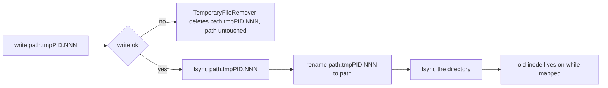

# 12. Loading GPT-2

This chapter connects the transformer from chapter 11 to the real GPT-2 small checkpoint published by OpenAI on Hugging Face. It covers three pieces: the safetensors file format and its reader and writer in `io/safetensors.cpp`, the translation of GPT-2 parameter names and layouts in `load_gpt2_weights`, and the byte-level BPE tokenizer in `text/bpe.cpp` that turns text into token ids and back. It ends with the end-to-end run: download the files, load them, generate text from C++ and from Python. This is the v1.0 milestone, "run GPT-2", but not the `v1.0.0` tag. The tags `chapter-12-transformer`, `chapter-13-polish` and `v1.0.0` all point at the same commit, and the BPE tokenizer, memory-mapped loading, atomic saves and `examples/gpt2_generate.cpp` landed in later commits that carry no tag. This chapter describes the current head of the repository.

| File | Role |
|------|------|
| `include/kael/io/safetensors.h` | `TensorMap`, `Metadata`, `LoadMode`, `SafetensorsFile`, `save_safetensors`, `read_safetensors`, `load_safetensors` |
| `src/io/safetensors.cpp` | Header parsing and validation, atomic save, memory-mapped load |
| `src/nn/transformer.cpp` | `translated_gpt2_name`, `stored_transposed`, `load_gpt2_weights` |
| `include/kael/text/bpe.h` | `split_gpt2_words`, `BpeTokenizer` |
| `src/text/bpe.cpp` | UTF-8 decoding, the pretokenizer, byte-to-unicode mapping, merges |
| `src/text/unicode_classes.inc` | Generated tables of Unicode letter and number ranges |
| `scripts/gen_unicode_classes.py` | Generates `unicode_classes.inc` from Python's `unicodedata` |
| `scripts/download_gpt2.sh` | Downloads weights, config, vocabulary and merges |
| `examples/gpt2_generate.cpp` | Text generation from C++ |
| `examples/gpt2_generate.py` | Text generation from Python, with a cache benchmark |
| `fuzz/fuzz_safetensors.cpp` | libFuzzer target for the reader (chapter 13) |

## Prerequisites

- [02. Memory model](02-memory-model.md): `Storage`, `Storage::external`, `TensorImpl`, dtypes and element sizes.
- [03. Views](03-views.md): `T()` and `contiguous()`.
- [07. Neural networks and training](07-neural-networks.md): `Module::state_dict`, `load_state_dict`, `Linear` weight layout.
- [10. Python bindings](10-python-bindings.md): `kael.GPT`, `kael.BpeTokenizer` and `kael.load_safetensors` on the Python side.
- [11. Transformer](11-transformer.md): `GPT`, its parameter names and `generate`.

## The safetensors format

### Layout

**Safetensors** is a file format for named tensors designed by Hugging Face. It has no code in it (unlike Python pickle), so loading an untrusted file cannot execute anything, and its data section can be mapped into memory directly. A file has three parts:

```text
offset 0        8 bytes   N: header length, unsigned 64-bit little-endian
offset 8        N bytes   header: UTF-8 JSON object, may end with spaces
offset 8 + N    rest      data: raw tensor bytes, back to back
```

The JSON header maps each tensor name to a description:

```json
{
  "__metadata__": {"format": "pt"},
  "wte.weight": {"dtype": "F32", "shape": [50257, 768], "data_offsets": [287209472, 441598976]}
}
```

- `dtype` is a string. kael reads and writes `F32`, `F64`, `I64` and `BOOL`. Any other dtype string (`F16`, `BF16`, `I32` and so on) raises `TypeError`, because kael has no such dtype (see [ADR 0001](adr/0001-runtime-dtype.md)).
- `shape` is an array of non-negative integers. `[]` is a scalar.
- `data_offsets` is `[begin, end)`, in bytes, relative to the start of the data section, not to the start of the file.
- The optional `__metadata__` entry is a flat map from string to string. It is not a tensor.

Elements are stored in row-major (C) order, little-endian, with no padding between tensors.

### A file byte by byte

This program writes two small tensors:

```cpp
kael::io::save_safetensors("t.safetensors",
                           {{"b", kael::ones({2, 2})},
                            {"a", kael::arange(0, 3, 1, kael::DType::I64)}});
```

The resulting file, from `xxd t.safetensors`:

```text
00000000: 7000 0000 0000 0000 7b22 6122 3a7b 2264  p.......{"a":{"d
00000010: 6174 615f 6f66 6673 6574 7322 3a5b 302c  ata_offsets":[0,
00000020: 3234 5d2c 2264 7479 7065 223a 2249 3634  24],"dtype":"I64
00000030: 222c 2273 6861 7065 223a 5b33 5d7d 2c22  ","shape":[3]},"
00000040: 6222 3a7b 2264 6174 615f 6f66 6673 6574  b":{"data_offset
00000050: 7322 3a5b 3234 2c34 305d 2c22 6474 7970  s":[24,40],"dtyp
00000060: 6522 3a22 4633 3222 2c22 7368 6170 6522  e":"F32","shape"
00000070: 3a5b 322c 325d 7d7d 0000 0000 0000 0000  :[2,2]}}........
00000080: 0100 0000 0000 0000 0200 0000 0000 0000  ................
00000090: 0000 803f 0000 803f 0000 803f 0000 803f  ...?...?...?...?
```

Reading it:

| Bytes | Content |
|-------|---------|
| `0x00` to `0x07` | `70 00 00 00 00 00 00 00`: header length 0x70 = 112, little-endian |
| `0x08` to `0x77` | 112 bytes of JSON. Keys are sorted (`"a"` before `"b"`) |
| `0x78` to `0x8F` | tensor `a`: data offsets `[0, 24)`, three int64 values 0, 1, 2 |
| `0x90` to `0x9F` | tensor `b`: data offsets `[24, 40)`, four float32 values `0x3F800000` = 1.0 |

The data section starts at `8 + 112 = 120 = 0x78`. Tensor `a` occupies data bytes 0 to 24, so file bytes `0x78` to `0x8F`. The file is 160 bytes, `8 + 112 + 40`.

## Writing a file

From `src/io/safetensors.cpp`:

```cpp
std::int64_t position = 0;
std::vector<Tensor> payloads;
payloads.reserve(tensors.size());
for (const auto& [name, tensor] : tensors) {
    KAEL_CHECK_VALUE(name != kMetadataKey, "a tensor cannot be named " << kMetadataKey);
    payloads.push_back(tensor.detach().cpu().contiguous());
    const std::int64_t end = position + tensor.nbytes();
    header[name] = {{"dtype", dtype_name(tensor.dtype())},
                    {"shape", tensor.shape()},
                    {"data_offsets", {position, end}}};
    position = end;
}

std::string text = header.dump();
text.append((kHeaderAlignment - (text.size() % kHeaderAlignment)) % kHeaderAlignment, ' ');
const std::uint64_t header_size = text.size();
```

- `TensorMap` is a `std::map<std::string, Tensor>`, so tensors are laid out in name order. The header is an `nlohmann::json` object, which also sorts its keys.
- Each tensor is detached, copied to the CPU and made contiguous. A view is saved by value: a transposed `[3, 2]` view of a `[2, 3]` tensor is written as a `[3, 2]` tensor in row-major order (`SavesViewsByValue`).
- The JSON text is padded with spaces to a multiple of `kHeaderAlignment = 8`. Since the length prefix is also 8 bytes, the data section starts at a multiple of 8 in the file, and every tensor whose offset is a multiple of its element size is naturally aligned. That matters for mapped loading below.
- A tensor named `__metadata__` is rejected, because it would collide with the metadata entry.
- The header is JSON, which must be valid UTF-8. `dump_header` catches the `nlohmann::json::type_error` that serializing an invalid string throws and raises `ValueError` ("tensor names and metadata must be valid UTF-8"), before any file is created (`SavingANameThatIsNotUtf8IsAValueError`).

### Atomic save

Writing directly to the target file has two failure modes. A crash or a full disk halfway through leaves a truncated file where a good checkpoint used to be. And a process that has the old file memory-mapped sees its pages change or disappear when the file is truncated. kael avoids both by writing to a temporary file in the same directory and renaming it over the target. From `src/io/safetensors.cpp`:

```cpp
// Mapped tensors may read from the file being replaced: truncating it would invalidate them.
std::filesystem::path temporary = path;
temporary +=
    ".tmp" + std::to_string(::getpid()) + "." + std::to_string(next_temporary_suffix());
TemporaryFileRemover remover{temporary};
std::ofstream file(temporary, std::ios::binary);
KAEL_CHECK(file.is_open(), "cannot write safetensors file " << temporary);
file.write(reinterpret_cast<const char*>(&header_size), sizeof(header_size));
file.write(text.data(), static_cast<std::streamsize>(text.size()));
for (const Tensor& payload : payloads) {
    if (payload.nbytes() > 0) {
        file.write(reinterpret_cast<const char*>(payload.data_ptr_raw()),
                   static_cast<std::streamsize>(payload.nbytes()));
    }
}
file.close();
KAEL_CHECK(file.good(), "failed writing safetensors file " << temporary);
flush_to_disk(temporary);
std::filesystem::rename(temporary, path);
remover.path.clear();
flush_to_disk(path.parent_path().empty() ? std::filesystem::path(".") : path.parent_path());
```



- The suffix is the process id followed by `next_temporary_suffix`: the steady clock count plus an atomic counter. The counter keeps two concurrent saves to the same path in one process apart, and the process id keeps saves from different processes apart.
- `TemporaryFileRemover` is an RAII guard. If anything throws before the rename, its destructor deletes the temporary file. After a successful rename, clearing its path disarms it.
- On POSIX, `rename` replaces the directory entry atomically. A reader sees either the old file or the new one, never a mix. A process that mapped the old file keeps its pages, because the old inode is only freed when its last mapping goes away.
- `flush_to_disk` opens a path read-only and calls `fsync` on it. The temporary file is flushed before the rename, so a crash after the rename cannot leave a renamed but empty or partial file. The directory is flushed after the rename, so the new directory entry itself survives a power loss. A failed `fsync` throws `kael::Error`.
- The length prefix and the tensor bytes are written in host byte order. On the little-endian hosts kael targets (x86-64 and ARM64), that is the format's byte order.

## Reading a file

### Validation

The reader treats the file as untrusted input. A corrupt or malicious file must produce a `kael::Error`, never a crash, an out-of-bounds read or a huge allocation. `read_safetensors` and its helpers check, in order:

| Check | Error |
|-------|-------|
| The file opens | `Error`: "cannot open safetensors file" |
| The file has at least 8 bytes | `ValueError`: "is too short" |
| `N <= 100,000,000` (`kMaxHeaderBytes`) and `N <= file_size - 8` | `ValueError`: "does not fit the file" |
| The header bytes can be read | `ValueError`: "is truncated" |
| The header parses as JSON and is an object | `ValueError`: "is not a JSON object" |
| `__metadata__`, if present, is an object of strings | `ValueError` |
| Each entry is an object with a string `dtype`, an array `shape` and an array `data_offsets` of exactly two elements | `ValueError` |
| `dtype` is one of `F32`, `F64`, `I64`, `BOOL` | `TypeError` |
| Every dimension and offset is a non-negative integer that fits in `int64` | `ValueError` |
| `begin <= end` | `ValueError`: "ends before it starts" |
| `end - begin == numel(shape) * element_size(dtype)`, computed with overflow checks | `ValueError` |
| Sorted by offset, the tensors tile the data section exactly: the first starts at 0, each starts where the previous ended, the last ends at the end of the file | `ValueError` |
| Every byte of a `BOOL` tensor is 0 or 1 | `ValueError` |

Notes on the less obvious checks:

- The header length is compared as `header_size <= file_size - sizeof(header_size)`, after checking that the file has at least 8 bytes. Writing it as `header_size + 8 <= file_size` would overflow for a length of `0xFFFFFFFFFFFFFFFF` and pass (`HugeHeaderLengthDoesNotOverflow`).
- The 100 MB cap bounds the string allocated for the header before the JSON is parsed. The GPT-2 header is 14,283 bytes.
- JSON is parsed with `Json::parse(text, nullptr, false)`, which returns a discarded value instead of throwing `nlohmann` exceptions, so all failures surface as kael errors.
- `non_negative_integer` accepts both signed and unsigned JSON integers and rejects floats, strings, negatives and unsigned values above `INT64_MAX`.
- The size check uses `numel(entry.shape)` and `detail::checked_mul`, both of which throw on overflow. A shape such as `[9223372036854775807, 9223372036854775807]` is rejected instead of wrapping to a small number.
- `check_layout` sorts the entries by `(begin, end)` and walks them. This one pass rejects gaps, overlaps, offsets past the end and trailing bytes. Overlapping entries would let two tensors alias the same bytes; gaps would hide data. Only after this check does the reader allocate or seek.
- A `BOOL` byte other than 0 or 1 would be a valid `uint8_t` but an invalid `bool`, and reading it as `bool` is undefined behavior.

The `BadHeader` parameterized suite in `tests/test_safetensors.cpp` feeds 26 corrupt headers and expects `ValueError` for each.

### The copying load

`LoadMode::Copy`, the default, allocates each tensor with `empty(shape, dtype)`, seeks to `8 + N + begin` and reads `end - begin` bytes. The resulting tensors own their memory and are independent of the file.

### The memory-mapped load

`LoadMode::Mapped` maps the whole file into the address space and builds tensors whose storage points into the mapping. Nothing is read until a page is touched, and pages that are only read are shared with the operating system's file cache. From `src/io/safetensors.cpp`:

```cpp
// Private pages: writing to a mapped tensor copies the page and never reaches the file.
std::shared_ptr<void> map_file(const std::filesystem::path& path, std::uint64_t expected_size) {
    const int descriptor = ::open(path.c_str(), O_RDONLY | O_CLOEXEC);
    KAEL_CHECK(descriptor >= 0, "cannot open safetensors file " << path);
    struct stat status{};
    const bool same_size = ::fstat(descriptor, &status) == 0 &&
                           static_cast<std::uint64_t>(status.st_size) == expected_size;
    void* address = same_size ? ::mmap(nullptr, static_cast<std::size_t>(expected_size),
                                       PROT_READ | PROT_WRITE, MAP_PRIVATE, descriptor, 0)
                              : MAP_FAILED;
    ::close(descriptor);
    KAEL_CHECK(same_size, "safetensors file " << path << " changed while it was being read");
    if (address == MAP_FAILED) {
        return nullptr;
    }
    return {address, [expected_size](void* mapped) {
                ::munmap(mapped, static_cast<std::size_t>(expected_size));
            }};
}
```

(The excerpt omits the `_WIN32` branch, which returns `nullptr`.)

- The header is validated first, through the ordinary stream, exactly as in copy mode. The mapping is created only for a file that passed every check.
- The file is reopened for the mapping. `fstat` confirms its size still matches the size used for validation; a file that changed in between is rejected.
- `MAP_PRIVATE` with `PROT_READ | PROT_WRITE` gives copy-on-write pages. Tensors are mutable in kael, so a mapped tensor must accept writes such as `fill_`. The first write to a page copies it privately, and the file on disk never changes (`WritingToAMappedTensorDoesNotChangeTheFile`).
- The descriptor is closed right after `mmap`. A mapping stays valid without an open descriptor.
- If `mmap` fails, `map_file` returns `nullptr` and every tensor falls back to the copying path. On Windows mapping is not implemented and the mapped mode always copies.

Each tensor is then built over the mapping. From `src/io/safetensors.cpp`:

```cpp
Tensor tensor_over_mapping(const std::shared_ptr<void>& mapping, std::uint64_t position,
                           const Entry& entry) {
    auto impl = std::make_shared<TensorImpl>();
    auto* first = static_cast<std::byte*>(mapping.get()) + position;
    impl->storage =
        std::make_shared<Storage>(Storage::external(first, entry.end - entry.begin, mapping));
    impl->shape = entry.shape;
    impl->strides = contiguous_strides(entry.shape);
    impl->dtype = entry.dtype;
    return Tensor::from_impl(std::move(impl));
}
```

`Storage::external` wraps memory that the storage does not allocate. Its third argument is an owner: a `shared_ptr` that the storage keeps alive. Every mapped tensor holds a copy of the same `shared_ptr<void>`, and its deleter calls `munmap`.

A tensor is built over the mapping only when it is non-empty and its file position is a multiple of its element size. `mmap` returns a page-aligned address, so a file offset that is a multiple of 4 gives a 4-byte aligned `float*`. A misaligned tensor is copied instead (`MappedLoadCopiesMisalignedTensors`), because dereferencing a misaligned `double*` is undefined behavior and traps on some CPUs.

```text
mapping (one shared_ptr<void>, munmap on last release)
+--------+-----------------+----------------------+----------------------+
| N (8B) | header (N bytes)| tensor a bytes       | tensor b bytes       |
+--------+-----------------+----------------------+----------------------+
                           ^                      ^
                           Storage of a           Storage of b
                           (owner = mapping)      (owner = mapping)
```

### Lifetime rules for mapped tensors

1. The mapping lives as long as any tensor, view or copy of a storage that came from it. Dropping the `TensorMap` does not unmap anything while one tensor is still referenced (`MappedTensorsOutliveTheMap`).
2. Writes to mapped tensors are private to the process and are lost when the mapping goes away.
3. Do not truncate or rewrite the file in place while mapped tensors are alive. Touching a page past the new end of a truncated file raises `SIGBUS`. The Python docstring of `kael.load_safetensors(path, mmap=True)` repeats this rule.
4. Replacing the file with `save_safetensors` is safe: the rename leaves the old inode alive for the existing mapping (`SavingOverTheFileBehindAMappedTensorKeepsItValid`).

## Loading GPT-2 weights

### What is in the checkpoint

The Hugging Face `gpt2` checkpoint is a 548,105,171-byte safetensors file with 160 F32 tensors and the metadata `{"format": "pt"}`. The entries of the first block and the global ones:

```text
wte.weight                [50257, 768]
wpe.weight                [1024, 768]
h.0.ln_1.weight / .bias   [768]
h.0.attn.c_attn.weight    [768, 2304]     bias [2304]
h.0.attn.c_proj.weight    [768, 768]      bias [768]
h.0.attn.bias             [1, 1, 1024, 1024]
h.0.ln_2.weight / .bias   [768]
h.0.mlp.c_fc.weight       [768, 3072]     bias [3072]
h.0.mlp.c_proj.weight     [3072, 768]     bias [768]
ln_f.weight / .bias       [768]
```

Compare `h.0.attn.c_attn.weight [768, 2304]` with kael's `blocks.0.attn.qkv.weight [2304, 768]`: same numbers, transposed.

### Why some weights are transposed

GPT-2 was written in TensorFlow, and its Hugging Face port keeps the original layer type for its projections, `Conv1D`. Despite the name, `Conv1D` is a linear layer that stores its weight as `[in_features, out_features]` and computes `x @ W + b`. PyTorch's `nn.Linear` and kael's `Linear` store `[out_features, in_features]` and compute `x @ W^T + b`. Both compute the same function, but the stored matrices are transposes of each other.

The four `Conv1D` layers per block are `c_attn`, `attn.c_proj`, `c_fc` and `mlp.c_proj`. Only their `.weight` tensors need transposing. Biases are vectors, embeddings are `[rows, C]` tables in both libraries, and layer norm parameters are vectors.

### The name mapping

| GPT-2 name | kael name | Transposed |
|------------|-----------|------------|
| `wte.weight` | `token_embedding.weight` | no |
| `wpe.weight` | `position_embedding.weight` | no |
| `h.{i}.ln_1.{weight,bias}` | `blocks.{i}.ln1.{weight,bias}` | no |
| `h.{i}.attn.c_attn.weight` | `blocks.{i}.attn.qkv.weight` | yes |
| `h.{i}.attn.c_attn.bias` | `blocks.{i}.attn.qkv.bias` | no |
| `h.{i}.attn.c_proj.weight` | `blocks.{i}.attn.proj.weight` | yes |
| `h.{i}.attn.c_proj.bias` | `blocks.{i}.attn.proj.bias` | no |
| `h.{i}.ln_2.{weight,bias}` | `blocks.{i}.ln2.{weight,bias}` | no |
| `h.{i}.mlp.c_fc.weight` | `blocks.{i}.mlp.fc1.weight` | yes |
| `h.{i}.mlp.c_fc.bias` | `blocks.{i}.mlp.fc1.bias` | no |
| `h.{i}.mlp.c_proj.weight` | `blocks.{i}.mlp.fc2.weight` | yes |
| `h.{i}.mlp.c_proj.bias` | `blocks.{i}.mlp.fc2.bias` | no |
| `ln_f.{weight,bias}` | `ln_final.{weight,bias}` | no |
| `h.{i}.attn.bias` | none: the causal mask buffer, ignored | |
| `lm_head.weight` | none: tied to `wte`, ignored | |

A leading `transformer.` prefix, present in checkpoints saved from `GPT2LMHeadModel.state_dict()`, is stripped first. The translation is plain string replacement. From `src/nn/transformer.cpp`:

```cpp
if (name.rfind("wte.", 0) == 0) {
    replace("wte.", "token_embedding.");
} else if (name.rfind("wpe.", 0) == 0) {
    replace("wpe.", "position_embedding.");
} else if (name.rfind("ln_f.", 0) == 0) {
    replace("ln_f.", "ln_final.");
} else if (name.rfind("h.", 0) == 0) {
    name.replace(0, 2, "blocks.");
    replace(".ln_1.", ".ln1.");
    replace(".ln_2.", ".ln2.");
    replace(".attn.c_attn.", ".attn.qkv.");
    replace(".attn.c_proj.", ".attn.proj.");
    replace(".mlp.c_fc.", ".mlp.fc1.");
    replace(".mlp.c_proj.", ".mlp.fc2.");
}
```

`stored_transposed` decides on the translated name: a name containing `.attn.qkv.`, `.attn.proj.`, `.mlp.fc1.` or `.mlp.fc2.` and ending in `.weight`.

### The loader

From `src/nn/transformer.cpp`:

```cpp
void load_gpt2_weights(GPT& model, const std::filesystem::path& path) {
    const io::TensorMap stored = io::load_safetensors(path, io::LoadMode::Mapped);
    const StateDict expected = model.state_dict();
    StateDict translated;
    for (const auto& [stored_name, tensor] : stored) {
        const std::string name = translated_gpt2_name(stored_name);
        if (expected.contains(name)) {
            translated.emplace(name, stored_transposed(name) ? tensor.T().contiguous() : tensor);
        }
    }
    model.load_state_dict(translated);
}
```

- Entries whose translated name is not a model parameter are dropped. That removes `attn.bias`, `lm_head.weight` and anything else the model does not have, so checkpoints with extra buffers load without special cases.
- `tensor.T().contiguous()` materializes the transpose. The model's `Linear` could use the stored layout as a strided view, but `load_state_dict` copies into existing parameters anyway, and a contiguous source keeps that copy a straight memory copy.
- `Module::load_state_dict` (chapter 07) first checks that every model parameter is present with the same shape, then copies all of them under `NoGradGuard`. A missing name throws `Error` ("state dict is missing parameter ..."), a shape mismatch throws `ValueError`. Because all checks run before the first copy, a failed load leaves the model unchanged.
- The model's parameters receive copies. When `load_gpt2_weights` returns, `stored` and `translated` are destroyed, and so is the mapping. The model never depends on the file afterwards.
- The model's `GptConfig` must match the checkpoint. Loading GPT-2 small into a model with another width fails on the first shape check.

The official `gpt2` file has a 14,283-byte header, so its data section starts at byte 14,291. That offset is not a multiple of 4, so no F32 tensor in it is 4-byte aligned in the file, and the mapped load copies every tensor. Files written by `save_safetensors` pad the header to 8 bytes and are mapped without copies.

## Byte-level BPE

GPT-2 does not see characters or words. It sees ids from a vocabulary of 50,257 tokens built by byte pair encoding over UTF-8 bytes. `BpeTokenizer` reproduces the GPT-2 tokenizer from the two files Hugging Face publishes, `vocab.json` and `merges.txt`.

### The idea of BPE

**Byte pair encoding** starts from single bytes and repeatedly merges the most frequent adjacent pair in a training corpus into a new symbol. The ordered list of merges is the learned model: merge 0 was the most frequent pair, merge 1 the next, and so on. To encode new text, apply the same merges in the same priority: at each step, among all adjacent pairs in the current word, merge the one with the lowest rank. Stop when no adjacent pair appears in the list.

Worked example with the merges `h e` (rank 0), `e l` (rank 1), `he l` (rank 2), from the `MergesFollowTheirRank` test:

```text
start       [h] [e] [l]
pairs       "h e" rank 0, "e l" rank 1      -> merge rank 0
            [he] [l]
pairs       "he l" rank 2                   -> merge rank 2
            [hel]
pairs       none                            -> stop, look up "hel"
```

With only `e l` (rank 0) and `h e` (rank 1), the result is `[h] [el]`: rank decides, not position (`ALowerRankWinsOverAnEarlierPosition`).

### Byte-to-unicode mapping

The vocabulary and merges files are text. Their tokens cannot contain raw bytes such as `0x00` or `0x0A`, and `merges.txt` uses a space as the separator between the two symbols of a pair, so a raw space cannot appear inside a symbol. GPT-2 solves this by assigning every byte a printable Unicode character:

- The 188 bytes that are already printable map to themselves: `0x21` to `0x7E`, `0xA1` to `0xAC`, `0xAE` to `0xFF`.
- The other 68 bytes (`0x00` to `0x20`, `0x7F` to `0xA0`, `0xAD`) map, in byte order, to code points 256, 257, and up.

From `src/text/bpe.cpp`:

```cpp
std::array<char32_t, 256> make_symbol_of_byte() {
    std::array<char32_t, 256> symbols{};
    char32_t next_unprintable = kFirstUnprintableSymbol;
    for (unsigned byte = 0; byte < 256; ++byte) {
        const bool printable = (byte >= 0x21 && byte <= 0x7E) || (byte >= 0xA1 && byte <= 0xAC) ||
                               (byte >= 0xAE && byte <= 0xFF);
        symbols[byte] = printable ? static_cast<char32_t>(byte) : next_unprintable++;
    }
    return symbols;
}
```

Examples, checked against `BpeTokenizer::byte_symbols()`:

| Byte | Meaning | Symbol | Code point |
|------|---------|--------|------------|
| `0x00` | NUL | `Ā` | U+0100 (256) |
| `0x0A` | newline | `Ċ` | U+010A (266) |
| `0x20` | space | `Ġ` | U+0120 (288) |
| `0x21` | `!` | `!` | U+0021 |
| `0xAD` | soft hyphen | `Ń` | U+0143 (323) |
| `0xFF` | | `ÿ` | U+00FF |

That is why GPT-2 tokens with a leading space appear as `Ġthe` (id 262) in `vocab.json`, and a newline as `Ċ` (id 198).

`byte_symbols()` returns the 256 symbols UTF-8 encoded, for building the initial symbols of a word. `byte_of_symbol()` is the reverse map, from code point to byte, used once per vocabulary token at load time. The highest symbol is U+0143, so `encode_utf8` only needs the one-, two- and three-byte forms.

### Pretokenization

BPE never merges across word boundaries. Before merging, GPT-2 splits text with this regular expression:

```text
's|'t|'re|'ve|'m|'ll|'d| ?\p{L}+| ?\p{N}+| ?[^\s\p{L}\p{N}]+|\s+(?!\S)|\s+
```

The alternatives, tried in order at each position:

1. English contractions: `'s`, `'t`, `'re`, `'ve`, `'m`, `'ll`, `'d` (lowercase only).
2. An optional single space followed by one or more letters (`\p{L}`).
3. An optional single space followed by one or more numbers (`\p{N}`).
4. An optional single space followed by one or more characters that are not whitespace, letters or numbers.
5. A run of whitespace not followed by a non-whitespace character. In practice: a whitespace run minus its last character when more text follows, so that the last space can start the next word.
6. Any remaining whitespace run.

kael implements the pattern by hand in the `WordSplitter` class instead of pulling in a regex library with Unicode property support and lookahead. `word_end` tries the alternatives in the same order. From `src/text/bpe.cpp`:

```cpp
[[nodiscard]] std::size_t word_end(std::size_t begin) const {
    for (const std::size_t end :
         {contraction_end(begin), class_run_end(begin, is_letter),
          class_run_end(begin, is_number), class_run_end(begin, is_other)}) {
        if (end != begin) {
            return end;
        }
    }
    return whitespace_end(begin);
}
```

`whitespace_end` implements alternatives 5 and 6 together:

```cpp
[[nodiscard]] std::size_t whitespace_end(std::size_t begin) const {
    std::size_t end = begin;
    while (end < points_.size() && is_space(points_[end])) {
        ++end;
    }
    if (end == points_.size() || end - begin == 1) {
        return end;
    }
    return end - 1;
}
```

Examples from `tests/test_bpe.cpp` and a direct run of `split_gpt2_words`:

```text
"Hello, world!"                  -> "Hello" "," " world" "!"
"don't we'll"                    -> "don" "'t" " we" "'ll"
"o'clock"                        -> "o" "'" "clock"
"abc123 45"                      -> "abc" "123" " 45"
"a  b"                           -> "a" " " " b"
"a\n\nb"                         -> "a" "\n" "\n" "b"
"a   "                           -> "a" "   "
"Hello, world!  I'm here 2024"   -> "Hello" "," " world" "!" " " " I" "'m" " here" " 2024"
"año €5 日本語"                   -> "año" " €" "5" " 日本語"
```

The splitter first decodes the text into code points with their byte offsets, then cuts words by offsets. `decode_utf8` rejects overlong encodings, surrogates, values above U+10FFFF and truncated sequences by returning U+FFFD with a length of 1. U+FFFD is neither a letter, a number nor whitespace, so an invalid byte joins an "other" run, and because words are cut by byte offsets, every original byte is kept (`KeepsEveryByteOfInvalidUtf8`).

### Unicode classes

`\p{L}` and `\p{N}` are the Unicode general categories starting with L (letters: Lu, Ll, Lt, Lm, Lo) and N (numbers: Nd, Nl, No). kael stores them as sorted tables of inclusive code point ranges, generated from Python's `unicodedata`. From `scripts/gen_unicode_classes.py`:

```python
def ranges_of(category_prefix):
    ranges = []
    for code_point in range(sys.maxunicode + 1):
        if not unicodedata.category(chr(code_point)).startswith(category_prefix):
            continue
        if ranges and ranges[-1][1] == code_point - 1:
            ranges[-1][1] = code_point
        else:
            ranges.append([code_point, code_point])
    return ranges
```

The script writes `src/text/unicode_classes.inc` with two arrays, `kLetters` and `kNumbers`, and a first line recording the Unicode version of the Python that generated it:

```cpp
// Generated by scripts/gen_unicode_classes.py from Unicode 15.0.0.
inline constexpr CodePointRange kLetters[] = {
    {0x41, 0x5A},
    {0x61, 0x7A},
    {0xAA, 0xAA},
```

`bpe.cpp` includes the file inside its anonymous namespace, right after defining `CodePointRange`. Whitespace (`\s`) is a short hand-written table, `kWhitespace`, with the ten ranges of the Unicode `White_Space` property: `0x9` to `0xD`, `0x20`, `0x85`, `0xA0`, `0x1680`, `0x2000` to `0x200A`, `0x2028` to `0x2029`, `0x202F`, `0x205F` and `0x3000`.

Membership is a binary search. From `src/text/bpe.cpp`:

```cpp
bool contains(std::span<const CodePointRange> ranges, char32_t code_point) {
    const auto* found = std::upper_bound(
        ranges.data(), ranges.data() + ranges.size(), code_point,
        [](char32_t value, const CodePointRange& range) { return value < range.first; });
    return found != ranges.data() && code_point <= (found - 1)->last;
}
```

`upper_bound` finds the first range that starts after the code point. The only candidate is the range before it, which contains the code point if its `last` is not smaller. Generating the table at build time instead of at runtime keeps the library free of ICU and gives the same result on every platform.

### Loading the vocabulary and merges

The constructor reads `vocab.json`, a JSON object from token string to id:

- Each id must be a non-negative integer, otherwise `ValueError`.
- `ids_` maps the token string to its id, for encoding.
- `bytes_of_id_` maps the id to the raw bytes the token stands for, computed by `bytes_of_token`: decode the token's UTF-8 code points and map each one back through `byte_of_symbol()`. A token containing a code point that is not one of the 256 byte symbols is not byte-level BPE and throws `ValueError`.

Then it reads `merges.txt`. Each non-empty line that does not start with `#version` must hold exactly two symbols separated by one space. A trailing `\r` is removed, so files with Windows line endings work. The line itself, such as `"Ġ t"`, is the key in `merge_ranks_`, and its rank is its position among the merge lines. The GPT-2 file has 50,000 merges after its `#version: 0.2` line.

Special tokens get no special treatment. `<|endoftext|>` (id 50256) is a vocabulary entry made of printable ASCII, so `decode({50256})` returns the text `<|endoftext|>`, and encoding that text produces ordinary tokens for `<`, `|` and so on. This matches `tiktoken`'s `encode_ordinary`.

### Encode and decode

`encode` splits the text into words and runs BPE on each. From `src/text/bpe.cpp`, the merge loop of `append_word_ids`:

```cpp
while (symbols.size() > 1) {
    std::int64_t best_rank = std::numeric_limits<std::int64_t>::max();
    std::size_t best = symbols.size();
    for (std::size_t i = 0; i + 1 < symbols.size(); ++i) {
        const auto found = merge_ranks_.find(merge_key(symbols[i], symbols[i + 1]));
        if (found != merge_ranks_.end() && found->second < best_rank) {
            best_rank = found->second;
            best = i;
        }
    }
    if (best == symbols.size()) {
        break;
    }
    // ... replace every adjacent (left, right) pair, scanning left to right ...
}
```

- The initial symbols are the byte symbols of the word's bytes, so the space in `" world"` becomes `Ġ`.
- Each round finds the adjacent pair with the lowest rank and merges every non-overlapping occurrence of it, scanning from left to right. This matches the reference GPT-2 implementation.
- When no pair is in the merge table, each remaining symbol is looked up in `ids_`. A symbol that is not in the vocabulary throws `ValueError` (`RejectsTextOutsideItsVocabulary`). With the real GPT-2 files this cannot happen, because every single byte symbol is a token.

The cost per word is quadratic in its length in the worst case, which is acceptable because pretokenization keeps words short. The reference implementation caches results per word; kael does not.

`decode` concatenates `bytes_of_id_` for each id and throws `IndexError` for an unknown id. The result is a byte string, not necessarily valid UTF-8: a multi-byte character can be split across two tokens, and decoding one token alone returns half a character. The Python binding returns `bytes` for this reason, and chapter 13 shows how the server decodes a stream incrementally.

## End to end

### 1. Download

From `scripts/download_gpt2.sh`:

```bash
directory="${1:-data/gpt2}"
base="https://huggingface.co/gpt2/resolve/main"
expected="248dfc3911869ec493c76e65bf2fcf7f615828b0254c12b473182f0f81d3a707"

mkdir -p "$directory"
curl --fail --location --continue-at - --output "$directory/model.safetensors" "$base/model.safetensors"
curl --fail --location --output "$directory/config.json" "$base/config.json"
curl --fail --location --output "$directory/vocab.json" "$base/vocab.json"
curl --fail --location --output "$directory/merges.txt" "$base/merges.txt"
echo "$expected  $directory/model.safetensors" | shasum -a 256 --check
```

`--continue-at -` resumes an interrupted download of the 548 MB weights file. The SHA-256 check covers the weights; the three small files are not checked. kael's loaders do not read `config.json`: the configuration comes from `GptConfig::gpt2_small()`.

### 2. Generate from C++

`examples/gpt2_generate.cpp` builds with `-DKAEL_BUILD_EXAMPLES=ON`. Its `run` function is the whole pipeline:

```cpp
const kael::text::BpeTokenizer tokenizer(options.directory / "vocab.json",
                                         options.directory / "merges.txt");
kael::nn::GPT model(kael::nn::GptConfig::gpt2_small());
kael::nn::load_gpt2_weights(model, options.directory / "model.safetensors");
model.to(options.device);
model.eval();

const std::vector<std::int64_t> ids = tokenizer.encode(options.prompt);
const auto length = static_cast<std::int64_t>(ids.size());
const kael::Tensor prompt =
    kael::from_vector<std::int64_t>(ids, {1, length}).to(options.device);

kael::manual_seed(options.seed);
const kael::Tensor output = kael::nn::generate(model, prompt,
                                               {.max_new_tokens = options.tokens,
                                                .temperature = options.temperature,
                                                .top_k = options.top_k});
```

It then decodes `output.select(0, 0)` and prints the text to standard output and the generation rate in tokens per second to standard error.

| Argument | Default |
|----------|---------|
| positional prompt | `"The meaning of life is"` |
| `--tokens` | 60 |
| `--temperature` | 0.8 |
| `--top-k` | 40 |
| `--seed` | 42 |
| `--data` | `data/gpt2` |
| `--device` | `cpu` (`cuda` selects the CUDA device) |

`--help` prints the usage. An unknown option, an option without its value or an unknown device name is an error, not a silent fallback to the defaults. The device name goes through `kael::parse_device`.

```bash
build/examples/gpt2_generate --tokens 20
```

```text
The meaning of life is not only about the meaning of life, but also the meaning of life itself." "It is a
```

That output came from one macOS run with the default seed. The exact text depends on the standard library's random distributions and the floating point summation order, so another platform may print different text with the same seed.

### 3. Generate from Python

`examples/gpt2_generate.py` uses the Python bindings for the model and `tiktoken` for the tokenizer:

```python
encoding = tiktoken.get_encoding("gpt2")
model = kael.GPT()
model.load_gpt2(arguments.weights)
model.to(arguments.device)
model.eval()
prompt = kael.tensor([encoding.encode(arguments.prompt)]).to(arguments.device)
```

Its arguments mirror the C++ example, except that `--weights` (default `data/gpt2/model.safetensors`) replaces `--data`. `argparse` restricts `--device` to `cpu` or `cuda`, and `--help` describes every option. With `--benchmark`, it runs greedy generation (temperature 0) twice, with and without the KV cache, and prints the rate of each:

```bash
python examples/gpt2_generate.py --benchmark --tokens 60
```

To use kael's own tokenizer from Python instead of `tiktoken`, create `kael.BpeTokenizer("data/gpt2/vocab.json", "data/gpt2/merges.txt")`. Its `decode` returns `bytes`.

## Edge cases and pitfalls

- Header length overflow. A length of `2^64 - 1` must not wrap. The comparison is ordered to avoid the addition (`HugeHeaderLengthDoesNotOverflow`).
- Size overflow in shapes. `numel` and `checked_mul` throw instead of wrapping, so a header cannot claim a huge tensor that fits in 16 bytes.
- Overlapping or gapped offsets. `check_layout` rejects both before any allocation.
- Invalid booleans. Bytes other than 0 and 1 in a `BOOL` tensor are rejected (`InvalidBoolBytesAreRejected`).
- Unsupported dtypes. `F16` and `BF16` checkpoints throw `TypeError`. Convert them to F32 first.
- Empty tensors. A tensor with zero elements has `begin == end`. It is never placed over the mapping and no bytes are read or written for it.
- Truncating a mapped file. Causes `SIGBUS` on the next page fault. Replace files with `save_safetensors` or another write-and-rename tool.
- Misaligned files. Files from other writers may not pad their header to 8 bytes. Mapped loading then copies misaligned tensors, and for the official GPT-2 file that means every tensor.
- Big-endian hosts. The reader and writer do not swap bytes. Safetensors is little-endian, so kael's files are only portable between little-endian hosts.
- Wrong GELU or config. Loading GPT-2 weights into a model with `tanh_gelu = false` succeeds, but the logits drift from the reference. A different `dimension` or `layers` fails with a shape or missing-parameter error.
- Text that is not UTF-8. The tokenizer handles it: invalid bytes become their own byte symbols and decode back to the same bytes (`RoundTripsArbitraryBytes`).
- Partial characters in decode. Decoding a prefix of a token sequence can end in the middle of a UTF-8 character. Decode incrementally or decode the whole sequence.
- Unicode version drift. The class tables are frozen at Unicode 15.0.0. Rerunning `gen_unicode_classes.py` with another Python can change the tables and therefore the tokenization of rare characters. Check the first line of the generated file after regenerating.

## How it is tested

`tests/test_safetensors.cpp`, suite `Safetensors` plus the parameterized `Corrupt/BadHeader`:

| Test | What it proves |
|------|----------------|
| `RoundTripEveryDtype`, `MetadataRoundTrip`, `StateDictRoundTrip` | save then load preserves values, dtypes, shapes and metadata |
| `SavesViewsByValue` | non-contiguous views are written in logical order |
| `HeaderFormatMatchesTheSpecification` | the header contains `"dtype":"F32"`, `"shape":[2,2]`, `"data_offsets":[0,16]` and `8 + N` is a multiple of 8 |
| `ReadsAFileWithPadding` | trailing spaces in the header are accepted |
| `MissingFile`, `TruncatedLengthPrefix`, `HeaderLongerThanFile`, `HugeHeaderLengthDoesNotOverflow` | framing errors |
| `BadHeader.IsRejected` | 26 malformed headers, each raises `ValueError` |
| `InvalidBoolBytesAreRejected`, `UnsupportedDtypeIsATypeError`, `NamesCannotBeTheMetadataKey`, `SavingANameThatIsNotUtf8IsAValueError` | content errors |
| `MappedLoadMatchesTheCopyingLoad`, `MappedLoadRejectsCorruptFilesLikeTheCopyingLoad` | the two modes agree |
| `MappedTensorsOutliveTheMap`, `WritingToAMappedTensorDoesNotChangeTheFile` | lifetime and copy-on-write |
| `MappedLoadSharesTheFilePagesWhenAligned`, `MappedLoadCopiesMisalignedTensors` | aligned tensors point into one mapping 4 floats apart; misaligned ones are copied and aligned |
| `SavingOverTheFileBehindAMappedTensorKeepsItValid`, `AFailedSaveLeavesTheExistingFileIntact`, `SavingLeavesNoTemporaryFilesBehind` | atomic save |

`tests/test_transformer.cpp`, suite `Gpt2Weights`:

- `MissingEntriesAreReported`: a file with only `wte.weight` throws.
- `Conv1DWeightsAreTransposed`: builds a fake Hugging Face file from a kael model's own state dict, with `transformer.h.*` prefixes, transposed Conv1D weights, an `lm_head.weight` and an `attn.bias` buffer, loads it into a fresh model and checks every parameter is bit-identical to the source.

`tests/test_bpe.cpp`, suites `Gpt2Split` and `Bpe`: the splitting examples above, merge ranking, a round trip of all 256 byte values, the `Ġ` leading space, special tokens decoded as text, and rejection of unknown ids, unknown symbols, corrupt files and missing files.

`python/tests/test_tokenizer.py` (skipped unless `tiktoken` is installed and `data/gpt2` holds the vocabulary) compares `kael.BpeTokenizer` with `tiktoken.get_encoding("gpt2").encode_ordinary` on fixed texts with contractions, mixed whitespace, several scripts and emoji, and on 2,000 random strings generated by Hypothesis.

`python/tests/test_gpt.py`:

- `test_safetensors_written_by_python_load_in_kael` and `test_safetensors_written_by_kael_load_in_python` check interoperability with the reference `safetensors` package in both directions, including metadata and an empty tensor.
- `test_mapped_safetensors_match_and_stay_private` checks the mapped mode from Python.
- `test_real_gpt2_logits_match_huggingface` (skipped without the downloaded weights) loads the real checkpoint, checks 124,439,808 parameters, and compares the last-position logits for "Hello, my name is" with Hugging Face `transformers` to within `1e-3`.

`fuzz/fuzz_safetensors.cpp` runs the reader on random files in both load modes (chapter 13).

## Build it yourself

1. Write `save_safetensors` without the temporary file: build the header, pad it, write the length, header and payloads. Checkpoint: `HeaderFormatMatchesTheSpecification` passes and `xxd` shows the layout from this chapter.
2. Write `read_safetensors` in copy mode with every check in the validation table. Checkpoint: all `BadHeader` cases, `HugeHeaderLengthDoesNotOverflow` and `RoundTripEveryDtype` pass.
3. Make the save atomic with the temporary file, the RAII remover and `rename`. Checkpoint: `AFailedSaveLeavesTheExistingFileIntact` and `SavingLeavesNoTemporaryFilesBehind` pass.
4. Add `LoadMode::Mapped` with `map_file`, `Storage::external` and the alignment fallback. Checkpoint: the six mapped tests pass, and `SavingOverTheFileBehindAMappedTensorKeepsItValid` still passes.
5. Write `translated_gpt2_name`, `stored_transposed` and `load_gpt2_weights`. Checkpoint: `Gpt2Weights.Conv1DWeightsAreTransposed` and `MissingEntriesAreReported` pass.
6. Write `decode_utf8`, `contains` and generate `unicode_classes.inc` with `python3 scripts/gen_unicode_classes.py`. Checkpoint: the library compiles with the generated file included.
7. Write `WordSplitter` and `split_gpt2_words`. Checkpoint: all `Gpt2Split` tests pass.
8. Write the byte-to-unicode mapping, the constructor and `encode`/`decode`. Checkpoint: all `Bpe` tests pass.
9. Run `scripts/download_gpt2.sh`, then `pytest python/tests/test_tokenizer.py python/tests/test_gpt.py`. Checkpoint: the tokenizer matches `tiktoken` and the real GPT-2 logits match Hugging Face.
10. Build and run `gpt2_generate`. Checkpoint: it prints a coherent English continuation of the prompt.

## Further reading

- The safetensors format specification in the Hugging Face `safetensors` repository.
- Sennrich, Haddow and Birch, "Neural Machine Translation of Rare Words with Subword Units" (2016): BPE for language models.
- OpenAI's original GPT-2 `encoder.py`: the byte-to-unicode table, the pretokenization regex and the merge loop.
- The Hugging Face `transformers` source for `GPT2Model` and `Conv1D`.
- `mmap(2)` and `rename(2)` in the POSIX manual pages.

Next: [13. Serving and tooling](13-serving-and-tooling.md)
