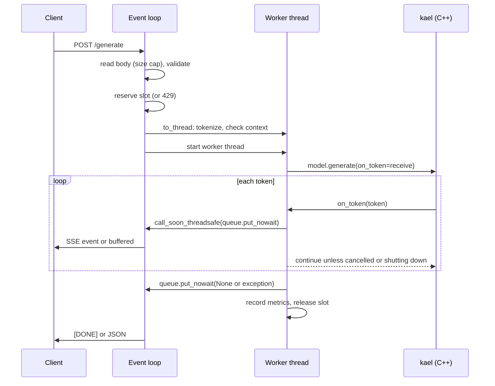
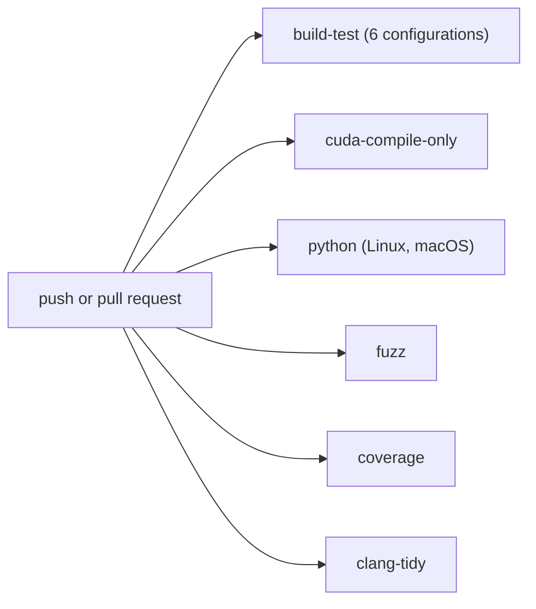

# 13. Serving and tooling

This last chapter covers what surrounds the library: an HTTP server that exposes GPT-2 generation, its Docker image, the debugging helpers in `debug.h`, fuzzing with libFuzzer, the sanitizer builds, clang-tidy and clang-format, and the CI jobs that run all of it. It maps to the `chapter-13-polish` tag, the same commit as `v1.0.0`.

| File | Role |
|------|------|
| `server/app.py` | FastAPI application: request validation, one generation slot, streaming, cancellation, metrics |
| `server/requirements.txt` | Runtime dependencies of the server: `fastapi`, `pydantic`, `uvicorn` |
| `server/Dockerfile` | Two-stage image: build the wheel, then run the server as a non-root user |
| `.dockerignore` | Keeps `build*`, `data`, `venv` and `.git` out of the Docker build context |
| `include/kael/debug.h`, `src/debug.cpp` | `explain`, `autograd_graph_dot`, `set_backward_trace`, `set_anomaly_detection` |
| `src/autograd/engine.cpp` | Where tracing and anomaly checks run during backward |
| `fuzz/fuzz_safetensors.cpp`, `fuzz/fuzz_idx.cpp`, `fuzz/CMakeLists.txt` | libFuzzer targets and their build |
| `fuzz/corpus/` | Seed inputs for each fuzzer |
| `CMakeLists.txt` | `KAEL_ENABLE_SANITIZERS`, `KAEL_ENABLE_TSAN`, `KAEL_BUILD_FUZZERS`, `kael_configure_target` |
| `.clang-tidy`, `.clang-format` | Static analysis and formatting rules |
| `.github/workflows/ci.yml`, `.github/workflows/wheels.yml` | CI and wheel release workflows |
| `python/tests/test_server.py`, `tests/test_debug.cpp` | Tests for the server and the debug helpers |

## Prerequisites

- [06. Autograd](06-autograd.md): graph nodes, edges, `AccumulateGrad`, the engine.
- [08. CPU performance](08-cpu-performance.md): the caching allocator, which sanitizer builds disable.
- [10. Python bindings](10-python-bindings.md): GIL release and reacquisition around C++ calls.
- [11. Transformer](11-transformer.md): `generate` and its `on_token` callback.
- [12. Loading GPT-2](12-model-loading.md): `load_gpt2_weights`, `BpeTokenizer`, the safetensors reader that the fuzzer attacks.

## The generation server

### What it exposes

`server/app.py` loads GPT-2 small once at startup and serves three endpoints:

| Method and path | Response |
|-----------------|----------|
| `POST /generate` | JSON with the generated text, or a stream of server-sent events |
| `GET /health` | `{"status": "ok"}` |
| `GET /metrics` | Prometheus text format |

The request body is validated by a pydantic model. From `server/app.py`:

```python
class GenerateRequest(BaseModel):
    prompt: str = Field(min_length=1, max_length=MAX_PROMPT_CHARACTERS)
    max_tokens: int = Field(default=64, ge=1, le=MAX_NEW_TOKENS)
    temperature: float = Field(default=0.8, ge=0.0, le=10.0)
    top_k: int = Field(default=40, ge=0, le=MAX_TOP_K)
    stream: bool = False

    @field_validator("temperature")
    @classmethod
    def temperature_is_zero_or_usable(cls, value):
        if 0.0 < value < MIN_TEMPERATURE:
            raise ValueError(f"temperature must be 0 or at least {MIN_TEMPERATURE}")
        return value
```

| Field | Default | Allowed |
|-------|---------|---------|
| `prompt` | required | 1 to 8,192 characters (`MAX_PROMPT_CHARACTERS`) |
| `max_tokens` | 64 | 1 to 512 (`MAX_NEW_TOKENS`) |
| `temperature` | 0.8 | 0, or 0.001 (`MIN_TEMPERATURE`) to 10 |
| `top_k` | 40 | 0 to 1,000,000 (`MAX_TOP_K`); values at or above the vocabulary size disable top-k |
| `stream` | `false` | `true` for server-sent events |

A plain request and its response:

```bash
curl -s localhost:8000/generate -H 'content-type: application/json' \
  -d '{"prompt": "The meaning of life is", "max_tokens": 20, "temperature": 0}'
```

```json
{"text": "...", "tokens": 20, "seconds": 1.9}
```

`text` holds only the generated continuation, not the prompt. `tokens` is the number of generated tokens and `seconds` the wall time from the start of generation.

### Architecture

FastAPI runs request handlers on an asyncio event loop. A GPT-2 forward pass takes tens of milliseconds to seconds and holds no Python lock (the binding releases the GIL), so it must not run on the event loop thread: every other request, including `/health`, would wait for it. The server therefore runs each generation on a worker thread and connects it to the handler through an `asyncio.Queue`.



`Generator` owns the model, the tokenizer, the device, the context length, the slot and the metrics. `create_app(generator)` builds the FastAPI app around it, and `load_app(data, device)` creates the real one: `kael.BpeTokenizer` from `vocab.json` and `merges.txt`, `kael.GPT()` with `load_gpt2`, the model moved to the device and switched to eval mode, and a context of 1024. Because `Generator` accepts any model with `generate` and any tokenizer with `encode` and `decode`, the tests replace the model and tokenizer with small fakes.

### The request flow

The `/generate` handler is four calls. From `server/app.py`:

```python
@app.post("/generate")
async def generate(http_request: Request):
    request = await parse_request(http_request)
    prompt = await prepare_prompt(request)
    started = time.perf_counter()
    queue, cancelled = start_generation(prompt, request)
    if request.stream:
        return StreamingResponse(
            stream_tokens(queue, cancelled), media_type="text/event-stream"
        )

    tokens = await collect_tokens(queue, cancelled, http_request)
    if tokens is None:
        return Response(status_code=499)
    generator.metrics.count_request("ok")
    return {
        "text": generator.tokenizer.decode(tokens).decode("utf-8", "replace"),
        "tokens": len(tokens),
        "seconds": time.perf_counter() - started,
    }
```

1. `parse_request` reads the body chunk by chunk and stops with 413 as soon as it exceeds `MAX_BODY_BYTES`. Only then does pydantic parse it. A `ValidationError` becomes 422 with the error list, built with `include_input=False` so the response never echoes the prompt back. Both count as `rejected`.
2. `prepare_prompt` reserves the generation slot, then tokenizes the prompt in a thread with `asyncio.to_thread`. Encoding 8,192 characters is not instant, and doing it on the loop would stall other requests (`test_the_event_loop_keeps_answering_while_a_prompt_is_encoded`). `prompt_tensor` rejects a prompt with no tokens (422) and a prompt whose token count plus `max_tokens` exceeds the context (413). Any failure here releases the slot. That includes `asyncio.CancelledError`, which reaches `prepare_prompt` when the request task is cancelled while the prompt is still being encoded. `CancelledError` derives from `BaseException`, not `Exception`, so it needs its own `except` clause; without it the slot would stay reserved and every later request would get 429 (`test_a_request_cancelled_while_encoding_frees_its_slot`).
3. `start_generation` creates the queue and a `threading.Event` named `cancelled`, and starts a daemon thread that calls `generator.run`.
4. Streaming requests return a `StreamingResponse` at once. Plain requests wait in `collect_tokens` and return JSON.

Rejecting `len(ids) + max_tokens > context` up front means the server never relies on the sliding window that `generate` uses past the context length (chapter 11), which would be much slower.

### The concurrency slot

One GPT model has one set of activations and runs one generation at a time. The server enforces that with a non-blocking lock. From `server/app.py`:

```python
def reserve(self):
    if not self.slot.acquire(blocking=False):
        self.metrics.count_request("busy")
        raise HTTPException(429, "the model is busy", headers={"Retry-After": "1"})
    with self.metrics.lock:
        self.metrics.in_flight += 1
```

A second request while one is running gets `429 Too Many Requests` with `Retry-After: 1` immediately, instead of queuing without bound. Clients retry, and a load balancer in front can spread retries across replicas.

The slot belongs to the worker thread, not to the HTTP handler. `Generator.run` releases it in a `finally` block after recording the metrics. The comment in `start_generation` states why:

```python
# The worker owns the slot: a client that never reads the body must not keep it.
threading.Thread(target=work, daemon=True).start()
```

If the slot were released when the streaming response finished, a client that opened a stream and never read it would hold the model forever. With the worker as owner, the slot is freed when generation ends, whatever the client does (`test_a_client_that_never_reads_the_stream_does_not_keep_its_slot`).

### Crossing from C++ to the event loop

`model.generate` is a C++ call with the GIL released. For each token, the C++ loop calls the Python callback, and the binding reacquires the GIL for that call only (chapter 10). The server's callback chain is:

- `Generator.run` passes `receive`, which counts the token and returns `on_token(token.item()) and not self.shutting_down.is_set()`.
- `on_token`, defined in `start_generation`, hands the id to the event loop and reports whether to continue:

```python
def on_token(token):
    loop.call_soon_threadsafe(queue.put_nowait, token)
    return not cancelled.is_set()
```

`asyncio.Queue` is not thread-safe, so the worker never touches it directly. `call_soon_threadsafe` schedules `put_nowait` on the loop thread. When `work` finishes, it enqueues `None` for success or the exception object for failure, which ends the consumer's loop.

A callback that returns a falsy value stops generation in C++: `generate` breaks out of its loop after the current token. A callback that raises propagates the exception to the Python caller (`test_python_callback_errors_reach_the_caller`).

### Streaming with server-sent events

**Server-sent events** (SSE) is a one-way HTTP streaming format: the response has content type `text/event-stream`, and each event is one or more `data: ...` lines followed by a blank line. The server sends one event per decoded piece of text and a final `[DONE]` marker:

```text
data: {"text": " not"}

data: {"text": " only"}

data: [DONE]

```

From `server/app.py`:

```python
async def stream_tokens(queue, cancelled):
    decoder = codecs.getincrementaldecoder("utf-8")("replace")
    finished = False
    try:
        while (item := await queue.get()) is not None:
            if isinstance(item, Exception):
                finished = True
                generator.metrics.count_request("error")
                yield sse({"error": "generation failed"})
                return
            text = decoder.decode(generator.tokenizer.decode([item]))
            if text:
                yield sse({"text": text})
        tail = decoder.decode(b"", final=True)
        if tail:
            yield sse({"text": tail})
        finished = True
        generator.metrics.count_request("ok")
        yield "data: [DONE]\n\n"
    finally:
        cancelled.set()
        if not finished:
            generator.metrics.count_request("cancelled")
```

The incremental UTF-8 decoder handles the partial-character problem from chapter 12. `BpeTokenizer.decode` returns `bytes`, and one GPT-2 token can hold half of a multi-byte character. Decoding each token's bytes on its own would emit replacement characters in the middle of `ñ` or `€`. The incremental decoder buffers an incomplete sequence and emits it once the next token completes it. `test_stream_does_not_split_multibyte_characters` feeds `"ñ€"` one byte per token and expects exactly the events `"ñ"` and `"€"`.

Errors are reported as `{"error": "generation failed"}`, never the exception text, so internal details do not leak to clients (`test_a_failed_generation_answers_500_and_frees_its_slot` checks that a `"secret detail"` message stays hidden).

### Cancellation

A generation can run for many seconds. When the client goes away, the server stops computing tokens nobody will read.

- Streaming. When the client disconnects, Starlette stops iterating the generator and closes it. The `finally` block sets `cancelled`. The next `on_token` call returns `False`, and the C++ loop stops after at most one more token. The request is counted as `cancelled`.
- Plain requests. Nothing is being sent, so a disconnect is only visible by asking. `collect_tokens` waits on the queue with a timeout of `DISCONNECT_POLL_SECONDS = 0.25` and checks `http_request.is_disconnected()` at most every 0.25 seconds. On a disconnect it sets `cancelled`, counts `cancelled` and returns `None`, and the handler answers with status 499 (the nginx convention for "client closed request"). The `PENDING` sentinel marks a poll that timed out without a token.
- Shutdown. The FastAPI lifespan handler runs after the server stops accepting requests. It sets `shutting_down`, which makes `receive` return `False`, and then waits up to `SHUTDOWN_WAIT_SECONDS = 30` for the slot, so the process exits only after the worker has released it (`test_shutdown_stops_a_running_generation`).

### Limits

| Limit | Value | Enforced in | Status |
|-------|-------|-------------|--------|
| Body size | `MAX_BODY_BYTES = 6 * 8192 + 1024 = 50,176` bytes | `parse_request`, while reading | 413 |
| Prompt length | 8,192 characters | pydantic | 422 |
| New tokens | 512 | pydantic | 422 |
| Prompt plus new tokens | 1,024 tokens (the context) | `prompt_tensor` | 413 |
| Concurrent generations | 1 | `reserve` | 429 |
| Temperature | 0 or 0.001 to 10 | pydantic | 422 |

`JSON_ESCAPE_FACTOR = 6` sizes the body cap: a single character can take six bytes in JSON as a `\uXXXX` escape, so the cap admits any valid 8,192-character prompt plus 1 KiB for the other fields. Checking the size while streaming the body means an attacker cannot make the server buffer a gigabyte before validation fails.

The temperature floor exists because dividing the logits by a tiny positive number can overflow to infinity, and softmax of infinities is NaN (chapter 11). A JSON string with a lone surrogate such as `"\ud800"` is rejected with 422 (`test_a_lone_surrogate_is_a_rejected_request`).

### Metrics

`Metrics` keeps counters behind a `threading.Lock`, because the worker thread and the event loop both update them. `GET /metrics` renders them in the Prometheus text format:

| Metric | Type | Meaning |
|--------|------|---------|
| `kael_requests_total{status="..."}` | counter | Requests by outcome: `ok`, `busy`, `rejected`, `error`, `cancelled` |
| `kael_generated_tokens_total` | counter | Tokens generated across all requests |
| `kael_tokens_per_second` | gauge | Rate of the most recent generation |
| `kael_requests_in_flight` | gauge | 0 or 1: generations holding the slot |
| `kael_request_seconds` | histogram | Generation time, buckets 0.1, 0.5, 1, 2, 5, 10, 30, 60, 120 seconds and `+Inf` |
| `kael_peak_memory_bytes` | gauge | Peak resident memory of the process |

The histogram is cumulative, as Prometheus requires: `finish_generation` increments every bucket whose bound is at least the observed time. The duration covers the call to `model.generate`, not the request parsing or the tokenization. `kael_peak_memory_bytes` comes from `resource.getrusage(...).ru_maxrss`, which is in bytes on macOS and in kibibytes on Linux; `PEAK_RSS_UNIT` converts.

### Running the server

```bash
scripts/download/gpt2.sh
pip install . -r server/requirements.txt
python server/app.py --data data/gpt2 --device cpu --host 127.0.0.1 --port 8000
```

The four flags above are all the options, and the values shown are their defaults. `--device` accepts only `cpu` or `cuda`, and `python server/app.py --help` describes each flag. `main` imports `uvicorn` inside the function, so importing `app.py` in tests does not require it.

### The Docker image

From `server/Dockerfile`:

```text
FROM python:3.12-slim AS build
RUN apt-get update && apt-get install -y --no-install-recommends build-essential cmake git \
    && rm -rf /var/lib/apt/lists/*
WORKDIR /source
COPY . .
RUN pip wheel --no-deps --wheel-dir /wheels .

FROM python:3.12-slim
RUN useradd --create-home --uid 1000 kael
COPY --from=build /wheels /wheels
COPY server/requirements.txt /app/requirements.txt
COPY server/app.py /app/app.py
RUN pip install --no-cache-dir /wheels/*.whl -r /app/requirements.txt && rm -rf /wheels
USER kael
WORKDIR /app
EXPOSE 8000
VOLUME /weights
HEALTHCHECK --interval=30s --timeout=3s --start-period=60s \
    CMD python -c "import urllib.request; urllib.request.urlopen('http://127.0.0.1:8000/health')"
CMD ["python", "app.py", "--data", "/weights", "--host", "0.0.0.0"]
```

- The build stage has the compiler, CMake and git (CMake's `FetchContent` downloads nlohmann_json during configuration). It builds the `kael-tensor` wheel from the repository root.
- The runtime stage copies only the wheel and `app.py`. The compiler toolchain stays in the discarded build stage, which keeps the final image small.
- The server runs as user `kael` (uid 1000), not root.
- Weights are not baked into the image. They are mounted at `/weights`, so one image serves any compatible checkpoint and image rebuilds do not copy 548 MB.
- The health check uses the Python standard library because the slim image has no `curl`. `--start-period=60s` covers the time to load the weights.
- The server listens on `0.0.0.0` inside the container so that the published port reaches it.
- The image runs on the CPU. It has no CUDA runtime.

The Dockerfile copies the whole build context, so build from the repository root:

```bash
docker build -f server/Dockerfile -t kael-server .
docker run --rm -p 8000:8000 -v "$PWD/data/gpt2:/weights:ro" kael-server
```

`.dockerignore` excludes, among others, `.git`, `build` and `build-*`, `data`, `venv`, `experiments`, `legacy` and `__pycache__`, so the context stays small and local build directories do not leak into the image.

## Debugging tools

`include/kael/debug.h` declares four functions:

```cpp
[[nodiscard]] std::string explain(const Tensor& t);
[[nodiscard]] std::string autograd_graph_dot(const Tensor& t);

void set_backward_trace(std::ostream* output);
void set_anomaly_detection(bool enabled);
```

Python exposes three of them as `kael.explain`, `kael.autograd_graph` and `kael.set_anomaly_detection`. `set_backward_trace` has no binding; from Python, use the environment variable described below.

### explain

`explain` prints everything about a tensor's memory and autograd state, one field per line. For the view `x.T().slice(0, 1, 3)` of a 4x4 float tensor `x`:

```text
shape: [2, 4]
strides: [1, 4]
offset: 1
dtype: float32
device: cpu
contiguous: no
storage: 0x9b0c04000, 64 bytes, version 0, references: 2
requires_grad: no
leaf: yes
has grad: no
```

Each line answers a question that comes up when a view behaves unexpectedly:

- `strides` and `offset` show how the view maps into storage (chapter 01). Here the transpose swapped the strides to `[1, 4]` and the slice moved the start by one element.
- `references: 2` is the `use_count` of the `shared_ptr<Storage>`: `x` and the view share the same 64 bytes, so writing through one changes the other.
- `version` is the storage version counter, which autograd uses to detect in-place modification of saved tensors (chapter 03).
- When the tensor has a `grad_fn`, a last line names it, for example `grad_fn: MulBackward`.

### Graph export

`autograd_graph_dot` walks the graph from the tensor's gradient edge and prints it in Graphviz DOT format. Each node is printed once, keyed by its address; each input edge is printed with the shape of the gradient it carries. For `sum(x * x)` with `x` of shape `[2]`:

```text
digraph autograd {
  n0 [label="SumBackward"];
  n1 [label="MulBackward"];
  n0 -> n1 [label="[2]"];
  n2 [label="AccumulateGrad"];
  n1 -> n2 [label="[2]"];
  n1 -> n2 [label="[2]"];
}
```

`MulBackward` has two edges to the same `AccumulateGrad` because `x` is both operands, which is why `x.grad` ends up as `2x`. Render the output with `dot -Tpng graph.dot -o graph.png`. A tensor that does not require grad gives an empty `digraph autograd {}`.

### Backward tracing

`set_backward_trace(&stream)` makes the engine print one line per node as it runs, with the shape of the incoming gradient and its L2 norm. From `src/autograd/engine.cpp`:

```cpp
void trace_node(std::ostream& output, const Node& node, const Tensor& gradient) {
    output << "backward " << node.name() << " shape=" << to_string(gradient.shape()) << " norm="
           << std::sqrt(kael::sum(gradient.to(DType::F64) * gradient.to(DType::F64)).item())
           << '\n';
}
```

For `sum(w * w).backward()` with `w = [3, 3]`:

```text
backward SumBackward shape=[] norm=1
backward MulBackward shape=[2] norm=1.41421
backward AccumulateGrad shape=[2] norm=8.48528
```

The value labeled `norm` is the L2 norm: the gradient reaching `w` is `[6, 6]`, and `sqrt(36 + 36) = 8.48528`. It is the same quantity that `clip_grad_norm_` compares with `max_norm`. The lines appear in the engine's execution order, which makes it easy to see where a gradient explodes or vanishes.

`set_backward_trace(nullptr)` turns tracing off. Setting the environment variable `KAEL_TRACE_BACKWARD` to any value turns it on at startup with output to standard error; the engine reads the variable once, the first time it checks the trace stream. Tracing computes a reduction per node and is slow; it is a debugging aid only.

### Anomaly detection

A NaN produced deep in backward spreads to every parameter, and by the time the loss is NaN the origin is lost. `set_anomaly_detection(true)` makes the engine check the outputs of every node right after it runs. From `src/autograd/engine.cpp`:

```cpp
void check_anomaly(const Node& node, const GradientList& gradients) {
    for (const std::optional<Tensor>& gradient : gradients) {
        if (gradient && is_floating_point(gradient->dtype())) {
            KAEL_CHECK(!kael::any(*gradient != *gradient).item<std::uint8_t>(),
                       "Function " << node.name() << " returned NaN in its gradient");
        }
    }
}
```

`x != x` is true only for NaN. For `sum(sqrt(x)).backward()` with `x = -1`, the error names the culprit:

```text
check '...' failed: Function SqrtBackward returned NaN in its gradient
```

Infinite gradients are not flagged, only NaN. Both the trace stream and the anomaly flag are process-wide globals, not per-thread settings: turn them on around the code under investigation and off again afterwards. `autograd::detail::trace_output()` and `autograd::detail::anomaly_detection()` return references to a `std::atomic<std::ostream*>` and a `std::atomic<bool>`, so switching them from one thread while another runs backward is not a data race. The stream itself is not synchronized: two threads tracing into one stream interleave their lines. Anomaly detection adds a full pass over every gradient and is off by default (`IsOffByDefaultAndLeavesCleanGraphsAlone`).

## Fuzzing

### What a fuzzer does

**Coverage-guided fuzzing** runs a function on generated inputs, measures which code each input reaches, and keeps mutating the inputs that reach new code. libFuzzer, part of LLVM, drives this loop in-process. Combined with AddressSanitizer and UndefinedBehaviorSanitizer, it finds inputs that cause out-of-bounds reads, overflows or crashes. kael fuzzes its two parsers of untrusted files: safetensors (chapter 12) and the MNIST IDX format (chapter 07).

### The targets

A libFuzzer target is one function, `LLVMFuzzerTestOneInput`. From `fuzz/fuzz_safetensors.cpp`:

```cpp
extern "C" int LLVMFuzzerTestOneInput(const std::uint8_t* data, std::size_t size) {
    static const std::filesystem::path path =
        std::filesystem::temp_directory_path() / ("kael_fuzz_st_" + std::to_string(getpid()));
    std::ofstream(path, std::ios::binary)
        .write(reinterpret_cast<const char*>(data), static_cast<std::streamsize>(size));
    for (const auto mode : {kael::io::LoadMode::Copy, kael::io::LoadMode::Mapped}) {
        try {
            const auto loaded = kael::io::read_safetensors(path, mode);
            for (const auto& [name, tensor] : loaded.tensors) {
                if (tensor.nbytes() > 0) {
                    volatile auto first = *tensor.data_ptr_raw();
                    volatile auto last = tensor.data_ptr_raw()[tensor.nbytes() - 1];
                    (void)first;
                    (void)last;
                }
            }
        } catch (const kael::Error&) {
        }
    }
    return 0;
}
```

- The reader takes a path, so the harness writes each input to a temporary file. The name includes the process id, so parallel fuzzing jobs (`-jobs=N`) do not overwrite each other's file.
- Both load modes run on every input. They share the validation but differ in how they reach the bytes.
- After a successful load, the harness reads the first and last byte of every tensor through `volatile` variables, so the compiler cannot drop the reads. If the parser accepted offsets that point outside the file or the mapping, AddressSanitizer reports the out-of-bounds access here.
- Only `kael::Error` is caught. Any other exception (for example an `nlohmann` exception or `std::bad_alloc`), a crash or a sanitizer report counts as a finding.

`fuzz/fuzz_idx.cpp` follows the same pattern for `kael::data::read_idx_images` and `kael::data::read_idx_labels`, calling both on every input.

### Building and running

From `fuzz/CMakeLists.txt`:

```cmake
foreach (target fuzz_safetensors fuzz_idx)
    add_executable(${target} ${target}.cpp)
    target_link_libraries(${target} PRIVATE kael::kael)
    target_compile_options(${target} PRIVATE -fsanitize=fuzzer)
    target_link_options(${target} PRIVATE -fsanitize=fuzzer)
    kael_configure_target(${target})
endforeach ()

target_compile_options(kael PRIVATE -fsanitize=fuzzer-no-link)
```

`-fsanitize=fuzzer` links libFuzzer's `main` into the targets. The library itself gets `-fsanitize=fuzzer-no-link`, which adds the coverage instrumentation without a second `main`; without it, libFuzzer would only see coverage in the small harness files and could not guide mutations through the parser.

The option needs a Clang that ships libFuzzer. Apple's Clang does not; on macOS use Homebrew's LLVM.

```bash
cmake -S . -B build-fuzz -DCMAKE_BUILD_TYPE=RelWithDebInfo \
  -DCMAKE_CXX_COMPILER=clang++ -DKAEL_BUILD_FUZZERS=ON -DKAEL_BUILD_TESTS=OFF \
  -DKAEL_ENABLE_SANITIZERS=ON
cmake --build build-fuzz --parallel
build-fuzz/fuzz/fuzz_safetensors -max_total_time=60 -malloc_limit_mb=2048 fuzz/corpus/fuzz_safetensors
```

`fuzz/corpus/fuzz_safetensors/seed1` is a valid 247-byte safetensors file with metadata, and `fuzz/corpus/fuzz_idx/` holds a small `images` file and a `labels` file. Starting from valid files lets the fuzzer reach the deeper checks quickly instead of spending its time failing on the first byte. libFuzzer writes new interesting inputs into the corpus directory it is given, so a local run grows `fuzz/corpus/`; review those files before committing them. `-malloc_limit_mb=2048` turns any single allocation above 2 GiB into a finding, which catches headers that trick the parser into a huge allocation.

To reproduce a crash, run the target on the saved input: `build-fuzz/fuzz/fuzz_safetensors crash-<hash>`.

## Sanitizers

Sanitizers are compiler instrumentation that checks a program's behavior at runtime and aborts with a report at the first error.

| Sanitizer | Finds | CMake option |
|-----------|-------|--------------|
| AddressSanitizer (ASan) | out-of-bounds access, use after free, double free, leaks on Linux | `KAEL_ENABLE_SANITIZERS=ON` |
| UndefinedBehaviorSanitizer (UBSan) | signed overflow, misaligned pointers, invalid shifts, invalid `bool` or enum values | `KAEL_ENABLE_SANITIZERS=ON` (together with ASan) |
| ThreadSanitizer (TSan) | data races between threads | `KAEL_ENABLE_TSAN=ON` |

From `CMakeLists.txt`, inside `kael_configure_target`, which every target (library, tests, examples, fuzzers, benchmarks) calls:

```cmake
if (KAEL_ENABLE_SANITIZERS)
    set(san_flags -fsanitize=address,undefined -fno-omit-frame-pointer)
    target_compile_options(${target} PRIVATE $<${gcc_like}:${san_flags}>)
    target_link_options(${target} PRIVATE $<${gcc_family}:${san_flags}>)
endif ()
if (KAEL_ENABLE_TSAN)
    set(tsan_flags -fsanitize=thread -fno-omit-frame-pointer)
    target_compile_options(${target} PRIVATE $<${gcc_like}:${tsan_flags}>)
    target_link_options(${target} PRIVATE $<${gcc_family}:${tsan_flags}>)
endif ()
```

- `-fno-omit-frame-pointer` keeps stack traces in the reports readable.
- TSan and ASan cannot run in one binary. Configuring with both options fails with `FATAL_ERROR`.
- Sanitizers and benchmarks are also mutually exclusive, because instrumentation distorts timings.
- Either sanitizer option defines `KAEL_NO_CACHING_ALLOCATOR` on the library. The caching allocator (chapter 08) keeps freed blocks for reuse, so a use after free would read a recycled block that ASan considers valid. With caching compiled out, every free goes to the system allocator, where ASan sees it. The allocator can also be disabled at runtime in a normal build by setting the environment variable `KAEL_NO_CACHING_ALLOCATOR`.
- Some tests adapt: `Gpt.Gpt2SmallHasTheKnownParameterCount` skips when the caching allocator is off, with the reason "drawing 250 million samples is too slow under sanitizers".

Build and run the tests under each sanitizer:

```bash
cmake -S . -B build-asan -DCMAKE_BUILD_TYPE=Debug -DKAEL_ENABLE_SANITIZERS=ON
cmake --build build-asan --parallel && ctest --test-dir build-asan --output-on-failure

cmake -S . -B build-tsan -DCMAKE_BUILD_TYPE=RelWithDebInfo -DKAEL_ENABLE_TSAN=ON
cmake --build build-tsan --parallel && ctest --test-dir build-tsan --output-on-failure
```

TSan matters for kael because of the thread pool and `parallel_for` (chapter 08), the global random generator and its mutex, and the Python server's worker threads calling into C++.

## clang-tidy and clang-format

### clang-tidy

`.clang-tidy` enables two check families and treats every finding as an error:

```text
Checks: >
  -*,
  bugprone-*,
  -bugprone-easily-swappable-parameters,
  -bugprone-narrowing-conversions,
  -bugprone-exception-escape,
  -bugprone-unchecked-optional-access,
  -bugprone-random-generator-seed,
  performance-*,
  -performance-enum-size,
  -performance-avoid-endl
HeaderFilterRegex: '(include/kael|src)/.*'
ExcludeHeaderFilterRegex: '_deps/.*'
WarningsAsErrors: '*'
```

- `bugprone-*` catches likely bugs: dangling references, suspicious string comparisons, use after move, integer division in floating point context and similar.
- `performance-*` catches needless copies, such as a `const std::string` parameter passed by value or a range-for loop that copies elements.
- The repository does not record why each check is disabled. Likely reasons: many kael functions take several `std::int64_t` dimensions in a row (`easily-swappable-parameters`), narrowing is already reported by the `-Wconversion` warning flag, and fixed seeds are deliberate in a library with `manual_seed`.
- `HeaderFilterRegex` restricts reports to kael's own headers and sources, and `ExcludeHeaderFilterRegex` skips dependencies fetched into `_deps`.

Run it on the sources with a compilation database:

```bash
cmake -S . -B build-tidy -DCMAKE_EXPORT_COMPILE_COMMANDS=ON -DKAEL_FAKE_CUDA=ON -DKAEL_BUILD_TESTS=OFF
run-clang-tidy -p build-tidy -quiet "src/.*\\.cpp$"
```

`KAEL_FAKE_CUDA=ON` compiles the host emulation of the CUDA kernels (chapter 09), so clang-tidy also analyzes the kernel code paths without a CUDA toolkit.

### clang-format

`.clang-format` is based on LLVM style with these changes: 4-space indentation, 100-column limit, left-aligned pointers (`int* p`), braces always inserted on control statements (`InsertBraces: true`), no single-line `if` or loop bodies, and includes regrouped by `IncludeCategories`: standard and system headers, then `gtest` and `benchmark`, then `kael/` headers, with any other quoted include in a final block. Format a file in place with `clang-format -i src/view.cpp`, or check without changing anything with `clang-format --dry-run --Werror <files>`. No CI job runs clang-format.

## Continuous integration

`.github/workflows/ci.yml` runs on every push and pull request.



| Job | What it does |
|-----|--------------|
| `build-test` | Configures with `CMAKE_BUILD_TYPE=Debug` and `KAEL_WARNINGS_AS_ERRORS=ON`, builds, runs `ctest`. Six configurations: `linux-gcc`, `linux-clang`, `macos-clang`, `linux-clang-sanitizers` (ASan and UBSan), `linux-clang-tsan`, and `linux-clang-fake-cuda` (host-emulated CUDA kernels under ASan and UBSan). `fail-fast: false` lets every configuration report |
| `cuda-compile-only` | In the `nvidia/cuda:12.6.2-devel-ubuntu22.04` container, configures with `KAEL_ENABLE_CUDA=ON` and `CMAKE_CUDA_ARCHITECTURES=86` and builds. It builds the real CUDA backend with `nvcc` on every push. Execution on the device is validated with `scripts/cuda/validate.sh` ([chapter 09](09-cuda-backend.md#validation-on-a-gpu)) |
| `python` | On Ubuntu and macOS with Python 3.12: `pip install ".[test]"` (pytest, hypothesis, torch, transformers, safetensors, tiktoken, fastapi, httpx) and `pytest python/tests -q`. Tests that need the downloaded GPT-2 files skip |
| `fuzz` | Builds both fuzzers with Clang, `RelWithDebInfo`, ASan and UBSan, then runs each for 60 seconds on its corpus with a 2 GiB allocation limit |
| `coverage` | Builds the tests with Clang's source-based coverage (`-fprofile-instr-generate -fcoverage-mapping`) and fake CUDA, runs `kael_tests`, and prints an `llvm-cov report` for `src` and `include/kael`. It calls the versioned tools `llvm-profdata-$version` and `llvm-cov-$version`, where `version` is the major version from `clang -dumpversion` |
| `clang-tidy` | Exports a compilation database with fake CUDA and runs `run-clang-tidy` on every file under `src/` |

`.github/workflows/wheels.yml` runs only on manual dispatch. It builds wheels with `cibuildwheel` on `ubuntu-latest`, `ubuntu-24.04-arm`, `macos-latest` and `macos-15-intel`, builds a source distribution, and, if the `publish` input is `testpypi` or `pypi`, uploads them with trusted publishing (`id-token: write`, no stored token). Chapter 10 describes the wheel configuration.

## Edge cases and pitfalls

- A slow client and the slot. The worker thread owns the slot and releases it in `finally`, so a client that never reads its stream cannot block the server.
- A client that disconnects during a plain request is detected only by polling, within 0.25 seconds plus the time to produce one token.
- The `cancelled` flag stops generation at a token boundary. A single long forward pass, such as the first step over a long prompt, runs to completion.
- Tokens per second is a gauge of the last generation only. Use the histogram and the token counter for rates over time.
- Exceptions inside the worker become 500 or an SSE error event with a fixed message. The original exception is chained with `from item` in the plain path, but no handler logs it, so the detail reaches neither the client nor the server log.
- `HTTPException` details from pydantic exclude the input, so a rejected prompt is not echoed back.
- `kael_peak_memory_bytes` is a peak, not the current usage. It never goes down.
- Do not mount weights for another configuration. `load_app` always builds `kael.GPT()` with GPT-2 small defaults, and other checkpoints fail to load.
- `explain` prints the storage address. It differs between runs; do not compare it in tests.
- `KAEL_TRACE_BACKWARD` is read once. Setting it after the first backward pass has no effect; use `set_backward_trace` from C++ instead.
- Anomaly detection reports NaN, not infinity, and slows backward down. Enable it only while hunting a NaN.
- The fuzzer harness writes to the system temporary directory and grows the corpus directory in place.
- ASan and TSan cannot be combined, and neither can sanitizers and benchmarks. Use separate build directories.
- clang-format is not enforced in CI. Run it before committing.

## How it is tested

`python/tests/test_server.py` (skipped unless `fastapi` and `httpx` are installed) drives the app with FastAPI's `TestClient`, a tiny `kael.GPT(vocab_size=256, max_positions=64, layers=1, heads=2, dimension=16)` and a byte-level tokenizer with no merges. Several tests call the endpoint function directly with a `FakeHttpRequest` to control the body stream and the disconnected flag.

| Area | Tests |
|------|-------|
| Results | `test_generate_returns_the_requested_token_count`, `test_temperature_zero_is_deterministic`, `test_stream_sends_the_same_text_as_a_plain_request`, `test_stream_does_not_split_multibyte_characters` |
| Slot | `test_only_one_generation_runs_at_a_time`, `test_an_exhausted_server_answers_429_and_recovers`, `test_slots_are_released_after_a_stream`, `test_a_client_that_never_reads_the_stream_does_not_keep_its_slot` |
| Cancellation | `test_a_disconnected_plain_client_cancels_its_generation`, `test_shutdown_stops_a_running_generation` |
| Limits and validation | `test_a_body_larger_than_the_limit_is_rejected_before_parsing`, `test_invalid_requests_are_rejected` (10 bodies), `test_a_lone_surrogate_is_a_rejected_request`, `test_a_large_top_k_is_clamped_to_the_vocabulary`, `test_a_prompt_longer_than_the_context_is_rejected`, `test_a_request_that_would_outgrow_the_context_is_rejected` |
| Robustness | `test_the_event_loop_keeps_answering_while_a_prompt_is_encoded`, `test_a_failed_generation_answers_500_and_frees_its_slot`, `test_a_failed_stream_sends_an_error_event_and_frees_its_slot`, `test_an_encoding_failure_answers_500_and_frees_its_slot`, `test_a_request_cancelled_while_encoding_frees_its_slot` |
| Metrics | `test_health_and_prometheus_metrics` |
| Callback binding | `test_python_callback_errors_reach_the_caller`, `test_truthy_or_missing_callback_answers_continue`, `test_falsy_callback_answers_stop` |

`tests/test_debug.cpp`:

| Test | What it proves |
|------|----------------|
| `Explain.ShowsLayoutAndDtype` | shape, strides, offset, dtype, device, contiguity, byte count and reference count |
| `Explain.ShowsSharedStorageOfViews` | a view reports a non-zero offset, non-contiguity and two references |
| `Explain.ShowsAutogradState` | `requires_grad`, `leaf` and `grad_fn: MulBackward` |
| `GraphDot.HasOneNodePerOperationAndOneEdgePerInput` | four node types and exactly five edges for `sum(a * a + a)` |
| `GraphDot.ATensorWithoutGraphIsAnEmptyDigraph` | no edges without a graph |
| `BackwardTrace.PrintsEveryNodeWithShapeAndNorm`, `BackwardTrace.ReportsTheL2NormOfEachGradient`, `BackwardTrace.IsOffByDefault` | trace format, the norm is the L2 norm (`2.82843` for `[2, 2]`), and default |
| `AnomalyDetection.NamesTheNodeProducingNan`, `AnomalyDetection.IsOffByDefaultAndLeavesCleanGraphsAlone` | the error names `Sqrt` and `NaN`; off by default; no false positives |

The fuzzers and the sanitizer configurations are themselves tests: CI runs the whole GoogleTest suite under ASan with UBSan and under TSan, and fuzzes both parsers on every push.

## Build it yourself

1. Write `explain` and `autograd_graph_dot` in `src/debug.cpp`. Checkpoint: the `Explain` and `GraphDot` tests pass, and `dot -Tpng` renders the graph of a small expression.
2. Add the trace stream and the anomaly flag to the engine, with `set_backward_trace` and `set_anomaly_detection`. Checkpoint: the `BackwardTrace` and `AnomalyDetection` tests pass.
3. Add `KAEL_ENABLE_SANITIZERS` and `KAEL_ENABLE_TSAN` to `kael_configure_target`, and define `KAEL_NO_CACHING_ALLOCATOR` when either is on. Checkpoint: `ctest` passes in an ASan build and in a TSan build.
4. Write `fuzz/fuzz_safetensors.cpp` and `fuzz/CMakeLists.txt`, and add a valid seed file. Checkpoint: `fuzz_safetensors -max_total_time=60` on the corpus finishes without a finding.
5. Add `.clang-tidy` and `.clang-format`. Checkpoint: `run-clang-tidy` on `src/` reports nothing.
6. Write `Generator`, `Metrics` and `create_app` with the plain JSON path only. Checkpoint: `test_generate_returns_the_requested_token_count`, the slot tests and `test_invalid_requests_are_rejected` pass.
7. Add streaming with the incremental decoder and the worker-owned slot. Checkpoint: `test_stream_sends_the_same_text_as_a_plain_request`, `test_stream_does_not_split_multibyte_characters` and `test_a_client_that_never_reads_the_stream_does_not_keep_its_slot` pass.
8. Add disconnect polling, the shutdown lifespan and the body size cap. Checkpoint: the whole `test_server.py` passes.
9. Write the Dockerfile and `.dockerignore`. Checkpoint: `docker build -f server/Dockerfile -t kael-server .` succeeds, the container reports healthy, and `curl` against `/generate` returns text.
10. Add the CI workflow. Checkpoint: every job is green on a pull request.

## Further reading

- The libFuzzer documentation in the LLVM project.
- The AddressSanitizer, UndefinedBehaviorSanitizer and ThreadSanitizer documentation in the Clang manual.
- The clang-tidy check list in the LLVM documentation.
- The HTML Living Standard section on server-sent events.
- The Prometheus documentation on the text exposition format and histograms.
- The FastAPI and Starlette documentation on `StreamingResponse` and lifespan events.

Back to the start: [00. Overview](00-overview.md)
